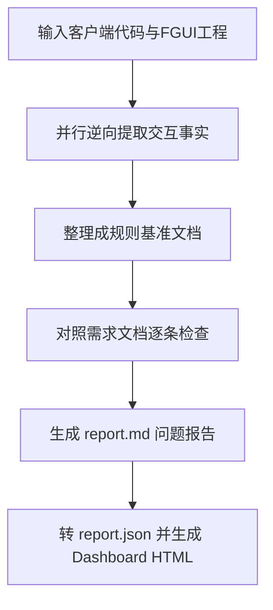

# ui-interaction-prd-extract

从游戏客户端代码逆向提取 UI 交互事实 → 组织成规则基准 → 对照需求文档检查 UI 交互缺陷 → 生成 report.md + HTML Dashboard。

## 流程总览



## 第一步：逆向提取交互事实

输入：

- 客户端代码根目录（如 `input-ui/xuanwulobby/assets/{gameId}`，先从 `common_game/config/GameDefine.ts` 的 GameIDList 确认目标玩法目录）
- FGUI 工程（如 `input-ui/kawuxing-fgui`，组件结构提取用）

按主题分组并行提取（每组一个只读子代理），推荐分组：

| 组 | 范围 |
|---|---|
| 操作按钮与权限 | layer/ 主界面按钮、权限位定义、手牌交互、置灰 |
| 界面清单与弹层生命周期 | @FguiView 定义、showFgui/hideFgui 调用、清理逻辑 |
| 断线重连与场景恢复 | RecoverCmd/sceneCmd、恢复顺序、end_wait 应答 |
| 托管与超时 | bot/auto 相关、超时提示、DelayCall 兜底 |
| 结算链与胡牌展示 | 局终动画链、小/大结算、摊牌、飘分 |
| 听牌提示与桌面常驻元素 | 听牌数据/箭头/弹窗、倒计时、方位盘、庄标 |

提取要求（每条）：

- 带真实代码锚点（文件 → 方法），禁止推测
- 标注死代码/无消费方/已移除项（防误报依据）
- 数据源映射：`@FguiView` → 界面清单；`addClick`/`onBtnXxx` → 按钮交互；`@gf.listen`/`dispatch` → 内部事件；`pfbm.uiFgui().showFgui()` → 弹层生命周期；gameCmd `dealData` → 网络收；Controller `sendXxx` → 网络发；recoverCmd/sceneCmd → 重连恢复；代码注释 → 边界规则

## 第二步：整理成规则基准

输出到 `references/rules/{玩法}_ui_interaction/`，一个主题一个文件 + `00-基准说明.md`。基准说明必须包含：

1. **基准来源**：代码目录 + 提取日期（同玩法需求才可直接作基准；跨玩法仅引擎级通用条款可用）
2. **基准性质声明**：基准是已实现事实；需求与基准冲突记需求的问题；需求有意新增的功能记 P3 差异说明（不是冲突）
3. **检查口径**：需求明示"本期不做"不报缺失；死代码条款不作缺失依据；交互限制四类（前置守卫/互斥/超时/失败恢复）是重点检查维度

每条规则带条款号（01#3 形式，供报告 ruleRef 引用）。

参考成品：`references/rules/hzmj_ui_interaction/`（杭州麻将 9 文件约 130 条）。

## 第三步：检查需求文档

对照规则基准逐条检查需求文档，产出 `examples/ui-interaction-prd-extract/report.md`。问题五类型与优先级沿用 game-prd-check 口径（MISSING/CONFLICT/LOGIC/AMBIGUOUS/INCOMPLETE × P0~P3）。

报告格式要求（dashboard 解析依赖，必须遵守）：

- 头部：检查对象：`{路径}`、规则基准：`{路径}`、检查日期：`YYYY-MM-DD`
- `## 1. 检查概览`：**优先级×类型矩阵统计表**（行 P0~P3，列五类型，末列小计、末行合计，加粗数字）
- `## 2. 问题清单`：8 列表格 `| ID | 问题维度 | 优先级 | 类型 | 模块 | 问题 | 原文位置 | 基准依据 |`，ID 用 Q01 形式连续编号；**问题维度固定写「UI 交互」**（合并检查场景下与 game-prd-check 功能报告的「功能规则」区分；脚本也会从规则基准路径含 `ui_interaction` 自动推导，但表格显式列为准确一）
- `## 3. 重点问题详情`：P0/P1 全部 + 典型 P2，每条 `### Q01【P0 / MISSING】标题` + `- **字段**：` 列表（问题性质/原文/基准依据/问题/影响/建议/验收口径/处理状态）
- `## 4. 总体建议`：问题最多模块、是否建议进入开发
- `## 附录：超出 UI 基准范围的发现（不计入统计）`（可选）：无基准条款支撑的发现（玩法逻辑/纯文档质量/无基准条款的文案问题），原编号+归口说明，不计入统计

硬性要求：证据先行（原文位置+引文）；报 MISSING 前复核基准条款与需求确实未覆盖；新功能差异记 P3。**严格 UI 归因**：每条问题的 ruleRef（基准依据）必须指向基准具体条款号（如 01#9、02#6）；玩法逻辑问题（何时可碰杠胡、番型、算分——该归玩法规则基准）与纯文档质量问题（章节编号引用悬空、术语一致性等无基准条款对照的）不得列入统计，超出范围的发现移入报告末尾"附录：超出 UI 基准范围的发现"（原编号+归口说明），不计入统计表与问题清单。

## 第四步：生成 Dashboard

报告完成后执行（复用 game-prd-check 的脚本，已支持本报告的 Q 格式）：

```bash
node .claude/skills/game-prd-check/scripts/build-dashboard.mjs "examples/ui-interaction-prd-extract/report.md" "examples/ui-interaction-prd-extract"
```

产物：

- `examples/ui-interaction-prd-extract/report.json`（结构化数据，含校验）
- `examples/ui-interaction-prd-extract/dashboard/{项目名}分析-Dashboard-{YYYYMMDD}-{NN}.html`（离线单文件，序号自动递增不覆盖）

脚本自适应三种报告格式（PRD-xxx skill 版 / PRD-xxx workflow 版 / Qxx 本技能版），校验失败会列出具体错误行（ID 重复/统计不一致/字段为空），按提示修复 report.md 后重跑。

## 与 game-prd-check 的关系

- 本技能的规则基准目录（`references/rules/{玩法}_ui_interaction/`）可通过 game-prd-check workflow 的 `args.rulesDir` 接入全并发检查管线（去重/主题归类/报告审核/Dashboard 全自动），单代理快速检查时直接用第三步
- game-prd-check 的服务端规则基准（hzmj_game_flow_handler）与本技能的客户端 UI 基准互补：前者管游戏流程逻辑，后者管界面交互表现
- **合并报告**：两份报告合并时靠问题上的「问题维度」字段区分（UI 交互 vs 功能规则）——本技能报告每条在清单表显式标注；功能报告由 dashboard 脚本从规则基准路径自动推导，report.json 的 `issue.dimension` 与 `statistics.dimensions` 可直接聚合
