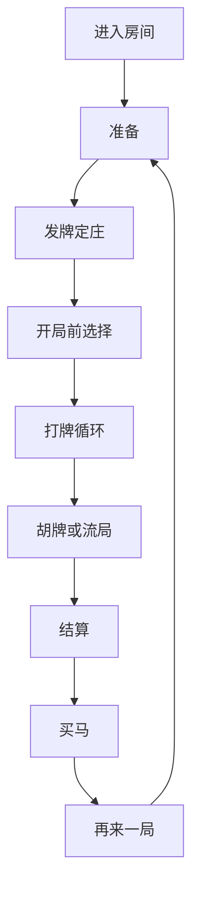

# 模块分析（{模块中文名}）

> 本文是 {模块名} UI 交互分析的总入口。索引所有子文档。
> 分析范围：{模块代码根路径，如 assets/42324}；FGUI 包：{包名列表}。

## 文档状态

- status: draft（draft / reviewed）
- 代码基线：{commit 或分支，如 main@xxxxxxx}
- 覆盖范围：{已分析界面清单或"layer/ 下全部 N 个界面"}
- last_updated: {日期}

## 1. 模块概述

- **模块名**：{中文名}（{代码标识，如 Game42324}）
- **玩法类型**：{一句话，如 卡五星麻将好友房/匹配场}
- **代码入口**：{入口文件，如 Game42324.ts → script/Game42324.ts（BoxKaWuXingView）}
- **代码结构**：
  - `layer/` 界面层（{N} 个界面）
  - `layer/comp/` 界面专属子组件
  - `component/` 公共组件（{列出}）
  - `control/` 控制器（{列出}）
  - `data/` 数据层（{列出}）
  - `protocol/` 网络协议（gameCmd 收发 {N} 个、recoverCmd 重连 {N} 个）
- **FGUI 工程**：{包名列表，各包一句话用途}

## 2. 流程 Loop 概览

一局的完整流程（详细时序见 [流程分析](流程分析.md)）：

{各节点一句话说明：触发条件、参与界面}

## 3. 界面清单

| 界面 | 中文名 | 类型 | FGUI 包 | 代码类 | 职责一句话 |
|---|---|---|---|---|---|
| [XxxView](界面/XxxView.md) | {中文} | 全屏/弹层/提示层 | {包名} | layer/XxxView.ts | {一句话} |

> 类型定义：全屏=Base 层常驻主界面；弹层=按需 showFgui 的弹窗；提示层=叠加在最高层的短提示/动画层。

## 4. 公共组件清单

| 组件 | 中文名 | 被哪些界面使用 | 文档 |
|---|---|---|---|
| [Xxx](组件/Xxx.md) | {中文} | {界面列表} | [组件/Xxx.md](组件/Xxx.md) |

> 仅列交互组件；纯静态组件见各界面文档的组件清单表。

## 5. 内部事件索引

| 事件名 | 定义位置 | 派发者 | 监听者 | 用途 |
|---|---|---|---|---|
| {EventName} | config/XxxDefine.ts | {类} | {类} | {一句话} |

## 6. 附录：网络协议索引

### 6.1 收（服务端 → 客户端）

| Cmd | xyid | 触发时机 | 数据落点 | 转发的内部事件 | 关联界面/组件 |
|---|---|---|---|---|---|
| XxxCmd | {id} | {何时服务端下发} | data/XxxGameData.{字段} | {GameEvent} | {界面列表} |

### 6.2 发（客户端 → 服务端）

| 发送方法 | xyid | 触发时机（用户操作） | 所在 Controller | 关联界面/组件 |
|---|---|---|---|---|
| sendXxx | {id} | {点了什么/什么状态} | XxxController | {界面列表} |

### 6.3 断线重连恢复

| RecoverCmd | 恢复内容 | 拉起的界面 |
|---|---|---|
| RelinkOnXxxCmd | {恢复什么状态} | {界面列表} |

## 7. 待确认清单

提取过程中发现的存疑点（代码注释提到的口径冲突、疑似冗余/dead code、占位实现、行为未定义处）。集中登记，不臆补结论。

| 编号 | 事项 | 影响界面/组件 | 处理 |
|---|---|---|---|
| TBD-001 | {存疑点描述 + 代码位置} | {界面列表} | {建议：人工复核 / 维持代码现状口径} |
