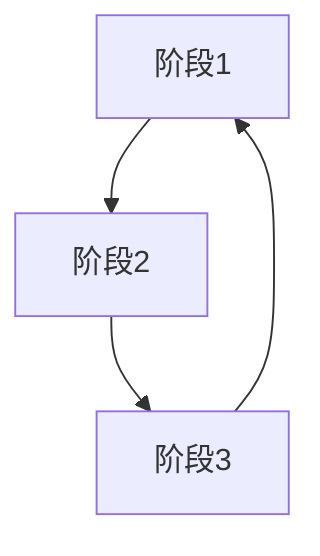
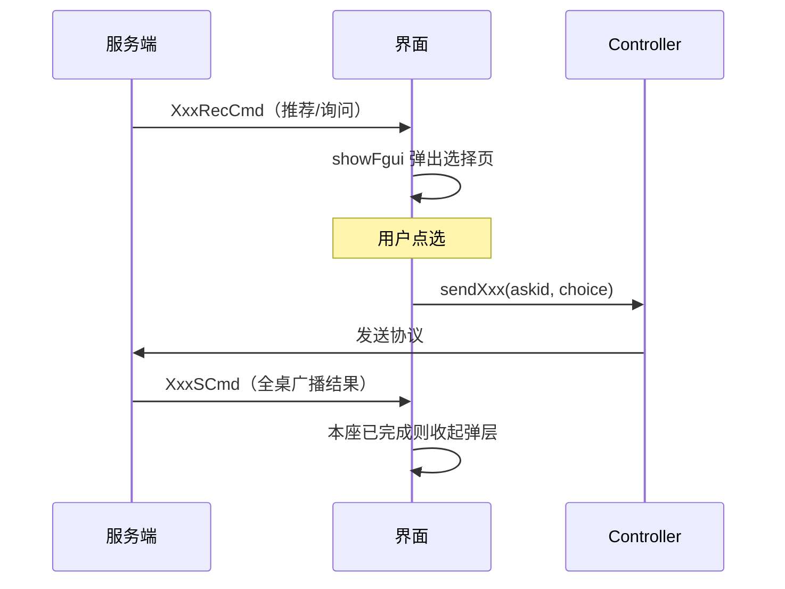

# 流程分析（{模块中文名}）

> 按一局游戏的流程顺序，串联界面切换、用户操作与事件时序。界面细节见各界面文档。

## 0. 总流程 Loop

{一句话说明循环如何闭合}

---

## 阶段 N：{阶段名，如 选漂}

### 触发条件

{什么 Cmd 到达/什么状态下进入该阶段}

### 参与界面与组件

| 界面/组件 | 角色 | 文档 |
|---|---|---|
| [XxxView](界面/XxxView.md) | 弹出选择弹层 | ... |
| [XxxView](界面/XxxView.md) | 刷新各座状态显示 | ... |

### 交互时序

### 状态变化

| 状态 | 变化时机 | 影响 |
|---|---|---|
| {状态字段} | {何时变化} | {界面表现} |

### 边界与特殊情况

{超时托管怎么办、断线重连怎么恢复、重复操作怎么去重等，从代码注释提取}
