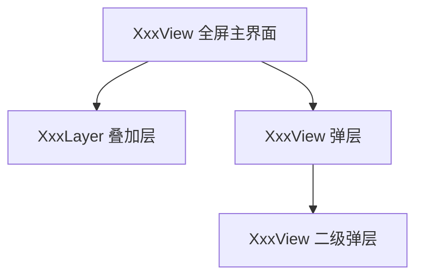

# 界面分析（{模块中文名}）

> 所有界面的总表与分层关系。单个界面的详细分析见 [界面/](界面/) 目录。

## 1. 界面总表

| # | 界面 | 中文名 | 类型 | Layer / sortingOrder | FGUI 包 | 代码类 | 常驻 or 按需 | 详细文档 |
|---|---|---|---|---|---|---|---|---|
| 1 | [XxxView](界面/XxxView.md) | {中文} | 全屏 | Base / {order} | {包} | layer/XxxView.ts | 常驻 | [界面/XxxView.md](界面/XxxView.md) |
| 2 | ... | | 弹层 | | | | 按需 showFgui | |

> 类型与分层从代码 `@FguiView({ layer, sortingOrder })` 提取；常驻=随场景创建，按需=通过 `pfbm.uiFgui("Xxx").showFgui()` 弹出。

## 2. 界面层级关系

{说明层级遮盖关系：谁压在谁上面，哪些互斥（如打开 A 时关闭 B）}

## 3. 界面生命周期关键点

| 界面 | 打开时机 | 关闭时机 | 重连恢复行为 |
|---|---|---|---|
| {XxxView} | {事件/流程节点} | {事件/流程节点} | {RelinkCmd 或"随场景重建"} |

## 4. 组件归属说明

- 公共组件（跨界面复用）：{列表，指向模块分析.md 第 4 节}
- 界面专属组件：见各界面文档"组件清单"表
