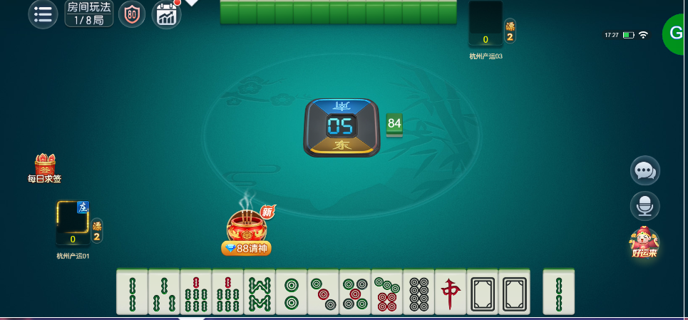
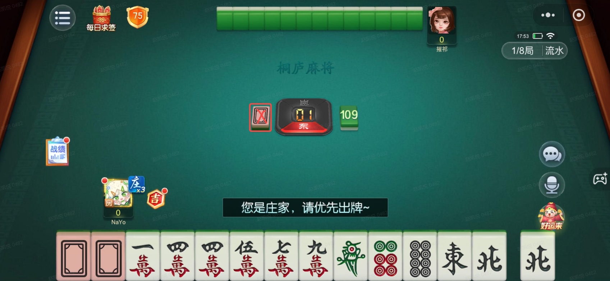

# 【卡五星】【桌面UI】不符合需求

- 缺陷链接: https://project.feishu.cn/btqsku/bug/detail/7141991468?
- 技术处理人: 王炼杰
- BUG类别: 研中bug

## 缺陷描述

卡五星的桌面的桌布、麻将、方位盘、头像位置保持和杭麻一致；

好友房的右上角的安全分、玩法、局数等要用玄武通用

以下是布局参考：

唯一区别是没有财神牌（方位盘左边的白板没有）

## 评论

（暂无评论）
