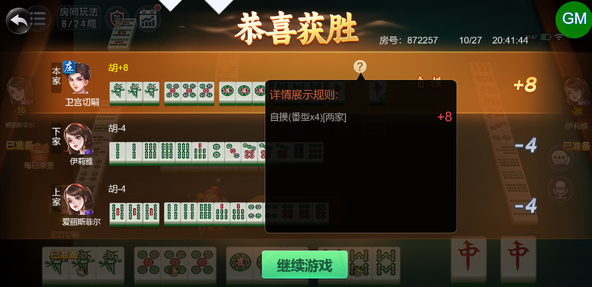
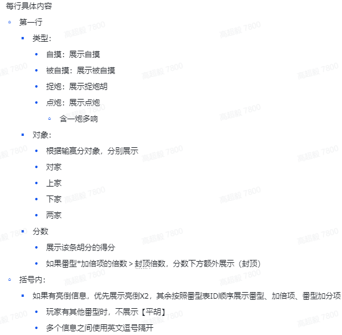

# 【卡五星】【小结算详情】亮倒的情况下，需要在胡分详情里显示亮倒的倍数

- 缺陷链接: https://project.feishu.cn/btqsku/bug/detail/7147388839?
- 技术处理人: 汪旭照
- BUG类别: 研中bug

## 缺陷描述

这把是手抓一2倍+亮倒2倍，自摸收2家，所以是最终得8分

设计稿：（以下截取部分，详细请参照案子结算详情板块）

## 评论

（暂无评论）
