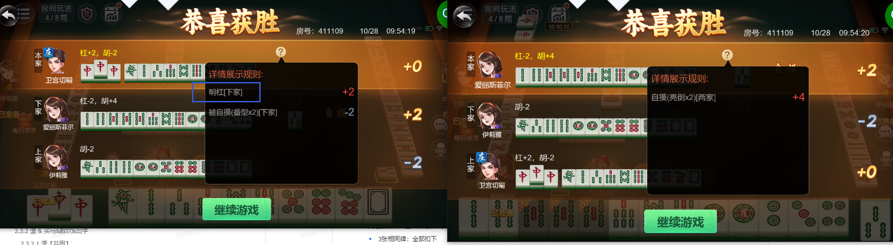
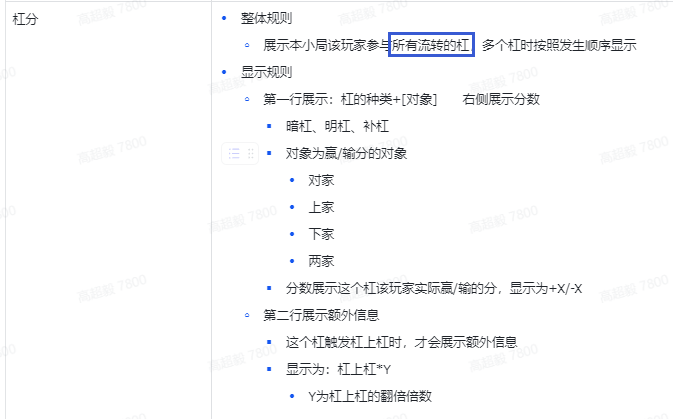
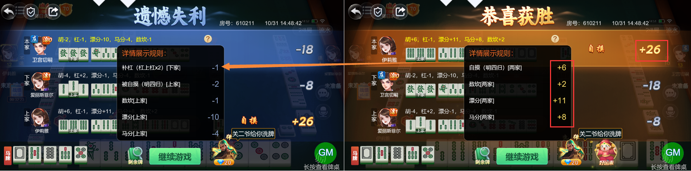

# 【卡五星】【小结算详情】胡牌玩家的详情里未显示放其他玩家明杠被扣除的分数

- 缺陷链接: https://project.feishu.cn/btqsku/bug/detail/7147648836?
- 技术处理人: 李锦程01
- BUG类别: 研中bug

## 缺陷描述

如下图：右侧玩家放上家明杠的扣分未显示

设计稿：

## 评论

**高超毅**  2026-10-31 14:55:16

boxId:610211

roundId:670934100280184509

依然会出现，赢家未显示其他玩家补杠的扣分，导致详情分数总计比结算显示分数多了1分

