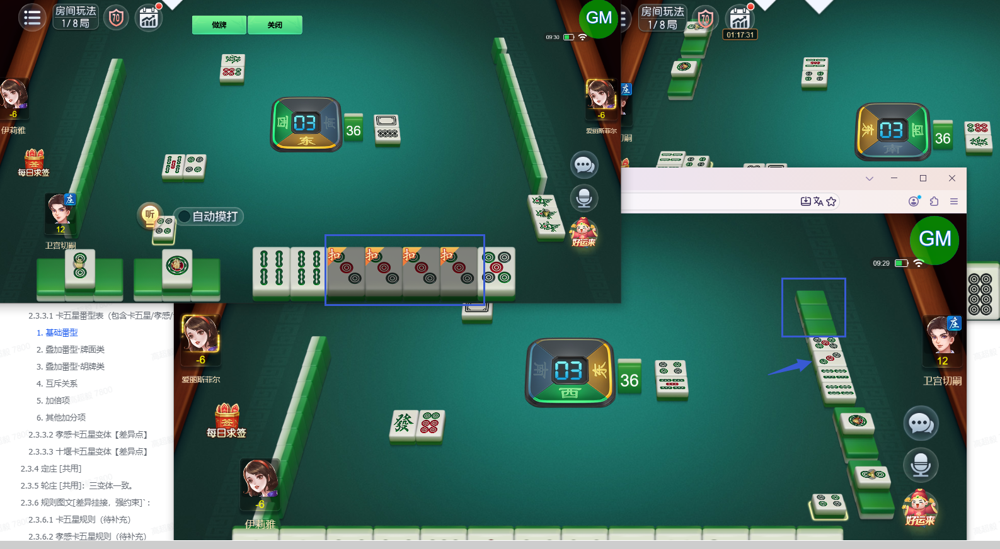
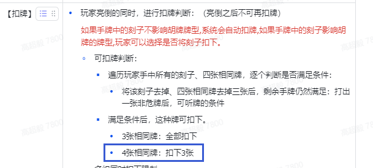
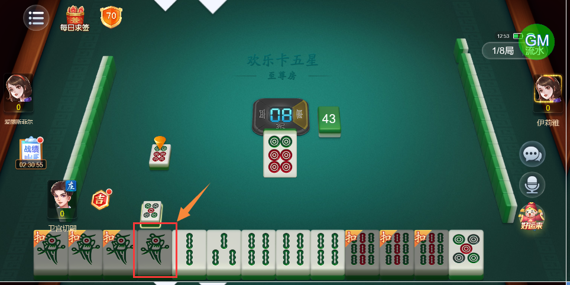

# 【卡五星】手上有4张一样的牌时选择亮倒，4张牌全都会被“扣”，实际应该只扣3张（其他玩家视角亦是如此）

- 缺陷链接: https://project.feishu.cn/btqsku/bug/detail/7147709777?
- 技术处理人: 李锦程01
- BUG类别: 研中bug

## 缺陷描述

设计稿：

## 评论

**高超毅**  2026-10-31 12:59:29

虽然只有3张显示“扣”，但另一张的阴影还在，不是扣牌的话不应该有阴影

