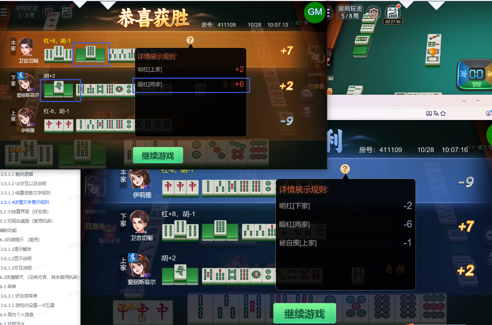
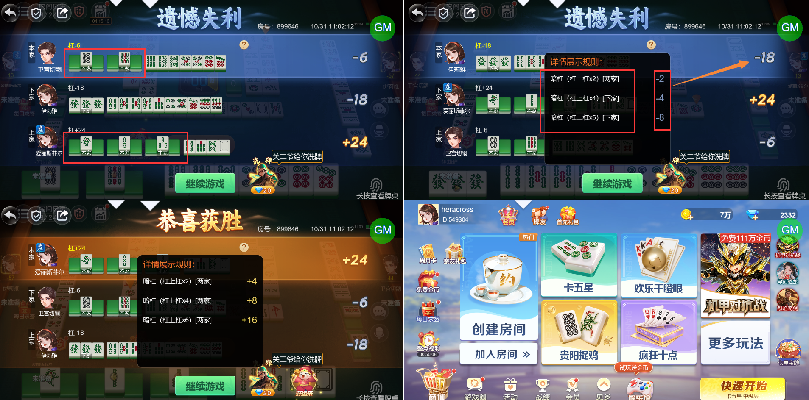

# 【卡五星】【小结算详情】同类的杠分（比如暗杠）被统计在一项数值里了，但根据设计是需要分开统计/展示的（方便玩家理解分数走向）

- 缺陷链接: https://project.feishu.cn/btqsku/bug/detail/7147792990?
- 技术处理人: 李锦程01
- BUG类别: 研中bug

## 缺陷描述

见下图：

获胜玩家的视角下，他的暗杠分应该有两项详情分：

1、暗杠[两家] +8

2、被暗杠[下家] -2

现在直接展示了最终统计 +6

## 评论

**高超毅**  2026-10-31 11:17:40

仍然没有统计全，详见下图：

全场有5个暗杠，以右侧未杠的输家为视角，详情里只展示了两家的2个基础暗杠+下家的二连杠1个+下家三连杠1个，总计4个杠分，还缺了上家的1个暗杠，导致详情的合计得分和结算的总得分对不上

**高超毅**  2026-11-03 15:36:51

详情里赢方暗杠分数仍然出现缺失：（应该分别赢两家，总+8，现在只有+4）

boxId:383984

roundId:422194891853499669

