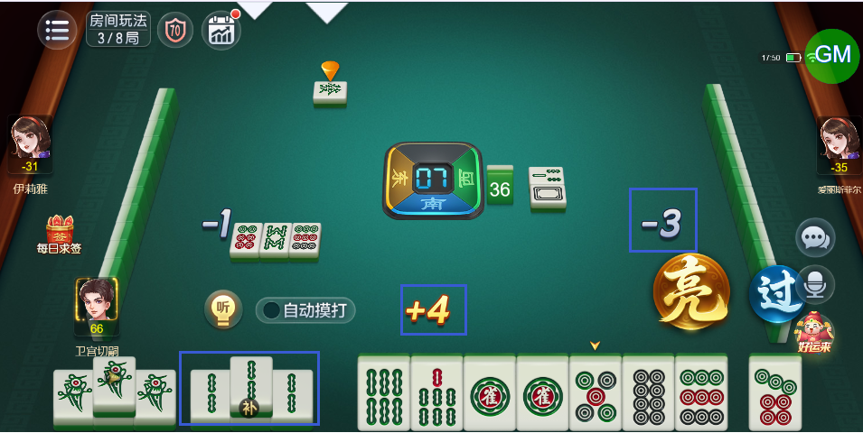

# 【卡五星】非连续杠牌（先明杠等一回合再补杠）的情况下，杠分动画的数值显示错误

- 缺陷链接: https://project.feishu.cn/btqsku/bug/detail/7148361657?
- 技术处理人: 汪旭照
- BUG类别: 研中bug

## 缺陷描述

玩家补杠，应该是+2，其他玩家是-1

现在显示+4，怀疑是把之前明杠的分也算上了

## 评论

（暂无评论）
