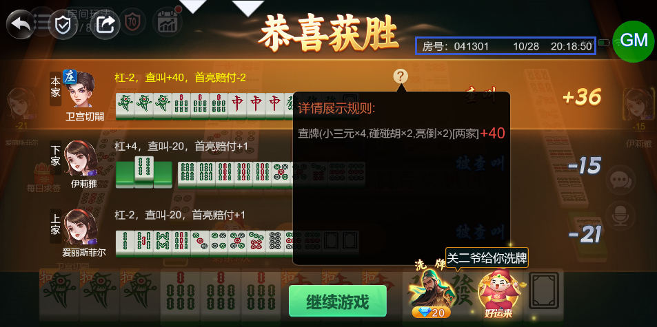

# 【卡五星】【查叫】查叫赔付的分数与预计不符，需要确认

- 缺陷链接: https://project.feishu.cn/btqsku/bug/detail/7148593923?
- 技术处理人: 汪旭照
李锦程01
- BUG类别: 研中bug

## 缺陷描述

手牌听 碰碰胡+小三元+亮倒  应该 16分，实际却算了20分

第1局，房号和时间见下图：

追加：又详细看了一下，怀疑是算上了坎分，但是未在结算信息上展示，仅供参考

## 评论

（暂无评论）
