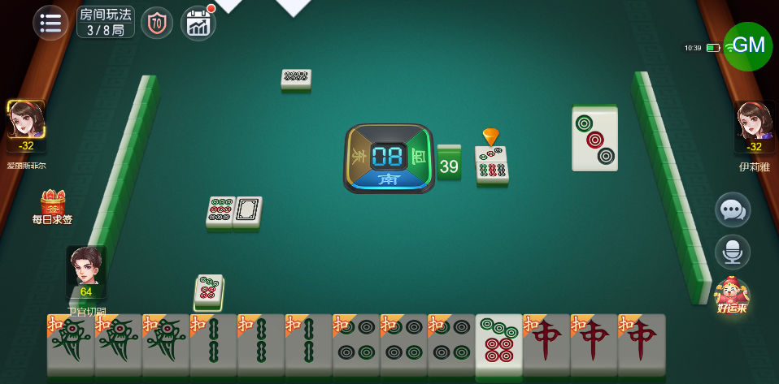
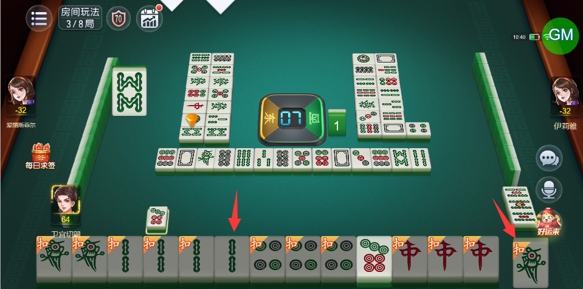
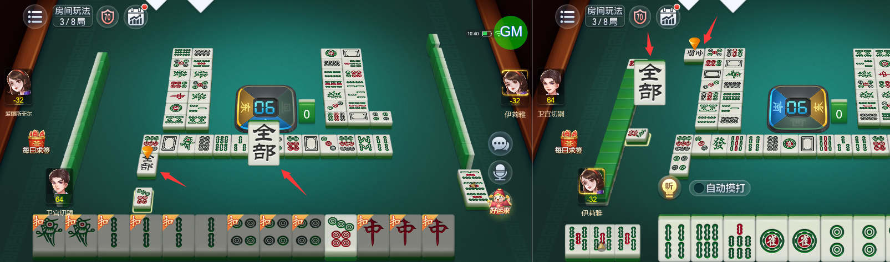

# 【卡五星】亮牌后摸到一张和扣牌同牌点的牌，手牌排序会发生变化，并且可以将扣牌打出去，打出的牌显示异常

- 缺陷链接: https://project.feishu.cn/btqsku/bug/detail/7149189584?
- 技术处理人: 李锦程01
汪旭照
- BUG类别: 研中bug

## 缺陷描述

第3局 房号：198031   29日 10:41:53

注意下方手牌变化：

## 评论

（暂无评论）
