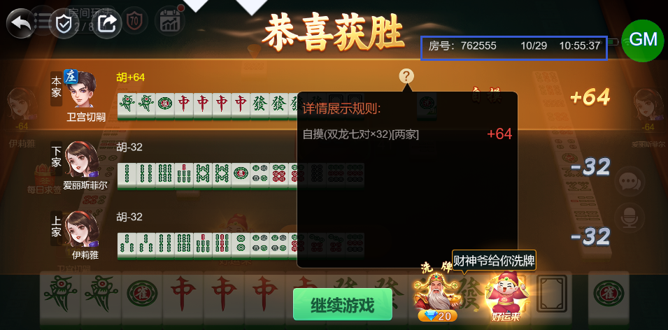

# 【卡五星】【小结算详情】勾选“三元七对”规则时，胡双龙七对牌型（牌型见图），详情里只显示了双龙七对的倍数，未显示三元七对的倍数

- 缺陷链接: https://project.feishu.cn/btqsku/bug/detail/7149283252?
- 技术处理人: 李锦程01
汪旭照
- BUG类别: 研中bug

## 缺陷描述

第2局 房号时间见下图：

双龙七对16倍，三元七对2倍（※注意这里三元七对2倍是因为有七对作为基础牌型的前提，单独一个三元七对是8倍）

## 评论

（暂无评论）
