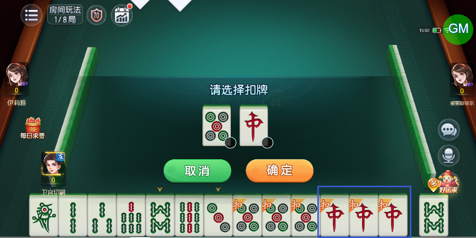
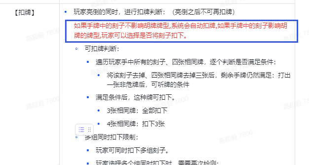

# 【卡五星】亮倒选择时，不影响胡牌牌型的3张牌系统应该自动扣下，现在仍然会让玩家选择

- 缺陷链接: https://project.feishu.cn/btqsku/bug/detail/7149745208?
- 技术处理人: 李锦程01
汪旭照
- BUG类别: 研中bug

## 缺陷描述

比如下图，扣掉红中并不会对胡牌牌型造成影响，应该由系统自动扣掉，5筒因为有可以和3筒组成顺子的可能，所以可以让玩家选择扣或者不扣

设计稿：（节选，详细请参照案子）

## 评论

（暂无评论）
