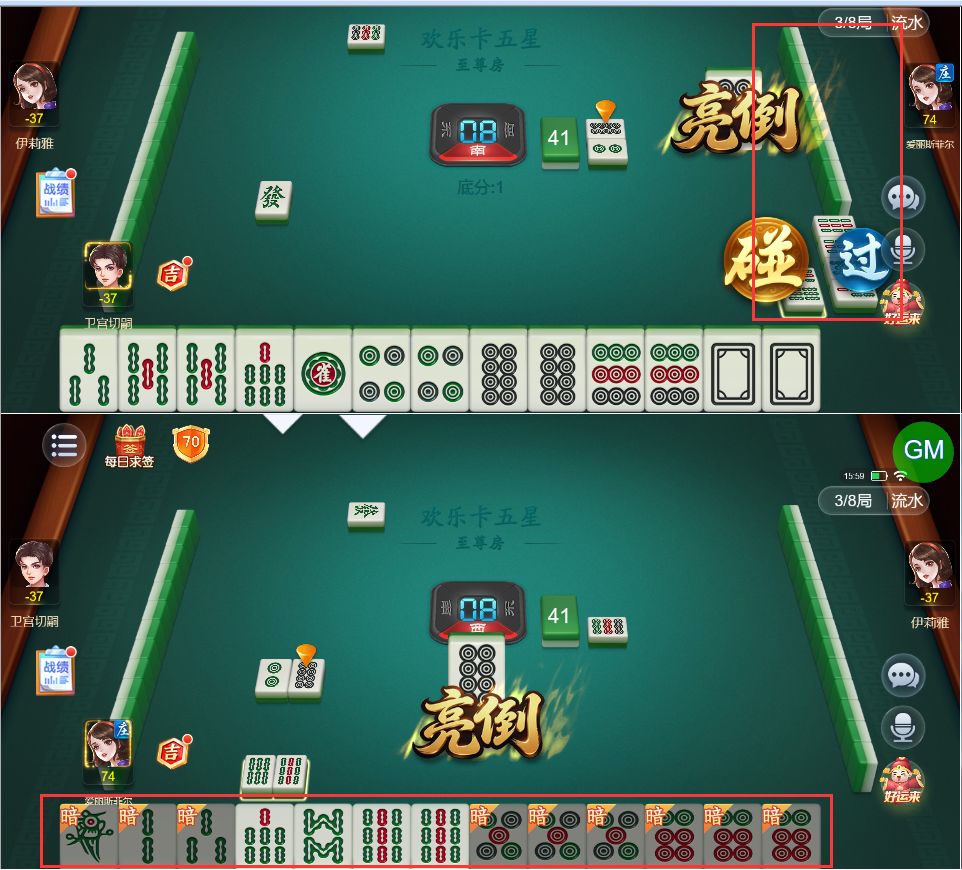
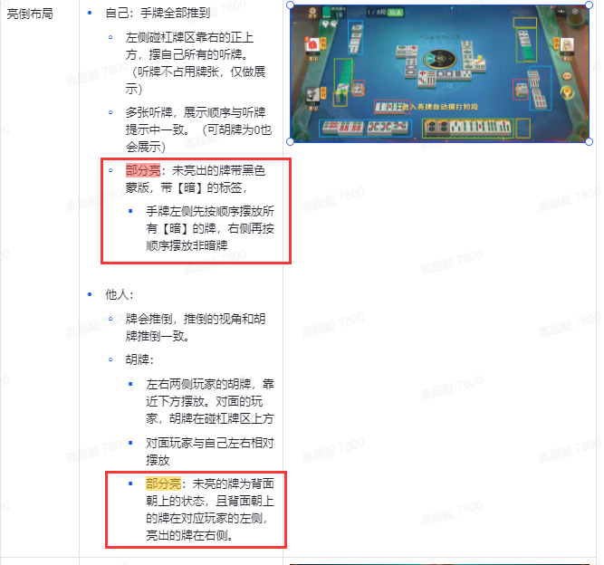
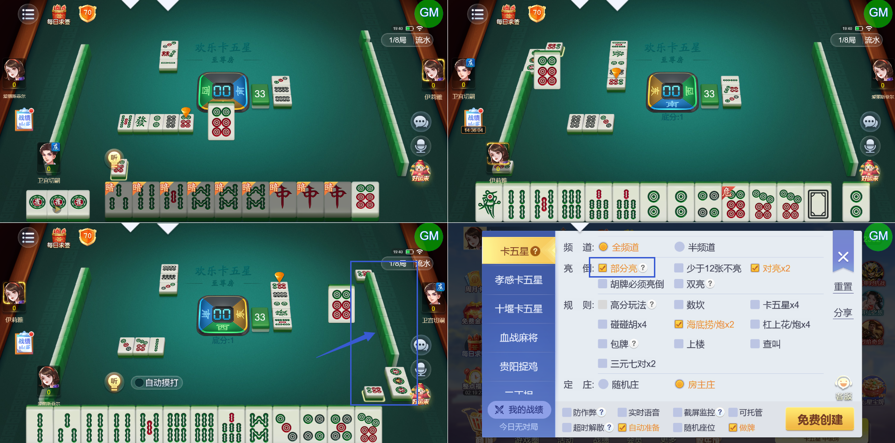
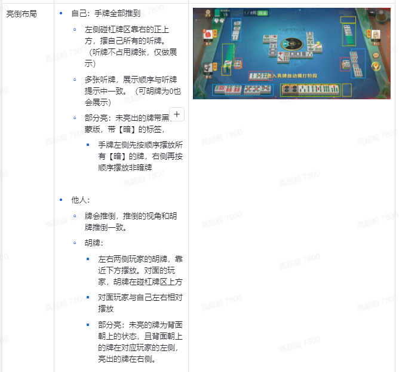

# 【卡五星】【创房规则】勾选“部分亮”的情况下，亮牌展示异常，详细见描述

- 缺陷链接: https://project.feishu.cn/btqsku/bug/detail/7149775474?
- 技术处理人: 李锦程01
- BUG类别: 研中bug

## 缺陷描述

（空）

## 评论

**高超毅**  2026-10-31 16:08:11

部分亮的情况下仍然有问题：

1、“暗”的手牌需要排左边（不管是自己视角还是其他人视角）

2、其他人视角下，手牌需要扣下的状态，现在还是立起的

设计稿：

**高超毅**  2026-11-03 19:44:19

部分亮，强制扣牌的情况下，在他人视角里，扣下的牌不能是立着的，要盖住，牌背向上

