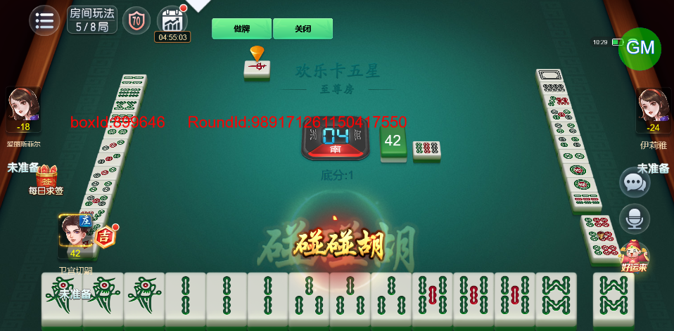
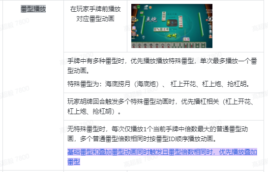
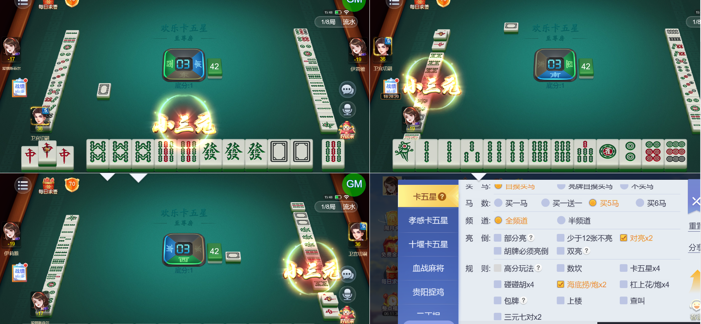
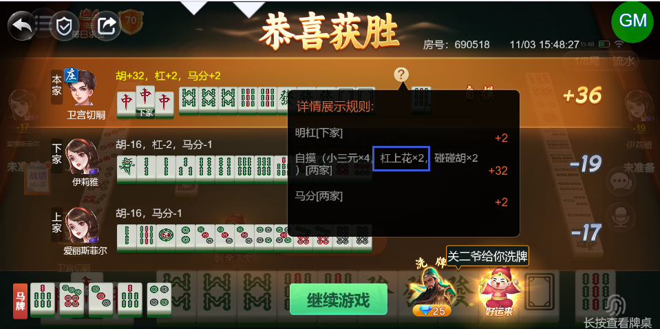
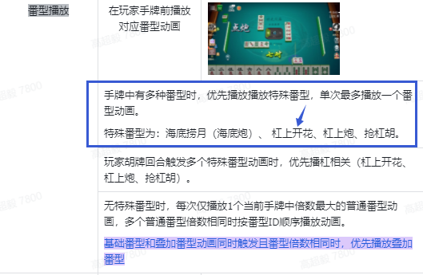
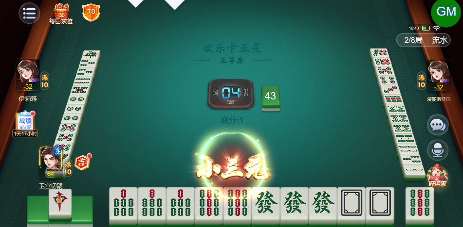
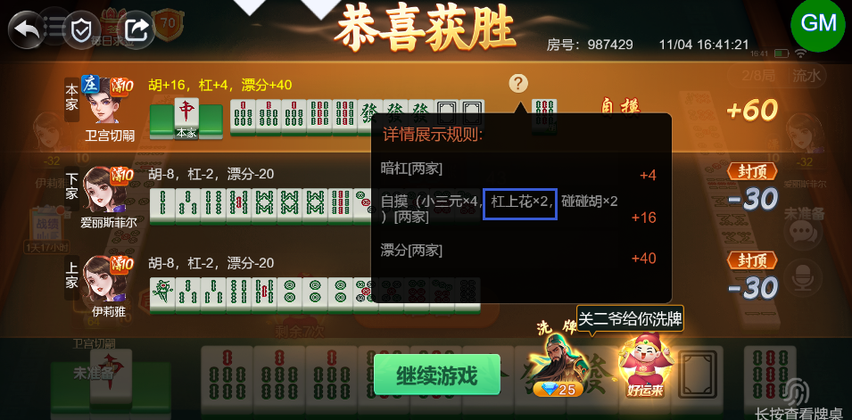

# 【卡五星】【番型】同时满足多种番型时，播放番型动画需要遵循特定条件，现在与设计不符

- 缺陷链接: https://project.feishu.cn/btqsku/bug/detail/7151531568?
- 技术处理人: 汪旭照
- BUG类别: 研中bug

## 缺陷描述

该牌型为：碰碰胡2倍，清一色4倍，根据案子应该播放清一色动画

（其他各类牌型组合的逻辑也建议参照案子再确认一下）

设计稿：

## 评论

**高超毅**  2026-11-03 15:52:13

同时满足特殊番型和普通番型的情况下，要优先播放特殊番型

如下图：杠上开花+小三元，杠上花是特殊番型所以动画要播杠上花

boxId:690518

roundId:759232576277287306

设计稿：

**高超毅**  2026-11-04 16:42:20

问题依旧……

boxId:987429

roundId:1085689677486944115

