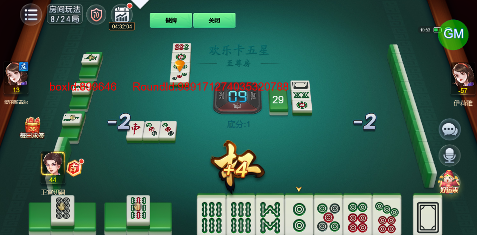

# 【卡五星】连续杠牌的情况下，出分动画的节奏会变得很快

- 缺陷链接: https://project.feishu.cn/btqsku/bug/detail/7151704639?
- 技术处理人: 李锦程01
- BUG类别: 研中bug

## 缺陷描述

正常情况下，播放杠动画后才会出现杠分动画

但是连续杠牌的情况下，播杠牌动画时杠分动画会一起播出来

## 评论

（暂无评论）
