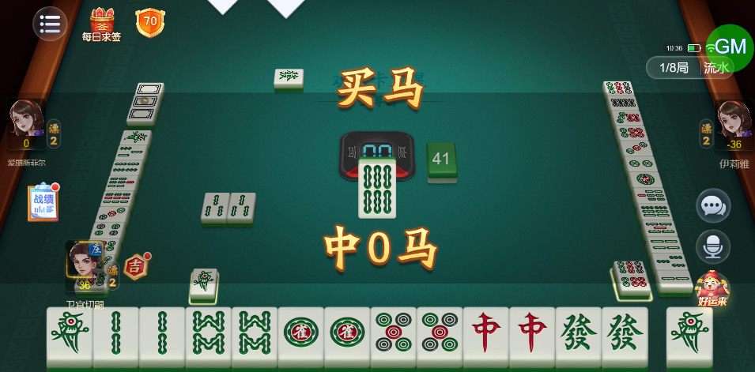
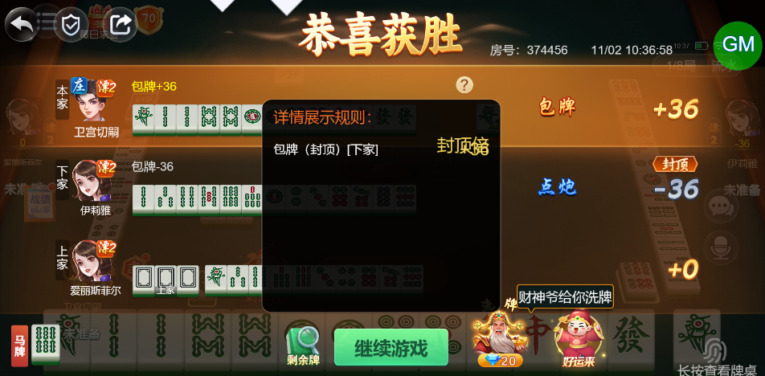
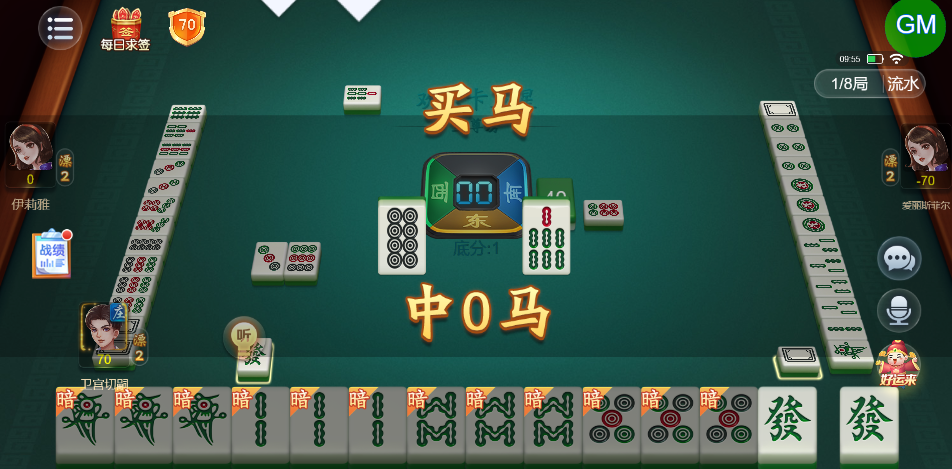
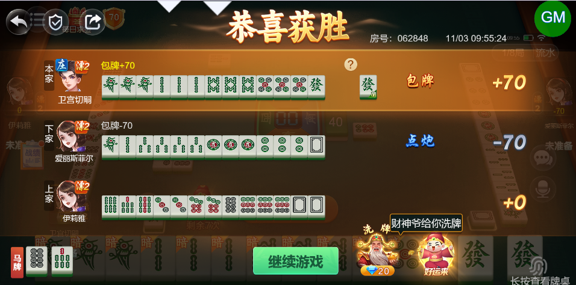

# 【卡五星】【包牌】【买马】触发包牌结算的情况下，买马模式也会触发（不应该触发，包牌属于点炮）

- 缺陷链接: https://project.feishu.cn/btqsku/bug/detail/7152405070?
- 技术处理人: 汪旭照
- BUG类别: 研中bug

## 缺陷描述

boxId:374456

roundId:411718732179044065

## 评论

**高超毅**  2026-11-03 09:57:00

还是会触发买马动画

boxId:62848

roundId:69102112871104179

