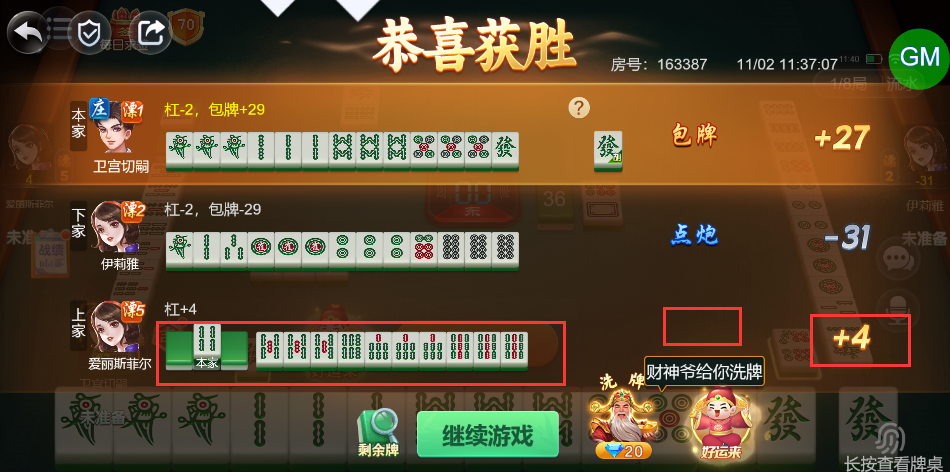

# 【卡五星】【包牌】【亮倒】点炮亮牌玩家触发包牌时，还要赔付另一个亮牌玩家番型分，现在该玩家只拿了杠分

- 缺陷链接: https://project.feishu.cn/btqsku/bug/detail/7152487456?
- 技术处理人: 汪旭照
- BUG类别: 研中bug

## 缺陷描述

boxId:163387

roundId:179645912415995119

## 评论

（暂无评论）
