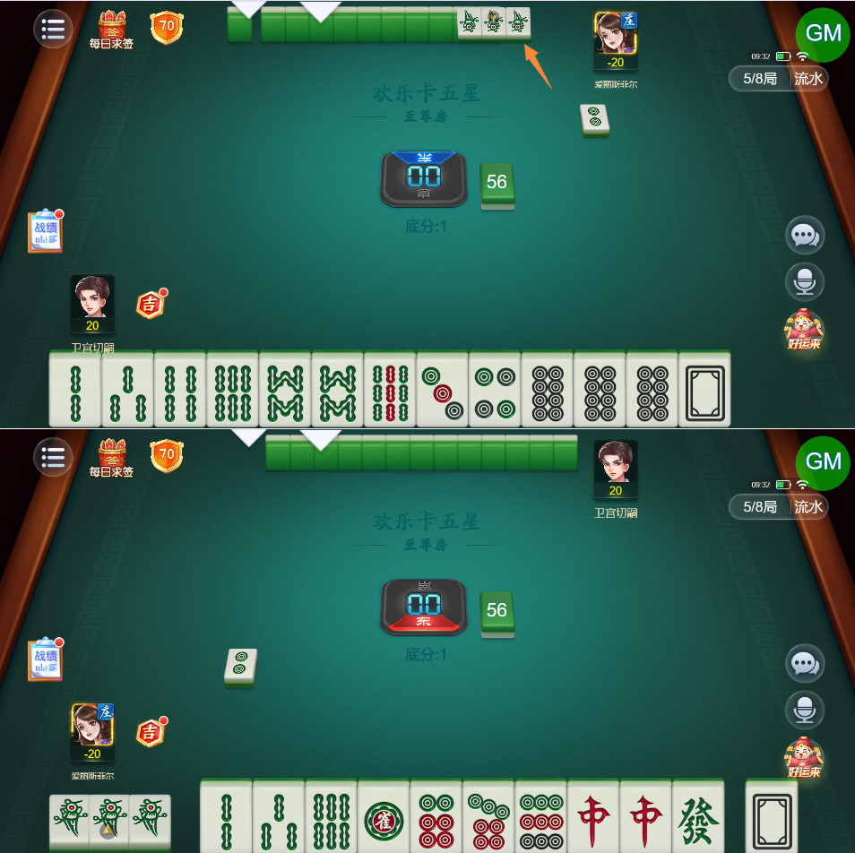
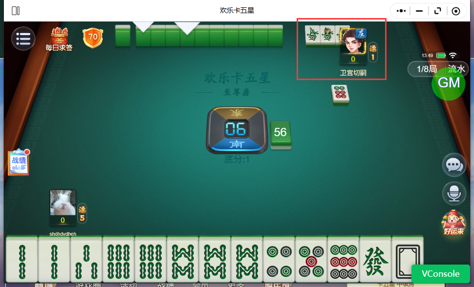
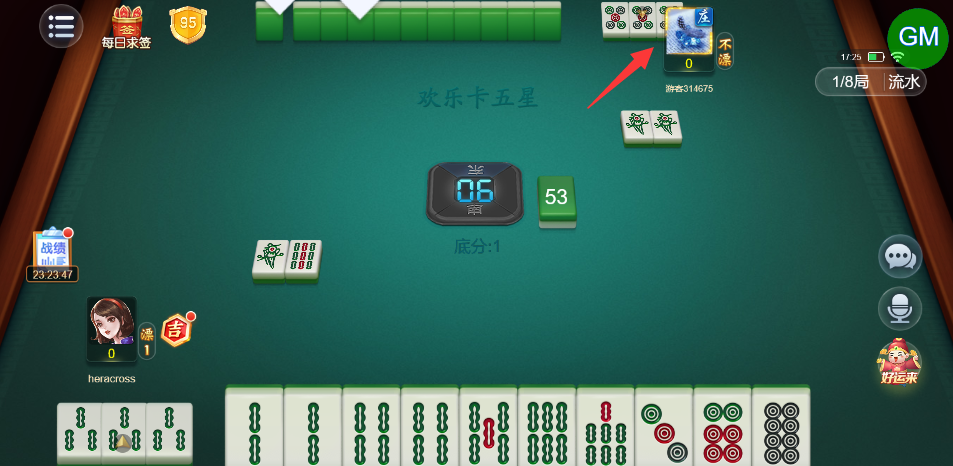
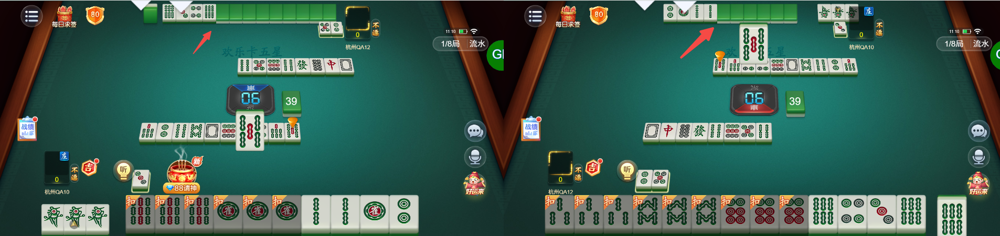

# 【卡五星】2人模式下，对家碰牌后手牌位置异常（出现重叠）

- 缺陷链接: https://project.feishu.cn/btqsku/bug/detail/7152620510?
- 技术处理人: 李锦程01
- BUG类别: 研中bug

## 缺陷描述

（空）

## 评论

**高超毅**  2026-11-03 13:51:23

现在跟手牌没重叠，但是跟玩家头像重叠了

**高超毅**  2026-11-05 17:27:10

问题依旧：

**刘海迪**  2026-11-06 11:11:24

两人模式对家亮倒后牌有重叠

