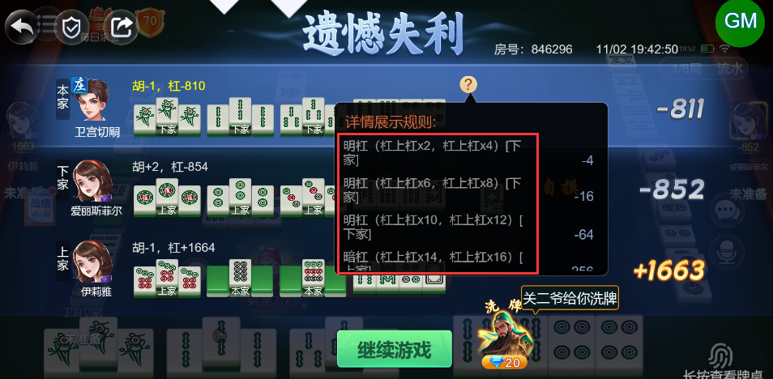
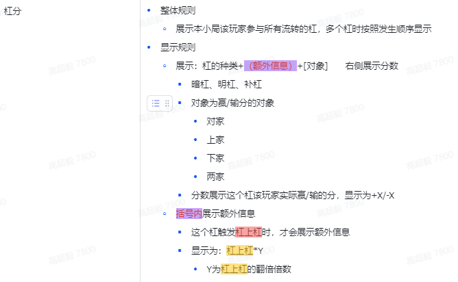
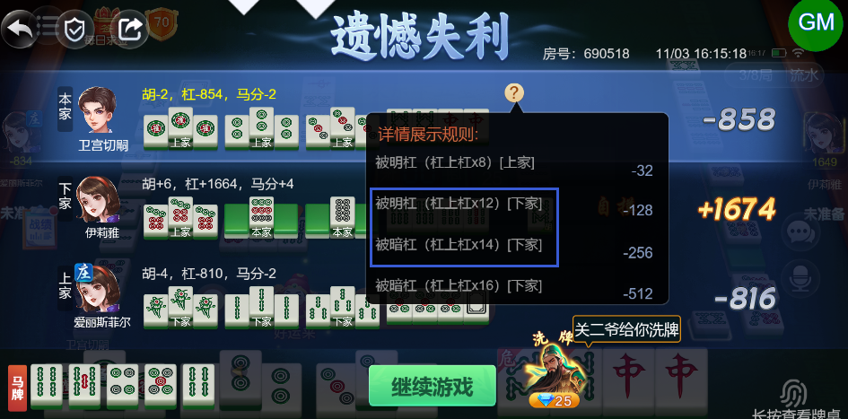

# 【卡五星】【小结算详情】触发连续杠上杠的情况，详情里杠上杠后对应的倍数应该是累乘的现在显示的是累加的

- 缺陷链接: https://project.feishu.cn/btqsku/bug/detail/7153541238?
- 技术处理人: 李锦程01
- BUG类别: 研中bug

## 缺陷描述

boxId:846296

roundId:930512298628904503

应该是2、4、8、16……

现在是2、4、6、8、10……

设计稿：

## 评论

**高超毅**  2026-11-03 16:19:10

还是一样的问题：

boxId:690518

roundId:759232584867223297

