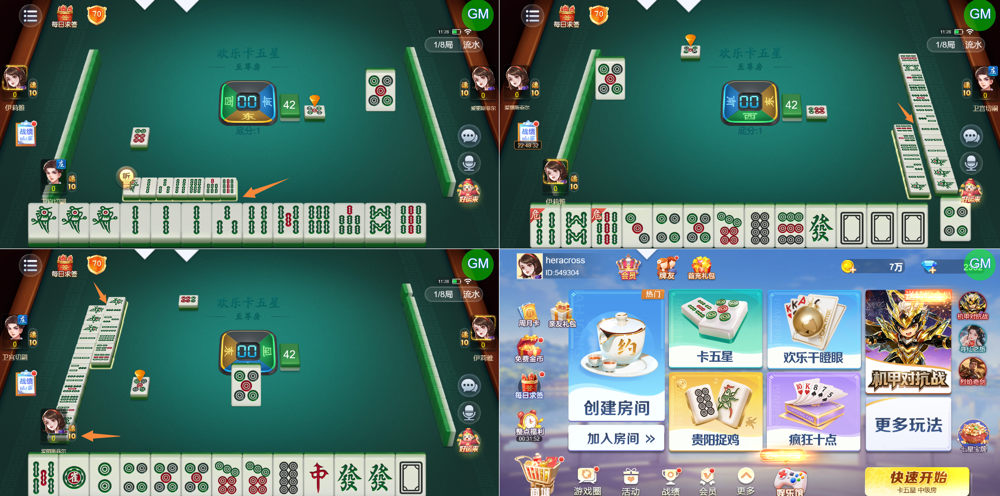
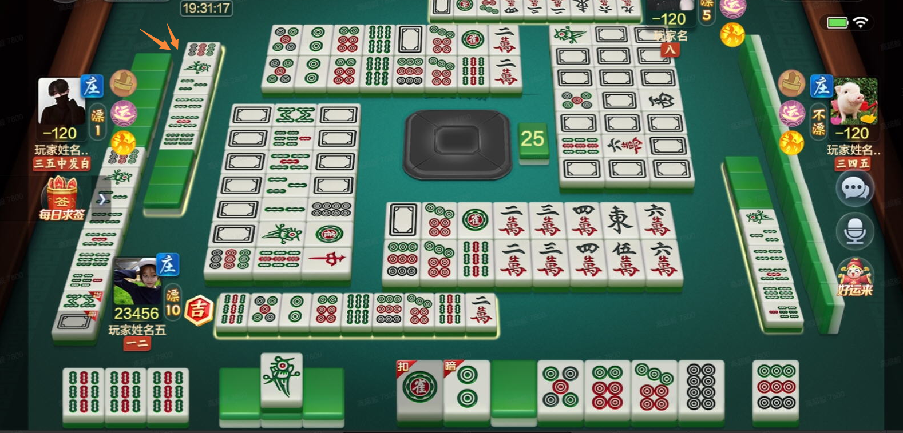
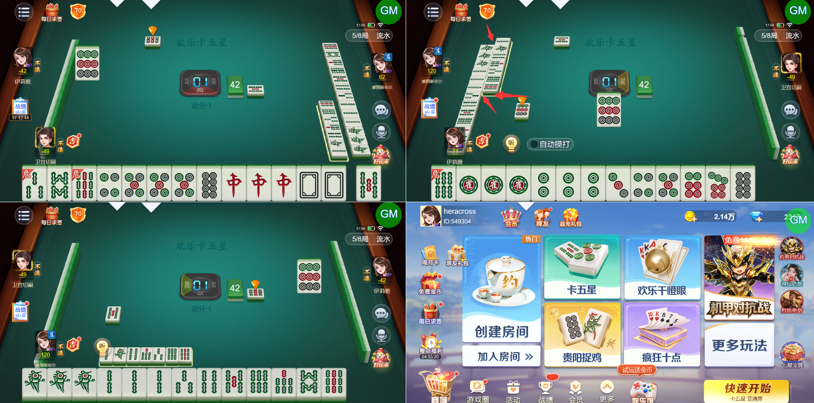

# 【卡五星】左侧玩家亮倒后，听牌显示与手牌靠的过近了（其他玩家两者之间都有间隙），需要优化

- 缺陷链接: https://project.feishu.cn/btqsku/bug/detail/7154279525?
- 技术处理人: 李锦程01
- BUG类别: 研中bug

## 缺陷描述

设计稿：

## 评论

**高超毅**  2026-11-05 17:05:30

仍然靠的有点近

