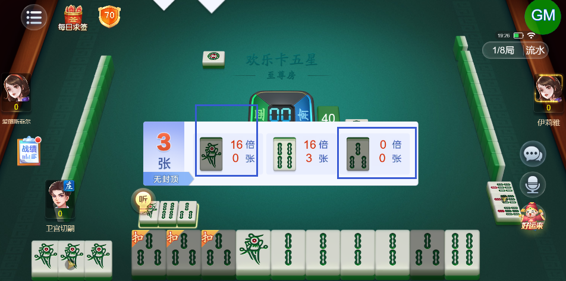
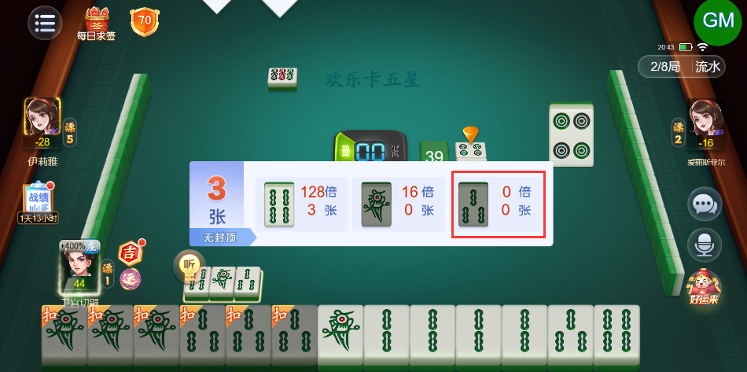
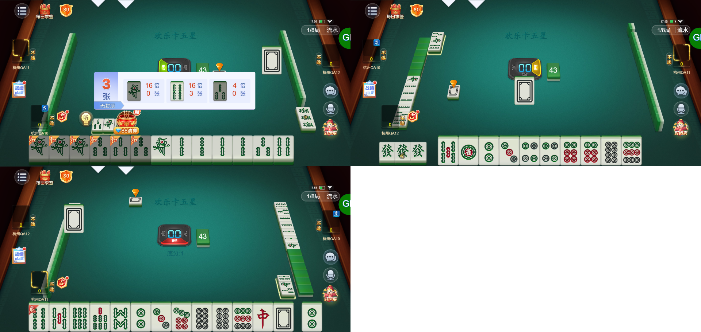

# 【卡五星】【听牌提示】部分牌型亮倒后出现听牌提示内容错误的情况，详细见图

- 缺陷链接: https://project.feishu.cn/btqsku/bug/detail/7155087591?
- 技术处理人: 汪旭照
- BUG类别: 研中bug

## 缺陷描述

1条和3条都已经全在我手中，不可能出现在听牌提示里（而且3条倍数都显示0了）

boxId:458300

roundId:503906185098413187

附个图：

## 评论

**高超毅**  2026-11-04 20:45:31

依然会出现0倍的三条听牌提示

boxId:782681

roundId:860566870723077727

**刘海迪**  2026-11-05 17:28:11

**刘海迪**  2026-11-05 17:56:20

