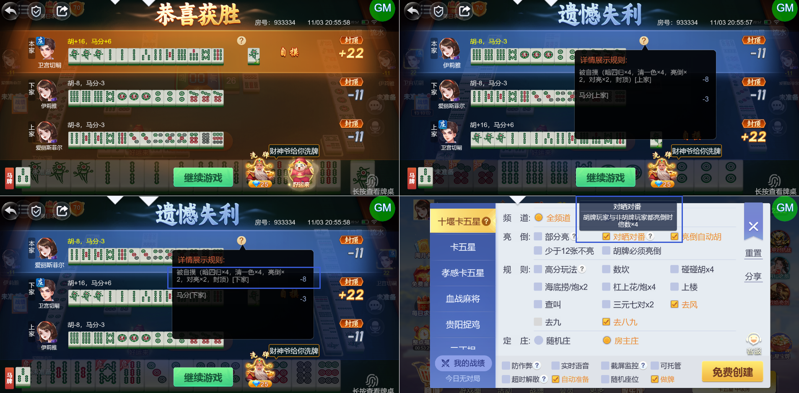
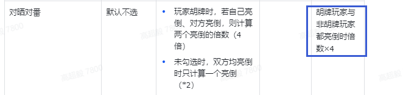
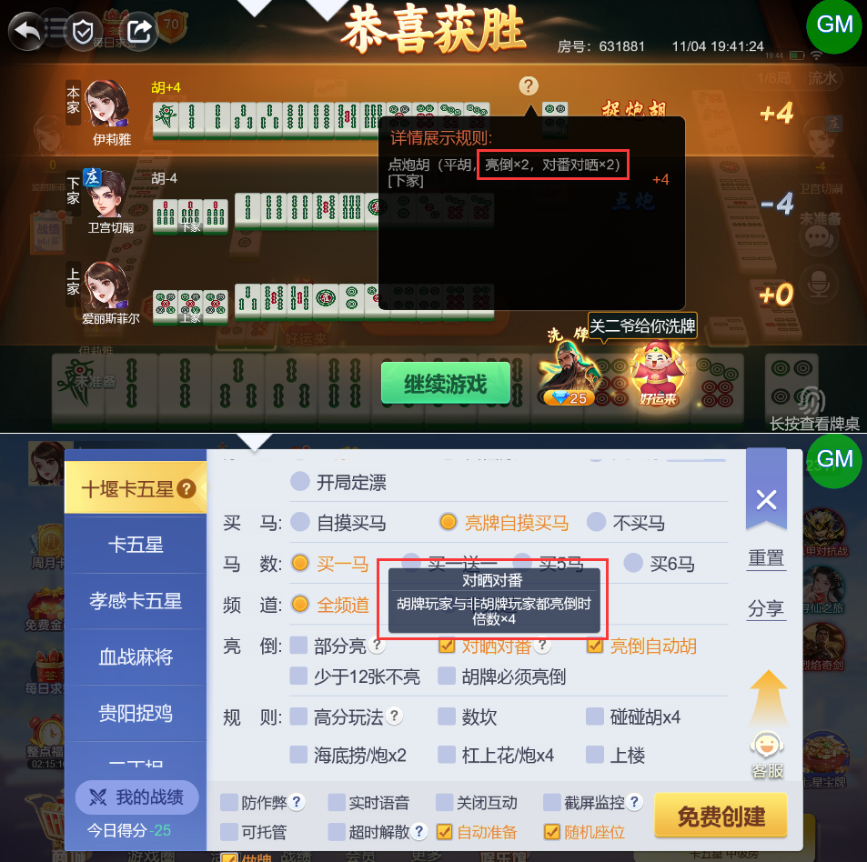

# 【卡五星】【十堰】【创房规则】勾选“对晒对番”时，非亮牌非胡牌玩家也算了4倍的分，并且详情上显示的是“对亮”

- 缺陷链接: https://project.feishu.cn/btqsku/bug/detail/7155130243?
- 技术处理人: 李锦程01
- BUG类别: 研中bug

## 缺陷描述

boxId:933334

roundId:1026211591687362923

设计稿：

## 评论

**高超毅**  2026-11-04 19:46:29

勾选“对番对晒”的情况下，应该直接显示为 对番对晒 x4，而不是 亮倒 x2，对番对晒 x2

boxId:631881

roundId:694760512959486161

