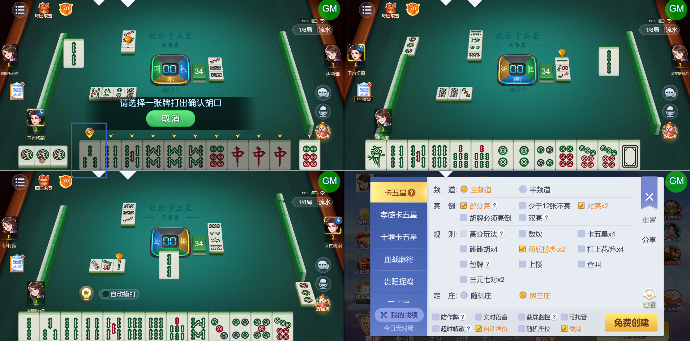

# 【卡五星】【亮倒】部分亮的情况下，亮倒后手牌中可以打出的牌是灰置的，无法打出

- 缺陷链接: https://project.feishu.cn/btqsku/bug/detail/7155134171?
- 技术处理人: 李锦程01
- BUG类别: 研中bug

## 缺陷描述

见下图：3条打出后依然可以听牌，但现在是灰置的状态

boxId:603836

roundId:663924709358421622

## 评论

（暂无评论）
