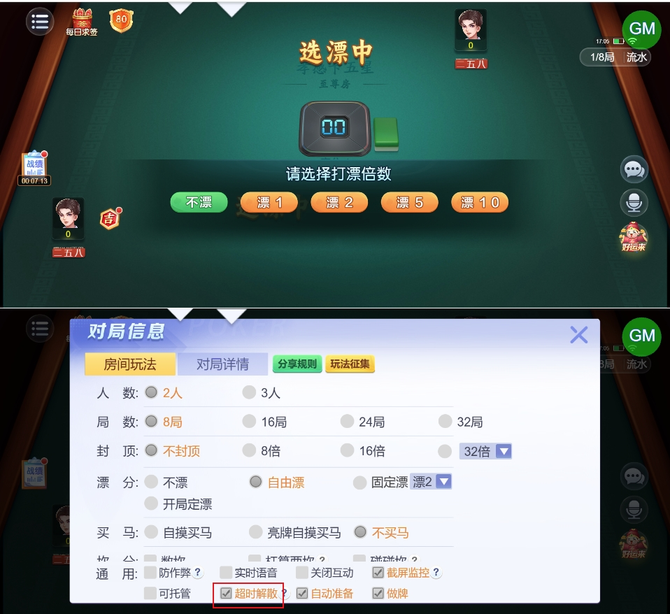
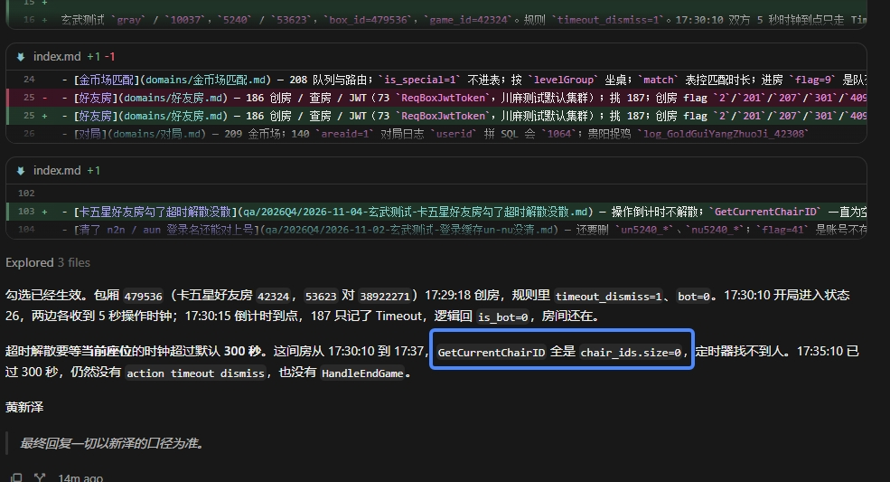

# 【卡五星】【超时解散】选漂阶段未计入超时

- 缺陷链接: https://project.feishu.cn/btqsku/bug/detail/7157396201?
- 技术处理人: 汪旭照
黄新泽
- BUG类别: 研中bug

## 缺陷描述

待填

## 附件

- img_v3_02174_6ac3cf2d-ba62-4630-aea9-e007807715cg.jpg

## 评论

**黄新泽**  2026-11-04 17:56:09

调用游戏逻辑的GetCurrentChairId返回的集合是0，找不到超时的人员；
@汪旭照需由logic开发人员进行排查

