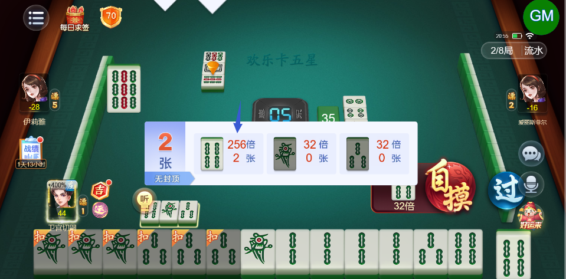
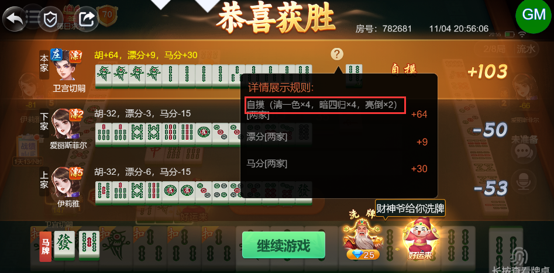
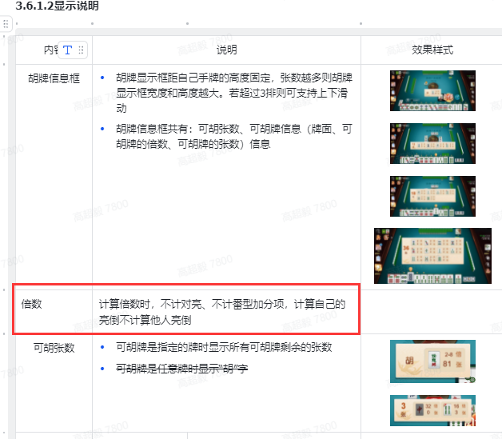
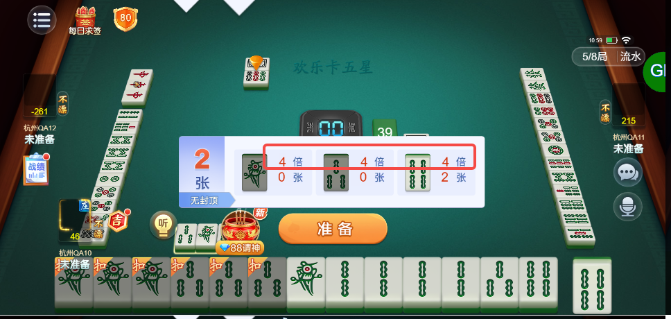
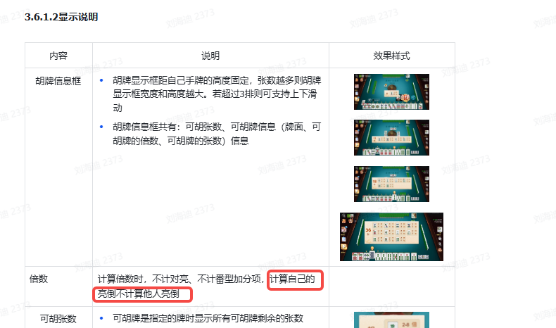

# 【卡五星】【听牌提示】倍数计算错误

- 缺陷链接: https://project.feishu.cn/btqsku/bug/detail/7157804881?
- 技术处理人: 汪旭照
- BUG类别: 研中bug

## 缺陷描述

应该是32倍（清一色+暗四归+亮倒）

boxId:782681

roundId:860566870723077727

设计稿：

## 评论

**刘海迪**  2026-11-06 11:01:23

听牌提示应该是8倍，要算上自己亮倒的倍数

