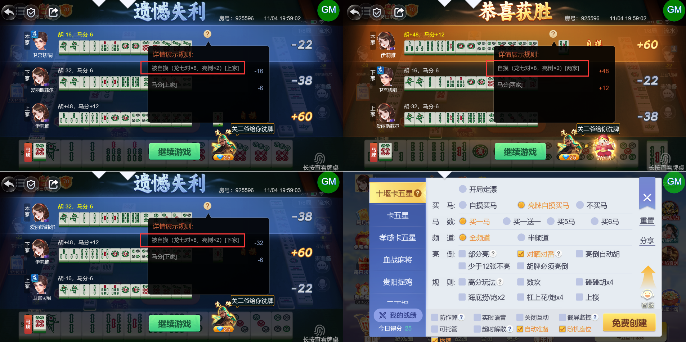

# 【卡五星】【十堰】【小结算详情】勾选“对晒对番”的情况下，两家亮倒，一家不亮的情况下，其中一家亮倒的自摸胡牌，详情内容需要区分玩家显示

- 缺陷链接: https://project.feishu.cn/btqsku/bug/detail/7157890083?
- 技术处理人: 汪旭照
李锦程01
- BUG类别: 研中bug

## 缺陷描述

需要根据玩家不同，区分显示：

1、亮倒玩家胡亮倒玩家，应该触发“对晒对番”，要显示  对晒对番 x4

2、亮倒玩家胡非亮倒玩家，只需要显示  亮倒 x2 即可

boxId:925596

roundId:1017703570711715254

## 评论

（暂无评论）
