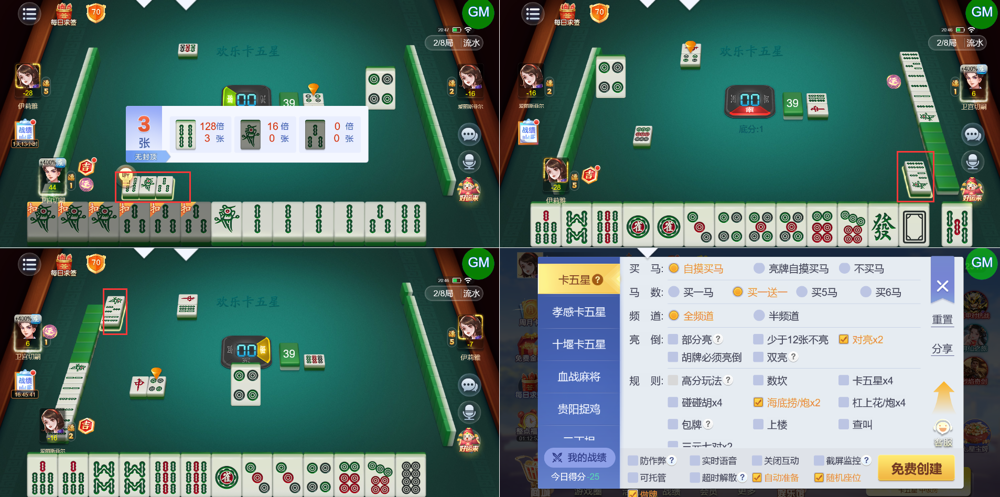

# 【卡五星】【亮倒】亮倒后听牌的牌型，不同视角下不一样，建议保持一致

- 缺陷链接: https://project.feishu.cn/btqsku/bug/detail/7158011328?
- 技术处理人: 李锦程01
- BUG类别: 研中bug

## 缺陷描述

亮倒玩家的听啤展示顺序是4、1、3条

在其他玩家的视角下是1、3、4条

boxId:782681

roundId:860566870723077727

## 评论

（暂无评论）
