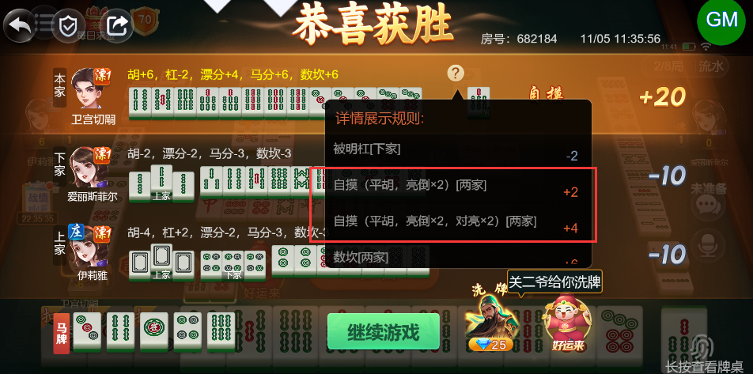
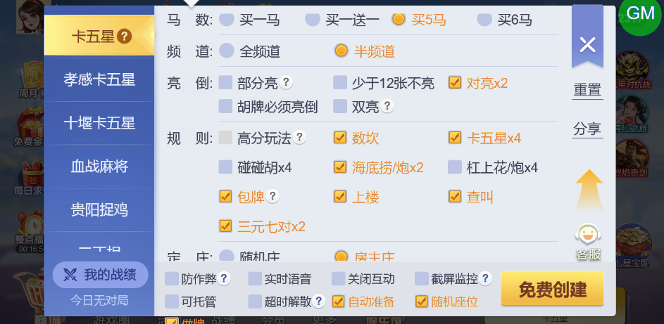
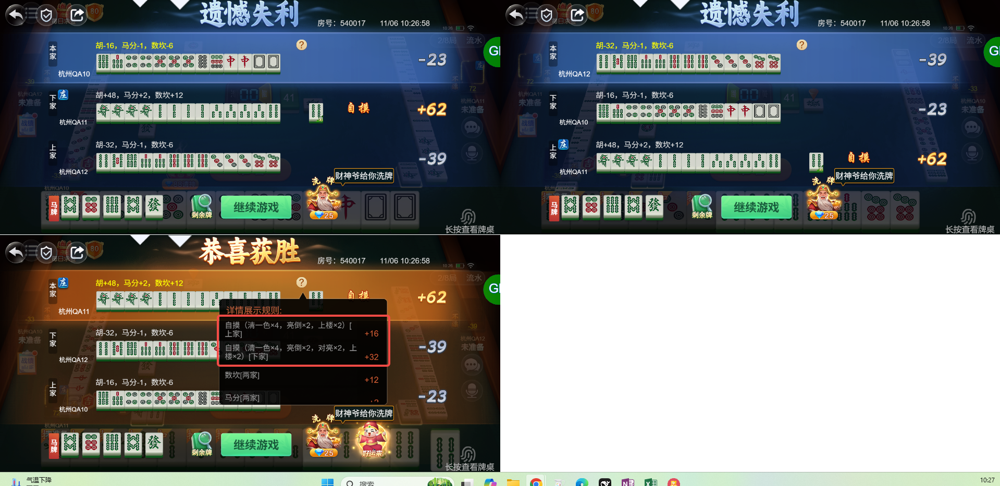

# 【卡五星】【小结算详情】2个玩家亮倒，1个玩家不亮的情况下，其中1个玩家自摸，在详情页会出现两条自摸[两家]的记录（应该是[上家]1条，[下家]1条）

- 缺陷链接: https://project.feishu.cn/btqsku/bug/detail/7158836755?
- 技术处理人: 李锦程01
- BUG类别: 研中bug

## 缺陷描述

boxId:682184

roundId:750069250666526211

附个规则：

## 评论

**刘海迪**  2026-11-06 10:27:30

