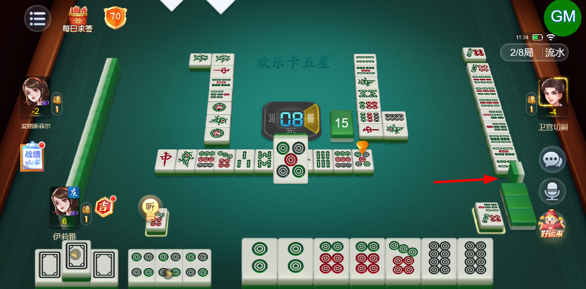
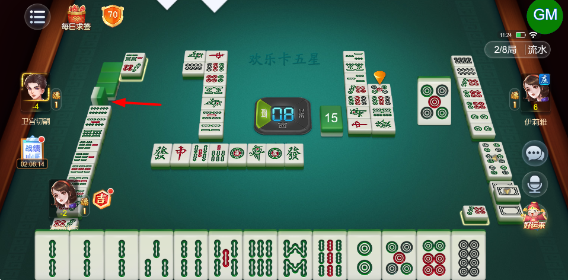
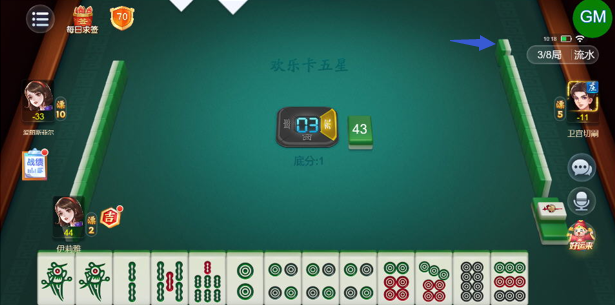
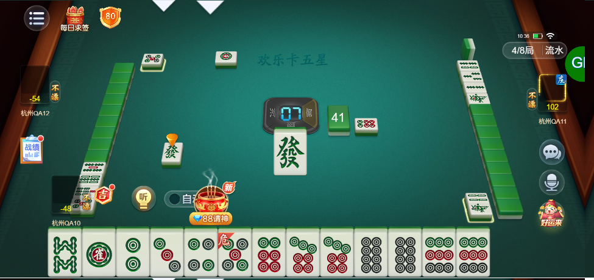
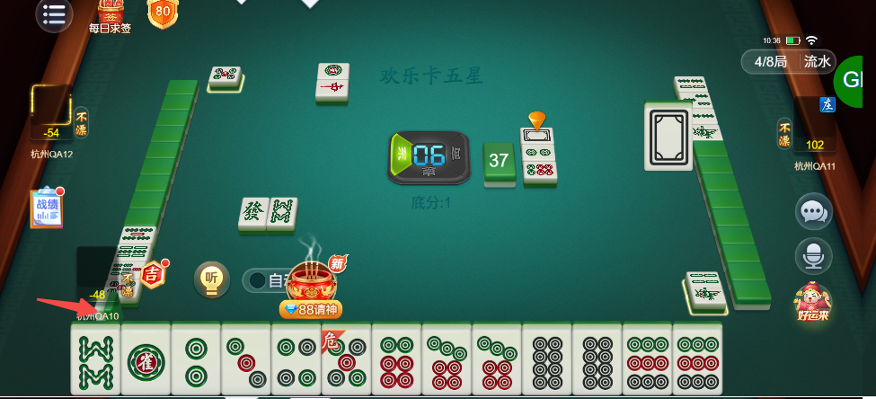
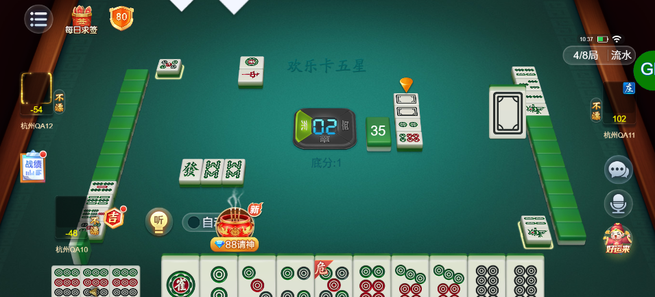
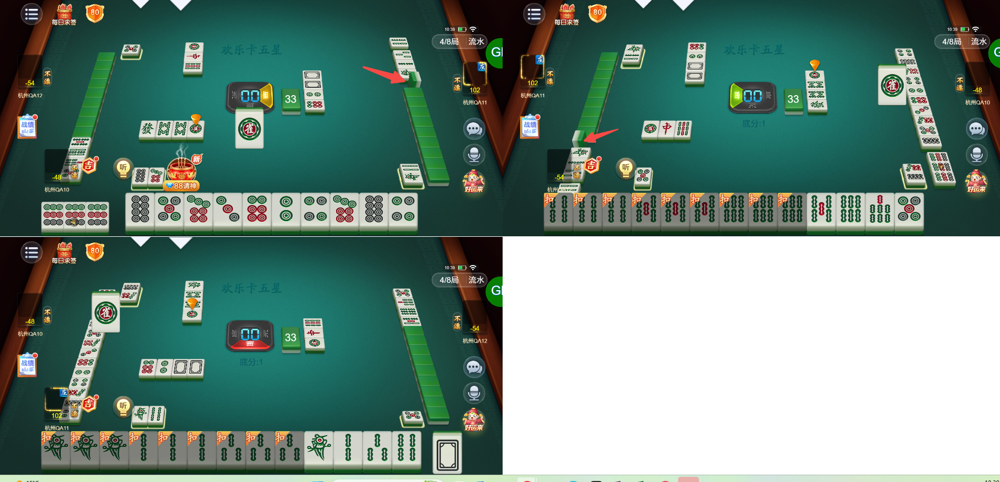

# 【卡五星】左右两侧玩家亮牌后，摸到的牌会立在手牌左侧（应该在右侧的）

- 缺陷链接: https://project.feishu.cn/btqsku/bug/detail/7158922714?
- 技术处理人: 李锦程01
- BUG类别: 研中bug

## 缺陷描述

参考图：

## 评论

**刘海迪**  2026-11-06 10:37:26

当前玩家没有亮倒，左右两家亮倒展示的正常

三家都亮倒，左右两家摸的牌展示到了中间

