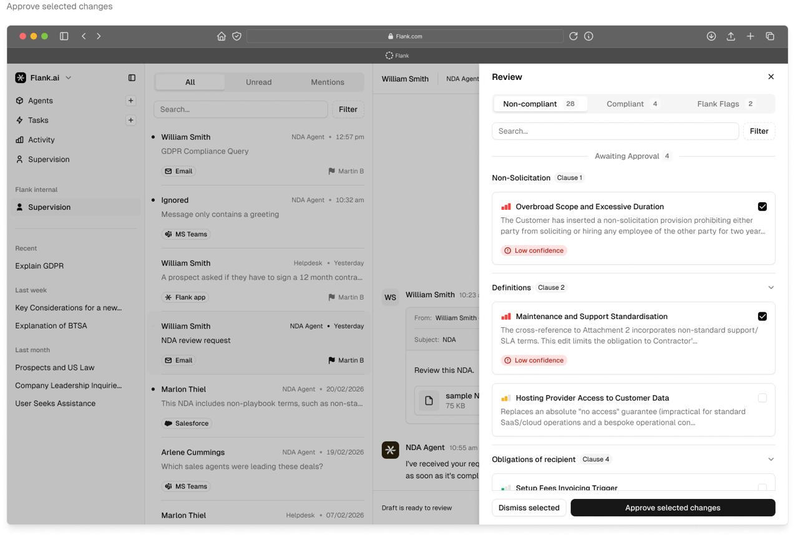

# Game PRD Decision Workbench（游戏需求裁决工作台）设计需求

> 来源：外部评审建议（2026-11-09）
> 定位：PrdGameSkill 正式组成部分，所有游戏项目可复用的 Human-in-the-loop 人工审批闭环
> 关联文档：[P6-P10 执行计划](../planning/2026-11-09-P6-卡五星需求审批与真实验收执行计划.md)
> 参考图已下载至本目录 `images/` 下

## 背景与问题定义

不要在 Markdown 文件里逐条回复裁决。应该把裁决做成一个独立的 Game PRD Decision Workbench（游戏需求裁决工作台），设计成 PrdGameSkill 的正式组成部分，以后所有游戏项目都能复用。

现在遇到的不只是 31 个问题不好处理，而是一个更大的需求工程问题：

> AI 负责发现问题、整理证据、提出候选方案；人负责判断、修改和批准。AI 根据人的裁决继续执行后续工作。

这应该形成一个完整的 Human-in-the-loop（人工审批闭环）。

## 一、产品形态：三栏式裁决工作台

单独增加一个页面：`/decision-workbench`。

它不只是一个问题列表，而是一个可以逐条处理、查看影响、保存进度和继续执行的工作台。



参考实现：[insights.flank.ai/supervision-experience](https://insights.flank.ai/supervision-experience)

建议采用三栏布局。

### 1. 左侧：待裁决问题列表

显示所有 OQ 问题，支持筛选和分组。

```
+----------------------------------------------------+
| 需求裁决                        18 项高优先级        |
|                                                    |
| 全部问题    31                                     |
| 已裁决       0                                     |
| 高优先级    18                                     |
|                                                    |
| [待裁决]  [按优先级排序]                             |
|                                                    |
| HIGH  OQ-013  字分是否参与结算                       |
| HIGH  OQ-014  杠开是否与其他番型叠加                  |
| HIGH  OQ-015  首亮荒庄赔付对象                       |
| HIGH  OQ-016  第二家亮倒包牌口径                     |
| HIGH  OQ-027  游戏大厅页面定义                       |
+----------------------------------------------------+
```

左侧需要支持：

- High / Medium / Low 筛选。
- 按规则、结算、UI、配置分类。
- 未处理 / 已处理 / 已挂起筛选。
- 搜索 OQ ID 和关键词。
- 显示完成进度。
- 按依赖关系排序。

### 2. 中间：问题详情与人工裁决

这是最重要的区域。

例如 OQ-013：

```
+----------------------------------------------------+
| OQ-013                                    [HIGH]    |
|                                                    |
| 字分是否参与结算？                                   |
|                                                    |
| 关联：GAME-RULE-116 · 结算总公式 S0                  |
|                                                    |
| 问题描述                                            |
| 原始需求主公式包含「+ 字分」项，但当前结构化规格中       |
| 的结算公式没有纳入字分，而且没有定义字分的计算口径。     |
|                                                    |
| 原始需求依据                                        |
| 原文位置：06-结算.md · §二 主公式                    |
| 展示原始公式、完整引用上下文和文件定位。               |
|                                                    |
| AI 分析（仅供参考）                                  |
| - 现有 IR 尚未定义字分计算方式。                      |
| - 如果参与结算，需要补充字分定义和计算规则。           |
| - 如果不参与结算，需要明确公式中的该项如何处理。       |
|                                                    |
| 请选择人工裁决                                      |
| [ 采纳当前建议口径 ]                                 |
| [ 修改为其他口径 ]                                   |
| [ 否决该需求或推导 ]                                 |
| [ 暂时挂起，后续处理 ]                               |
|                                                    |
| [ 生成裁决记录草稿 ]                                 |
|                                                    |
| 以上为交互原型，不会直接修改仓库或批准真实规则。       |
| 真正开发时，点击确认才会提交正式裁决。                |
+----------------------------------------------------+
```

设计原则：

> AI 可以提供推荐方案，但不能默认把推荐方案作为最终答案。尤其是结算公式、番型和赔付规则。

### 3. 右侧：影响分析

这个区域特别重要，甚至比裁决按钮还重要。

例如修改 OQ-013，系统应该展示：

| 关联对象          | 影响     |
| ------------- | ------ |
| GAME-RULE-116 | 结算公式   |
| GAME-RULE-119 | 加倍项    |
| Simulator     | 结算计算   |
| Test Cases    | 结算测试   |
| HTML PRD      | 结算规则展示 |

这样看到的不是一个孤立问题，而是知道修改它会影响整个系统的哪些部分。

## 二、裁决数据结构与状态设计

### 统一裁决数据结构

裁决不能只是四个按钮，每条问题都采用统一的裁决数据结构：

```json
{
  "decision_id": "DEC-013",
  "question_id": "OQ-013",
  "status": "approved",
  "outcome": "modified",
  "final_decision": {
    "participates_in_settlement": true,
    "formula": "由人工确认的最终公式"
  },
  "rationale": "产品确认字分参与结算",
  "affected_requirements": [
    "GAME-RULE-116"
  ],
  "affected_tests": [],
  "reviewer": "human",
  "created_at": "2026-11-09T00:00:00+08:00"
}
```

实际字段需要根据裁决类型定义，不能把所有问题都套用一个布尔值。

### 裁决状态与需求状态必须分开

裁决状态（Decision）：

| 裁决状态     | 含义      |
| -------- | ------- |
| pending  | 尚未处理    |
| draft    | 已填写但未提交 |
| approved | 人工采纳    |
| modified | 人工修改后采纳 |
| rejected | 人工否决    |
| deferred | 暂时挂起    |

需求状态（Requirement）仍沿用原有：

`proposed / approved / rejected / deprecated`

两套状态不能混淆。

例如 OQ-013 已经提交裁决，但关联的结算规则还没有重新校验，这时不能直接认为整套 Game Spec 已经完成审批。

### 支持问题合并

31 个问题里有些存在关联或重复，例如：

- OQ-003 和 OQ-008 都涉及回手杠配置。
- OQ-014 和 OQ-021 都涉及杠开叠加。
- OQ-020 和 OQ-021 都涉及番型叠加。

建议支持：

- 主问题。
- 关联问题。
- 重复问题。
- 一次裁决影响多个需求。

但是不能因为两个问题相似，就自动合并它们的业务含义。

## 三、审批状态机与 Gate 机制

处理完成后，让 AI 继续工作。设计一个正式的审批状态机：

```
Decision Workflow

PENDING           AI 发现问题，生成证据和候选方案
    |
    v
HUMAN REVIEW      人工阅读原文、影响分析、提交裁决
    |
    +--> APPROVED     采纳 / 修改采纳
    |
    +--> DEFERRED     挂起，等待后续
    |
    v
UPDATE GAME SPEC  写入 Decision Log，更新 IR 和关联关系
    |
    v
REVALIDATE        重新生成测试、检查规则、UI 和模拟器
    |
    v
P6 COMPLETE       达到发布 Gate，允许进入下一阶段
```

### Gate 机制：不要求 31 个问题全部处理完才能继续

| 问题类型       | 是否阻塞       |
| ---------- | ---------- |
| 结算公式未确认    | 阻塞相关结算开发   |
| 核心番型未确认    | 阻塞相关规则实现   |
| UI 页面细节未确认 | 阻塞对应页面正式验收 |
| 文档章节编号问题   | 不阻塞        |
| 非当前游戏变体问题  | 不阻塞当前变体    |

即使还有 5 个 Low 问题没有处理，也可以继续其他已确认模块的工作。但最终发布仍然必须满足核心规则完整性要求。

## 四、技术架构

### 两层分离

不建议把裁决功能直接写进当前生成的 `index.html`。因为裁决有一个重要需求：人工填写的结果必须真正写回 PrdGameSkill 仓库，并且可以恢复、追溯和继续执行。普通离线 HTML 不适合直接承担这个职责。

| 层 | 定位 | 能力 |
|---|---|---|
| 第一层：Interactive PRD Viewer | 只读展示，可以离线分享 | 需求浏览、原文引用、UI Demo、流程图、规则模拟 |
| 第二层：Decision Workbench | 本地运行，需要持久化能力 | 问题审批、裁决记录、影响分析、进度管理、重新验证、恢复工作 |

### 推荐目录

```
skills/interactive-game-prd/
├── decision/
│   ├── schemas/
│   │   └── decision.schema.json
│   ├── services/
│   │   ├── decision-service.ts
│   │   ├── impact-analyzer.ts
│   │   ├── approval-gate.ts
│   │   └── resume-service.ts
│   └── scripts/
│       ├── import-questions.ts
│       ├── apply-decisions.ts
│       └── validate-decisions.ts
├── web/
│   └── decision-workbench/
│       ├── src/
│       │   ├── pages/
│       │   ├── components/
│       │   ├── stores/
│       │   └── services/
│       └── package.json
└── workflows/
    ├── review-requirements.md
    ├── apply-decisions.md
    └── resume-after-review.md

examples/mahjong/
└── game-spec/
    └── reviews/
        ├── open-questions.json
        ├── decision-log.json
        └── approval-state.json
```

### 技术实现建议

- 前端：React + TypeScript。
- UI：沿用现有 HTML PRD 的视觉规范。
- 后端：轻量 Node.js 本地服务。
- 持久化：先用 JSON 文件，不急着上数据库。
- 数据校验：沿用 JSON Schema。
- 自动化：Playwright。
- 变更管理：Git Commit + Decision Log。

安全约束：本地服务只允许修改指定的 `game-spec` 文件，不允许 AI 或前端任意写入仓库其他路径。

第一版不需要账号系统、多人协作和复杂权限平台。

## 五、5 个重要功能

这几个功能决定它以后能不能用于真正的游戏项目。

### 1. 自动保存草稿

填写到一半退出，不应该丢失。支持：自动保存、未提交草稿、恢复上次编辑、提交前预览。

### 2. 原始文档证据定位

点击引用直接打开对应原始 PRD，定位章节和原文。不能只显示 AI 摘要。

### 3. 裁决历史

已经批准的规则不能直接覆盖：

```
DEC-013
  第一次：修改为字分参与结算
  第二次：重新裁决为字分不参与结算

当前有效版本：第二次
历史记录：完整保留
```

### 4. 变更影响自动分析

修改一条规则后，自动找出受影响的 Requirement、UI、Simulator、Test Cases，只重新生成必要的内容。

### 5. 中断恢复

今天处理了 10 项，明天打开工作台：已完成 10 项、未处理 15 项、挂起 6 项，自动定位上次处理的位置。这也是后续 AI Workflow 可以持续运行的基础。

## 六、P6 开发任务拆解

先不把整个审批工作台做得太复杂，按三个阶段完成：

| 阶段   | 交付内容                     | 验收重点       |
| ---- | ------------------------ | ---------- |
| P6-A | 裁决数据模型、Decision Log、状态管理 | 数据可靠       |
| P6-B | 三栏式 Decision Workbench   | 31 项可以完整处理 |
| P6-C | 自动写回 IR、影响分析、Gate、恢复执行   | 裁决后工作流能继续  |

### P6 最终验收标准

1. 31 个 OQ 全部可以在页面中浏览。
2. 每条问题都可以查看原文证据。
3. 支持采纳、修改、否决、挂起。
4. 支持草稿和自动保存。
5. 提交裁决后生成不可丢失的历史记录。
6. 可以查看关联需求和影响范围。
7. 页面刷新、关闭后可以恢复。
8. 可以将裁决结果写回 JSON。
9. IR 更新后自动执行 Schema 和引用校验。
10. 达到 Gate 后可以触发后续 Workflow。
11. AI 不能代替人工提交正式裁决。
12. 未确认的规则不能被模拟器当成正式规则使用。

## 七、通用产品命名：Game Decision Workbench

不要针对卡五星命名（如 Mahjong Approval Page），应命名为 Game Decision Workbench。未来其他游戏也会有几十甚至几百个待确认项，同一套审批机制，不同游戏只需要提供各自的 IR Schema 和问题数据：

| 场景     | 审批内容         |
| ------ | ------------ |
| 麻将     | 玩法、番型、结算     |
| 卡牌游戏   | 卡牌效果、触发条件、数值 |
| RPG    | 技能、属性、任务流程   |
| SLG    | 战斗规则、资源、建筑   |
| Web 产品 | 业务规则、权限、异常流程 |

### 最终产品形态

```
Game Requirement IR            所有游戏的统一需求数据
PRD Viewer                     阅读和演示
Decision Workbench             人工裁决
UI Workbench                   UI 设计与编辑
Test Workbench                 测试和验证
AI Game Development Workflow   经过确认的需求才进入开发
```

## 实施建议

先开发 P6-A + P6-B，不要急着做完整的审批平台。

先让卡五星这 31 个问题能够在一个页面里完成处理、保存、恢复和提交。然后再开发 P6-C，把裁决真正接入 IR 更新和后续 AI 工作流。

这会是 PrdGameSkill 从「AI 生成需求文档」迈向「AI 需求工程系统」的一个重要升级。
