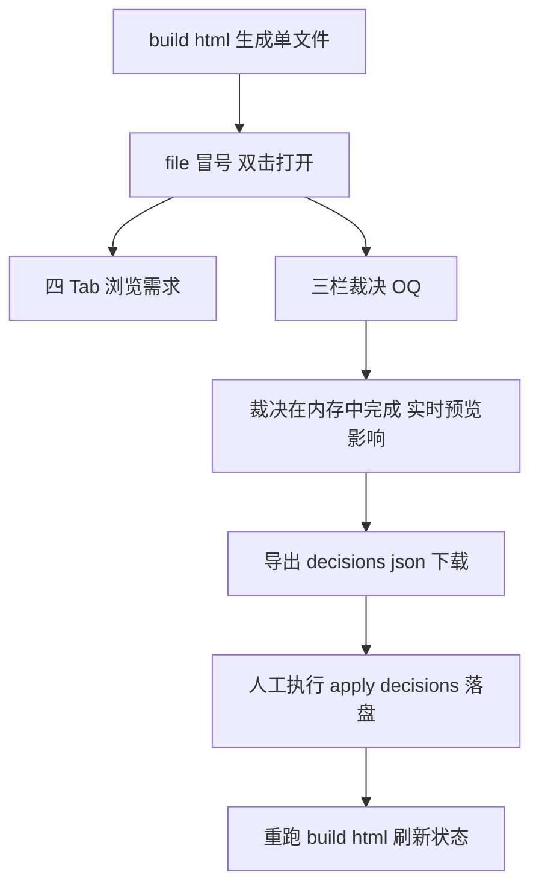

# 独立单文件 index.html（需求浏览 + OQ 裁决一体）可行性分析

> 需求：一个独立 index.html，包含所有信息（Interactive HTML PRD 的四 Tab 浏览 + Decision Workbench 的三栏 OQ 裁决），不依赖 React/Vite/npm build 环境也能跑（file:// 双击即可）。

## 现状两条管线

| | Interactive HTML PRD | Decision Workbench |
|---|---|---|
| 形态 | 单文件 383 KB（build-html.mjs 生成：模板 + APP_DATA 内嵌 + 模拟器 UMD 注入） | React + Vite + TS 工程，npm run build 产物 dist/（JS/CSS 分离） |
| 运行 | file:// 双击即跑，零环境 | 必须起 decision-workbench.mjs（Node 后端 API：读写 reviews、dry-run、落盘） |
| 覆盖 | 需求卡片 / UI Demo 模拟器 / Flow 状态机 / Tests 用例（只读浏览） | 31 项 OQ 三栏裁决（列表 / 详情 / 影响分析，写回 reviews） |

## 核心矛盾：裁决是写操作

浏览是纯读（APP_DATA 内嵌已验证）；裁决要把结果**写回** reviews/*.json。浏览器 file:// 安全沙箱禁止直接写本地文件——这是唯一硬约束，三个方案围绕它展开。

## 方案对比

### 方案 A：单文件 + 导出下载（推荐）

- **做法**：扩展 build-html.mjs——APP_DATA 追加内嵌 OQ 31 条 + approval-state + decision-log + 需求引用图（OQ → requirement_id → 需求 → ui_refs / test_refs，APP_DATA 里已有全部数据）；模板追加「裁决」Tab（原生 JS 重写三栏：列表 / 详情 / 裁决按钮 + 影响预览）；导出按钮生成 decisions.json 触发浏览器下载。
- **落盘闭环**：导出的 decisions.json 正好是现有 `apply-decisions.mjs` 的输入格式（先 `--dry-run` 预演再落盘）——管线已存在，不用新写。
- **红线完整保留**：AI 不代人工提交——人工点「导出」即人工确认动作，脚本只做确定性落盘；decision-log 追加 / supersedes 链机制不变。
- 优点：零环境依赖、单文件、闭环完整。
- 代价：裁决落盘从「一键写回」变「导出 + 跑一条命令」两步。

### 方案 B：单文件 + 本地服务写回

静态文件仍单文件，但写回依赖起 decision-workbench.mjs。等于现状换壳（React 版只是壳，依赖的是后端 API），没解决用户诉求——排除。

### 方案 C：方案 A + File System Access API 直接写回（可选增强）

Chrome/Edge 的 `showDirectoryPicker` 可让页面获授权后直接读写本地目录：打开时授权 `game-spec/reviews/` 目录，裁决点「落盘」直接写回 open-questions.json / approval-state.json / decision-log.json——体验回到一键写回。

- 前提：Chrome/Edge（用户环境即 Chrome）；file:// 下 File System Access API 可用性需实测（file:// 属 secure context，理论上可用）。
- 降级路径：API 不可用时自动回退方案 A 的导出下载——两方案共存不冲突。

## 工作量评估（方案 A）

| 项 | 内容 | 估时 |
|---|---|---|
| build-html.mjs 扩展 | APP_DATA 追加 reviews 数据 + 引用图内嵌 | 0.5 天 |
| 模板扩展 | 原生 JS 三栏裁决 Tab（列表 / 详情 / 裁决 / 影响预览 / 导出），396 行模板增至约 800~1000 行 | 1 天 |
| 影响分析移植 | P6-B 的引用图影响预览逻辑（React 版已有，纯 JS 重写） | 0.5 天 |
| 测试 | mahjong-smoke 扩展：裁决 Tab 渲染 / 裁决点击 / 导出内容断言 | 0.5 天 |
| 方案 C 增强 | FSA API 写回 + 降级 | +0.5 天 |

合计约 2.5 天（含方案 C 约 3 天）。

## 结论与建议

1. **可行**：唯一硬约束（file:// 不能写文件）有两条出路——导出下载（方案 A，稳）或 FSA API 直写（方案 C，限 Chrome/Edge）。
2. **推荐 A 起步 + C 增强**：A 先落地保证零依赖闭环；C 作为 Chrome 下的体验增强，自动降级到 A。
3. React 版 Workbench 去留：单文件版覆盖「看 + 裁 + 导」主流程后，React 版可保留为「多人在线裁决 / 直接写回」的完整版，或废弃——建议先保留观察单文件版使用率再决定。
4. 体积影响：383 KB 预计增至 450~500 KB（+OQ + 引用图 + 三栏 UI），无压力。
5. 风险：原生 JS 重写三栏 UI 需对照 P6-B 的 21 项测试语义逐一补冒烟断言，防止交互回归。

## 引用说明

- 现有单文件管线：`scripts/build-html.mjs` + `assets/html-template/index.html`（本仓库已验证）
- 现有裁决落盘管线：`scripts/apply-decisions.mjs`（decisions.json 输入格式、dry-run、supersedes 链）+ `scripts/decision-lib.mjs`
- React 版三栏实现（移植参考）：`web/decision-workbench/src/`（WorkbenchPage / QuestionList / QuestionDetail / ImpactPanel）
- P6-B 验收记录：`dev-docs/progress-result/P6-B-执行报告.md`
- File System Access API：https://developer.mozilla.org/docs/Web/API/File_System_API
