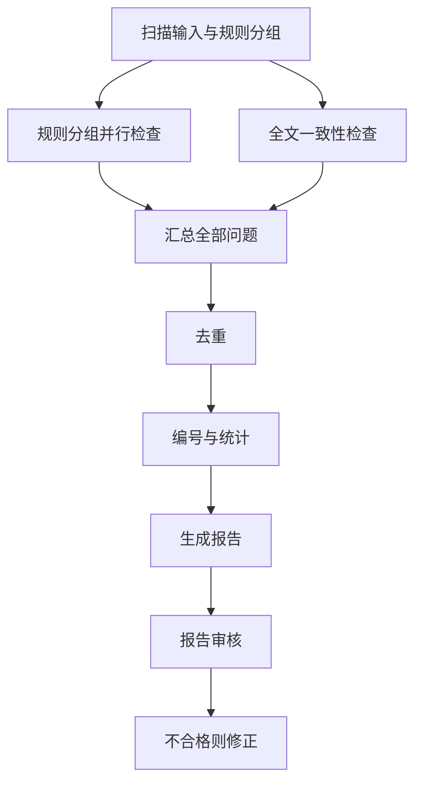
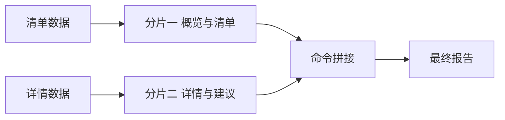

# game-prd-check Workflow 优化记录

- 日期：2026-11-10
- 对象：`.opencode-workflows/workflows/game-prd-check.js`
- 来源：把 `.claude/skills/game-prd-check/SKILL.md` 的四步检查流程转写为 OpenCode workflow 脚本
- 目标：在保证报告质量结构（五类问题、四级优先级、证据先行）的前提下降低墙钟耗时

## 一、提交记录总览

| 提交 | 时间 | 类型 | 变更要点 |
| --- | --- | --- | --- |
| b80f4ec | 14:34 | feat | 首次转写：扫描、规则分组并行检查、全文一致性检查、汇总去重、生成报告、审核修正 |
| 16bdd0a | 14:36 | feat | 分析阶段默认改用快速模型 deepseek-v4.1-flash-official |
| 755b903 | 14:38 | feat | 并发上限默认 8 路 |
| 252a784 | 14:40 | perf | 大规则文件按行拆分、skipReview、报告输入瘦身、小问题集确定性去重、产物目录隔离 |
| d44d210 | 14:42 | perf | 一章一组、组上限 24、并发 16、每组问题上限 10、质检改用快速模型 |
| 41a825a | 14:44 | feat | 新增 args.fast 最快档：组数压到 16、强制确定性去重、报告分片并行写、默认跳过质检 |

合计：1 次功能转写 + 5 次优化迭代。

## 二、逐项优化说明

### 1. 流程转写（b80f4ec）

把 skill 的固定四步扩展为可并行流水线：

- 扫描阶段由子代理列出需求文档与规则文件，并按主题分组；
- 规则分组检查与全文一致性检查并行执行，而不是串行逐份读规则；
- 汇总阶段统一编号 PRD-001 起，统计与模块分布由脚本确定性计算，避免报告数字与清单不一致；
- 报告审核不通过时自动触发修正代理。

关键收益：从“一个代理顺序读全部规则”变成“多代理按组并行”，墙钟由串行累加变为最慢分组决定。

### 2. 分析阶段模型降级（16bdd0a）

扫描、规则检查、一致性检查、去重统一使用 `biangfeng-gateway/deepseek-v4.1-flash-official`；报告撰写与质检保留会话默认模型。

理由：分析任务以对照与枚举为主，快速模型足够；报告撰写是长输出且要求结构完整，保留更强模型。

可通过 `args.analysisModel` 覆盖，传空字符串回落会话默认模型。

### 3. 并发放开（755b903 → 252a784 → d44d210）

| 阶段 | 并发 |
| --- | --- |
| 初始 | 未设置，走运行时缺省（CPU 核数减 2，本机 6 核为 4） |
| 755b903 | 8 |
| 252a784 | 12 |
| d44d210 起 | 16（运行时上限，再大也会被钳制） |

### 4. 大规则文件按章节拆分（252a784 → d44d210）

问题：85KB 的规则 PRD 若整份作为一个分组，该代理要读 85KB 规则加 104KB 需求文档，是全流程最慢路径。

方案：扫描阶段对超过 20KB 的规则文件按一级章节拆成行号片段（`sections` 含 file、fromLine、toLine、title），一个片段一个分组；片段必须首尾相接覆盖全文，不能留空档。

参数差异：252a784 是“拆 2~4 段、组上限 10”；d44d210 改为“一章一段、组上限 24”；41a825a 的 fast 档再把组数压到 16 以内，允许相邻章节合并。

### 5. 质检可跳过与质检模型（252a784 → d44d210）

- 新增 `args.skipReview`：跳过质检与修正回合，省一次串行读全报告的耗时；
- 质检默认也改用快速模型，可用 `args.reviewModel` 覆盖；
- fast 档默认跳过质检，传 `skipReview: false` 可强制保留。

### 6. 报告输入瘦身（252a784 → d44d210）

报告代理不再接收全部问题的完整字段：

- 清单表只给 id、type、priority、title、location、suggestion；
- 详情只给 P0、P1 全部，加 3 条典型 P2（252a784 时为 4 条）；
- 质检按“期望详情条数”校验，避免因固定条数要求导致反复修正。

### 7. 去重条件化（252a784 → 41a825a）

- 初始：无论问题多少都调用一次 LLM 合并代理；
- 252a784：问题不超过 15 条时改用 JS 精确去重（同 type、location、标题），跳过合并代理；
- d44d210：精确去重键改为标题前 12 字，对措辞略有差异的重复更有效；
- 41a825a：fast 档无条件走 JS 去重，进一步省掉一个串行回合。

### 8. 产物目录隔离（252a784）

报告默认输出从 `examples/game-prd-check/report.md` 改为 `examples/game-prd-check-workflow/report.md`，避免与原 skill 产物互相覆盖；仍可用 `args.outPath` 指定。

### 9. 最快档 args.fast（41a825a）

一键开启全部加速项：

1. 规则组不超过 16 组（相邻章节合并到同一分组，sections 可含多个连续片段）；
2. 强制确定性去重；
3. 报告拆成两片并行写：概览加清单、详情加建议，随后用 PowerShell 命令拼接并清理临时文件；
4. 默认跳过质检。

## 三、当前执行流程

报告生成在 fast 档下的内部结构：

## 四、当前默认参数

| 参数 | 默认值 | 说明 |
| --- | --- | --- |
| analysisModel | biangfeng-gateway/deepseek-v4.1-flash-official | 扫描、规则检查、一致性、去重 |
| reviewModel | 同 analysisModel | 质检 |
| concurrency | 16 | 运行时最高 16 |
| maxIssuesPerGroup | 10 | 每组输出上限 |
| maxRuleGroups | fast 16，否则 24 | 分组数量上限 |
| outPath | examples/game-prd-check-workflow/report.md | 与原 skill 隔离 |
| skipReview | fast 档默认 true，否则 false | 可显式覆盖 |
| fast | false | 最快档开关 |

## 五、收益结构分析

墙钟时间由两部分决定：

1. 并行波次：分组数除以并发上限向上取整。23 个章节组、并发 16 会排成 16 加 7 两波；压到 16 组以内只需一波，尽管每组读的规则略多，但需求文档 104KB 才是主要耗时，因此组数控制比单组规则量更重要。
2. 串行回合：去重、写报告、质检各占一轮。fast 档分别用确定性去重、分片并行加命令拼接、默认跳过来削减。

## 六、类比理解

把整个流程想成一家餐厅出餐：

- 规则文件像菜谱分册，23 个章节就是 23 道工序；可同时开 16 个灶（并发上限），多出来的菜要等下一轮，所以把工序合并到 16 道以内就能一轮出齐。
- 每个厨师都要先看同一份总菜单（104KB 需求文档），所以让一个厨师单独啃 85KB 的厚菜谱，就成了全场最慢的那位。
- 写报告像摆盘，拆成前菜与主菜两个人同时摆，再用传菜员拼盘，比一个人从头摆到尾快。
- 去重与质检像出餐前的检查，能用固定规则机械核对的部分（确定性去重）就不必再请老师傅过目（LLM 归并）。

## 七、遗留问题与后续建议

1. 尚未实际运行验证：分片拼接依赖 PowerShell 命令在目标环境的可用性，命令失败时才会回落为读取分片再合并。
2. 大分组全量读文档的 token 开销显著（约 23 倍需求文档体积），当前以速度优先，未做输入裁剪。
3. 确定性去重只合并 type、location、标题前缀都相同的条目，语义重复仍可能残留；需要更严格去重时应关闭 fast 档并使用 LLM 归并。
4. 质检跳过意味着 ID 连续性、统计一致性等问题不会自动纠正，正式交付建议保留质检。

## 八、引用说明

- 项目内规范：`.claude/skills/game-prd-check/SKILL.md`（问题类型、优先级、硬性要求、报告结构）
- workflow 运行时说明：`.agents/skills/workflow-authoring/references/runtime.md`
- workflow 编写规范：`.agents/skills/workflow-authoring/SKILL.md`
- 模板：`.claude/skills/game-prd-check/references/templates/report.template.md`
- 提交记录：
  - https://github.com/mickorz/PrdGameSkill/commit/b80f4ec
  - https://github.com/mickorz/PrdGameSkill/commit/16bdd0a
  - https://github.com/mickorz/PrdGameSkill/commit/755b903
  - https://github.com/mickorz/PrdGameSkill/commit/252a784
  - https://github.com/mickorz/PrdGameSkill/commit/d44d210
  - https://github.com/mickorz/PrdGameSkill/commit/41a825a
