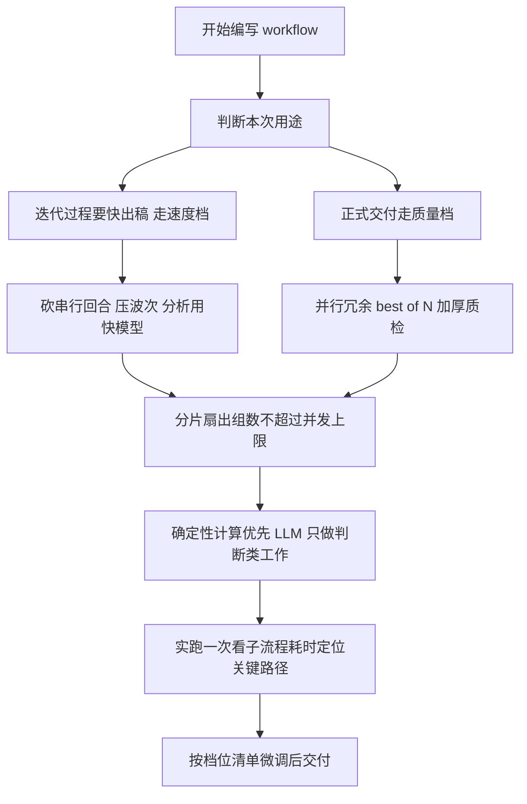

# workflow-authoring skill 速度与质量双模式优化方案

- 日期：2026-11-11
- 对象：`.agents/skills/workflow-authoring`（SKILL.md + references/）
- 依据：`dev-docs/design/2026-11-10-game-prd-check-workflow-optimization.md` 中六次迭代沉淀的经验
- 前提：开发过程中 token 消耗不设限时；两档模式为「速度优先」（压墙钟）与「结果质量优先」（压缺陷率）

## 一、背景

game-prd-check workflow 的六次优化（转写、模型降级、并发放开、大文件分片、质检可跳、fast 档）都是针对单一脚本的手工调优。这些手段全部只用了 workflow-authoring 已有的 API（`setConcurrency` / `parallel` / `args` / `model` / `check`），没有动 runtime——说明它们是**编写指导**层面的经验，应该沉淀回 skill 本身，让下一次写 workflow 时直接套用，而不是再迭代六轮。

当前 skill 的缺口：

1. SKILL.md 只讲了「怎么写对」（语法、不变量、API），没讲「怎么写快」「怎么写好」。
2. `judgePanel` / `verify` / `retry` 这些质量助手在文档里只有 API 说明，没有使用时机指导（什么时候该上、上多少 reviewer）。
3. 没有墙钟模型：不知道「串行回合数 × 波次 × 最慢任务」这个公式，优化就是拍脑袋。

## 二、核心模型

一次 run 的墙钟 ≈ 各串行回合墙钟之和；单个回合墙钟 ≈ ceil(任务数 ÷ 并发上限) × 该回合最慢任务耗时。

推出两个互不冲突的优化轴，外加一个关键路径原则：

| 轴 | 手段 | 对应档位 |
|---|---|---|
| 砍串行回合 | 确定性去重替代 LLM 归并、写作分片并行、质检跳过或客观化 | 速度优先 |
| 压波次 | 扇出组数 ≤ 并发上限（16）、大输入按章节分片避免单组过长 | 速度优先 |
| 关键路径 | 找出「每个任务都要读的公共大输入」（如 104KB 需求文档），它是全场瓶颈；压组数比减单组规则量更重要 | 两者通用 |

质量与速度的和解（token 不限时的核心推理）：**质量靠并行冗余买**——同一产物生成 N 份用 `judgePanel` 选优、结论用 `verify` 多 reviewer 对抗评审，这些都是并行 fan-out，不增加串行回合，墙钟几乎不变；**速度靠砍串行买**。所以同一个脚本可以做成双档，用 args 开关切换，不需要两份脚本。



## 三、方案总览

只改两个文件，零 runtime 改动，全部用现有 API：

| 文件 | 变更 | 作用 |
|---|---|---|
| `SKILL.md` | 新增「速度与质量两种模式」一节 + 参考列表补一行 | 常驻上下文里放一页速查表，指向手册 |
| `references/performance.md` | 新建，性能与质量模式手册（主体） | 墙钟模型、两档清单、十个命名模式带代码片段 |

不改 `references/runtime.md`（API 未变），不加新示例 js（模式手册内联片段已够，YAGNI）。

## 四、详细设计

### 4.1 SKILL.md 新增章节（拟插入位置：「质量与控制助手」之后、「交付前语法自检」之前）

```markdown
## 速度与质量两种模式

写有扇出的 workflow 前，先定档：**速度优先**（迭代出稿，压墙钟）或**质量优先**（正式交付，压缺陷率）。token 消耗不设限时——质量靠并行冗余买（不增加串行回合），速度靠砍串行买，两档共用同一脚本，用 args 开关切换。

| 维度 | 速度优先 | 质量优先 |
|---|---|---|
| 串行回合 | 能砍则砍：确定性去重、质检跳过或改 check 客观校验 | 保留并加厚：verify 多 reviewer、有界修正循环 |
| 波次 | 组数 ≤ 并发上限，一波跑完 | 不敏感，冗余并行随便加 |
| 模型 | 分析对照类用快模型，写作保留默认 | 关键路径全强模型 + best-of-N 选优 |
| 写作输入 | 瘦身字段（P0/P1 全量、P2 抽样） | 全量字段、全量详情 |
| 大输入 | >20KB 按章节分片并行 | 同样分片（分片与质量不冲突） |

默认建议：日常迭代用速度档快速反馈，正式交付前用质量档重跑一遍。细节与代码片段见 [性能与质量模式手册](references/performance.md)。
```

同时在文末「参考」列表补一行：

```markdown
- [性能与质量模式手册](references/performance.md)
```

### 4.2 references/performance.md 全文草案

````markdown
# 性能与质量模式手册（速度优先 / 质量优先）

token 消耗不设限时的两条铁律：

1. 墙钟由「串行回合数 × 每回合波次 × 最慢任务」决定——砍串行、压波次就是提速。
2. 质量由并行冗余与验证层决定——多生成几份选优、多 reviewer 评审，并行 fan-out 几乎不加墙钟。

## 一、墙钟模型

一次 run 的墙钟 ≈ Σ 各串行回合墙钟；单回合墙钟 ≈ ceil(任务数 ÷ 并发上限) × 最慢任务耗时。

写脚本前先回答三个问题：

1. **哪些阶段是串行尾？** 去重、汇总、质检、写报告这类只能排队的环节，每砍掉或并行化一个，墙钟少一个回合。
2. **扇出组数是否 ≤ 并发上限？** `setConcurrency` 钳 16；23 组配并发 16 会排成 16+7 两波，压到 16 组以内一波跑完——宁可每组多读点内容。
3. **关键路径是什么？** 找「每个任务都要读的公共大输入」（如需求文档全文），它决定单波最慢任务。公共输入能裁就裁，不能裁就接受并控制组数。

## 二、两档清单

### 速度优先 checklist（迭代出稿）

- [ ] 开局 `setConcurrency(16)`；分组数压到 ≤16，避免第二波
- [ ] 大输入 >20KB 按一级章节分片（首尾相接全覆盖），一片一组
- [ ] 分析/对照/枚举类 agent 用 `small` tier 或快模型；长输出结构化写作保留会话默认模型
- [ ] 统计、编号、排序、格式去重全用 JS 算，不过 LLM；语义归并只在超过阈值（如 15 条）时启用
- [ ] 长报告拆 2~4 片 parallel 写，确定性拼接
- [ ] 写作代理输入瘦身：只给必需字段，P0/P1 全量、长尾抽样
- [ ] 质检默认跳过；必须质检时优先 `check()` 客观校验（行数、ID 连续性）而非 AI 质检
- [ ] 提供 `args.fast` 一键预设全部开关

### 质量优先 checklist（正式交付）

- [ ] 关键产物 best-of-N：N 份 parallel 生成 + `judgePanel` 选优（judges 3~5）
- [ ] 结论过 `verify`（reviewers 3~5，threshold 0.5~0.7，`lens` 分视角反驳）
- [ ] 保留质检回合并加厚：`retry` + `until` 有界修正循环，或「质检失败 -> 修正代理 -> 复检」sequence
- [ ] 不瘦身输入：写作代理拿全量字段，详情全展开
- [ ] 语义去重用 LLM 归并代理（确定性去重只处理精确重复）
- [ ] 关键判断可 `race` 两个模型再评优，或同任务双份交叉验证
- [ ] 分析阶段不降级模型，全强模型贯穿
- [ ] 提供 `args.quality` 一键预设

两档共用同一脚本：`const fast = args.fast === true; const quality = args.quality === true`，分支只影响模型、组数、去重方式、质检开关，流程骨架不变。

## 三、命名模式库（源自 game-prd-check 六次迭代）

### P0 关键路径识别

所有分组代理都要读的公共输入（如 104KB 需求文档）就是瓶颈。先 `log()` 出各阶段输入体量再动刀，不要猜。

### P1 大输入分片

```javascript
phase('扫描')
const groups = await agent(
  `列出规则目录下全部文件的字节数。超过 20KB 的按一级章节拆行号片段
   （sections 含 file/fromLine/toLine/title，片段首尾相接全覆盖），
   小文件按业务主题合并；总组数不超过 16。JSON 返回。`,
  { schema: groupSchema, ...quickOpts },
)
```

片段必须首尾相接覆盖全文——漏一段等于漏检。

### P2 波次控制

```javascript
setConcurrency(16)  // 开局就设，别等派发后再调
// 分组阶段硬性约束组数 ≤ 16；超限就相邻组合并
```

组数控制比单组内容量更重要：第二波意味着整段墙钟翻倍。

### P3 模型分层

```javascript
const quickOpts = { model: 'provider/fast-model', timeoutMs: 3600000 }  // 对照、枚举、归类
const strongOpts = { timeoutMs: 3600000 }                                // 写作、终稿走会话默认
```

判断标准：任务是「对照与枚举」（快模型够）还是「长输出结构完整写作」（保留强模型）。质量档下分析类也可用强模型。

### P4 确定性优先

```javascript
const seen = new Set()
const deduped = issues.filter(i => {
  const key = i.type + '|' + i.location + '|' + i.title.replace(/\s+/g, '').slice(0, 12)
  if (seen.has(key)) return false
  seen.add(key); return true
})
// 少于阈值直接用上面的结果；超过阈值才派 LLM 归并代理处理语义重复
const merged = deduped.length > 15 ? await agent('归并同根因重复项...', quickOpts) : deduped
```

能用 JS 算的统计、编号、排序、精确去重，永远不要过 LLM。LLM 只做「需要理解语义」的判断。

### P5 写作分片并行

```javascript
phase('生成报告')
const [head, detail] = await parallel([
  () => agent(`写报告概览与问题清单分片，数据：${JSON.stringify(listData)}`, { ...strongOpts, agentType: 'general' }),
  () => agent(`写重点详情与总体建议分片，数据：${JSON.stringify(detailData)}`, { ...strongOpts, agentType: 'general' }),
])
```

分片边界要切在数据自然分界处（概览/清单 vs 详情/建议），拼接用确定性命令或 JS。

### P6 输入瘦身（仅速度档）

```javascript
const listData = issues.map(i => ({ id: i.id, theme: i.theme, priority: i.priority, title: i.title, location: i.location }))
const detailData = { p0p1: issues.filter(i => /P0|P1/.test(i.priority)), p2Sample: issues.filter(i => i.priority === 'P2').slice(0, 3) }
```

质量档不做瘦身——全量输入是质量的一部分。

### P7 冗余验证（质量档核心）

```javascript
phase('生成与选优')
const candidates = await parallel([1, 2, 3].map(n => () => agent(`独立生成方案 变体 ${n}`, strongOpts)))
const best = await judgePanel(candidates.filter(Boolean), { judges: 3, rubric: '正确性与完整性' })
const verdict = await verify(best.attempt, { reviewers: 3, threshold: 0.6, lens: ['业务规则', '数据一致性', '可执行性'] })
if (!verdict.real) { /* 走修正循环或明确报告未过 */ }
```

N 份生成 + 选优是并行波，墙钟 ≈ 单份生成时间；质量收益来自「取最好」而非「平均好」。这是 token 不限时最划算的质量投资。

### P8 有界修正循环

```javascript
const report = await retry(
  () => agent('按模板写报告...', { ...strongOpts, agentType: 'general' }),
  { attempts: 3, until: r => r && !/待填写|TODO|占位/.test(r) },
)
```

修正必须有界（attempts ≤ 3），否则失败模式会拖死墙钟。速度档直接跳过这层。

### P9 档位预设开关

```javascript
const fast = A.fast === true
const quality = A.quality === true
const maxGroups = fast ? 16 : 24
const analysisOpts = quality ? strongOpts : quickOpts
const skipReview = fast && A.skipReview !== false
```

一键预设比让调用方记 5 个参数可靠。两档都缺省时落中间档。

### P10 迭代调优用 resume

反复调优时用 `resumeFromRunId`：改了后半段逻辑，前半段未变的 agent 从 journal 回放（零 LLM 调用），只有变更点之后重跑。调优本身也要快。

## 四、什么时候不要优化

- 任务数本来就 ≤ 并发、单任务本来就轻：别上分片，别设档位开关。
- 没实跑过就动刀是猜：先跑一次，看结果里的「子流程耗时」与 journal，找到真正慢的阶段再改。
- 速度档砍掉的质检在正式交付时必须用质量档补回——速度档是迭代反馈用，交付走质量档，不要拿 fast 档产物直接交付。

## 五、引用说明

- game-prd-check 优化全过程：`dev-docs/design/2026-11-10-game-prd-check-workflow-optimization.md`
- workflow 运行时 API：`.agents/skills/workflow-authoring/references/runtime.md`
- workflow 编写规范：`.agents/skills/workflow-authoring/SKILL.md`
- 原始检查 skill（流程与报告结构基准）：`.claude/skills/game-prd-check/SKILL.md`
````

## 四点三、生成前问询（2026-11-11 追加需求）

用户补充：skill 在生成 workflow js 之前，必须先用问询方式向用户确认三件事，一次问完：

1. **用途与档位**：速度优先（迭代出稿）/ 质量优先（正式交付）/ 双档开关（args.fast / args.quality）。
2. **模型**：先探测环境可用模型，再把候选列出来让用户自己选。探测按可靠度排序：
   - 既有 workflow 脚本与 dev-docs 里实际用过的 model（如 `biangfeng-gateway/deepseek-v4.1-flash-official`）——用过即证明可用，最可靠；
   - 模型列表 CLI（如 `opencode models`）或 provider/model-tiers 配置；
   - 都拿不到时直接问用户要模型名。

   分析类（扫描 / 对照 / 枚举 / 归类）与写作类（长输出报告 / 终稿）分两问让用户各选一个；写作类缺省用会话默认模型。
3. **并发数量**：默认 16（运行时钳制上限）；网关限流环境建议 8；允许自定义正整数。

问询产出直接落成脚本头部：model 常量、args 默认值、`setConcurrency(并发)`，并在头注释里记录用户选择。

### 落点

问询章节放 SKILL.md 最前面（「不变量」之前）——它是流程入口，先问后写；档位与模型分层的执行细节仍在 performance.md 手册。

## 五、落地步骤

1. 新建 `.agents/skills/workflow-authoring/references/performance.md`（4.2 节草案全文）。
2. 编辑 `.agents/skills/workflow-authoring/SKILL.md`：开头插入「生成前问询（必做）」章节（4.3 节）+「速度与质量两种模式」章节（4.1 节）+ 参考列表补一行。
3. 手册内代码片段为片段式（非完整脚本），不跑 wf-syntax-check；但片段语法需人工核对一遍（已按不变量写：无 import/无 Date.now/parallel 传 thunk）。
4. 按 CLAUDE.md 规范 commit + push（docs: workflow-authoring 新增速度与质量双模式手册）。

## 六、明确不做的事

- 不改 runtime.md、不加新 runtime 能力——十个模式全部用现有 API，这正是经验能沉淀为「编写指导」的前提。
- 不新建示例 js 文件——手册片段足够，等出现第二个真实双档 workflow 再考虑抽示例（YAGNI）。
- 不把 game-prd-check.js 重构成双档——它已经稳定，本次只沉淀方法论。

## 七、类比理解

把写 workflow 想成开一家餐厅排班：

- **串行回合**是只有一位老师的工序（去重、质检、写总结）：他一个人排队干，加多少学徒都没用。提速的第一刀永远砍这里——能让机器核对的（确定性去重）绝不请老师傅。
- **波次**是灶台数量（并发 16）：23 道菜 16 个灶必然两轮，把相邻工序合并到 16 道以内，一轮出齐。宁可每道菜多备点料（单组读更多规则），也不要两轮。
- **关键路径**是那本所有厨师都要通读的 104KB 总菜单：它才是全场瓶颈，与某本 85KB 厚菜谱无关。先找到「人人都得读的东西」，再谈优化。
- **质量优先**是请三位厨师各做一份同款菜再让评审团盲选（judgePanel）：三人同时开火，出餐时间几乎不变，但端出去的一定是三份里最好的那份——token 不限时，这是白捡的质量。
- **两档共用同一脚本**像同一份菜谱的「家常快做版」和「宴客精做版」：骨架一样，快做版省掉摆盘质检，宴客版加一道盲选工序。开关写在 args 上，不必维护两本菜谱。

## 八、遗留与后续

1. 手册落地后，下次写新 workflow 时按清单走一遍，验证清单可操作性，发现缺项再补（经验文档预期会持续迭代）。
2. 若后续出现多个双档 workflow，可考虑抽一个带 `args.fast` / `args.quality` 骨架的示例脚本进 examples/。
3. `verify` / `judgePanel` 的 reviewer 数量与 threshold 经验值（3~5、0.5~0.7）目前来自单项目实践，待更多场景校准。
