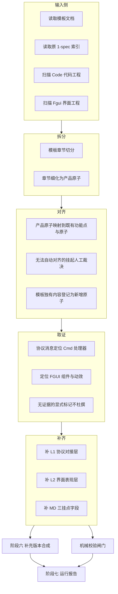

# outputspec 生成工作流需求分析

> 需求来源：`dev-docs/design/outputspec生成工作流计划.md`（原始计划，粗稿）
> 分析日期：2026-11-13
> 结论先行：该需求本质是"以模板文档为产品口径、以客户端代码为证据，把服务端反推的 1-spec 补齐成含客户端逻辑与 UI 交互的完整规格"，产出两份互相配套的产物。计划本身有 5 处歧义需确认口径（见第 4 节），确认前不应直接开工写 workflow。

## 1. 一句话目标

制作一个 workflow JS（格式对齐 `.opencode-workflows/workflows/` 既有 workflow），把 `source-code/client/42320/2026-11-13-v3/1-spec`（纯服务端反推规格）中的**客户端逻辑需求**和 **UI 交互需求**补齐，最终产出：

| 产物 | 路径 | 形态 |
| --- | --- | --- |
| 产物一：补齐后的 1-spec | `spec-workflow/output-spec/2026-11-13/1-spec/` | 结构对齐原版（feature_index.json + stages/），原子项补齐客户端交互与 UI 表现 |
| 产物二：补充版本需求文档 | `spec-workflow/output-spec/核心流程杭州麻将好友房AI-补充版本.md` | 模板文档的完整复制 + 客户端证据补充 |

类比理解：原 1-spec 像一份"只有后厨流程的菜谱"（服务端每一步怎么做），模板像"客人点的菜单"（好友房口径下这局棋该怎么下、界面该怎么显示），客户端代码是"前厅实际怎么端菜"的证据。这个 workflow 要做的是把三者对齐，写出一份"前后厨 + 餐桌呈现"的完整菜谱。

## 2. 输入资产盘点

### 2.1 原 1-spec（补齐对象，只读）

`source-code/client/42320/2026-11-13-v3/1-spec/`，结构分析见 `dev-docs/research/2026-11-13-v3-1spec-结构分析.md`：

- 数据层级：14 阶段 / 73 功能点（FP）/ 375 原子项（AT）/ 2693 代码符号单元（SRC）。
- 关键现状：原子项 `client_interaction` 仅 ST-002 的 22 条已填（最小口径：只写"对应哪条下发消息/字段"，如 `MsgJuData.zhuang`），其余 353 条为空。
- MD 侧挂点：每个原子项的 `客户端交互` / `客户端职责` / `协作边界` 三个列表字段；`客户端职责` 普遍写"本次仅还原服务端"——正是本次要打破的口径。
- 校验口径注意：`spec_check_report.md` 的「端侧职责」维度按"仅还原服务端"放行，补齐后该报告口径需同步修订（结构分析 5.4 第 4 点）。

### 2.2 模板文档（产品口径基准）

`templates/【杭州麻将】核心流程杭州麻将好友房AI-核心简化版本.md`：

- 口径：**好友房 AI**（四人好友房、固定 8 局、底分 1、白板财神、笃三老庄、庄闲放铳、三摊承包、吃碰禁手、无托管）。
- 结构：名词 / 开局（定庄与轮庄、财神与牌组、发牌）/ 行牌（操作优先级、吃碰杠、杠后补牌、自摸放铳抢杠胡、飘财、杠开杠飘飘杠、吃碰禁手、出牌与响应）/ 三摊承包 / 算分 / 番型 / 结算。
- 内容特点：规则与 UI 交互**混排**——既有"碰成立后碰牌组三张都正面展示"这类 L2 UI 表现，也有"上家逆时针"这类纯规则；且是好友房口径，与 1-spec 的线上服务端口径（含 ST-010 金币场加倍等好友房没有的阶段）存在变体差异。

### 2.3 客户端代码工程（证据源一：逻辑层）

`source-code/client/Code/`（Cocos Creator + FairyGUI，TypeScript）：

| 目录 | 内容 | 对补齐的作用 |
| --- | --- | --- |
| `protocol/GameGlcProtocol.ts` | 协议定义、GAME_STATUS 游戏状态机（与 1-spec 各阶段 Step 一一对应） | 阶段 → 状态映射的锚点 |
| `controller/cmd/gameCmd/` | 约 40 个消息处理器（GameJuDataCmd、GamePlayCmd、GamePungCmd、GameResultHuCmd、RelinkOnStartCmd 等，每条 Msg 一个 Cmd） | L1 协议对接层的直接证据：消息字段怎么消费 |
| `controller/cmd/` | CmdDefine、sceneCmd、RecoverGameSceneCmd（重连恢复） | ST-012 重连阶段证据 |
| `fgui_uideclare/` | 11 个 FGUI 包的 TS 声明（box_hzmj_main / player / result / tingPai / tipAni / specf 等） | L2 UI 表现的组件级证据 |
| `data/` | GameData.ts、PlayerCardsData.ts | 客户端状态缓存逻辑 |
| `config/` `layer/` `interface/` | 配置、层级、接口 | 辅助证据 |

### 2.4 FGUI 界面工程（证据源二：界面层）

`source-code/client/Fgui/`（FairyGUI 编辑器工程）：

- `assets/`：11 个 UI 包源文件（每个包含 BoxHzmjMainView.xml、component/、effect/ 等）。
- `TS_SCRIPT/`：生成的 TS 工程（src/ 等）。
- 作用：UI 组件、动效、字效（飘字、番型字效）、结算面板结构的界面侧证据，与 Code/fgui_uideclare 互相印证。

### 2.5 既有 workflow 基建（实现载体）

- 格式：`.opencode-workflows/workflows/*.js`，`export const meta` + `phase()` + `agent()` + `parallel()`，args 显式传 `date`（脚本内禁止取当前时间），模型与超时显式配置（参考 `ui-interaction-prd-extract.js` 的 analysisModel / 1h 超时经验）。
- 佐证脚本惯例：`.opencode-workflows/scripts/*.mjs`（确定性校验下沉 node 脚本，如 check-shared-snapshot.mjs）。
- 运行约束：不自行 `opencode run` 触发测试，需测试时告知用户（既有约定）。

## 3. 需求解读：数据流与两个产物的关系

原始计划的三步描述，解读为一条数据流：

1. **拆分**：读取模板 → 把模板章节拆成原子需求（产品口径的原子，粒度对齐 1-spec 的 AT）。
2. **取证**：对每个原子，去 Code（协议/Cmd/数据/UI 声明）与 Fgui（界面工程）检索相关逻辑，作为补充内容的证据。
3. **产出**：
   - 产物一：写入 `spec-workflow/output-spec/2026-11-13/1-spec/`，结构沿用原版（feature_index.json + stages/*.md + manifest），原子项补齐客户端侧字段；
   - 产物二：以模板为底稿复制一份，把补充内容（客户端证据、交互细节）合并进去，成为完整的《核心流程杭州麻将好友房AI-补充版本.md》。

两产物的分工：产物一是**机器可消费的结构化规格**（后续可对接 Checker / 共享需求快照体系），产物二是**人可读的完整需求文档**（模板行文风格的增强版）。同一批原子、同一批证据，两种呈现。

## 4. 核心歧义与建议口径（开工前必须确认）

### Q1 产物一的原子集合：以谁为准？

- 计划原句既有"把原始 1-spec 中的客户端逻辑需求和 ui 交互需求补齐"（暗示以原 375 原子为基线补字段），又有"读取模板拆分成原子需求……最后产出 1-spec"（暗示以模板新拆原子为主体）。
- **建议口径 A（推荐）**：以原 375 原子为基线骨架（REQ/AT 身份稳定，符合"需求身份唯一"既有原则），模板拆出的产品原子**对齐映射**到既有原子；模板有而 1-spec 无的内容（好友房特有规则、纯 UI 表现原子）按既有编号规则在对应阶段内续号**新增原子**。不推翻既有 ID 体系。
- 口径 B（模板全量新拆）会废弃既有 375 ID，与下游消费体系脱钩，不推荐。

### Q2 变体差异：好友房口径 vs 线上服务端口径怎么处理？

- 模板是好友房（无 ST-010 金币场加倍、无托管、固定 8 局）；1-spec 是线上服务端反推（含金币场加倍、干预做牌、衍生玩法差异等）。
- **建议**：产物一保留 14 阶段全结构；模板口径覆盖不到的阶段/原子（如 ST-010 金币场加倍）不删，`client_interaction` 显式写"好友房口径无此交互"，避免静默缺格。产物二天然只写模板（好友房）口径，不扩写。

### Q3 L1 与 L2 的落点：client_interaction 一个字段装两层吗？

- 结构分析已区分两个层次：L1 协议对接层（消息/字段/时机，ST-002 已验证的最小口径）、L2 UI 交互层（按钮、弹窗、压暗、动画、结算面板）。
- **建议**：JSON 侧沿用 `client_interaction` 装 L1（格式与 ST-002 一致），**新增字段** `ui_interaction` 装 L2（描述 + 证据引用：FGUI 包名/组件/Code 文件）；MD 侧 `客户端交互` 列表允许多条 bullet 分别承载。只增字段不改既有字段语义，保证 schema 兼容。

### Q4 补充版本.md 的命名与位置

- 计划原文路径为 `spec-workflow/output-spec/核心流程杭州麻将好友房AI-补充版本.md`（不带【杭州麻将】前缀、不在日期目录下），与模板命名风格及产物一的日期目录不一致。
- **建议**：统一放 `spec-workflow/output-spec/2026-11-13/`，命名 `【杭州麻将】核心流程杭州麻将好友房AI-补充版本.md`（沿用模板前缀风格）；如需保持计划原文路径也可以，但要二选一定死。

### Q5 workflow 命名与注册

- **建议**：id/name `output_spec_generate`，文件 `.opencode-workflows/workflows/output-spec-generate.js`，与既有命名风格（kebab-case 文件名 + snake_case name）一致。

## 5. workflow 流程设计（阶段划分）



各阶段要点：

| 阶段 | 输入 | 输出 | 说明 |
| --- | --- | --- | --- |
| 1 扫描与盘点 | 模板、1-spec、Code、Fgui | 四份索引（模板章节表 / ST-FP-AT 索引 / 消息→Cmd→UI 链表 / FGUI 包清单） | 确定性脚本可做（不依赖模型）；消息→Cmd 映射可由 CmdDefine 注册表直接推导 |
| 2 模板拆分 | 模板章节表 | 产品原子清单（章节 → 原子，含原文摘录） | 模型任务，按既有 quote 摘录口径 |
| 3 对齐映射 | 产品原子 × 既有 AT | 映射表 + pending-confirm 挂起清单 + 新增原子清单 | exact/anchor 匹配 + 人工裁决挂起，不为达标率强行合并（沿用 v4 执行重点 1） |
| 4 代码取证 | 每原子（含消息面） | 证据记录：Cmd 文件+行、FGUI 包/组件、GameData 字段 | 模型并行任务（按阶段分组，沿用 concurrency 上限经验）；无证据显式 unknown |
| 5 原子补齐生成 | 原子 + 证据 + 模板原文 | 产物一：feature_index.json + stages/*.md | client_interaction(L1) / ui_interaction(L2) / MD 三挂点；确定性编号 |
| 6 补充版本合成 | 模板 + 补充内容 | 产物二：补充版本.md | 模板原文 100% 保留，补充内容以可辨识形式（引用块或标注）插入对应章节 |
| 7 机械校验与报告 | 两产物 | 运行报告：补齐率 / 证据率 / 对齐统计 / 无证据清单 | 确定性 node 脚本闸门（对齐既有 mechanical.md 风格）；原版 spec_check 口径差异记录 |

## 6. 数据契约

### 6.1 产物一：output-spec/2026-11-13/1-spec/

结构与原版一致（feature_index.json、stages/spec_stage_ST-*.md、stage_manifest、运行时报告放 runtime/），schema 只增不改：

```jsonc
// feature_index.json 原子项字段（增量）
{
  "id": "AT-ST-006-012",
  "name": "出牌压暗规则",
  "rule": "……（原样保留服务端规则）",
  "owner": "server",
  "source_unit_id": "SRC-…",
  "source_file": "……",
  "source_location": "……",
  "client_interaction": "MsgPlayC(1406) 提交出牌；（L1，沿用 ST-002 格式）",
  "ui_interaction": "……（L2 新增：界面表现描述 + 证据引用）",
  "ui_evidence": ["Code/fgui_uideclare/box_hzmj_main/FGUI_box_hzmj_main_BoxHzmjMainView.d.ts", "Fgui/assets/box_hzmj_main/BoxHzmjMainView.xml"]
}
```

新增原子额外带模板溯源（`template_section` / `template_quote`），与既有 SRC 溯源并存。

### 6.2 产物二：补充版本.md

- 底稿 = 模板全文复制，章节、行文顺序不变。
- 补充内容插在对应章节/条目之后，统一格式（如 `> 补充：……（证据：Code/... ）`），保证 diff 可辨识、可回溯到产物一的原子 ID。

## 7. 关键设计原则

1. **原版只读**：`source-code/client/42320/2026-11-13-v3/1-spec/` 是历史快照，绝不原地修改；产物全部写 `spec-workflow/output-spec/`（沿用 v4 原则 2）。
2. **证据链完整**：每条 L1/L2 补充要么带客户端代码证据（文件+符号），要么显式写"无/不适用/无证据"；禁止凭服务端代码或想象杜撰 UI 表现（结构分析 5.3 明确红线）。
3. **需求身份唯一**：既有 375 AT ID 不重建；新增原子按阶段内续号，不与既有 ID 冲突（沿用 v4 原则 3）。
4. **确定性优先**：日期、编号、文件名、统计全部由 args 与数据推导，脚本内禁止取当前时间（既有 workflow 硬性约定）；消息→Cmd→UI 的第一层映射用确定性脚本（CmdDefine 注册表）而非模型。
5. **规模与模型**：375 原子 × 取证+补齐两个模型任务，按阶段分组并行（参考既有 concurrency 16 / analysisModel flash / 1h 超时的提速经验）；对齐阶段挂起项单独成清单不阻塞主流程。

## 8. 风险与对策

| 风险 | 对策 |
| --- | --- |
| 模板与 1-spec 口径冲突（好友房 vs 线上/金币场） | Q2 口径：不删不骗，显式标注"好友房无此交互/不适用" |
| 模板描述的 UI 在客户端代码找不到（版本差异） | 显式 unknown + 汇入运行报告，不杜撰 |
| 对齐强行合并导致需求错位 | pending-confirm 挂起人工裁决（v4 执行重点 1 的教训） |
| 原 spec_check_report 口径与补齐后数据不一致 | 产物 runtime 里重生成校验报告，并注明与原报告口径差异 |
| 补充版本.md 原文被改写 | 机械校验：模板原文逐行保留率 100% |

## 9. 验收标准

1. 产物一结构对齐原版：feature_index.json 可解析、stages/ 14 文件齐全、既有字段语义不变、新增字段只在原子项层。
2. 补齐率：375 既有原子 client_interaction 非空率 100%（"无交互/不适用"算显式填写）；L2 视证据覆盖率出统计，不设硬指标但必须进运行报告。
3. 证据率：所有非"无"的 L1/L2 描述均带客户端代码引用。
4. 产物二：模板原文 100% 保留，补充内容可辨识、可回溯原子 ID。
5. 可复跑：同 args 重跑产物逐字节一致（除运行报告时间戳字段）。

## 10. 开放问题清单（汇总）

| 编号 | 问题 | 建议 |
| --- | --- | --- |
| Q1 | 原子集合口径 | 以原 375 为基线 + 模板新增原子（口径 A） |
| Q2 | 好友房不适用阶段 | 保留结构，显式标"不适用" |
| Q3 | L2 落点字段名 | 新增 ui_interaction + ui_evidence |
| Q4 | 补充版本命名与位置 | 统一入 2026-11-13/ 目录，带【杭州麻将】前缀 |
| Q5 | workflow 命名 | output-spec-generate.js / output_spec_generate |

## 11. 引用说明

- 原始需求：`dev-docs/design/outputspec生成工作流计划.md`
- 1-spec 结构分析（本分析的主要依据）：`dev-docs/research/2026-11-13-v3-1spec-结构分析.md`
- 模板文档：`templates/【杭州麻将】核心流程杭州麻将好友房AI-核心简化版本.md`
- 补齐对象：`source-code/client/42320/2026-11-13-v3/1-spec/`（feature_index.json、stages/、spec_check_report.md）
- 客户端代码工程：`source-code/client/Code/`（protocol/GameGlcProtocol.ts、controller/cmd/gameCmd/、fgui_uideclare/）
- FGUI 界面工程：`source-code/client/Fgui/`（assets/、TS_SCRIPT/）
- 既有 workflow 参考：`.opencode-workflows/workflows/ui-interaction-prd-extract.js`（模型/超时/并发经验）、`prd-requirements-extract.js`
- UI 交互维度口径：`dev-docs/research/ui-interaction-prd-extract-流程分析.md`
