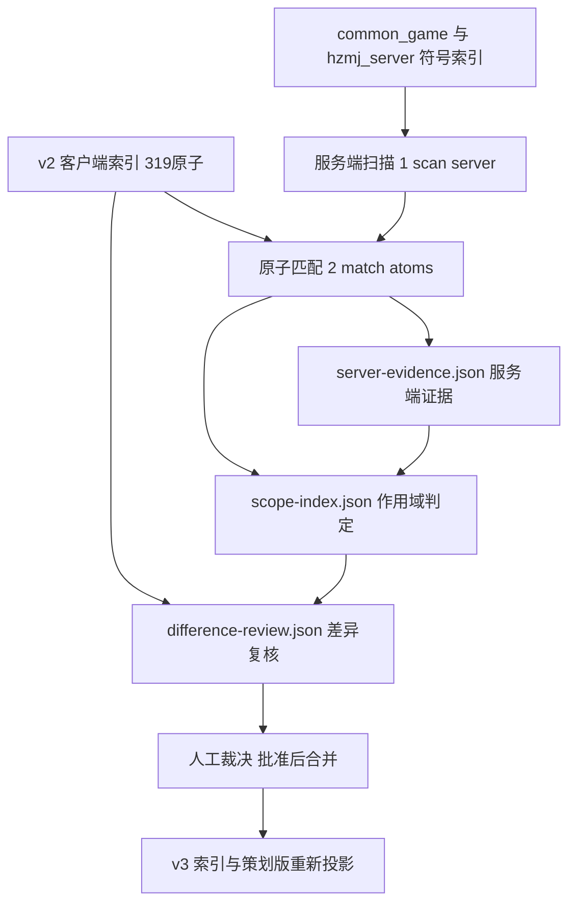

# OSG-W4 T0.3：L7 分类与玩法配置作用域设计说明

- **日期**：2026-11-14
- **需求来源**：`dev-docs/requirements/2026-11-14-OSG-W4-服务端规则补证与需求差异质量修复.md` 第 2 节
- **事实输入**：`dev-docs/research/2026-11-14-OSG-W4-T0服务端结构与职责调查报告.md`
- **设计原则**：三份 Sidecar 独立于现有索引落盘；只增不改（原 difference/verdict/客户端证据一律保留）；复核批准后才合并进新索引版本。

## 1. 总体数据流



## 2. Sidecar 一：server-evidence.json（服务端证据）

**职责**：记录「服务端哪里实现了什么」，只存事实，不做判定。

```json
{
  "schemaVersion": 1,
  "sourceRepos": {
    "common_game": "E:/WorkProjects/xc-flow/.xflow/xc/xcodeDev/game-mahjong/server/Logic/mahjong_server/src/game_hzmj/common_game",
    "hzmj_server": "E:/WorkProjects/xc-flow/.xflow/xc/xcodeDev/game-mahjong/server/Logic/mahjong_server/src/game_hzmj/hzmj_server",
    "pathNote": "需求原文 src/common/game_hzmj/common_game 层级勘误，见需求文档第 6 节登记"
  },
  "entries": [
    {
      "id": "SVE-ST-C01-001",
      "atomId": "AT-ST-C01-001",
      "layer": "common_game",
      "file": "common_game/com_game/common_game_com_ju.cpp",
      "location": "common_game/com_game/common_game_com_ju.cpp:127",
      "symbol": "BoxZhuangStep::JudgeDingZhuang",
      "excerpt": "if (GetSvrCfg()->GetFirstBankerType() == 1) { zhuang_seat = GetHostChairId(); } else { zhuang_seat = rand() % GetPlayerCount(); }",
      "excerptTruncated": true,
      "configKeys": ["first_banker_type"],
      "collectedBy": "2-match-atoms",
      "collectedAt": "<运行日期，由调度方传入>"
    }
  ]
}
```

字段约束：

- `layer`：`common_game` / `hzmj_server` / `mah_frame`（框架）/ `config`（纯配置，无代码体）。
- `evidence` 与 excerpt 截断规则沿用 v2 客户端证据惯例（摘录 ≤ 120 字）。
- 一条原子可有多条 entries；**没有服务端实现 = 没有 entries，不伪造**。

## 3. Sidecar 二：scope-index.json（玩法配置作用域）

**职责**：回答「这条服务端证据在杭州麻将好友房是否生效」。这是本轮最关键的新增判定层。

```json
{
  "schemaVersion": 1,
  "scopeTarget": { "game": "hzmj", "roomType": "friend", "gameId": "42320" },
  "entries": [
    {
      "atomId": "AT-ST-C01-001",
      "applicability": "conditional",
      "configVerified": true,
      "callPathVerified": true,
      "configCondition": "first_banker_type=0（好友房默认）时随机定庄生效；=1 时房主坐庄",
      "configDefault": "0（LoadBoxJsonConfig 注释默认值）",
      "callPath": "common_game_init.cpp L148 注册 BoxZhuangStep → JudgeZhuang → JudgeDingZhuang",
      "evidenceIds": ["SVE-ST-C01-001"],
      "unresolved": "好友房创房面板实际下发值需客户端配置或配置平台核对"
    }
  ]
}
```

### 3.1 applicability 判定规则

| 值 | 判定条件 | 两个 verified 开关的要求 |
|---|---|---|
| `active` | 规则无条件生效，或配置条件已确认被好友房满足，**且完整执行路径已证** | configVerified 与 callPathVerified 均 true，无未消化的 unresolved |
| `conditional` | 代码生效但取决于配置值（如 `first_banker_type`/`cai_shen_type`/`banker_level_type`），且实际下发值未确认 | configVerified=true（知道配置项与默认值）+ callPathVerified=true |
| `inactive` | 已验证当前玩法配置下不生效（如仅其他玩法变体调用） | 两者均 true 且证据明确排除 |
| `unknown` | 只有函数/符号级线索，规则选择条件或调用链未核实；**包括关键链路存在未证缺口的情况** | 任一开关 false |

**禁止事项（对应复核规则 3）**：`common_game 里存在实现` 只能得 `conditional` 或 `unknown`，**不得**直接得 `active`；同理不得因「支持翻财神的通用代码存在」而判 `conflict`。

**注册顺序不等于执行顺序**（二审补充）：注册/创建顺序只能作为线索，`active` 判定必须有调度代码（Step 链 push/执行入口）的顺序证据；未证前一律 `unknown`（AT-ST-C01-002 即因此由 active 降级）。

**缺失作用域处理（二审固定）**：未经调查、没有 scope 条目的原子一律按 `unknown`（未查证）处理，**禁止把缺失当成 inactive**；S1.1 分类脚本必须具备缺失作用域能力。

### 3.2 configVerified / callPathVerified 的核验口径

- `configVerified=true`：找到配置项定义、写入路径（LoadBoxJsonConfig 的 json_key）与默认值三者。
- `callPathVerified=true`：从 Step 链注册（common_game_init.cpp）或消息处理入口到目标函数的调用链每一段有 file:line 证据。
- 好友房实际下发值不属于服务端代码可证范围，进 `unresolved`，由 S2 向客户端创房配置核对——**代码查证完成不等于配置查证完成**。

### 3.3 作用域绑定粒度：证据优先，Atom 汇总（二审固定）

作用域**优先绑定具体证据条目**，不总是属于整个 Atom：

- `server-evidence.json` 每条证据可携带自己的 scope（`evidenceScopes[]`，ref 指向 SVE id 或 `client-visual` 客户端视觉证据标记）。
- Atom 级 `applicability` 是**汇总视图**，用于统计与筛选，不用于冲突判定。
- **冲突判定采用证据级 scope**：`conflict + inactive → not_applicable` 仅适用于「产生冲突的那条证据本身已确认 inactive」；其他无关服务端证据的 inactive/conditional **不得消除已成立的客户端视觉冲突**（如 AT-ST-C02-008：客户端牌河高亮证据 scope 恒 active，服务端候选排除受配置影响，两者互不覆盖）。
- 实现约束：所有 `conflict` 类复核条目必须提供 `evidenceScopes`，缺失时校验 fail（进 S1.3 校验清单）。

## 4. Sidecar 三：difference-review.json（差异二次复核）

**职责**：对 v2 的 difference 做二次判定，保留历史，批准后合并。

```json
{
  "atomId": "AT-ST-C01-006",
  "previousDifference": "unverified",
  "reviewedDifference": "unverified",
  "reviewReason": "规则R2：缺少服务端证据不等于冲突；服务端实现为配置依赖（banker_level_type 默认平庄起），好友房实际配置未确认，不足以改判",
  "reviewRule": "no-server-evidence-is-not-conflict",
  "scopeApplicability": "conditional",
  "evidenceIds": ["SVE-ST-C01-002"],
  "reviewStatus": "pending"
}
```

### 4.1 L7 业务分类与审批状态（双维度，二审固定）

**`l7` 与 `reviewStatus` 是两个独立维度，禁止混淆**：`l7` 是业务分类四值；`reviewStatus` 是审批状态（pending/approved/rejected）。二者组合语义：`l7=verification_required` 不等于「尚未审批」，`reviewStatus=approved` 不等于「业务规则已验证」。

另新增 `effectiveDifference`：**当前实际生效的结论**（approved 时等于 reviewedDifference，pending/rejected 时等于 previousDifference）。未批准的 reviewedDifference 仅为 proposed 建议，不得写入正式生效索引。

l7 判定与策划版表达：

| l7 | 判定 | 策划版表达 |
|---|---|---|
| `verified` | effectiveDifference=consistent 且 scope=active | 不生成待确认 |
| `verification_required` | 证据不足或 scope=conditional/unknown 且无矛盾 | 「规则待验证：{缺什么证据或依赖什么配置}」 |
| `decision_required` | effectiveDifference=conflict | 「待策划裁决：需求为「…」，实际表现「…」」 |
| `not_applicable` | 证据级 scope=inactive（仅冲突证据自身确认不适用，见 3.3） | 不纳入当前玩法冲突清单 |

建议判定矩阵（reviewedDifference × 证据级 scopeApplicability → l7，产出均为 proposed）：

| | active | conditional | unknown | inactive |
|---|---|---|---|---|
| consistent | verified | verification_required | verification_required | not_applicable |
| partial | verification_required | verification_required | verification_required | not_applicable |
| conflict | decision_required | decision_required | decision_required | not_applicable |
| unverified | verification_required | verification_required | verification_required | not_applicable |

要点：**conflict 不因 scope 未知而降级**（规则 4：客户端视觉冲突独立成立，且冲突判定采用证据级 scope，见 3.3）；**consistent 在 conditional 下也不算 verified**（如 AT-ST-C02-004 白板财神是默认值而非唯一值）；**缺 scope 一律 unknown**（不缺省 inactive）。

### 4.2 复核五规则与 reviewRule 枚举

| 枚举 | 对应规则 |
|---|---|
| `evidence-is-not-consistency` | 找到直接实现证据，不等于规则一致 |
| `no-server-evidence-is-not-conflict` | 缺少服务端证据，不等于规则冲突 |
| `common-capability-is-not-enabled` | 通用能力存在，不等于当前玩法启用 |
| `ui-conflict-stands-alone` | 客户端视觉冲突独立成立，即使服务端规则正确 |
| `history-preserved` | 任何状态变更保留原值/新值/理由/证据，不覆盖历史 |

### 4.3 复核优先级与合并流程

1. 全部 `conflict`（2 条：AT-ST-C02-008、AT-ST-C15-018）→ 产出「需求差异裁决清单」交策划。
2. 全部 `partial`（64 条）→ 结合 scope 重判。
3. `unverified`（188 条）按业务风险分批（优先服务端证据已就位的原子）。
4. 人工裁决 `reviewStatus: pending → approved/rejected`；**只有 approved 条目的 reviewedDifference 成为 effectiveDifference**，由 `assemble-output-spec-index.mjs`（扩展）合并进 **v3 新目录**，v2 产物只读不动；pending/rejected 条目的 reviewedDifference 仅是 proposed 建议，正式索引不可见。
5. 预测统计（如样本的 afterReviewProjection）必须由 `previousDifference → reviewedDifference` 确定性迁移计算，**禁止手工填写**（二审意见 1）。

### 4.4 classify-l7.mjs 输入契约（二审意见 3，S1.1 实现）

输入四件套（缺一不可）：

1. `feature_index.json`（客户端基线，提供 previousDifference）
2. `scope-index.json`（证据级与 Atom 级作用域；缺失条目按 unknown/未查证处理）
3. `server-evidence.json`（证据 id 与分层）
4. `difference-review.json`（复核建议）——**二审补充的必要输入**，矩阵输入是 reviewedDifference×scopeApplicability，不能只靠基线 difference

输出：`l7` + `reviewStatus` + `effectiveDifference` 三字段；未批准条目的 l7 标记为 proposed 性质（l7Basis 字段），不入正式索引。

## 5. 对现有文件的改动约定（S1/S3 实现时生效）

| 文件 | 改动 | 不做什么 |
|---|---|---|
| `3-produce-outputs.js` | `plannerPartPrompt` 增加分支：存在 difference-review 时按 L7 分类生成「规则待验证 / 待策划裁决」行，口径与 4.1 表一致；无复核数据时保持现行为 | 不再让 LLM 从 notes 猜差异含义 |
| `assemble-output-spec-index.mjs` | 新增可选输入 server-evidence/scope-index/difference-review，合并进 v3 索引顶层（`server_evidence_count`/`scope_stats`/`l7_stats`） | 不改动 v2 原有字段语义 |
| `verify-output-spec.mjs` | 新增复核自洽校验：review 的 atomId 必须存在于 trace_index；evidenceIds 必须存在于 server-evidence；l7 四值与矩阵自洽；**审批状态独立校验（pending 条目不得进正式索引）**；conflict 条目必须带证据级 scope；**缺失 scope 不得被判为 not_applicable** | — |
| `2-verify-stages.js` | 本轮不修改 | — |

## 6. 引用

- 需求与 Sidecar 原始设计：OSG-W4 需求文档第 2 节
- 实现事实：T0.1 调查报告（同日）
- v2 基线：`spec-workflow/output-spec/2026-11-14/1-spec/`（trace_index.json 的 atomId 是三份 Sidecar 的对齐主键）
