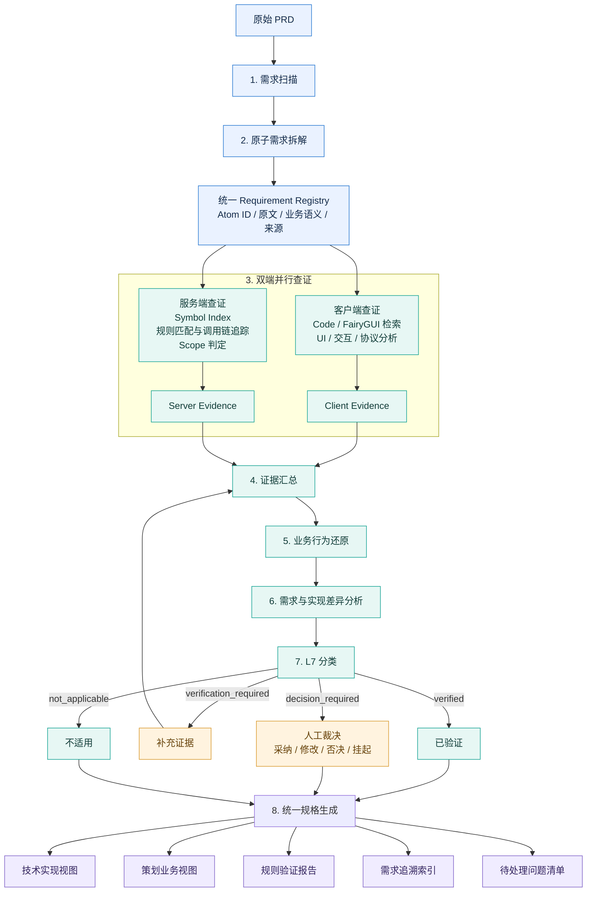

# 统一 Workflow「game-requirement-audit」需求方案

- 日期：2026-11-17
- 类型：架构设计方案（用户需求存档）
- 状态：已确认方向，待定数据契约后进入迁移计划
- 涉及现有资产：`.opencode-workflows/workflows/output-spec-generate/`、`.opencode-workflows/workflows/server-rule-verify/`

## 0. 结论（用户已确认）

**赞成合并成一个统一的 `game-requirement-audit` Workflow，但客户端查证和服务端查证保留为两个独立子流程，并行执行。**

关键区别：

- 不把两个 Workflow 的代码全部揉成一个大文件。
- 合并的是**业务流程、调度入口、数据契约和最终交付**。
- 客户端与服务端仍然分别使用自己的检索策略、证据结构和验证规则。

目标：统一管理，同时不牺牲两端查证的专业性。

## 1. 为什么应该改成并行查证

### 1.1 现有流程（串行）

```
原始 PRD
   ↓
原子需求拆解
   ↓
客户端查证
   ↓
生成技术规格和策划规格
   ↓
服务端查证
   ↓
差异复核
   ↓
L7 分类
```

问题：客户端和服务端其实是在回答**同一个原子需求的不同方面**。

示例——需求「玩家打出财神牌后，牌河中的财神应该如何显示？」：

| 端 | 查证内容 |
|---|---|
| 客户端 | 牌河显示逻辑、财神标记处理、UI 刷新逻辑 |
| 服务端 | 财神牌的判定、牌型数据下发、出牌事件处理、服务端是否改变牌的业务属性 |

两个查证没有必要前后等待。更重要的是：**两个端的证据合起来，才能完整还原业务行为。**

### 1.2 目标流程（并行 + 统一分析）

```
原始 PRD
   ↓
原子需求拆解（统一 Atom ID、业务语义、来源追溯）
   ↓
┌─────────────────────┬─────────────────────┐
│ 并行任务 A：客户端查证 │ 并行任务 B：服务端查证 │
│ - Code              │ - Symbol Index      │
│ - FairyGUI          │ - 规则判定           │
│ - 协议消费           │ - 配置解析           │
│ - UI 交互           │ - 调用链            │
│ - 客户端证据         │ - 服务端证据         │
└─────────────────────┴─────────────────────┘
   ↓
统一证据汇总（客户端证据 + 服务端证据 + 需求原文）
   ↓
统一差异分析与 L7 分类
   ↓
技术视图 + 策划视图 + 人工裁决
```

客户端和服务端查证并行，最终**统一判断**，而不是先让客户端形成一个结论、再让服务端补充。

## 2. 统一 Workflow 设计

统一入口：**game-requirement-audit（游戏需求审计与规格生成）**，五个阶段：

| 阶段 | 模块 | 说明 |
|---|---|---|
| 阶段一：需求解析 | scan-template / atomize-requirements / identity-map / requirement-registry | 产生唯一事实源 |
| 阶段二：双端并行查证 | client-verify / server-verify | 两套独立证据体系 |
| 阶段三：统一分析 | merge-evidence / business-behavior-analysis / difference-review / l7-classify | 汇总后统一判断 |
| 阶段四：规格生成 | technical-spec / planner-spec / trace-index / verification-report | 双端齐备后生成 |
| 阶段五：人工裁决 | pending review / 补证 / 采纳·修改·否决·挂起 | |

### 2.1 重要调整：原子拆解和客户端查证要彻底分离

现有架构需要改造的点：现在 `output-spec-generate` 的 `2-verify-stages.js` 同时做了：

1. 原子需求拆解；
2. 客户端代码查证；
3. 业务语义提取；
4. 差异初步判定。

应拆成三个独立职责：

| 模块 | 职责 |
|---|---|
| atomize-requirements | 只负责需求拆解，产生统一 Atom |
| client-verify | 只负责客户端查证 |
| server-verify | 只负责服务端查证 |

这样两个查证模块接收到**完全相同的原子需求**，不会各自重新理解 PRD。

## 3. 统一后的完整流程图



## 4. 需要特别注意的三个技术问题

### 4.1 两端查证结果不能直接互相覆盖

建立统一的 Atom 结构（示意）：

```json
{
  "atomId": "AT-ST-C01-001",
  "requirement": "原始需求",
  "clientVerification": {
    "verdict": "confirmed",
    "evidenceIds": []
  },
  "serverVerification": {
    "applicability": "conditional",
    "evidenceIds": [],
    "configCondition": ""
  },
  "difference": "unverified",
  "l7": "verification_required"
}
```

注意（结构仅为示意）：客户端的 `verdict` 和服务端的 `applicability` 是**不同维度**，不能合并成一个字段。

### 4.2 两端都完成后再进行统一业务判断（同步屏障）

不能出现：客户端查到实现就先判定需求一致，随后服务端发现规则没有启用，却没有重新修正之前的结论。

```
客户端查证完成 ──┐
                 ├── 两端结果齐备 → 统一分析
服务端查证完成 ──┘
```

某一端超时或失败时，允许标记 `pending`，**不能把没有结果当成 `not_found`，更不能默认通过**。

### 4.3 文档生成放到双端查证之后

现有技术规格和策划规格主要依赖客户端查证结果。统一架构后：

- **技术文档**同时展示：客户端职责、服务端职责、双端协作关系、配置生效条件、证据定位、实际实现差异。
- **策划文档**只消费业务行为和 L7 分类，不暴露技术细节。

这样可以避免先生成一版文档、再因为服务端补证而重复生成。

## 5. 现有代码迁移方案

**不重新开发，最大限度复用现有代码。**

| 现有模块 | 实际文件 | 调整方案 |
|---|---|---|
| output-spec 的 scan-template | `output-spec-generate/1-scan-template.js` | 保留 |
| output-spec 的 verify-stages | `output-spec-generate/2-verify-stages.js` | 拆成 atomize + client-verify |
| output-spec 的 produce-outputs | `output-spec-generate/3-produce-outputs.js` | 移到统一分析之后 |
| output-spec 的 assemble-verify | `output-spec-generate/4-assemble-verify.js` | 保留并扩展 |
| server-rule 的 scan-server | `server-rule-verify/1-scan-server.js` | 保留 |
| server-rule 的 match-atoms | `server-rule-verify/2-match-atoms.js` | 保留 |
| server-rule 的 verify-scope | `server-rule-verify/3-verify-scope.js` | 保留 |
| server-rule 的 review-difference | `server-rule-verify/4-review-difference.js` | 调整为统一双端差异分析 |
| classify-l7 | （统一分类模块） | 保留，作为统一分类模块 |
| merge-verify-output | （双端证据汇总与校验） | 扩展为双端证据汇总与校验 |

数据结构方面：原来的 `scope-index`、`server-evidence`、`difference-review` 等**不需要全部推翻**，重点是增加客户端对应的证据数据，并建立统一关联。

## 6. 最终建议

**推荐方案：一个主 Workflow + 五个阶段 + 两条并行查证分支。**

### 三个架构原则

1. **一个需求事实源**：Atom ID 只能由原子需求拆解阶段产生。
2. **两套独立证据体系**：客户端和服务端分别查证，不互相代替。
3. **一个统一业务结论**：双端证据汇总后再判断差异和 L7。

### 下一步

**不直接改代码，先确定统一后的数据契约**，尤其是以下四个结构：

1. Requirement Registry
2. Client Evidence
3. Server Evidence
4. Unified Difference

这四个结构确定之后，再整理 Skill 和 Workflow 的迁移执行计划，避免两个旧系统合并后出现数据口径不一致的问题。
