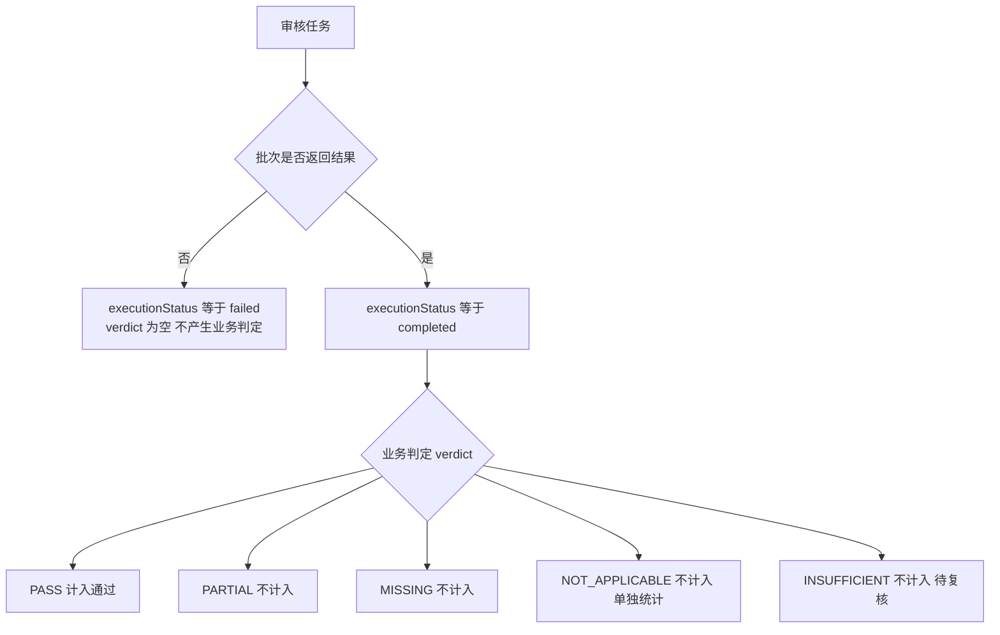

# v4 共享快照消费契约

- 日期：2026-11-12
- 状态：已确认（依据 `dev-docs/requirements/2026-11-12-v4架构收敛需求-共享需求接入与Bug判定修复.md` 与 `dev-docs/planning/2026-11-12-v4架构收敛执行计划.md` 阶段 0 产出）
- 适用范围：game-prd-check / ui-interaction-prd-extract / bug-coverage-check 三个 Checker 及共享 RTM Core（阶段 6）

## 一、三条设计原则（执行期间必须守住）

1. **旧路径兼容**：不传 `requirementsPath + extractionRunId` 时，三个 Checker 保持原有行为，旧报告可复现。
2. **历史快照只读**：`examples/game-prd-check-workflow/rtm/runs/run-20261112/` 为 Game RTM 基线，只读；所有改造产物写入新目录。
3. **需求身份唯一**：三个 Checker 只能消费共享 REQ-ID（identity-map 单写者分配），不能自行重新生成需求 ID。

## 二、两个执行重点

1. **阶段 2 对齐率不是合并许可**：exact + anchor 匹配率 ≥ 90% 是进入阶段 3 的门槛，不代表全部需求可自动对齐；剩余部分必须进 pending-confirm 人工裁决，**不得为达标率强行合并**。
2. **阶段 6 以关系记录为中心**：RTM Core 不是把 Game / UI / Bug 三套报告拼接成一个大 JSON；核心实体是关系记录（dimension + requirementId + targetId + verdict + executionStatus + evidence + issueIds），四种字段语义各自独立，不得互相折叠。

## 三、Checker 消费参数契约

| 参数 | 含义 | 校验规则 |
|------|------|----------|
| `requirementsPath` | 共享提取快照目录（含 requirements.json 与 manifest.json），如 `output/projects/hzmj/extractions/20261113-01` | 目录存在且 requirements.json 可解析，否则直接报错（不猜测、不回退旧路径静默运行） |
| `extractionRunId` | 提取运行 ID | 必须与 manifest.json 的 `extractionRunId` 一致；不一致直接报错 |

行为约定：

- 两个参数**都不传** → 走旧路径（Checker 自行扫描/提取 PRD），行为与 v4 改造前完全一致
- 只传其一 → 报错（要求成对出现）
- 传入且校验通过 → 消费共享快照，本次运行 manifest 必须记录 `extractionRunId`（可追溯本次检查消费了哪次提取）

## 四、状态机契约（全维度统一）

执行状态与业务判定分离，二者独立记录：

| 字段 | 取值 | 语义 |
|------|------|------|
| `executionStatus` | `completed` / `failed` | 审核是否真正执行完成；failed 时 verdict 必须为 null（缺失即 failed，不冒充 INSUFFICIENT） |
| `verdict` | `PASS` / `PARTIAL` / `MISSING` / `NOT_APPLICABLE` / `INSUFFICIENT` / null | 业务判定；仅 executionStatus=completed 时产生 |

统计口径：

- 分母 = 总数 − NOT_APPLICABLE − failed
- 通过分子只含 PASS
- NOT_APPLICABLE（范围不适用）、INSUFFICIENT（证据不足待复核）、failed（未完成审核）三类**各自单独统计**，不得互相折算、不得计入通过

## 五、共享提取快照 Schema

依据 prd-requirements-extract.js + requirements-build.mjs 实际产物字段（mock 验证版 ext-20261112-01）。

### requirements.json（数组，每个元素一个原子需求点）

| 字段 | 类型 | 说明 |
|------|------|------|
| `requirementId` | string | 共享稳定 ID（REQ-001 起，identity-map 单写者分配） |
| `reqKey` | string | 来源文件内业务键（文件名 + 序号，供锚点匹配） |
| `title` | string | 需求标题 |
| `text` | string | 需求原文（引文必须与源文件一致，构建时校验） |
| `source` | object | `{file, section?, fromLine?, toLine?}` 来源定位 |
| `identityStatus` | string | `exact-match` / `anchor-match` / `new` / `pending-confirm` |

### identity-map.json（跨运行持久，requirements-build 单写者）

| 字段 | 类型 | 说明 |
|------|------|------|
| `version` | number | 映射表版本，每次写入递增 |
| `byHash` | object | 规范化文本哈希 → REQ-ID（exact-match 用） |
| `byAnchor` | object | 来源锚点（file\|section）→ REQ-ID 数组（anchor-match 用） |
| `texts` | object | REQ-ID → 规范化文本（相似度计算用） |
| `pending` | array | 待人工裁决的疑似重复/疑似匹配项，**不自动合并** |
| `next` | number | 下一个可分配 ID 序号 |

### manifest.json（提取运行元信息）

| 字段 | 类型 | 说明 |
|------|------|------|
| `schemaVersion` | number | 当前为 1 |
| `projectKey` | string | 项目标识（目录名） |
| `extractionRunId` | string | 提取运行 ID（Checker 消费时校验一致性） |
| `sourceFiles` | array | `[{file, sha256, bytes}]` 源文件哈希清单 |
| `requirementsPath` | string | 需求清单相对路径（requirements.json） |
| `identityMapPath` | string | identity-map 绝对路径 |
| `identityMapVersion` | number | 消费的映射表版本 |
| `validationStatus` | string | 引文一致性校验结果（passed / failed） |
| `identityStats` | object | 匹配统计（exact / anchor / new / pending 数量） |

### 辅助产物

- `source-manifest.json`：`{projectKey, sourceFiles}`（分片提取输入快照）
- `validation.json`：`{status, checkedRequirements, failures[]}`（引文与源文件一致性校验结果）
- `align-report.json` / `align-report.md`：ID 对齐验证产物（`align-check.mjs`，阶段 2 验收工具）：exact + anchor 匹配清单、两侧未匹配清单（人工确认，不自动合并）、对齐率与门槛判定

## 六、Game Checker 消费转换契约（阶段 3 细则）

game-prd-check 传共享参数时，自提取阶段跳过，共享 requirements.json **确定性转换**为 `runDir/requirements/parts/part-01.json`（rtm-assemble 既有分片契约，零格式改动）：

| 共享字段 | 分片字段 |
|----------|----------|
| `reqKey` | `reqKey` |
| `title` | `title` |
| `source` | `source` |
| `text` | `text` |

REQ-ID 稳定性依赖：rtm-assemble 调用时传 `--identity-map output/projects/{projectKey}/identity-map.json`（全局共享，而非 runDir 内私有副本）。

## 七、变更记录

| 日期 | 变更 |
|------|------|
| 2026-11-12 | 首版：参数契约、状态机、快照 Schema、三原则两重点（阶段 0 产出） |
| 2026-11-12 | 补充阶段 2 对齐验证工具契约：`align-check.mjs`（exact=normText 相同 / anchor=同 basename 文件同章节且 bigram Jaccard ≥ 0.6 且唯一或领先 ≥ 0.25，与 requirements-build.mjs 同算法同口径），产物 align-report.json/md，门槛 90%，未匹配项人工裁决不自动合并 |
