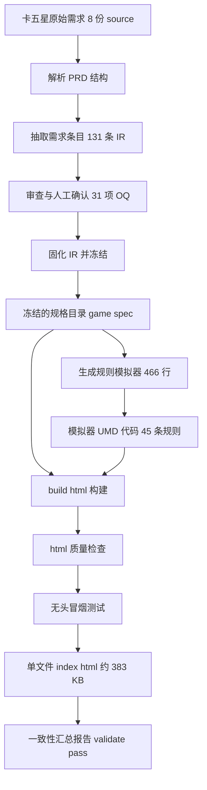
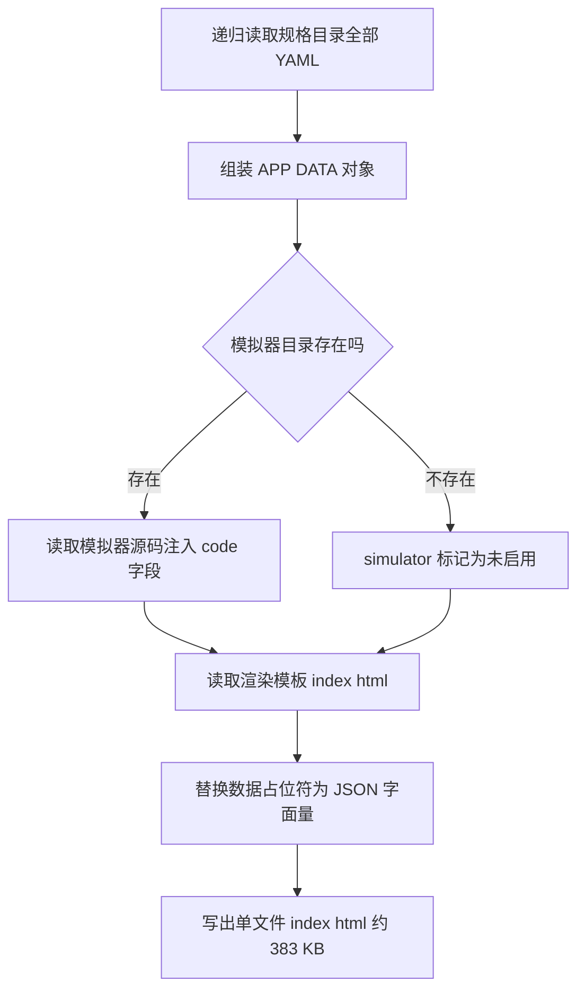

# 卡五星 Interactive HTML PRD 生成链路指南

> 整理 `.claude/skills/interactive-game-prd` 如何生成 `examples/mahjong/output/interactive-game-prd/index.html`（383 KB 单文件）的完整流程。
> 样例：卡五星（好友房）——8 份原始需求 source → 131 条 IR 需求 → 383 KB Interactive HTML PRD + 466 行规则模拟器。
> mini-game（记忆翻牌）是同一管线的迷你验证样例，链路同构，规模对照见文末。

## 一句话原理

`index.html` = **渲染模板**（`assets/html-template/index.html`，396 行）+ **全部规格数据内嵌**（APP_DATA JSON）+ **模拟器源码字符串注入**——构建时把三者拼成一个离线单文件，浏览器打开即可运行，无任何外链。

## 总流程图



## 阶段一：Create 流程（一次性，产出冻结 IR 与模拟器）

卡五星于 2026-11-09 走完（P2 阶段抽取 Golden Sample）。按 SKILL.md 的 Create 模式六步：

| 步骤 | 工作流 | 卡五星实际产出 |
|---|---|---|
| 1 | parse-prd | 8 份 source（01-基础规则 ~ 08-UI交互，共 5248 行）章节清单与材料盘点；原始文件只读（红线：任何模式不得覆盖 `game-spec/source/`） |
| 2 | extract-requirements | 131 条 IR 需求（功能/规则/状态，GAME-FR / GAME-RULE / GAME-ST）+ UI 5 个页面 + 测试用例 10 个 + 术语表 |
| 3 | review-requirements | 审查报告 + 31 项开放问题（open-questions.json，全部 open 待人工裁决） |
| 4 | generate-ir | 固化为 `game-spec/` 目录（YAML 树：manifest / game / requirements / ui / tests / reviews / source），`validate-ir` PASS |
| 5 | generate-html | 见阶段三（可反复重跑） |
| 6 | generate-simulator | 见阶段二 |

状态红线贯穿全程：每条需求带 `status: proposed|approved|rejected|deprecated` 与 `authority: fixed|delegated|open`；AI 只能提 proposed，approved 只能由人工裁决产生并记录 decision-log；31 项 OQ 未裁决前对应规则保持 open。

## 阶段二：generate-simulator（模拟器怎么来的）

`examples/mahjong/simulator/simulator.js`（466 行，UMD 结构）由 AI 按 `assets/simulator-template/engine.js` 框架契约生成（P4 子集：核心行牌与结算规则）：

1. **UMD 双用途**：Node 环境 `module.exports` 导出（供 `mahjong-simulator.test.mjs` 场景回放），浏览器环境挂到 `window.MiniGameFactory`（供 HTML 内嵌执行）。
2. **RULE_TABLE 规则声明表**：声明模拟器实现的 45 条规则引用（GAME-RULE-033 危牌禁打 / 038 碰牌 / 039 操作优先级 / 040 杠类型 / 041 杠分结算 等），status/authority 与 IR 一致。
3. **规则守卫**：查表不存在、或 `authority=open`（如 S0 结算总公式，31 项 OQ 未裁决）时抛 `RULE_NOT_CONFIRMED`，**禁止编造判定结果**——卡五星大量规则尚未人工确认，模拟器对未确认规则明确拒绝执行而非猜测。
4. **逻辑与 DOM 分离**：`createGame(config, logger)` 纯逻辑核心（dispatch/getState/snapshot/restore，无 DOM，Node 可测）；`create(area, msg)` DOM 适配层。
5. **可追踪日志**：每个判定分支调用 `logger(ruleId, verdict, detail)`，UI Demo 中实时展示规则引用。

## 阶段三：build-html（index.html 怎么拼出来的）

命令：

```bash
node .claude/skills/interactive-game-prd/scripts/build-html.mjs \
  examples/mahjong/game-spec \
  examples/mahjong/output/interactive-game-prd \
  examples/mahjong/simulator
```



### 第 1 步：collectSpec —— 把规格目录读成一个对象

`build-html.mjs` 的 `collectSpec(specDir)` 按固定清单读取 `game-spec/`：

| 数据来源 | 去向 |
|---|---|
| `manifest.yaml` | `APP_DATA.manifest`（游戏名/版本/统计：131 需求、5 页面、10 用例） |
| `game/overview.yaml` `core-loop.yaml` `glossary.yaml` | `APP_DATA.game.*`（概述/主循环/术语） |
| `requirements/` 全部 YAML（递归） | `APP_DATA.requirements`（131 条功能/规则/状态） |
| `data/configs/` | `APP_DATA.configs` |
| `requirements/states/` | `APP_DATA.states`（状态机） |
| `ui/pages/` `ui/components/` `ui/interactions/` `ui/navigation.yaml` | `APP_DATA.ui.*`（5 页面/组件/事件/导航） |
| `tests/cases/` `tests/scenarios/` | `APP_DATA.tests.*` |
| `reviews/` 四份 JSON（open-questions / decision-log / completeness / consistency） | `APP_DATA.reviews.*`（含 31 项 OQ） |
| `source/source-map.json` | `APP_DATA.sourceMap`（8 份 source 原文溯源） |

### 第 2 步：模拟器注入

读 `simulator/simulator.js` **整个源码字符串**放进 `APP_DATA.simulator = { enabled: true, code: "<源码>" }`（不是引用路径——file:// 协议下浏览器无法 fetch，数据必须全部内嵌）。

### 第 3 步：模板替换

读 `assets/html-template/index.html`（396 行渲染模板，含 CSS/JS），把模板脚本首行的占位符：

```js
const APP_DATA = /*__APP_DATA_JSON__*/null;
```

替换为 `JSON.stringify(appData)` 的数据字面量（`.replace(/<\/script/g, "<\\/script")` 防止数据中的 `</script` 提前闭合标签逃逸）。替换失败（占位符残留）则构建报错。最终写出 `output/interactive-game-prd/index.html`（383 KB 单文件）。

## 阶段四：质量门（两道专用检查 + 一道汇总）

| 检查 | 命令 | 内容 |
|---|---|---|
| mahjong-smoke | `mahjong-smoke.test.mjs <output>` | jsdom 无头冒烟 17 项（通用断言，不依赖游戏专用交互）：标题渲染卡五星、需求卡片 130+ 渲染、状态徽标、Tab 切换、模拟器注入与判定日志、组件覆盖等 |
| mahjong-simulator.test | `mahjong-simulator.test.mjs` | 场景回放 40 项断言：核心行牌流程（摸/出/碰/杠）与结算规则按 IR 执行、未确认规则被 RULE_NOT_CONFIRMED 拒绝 |
| validate-output | `validate-output.mjs examples/mahjong` | 串联全部校验输出机器可读报告（`output/reports/validate-report.json`）：result=pass、requirement_total=165（含 configs/states）、来源追溯率 100% |

说明：`e2e.mjs`（端到端 7 步）固定跑 mini-game 样例（管线回归锚点）；卡五星的全链验证由上述两项专用测试 + validate-output 覆盖。Export 前要求 validate-output result=pass，产物 ZIP 在 `output/interactive-game-prd.zip`。

## 运行时：浏览器打开 index.html 会发生什么

单文件离线（file:// 双击可开），左侧导航（131 条需求按组）+ 四个 Tab：

| Tab | 内容 |
|---|---|
| PRD | 需求卡片列表（状态徽标 proposed/approved + 权限徽标 fixed/delegated/open + 原文引用 quote / 推导依据 basis——每条可溯源到 8 份 source），底部 31 项未决问题区 |
| UI Demo | 规则模拟器：执行 `new Function(APP_DATA.simulator.code)()` 加载 UMD 代码挂 window.MiniGameFactory，`MiniGameFactory.create(area, logger)` 起 DOM 模拟器；每次操作输出带 GAME-RULE 引用的判定日志；未确认规则（authority=open，如结算总公式）操作弹 `RULE_NOT_CONFIRMED` |
| Flow | 状态机 SVG（对局状态流转）与主循环 |
| Tests | 测试用例表（10 个 GAME-TC）+ 预设场景卡片 |

双向定位：PRD 卡片【查看 UI】按钮 → 跳 UI Demo 并高亮组件；UI 组件右键 → 跳回 PRD 并高亮关联需求。

## 何时重新生成

- 31 项 OQ 裁决后（走 Decision 模式 apply-decisions 落盘 + decision-log 追加，或 Decision Workbench 页面裁决）→ 重跑阶段三构建 + 质量门，HTML 中规则状态与徽标随之更新
- IR 变化（Update 流程）后：重跑构建
- 只改模拟器：重跑 build-html（第三参数注入）
- 前端渲染模板改动：重跑 build-html（模板随 skill 版本更新）
- Export 前必须 validate-output result=pass，才打 ZIP

## 命令速查

```bash
# 构建（含模拟器注入）
node .claude/skills/interactive-game-prd/scripts/build-html.mjs examples/mahjong/game-spec examples/mahjong/output/interactive-game-prd examples/mahjong/simulator

# 质量检查
node .claude/skills/interactive-game-prd/scripts/validate-html.mjs examples/mahjong/output/interactive-game-prd examples/mahjong/game-spec

# 卡五星专用冒烟（17 项）
node .claude/skills/interactive-game-prd/scripts/mahjong-smoke.test.mjs

# 卡五星模拟器场景回放（40 项）
node .claude/skills/interactive-game-prd/scripts/mahjong-simulator.test.mjs

# 一致性汇总（含 Export 质量门）
node .claude/skills/interactive-game-prd/scripts/validate-output.mjs examples/mahjong

# 裁决工作台（31 项 OQ 人工裁决，页面操作写回 reviews）
node .claude/skills/interactive-game-prd/scripts/decision-workbench.mjs examples/mahjong/game-spec --port 8434
```

## mini-game 与 mahjong 链路对照

同一管线（同一 build-html.mjs、同一渲染模板、同一 UMD 挂载 MiniGameFactory），规模与测试不同：

| | mini-game（记忆翻牌） | mahjong（卡五星） |
|---|---|---|
| 原始 source | 1 份 PRD | 8 份 Markdown（5248 行） |
| IR 需求 | 8 条 | 131 条 |
| 模拟器 | 165 行 / 6 规则 | 466 行 / 45 规则 |
| index.html | 42 KB | 383 KB |
| 冒烟测试 | html-smoke（20 项，游戏专用断言） | mahjong-smoke（17 项，通用断言） |
| 场景回放 | simulator.test（11 项） | mahjong-simulator.test（40 项） |
| 端到端 | e2e.mjs（7 步，管线回归锚点） | validate-output（result=pass） |
| 定位 | 管线验证 Golden Sample（冻结） | 真实业务样例（随裁决演进） |

## 引用说明

- 流程依据：`.claude/skills/interactive-game-prd/SKILL.md`（七种模式与三层职责）、`workflows/generate-html.md`、`workflows/generate-simulator.md`
- 构建逻辑：`.claude/skills/interactive-game-prd/scripts/build-html.mjs`（collectSpec/模板替换）
- 渲染与模拟器运行时：`.claude/skills/interactive-game-prd/assets/html-template/index.html`、`assets/simulator-template/engine.js`
- 卡五星样例：`examples/mahjong/`（game-spec 131 条 IR、simulator 466 行、output 383 KB、reviews 31 项 OQ）
- 相关进度：`dev-docs/progress/执行进度.md`（P2 Golden Sample / P3 HTML / P4 模拟器 / P6 裁决工作台各阶段记录）
