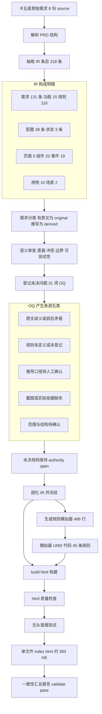
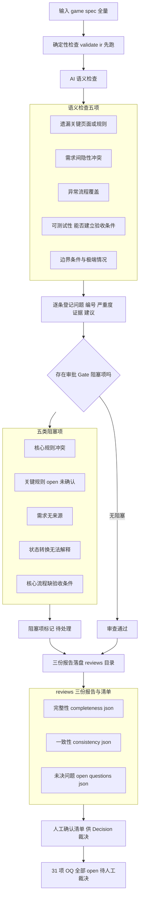
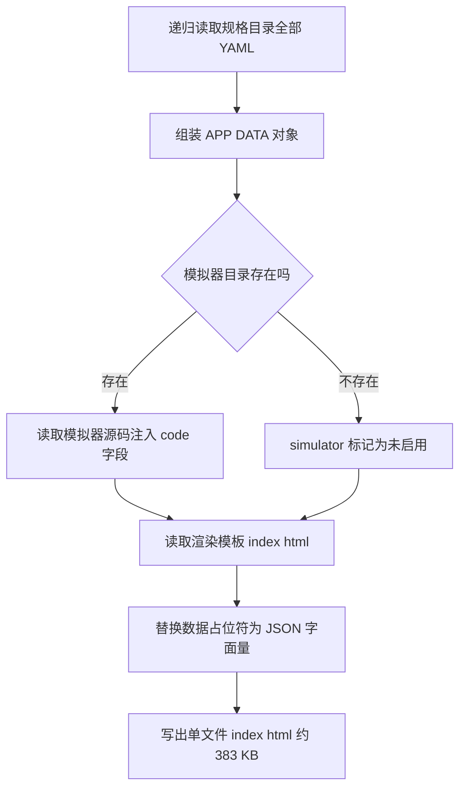

# 卡五星 Interactive HTML PRD 生成链路指南

> 整理 `.claude/skills/interactive-game-prd` 如何生成 `output/interactive-game-prd/index.html`（383 KB 单文件）的完整流程。
> 样例：卡五星（好友房）——8 份原始需求 source → 131 条 IR 需求 → 383 KB Interactive HTML PRD + 466 行规则模拟器。
> mini-game（记忆翻牌）是同一管线的迷你验证样例，链路同构，规模对照见文末。

## 术语表

| 缩写 | 全称 | 含义 | 对应产物目录 |
|---|---|---|---|
| PRD | Product Requirements Document（产品需求文档） | 两处出现：原始输入（8 份 Markdown）与最终产物（Interactive HTML PRD，交互式单文件） | 输入：`game-spec/source/`；产物：`output/interactive-game-prd/index.html` |
| IR | Game Requirement IR（结构化需求中间表示） | 唯一事实源：131 条需求 + UI + 测试 + 审查记录，所有产物从它生成 | `game-spec/`（YAML 树） |
| OQ | Open Question（开放问题） | 需人工裁决的未决问题（31 项，裁决前对应规则保持 `authority=open`，模拟器拒绝执行） | `game-spec/reviews/open-questions.json` |
| GAME-FR | Game Feature Requirement（功能需求条目 ID 前缀） | IR 中的功能需求条目，描述产品要做什么（如 GAME-FR-001） | `game-spec/requirements/features/` |
| GAME-RULE | Game Rule（规则需求条目 ID 前缀） | IR 中的规则条目，描述玩法判定逻辑（如 GAME-RULE-033 危牌禁打） | `game-spec/requirements/rules/` |
| GAME-STATE | Game State（状态定义条目 ID 前缀） | IR 中的状态机状态定义条目（如 GAME-STATE-001 全局对局状态机） | `game-spec/requirements/states/` |
| GAME-TC | Game Test Case（测试用例 ID 前缀） | IR 中的测试用例条目，供模拟器场景回放断言（10 个） | `game-spec/tests/cases/` |
| APP_DATA | 内嵌数据常量 | 构建时注入模板的单体 JSON（全部 IR 数据 + 模拟器源码），file:// 离线运行的基础 | 构建产物内嵌，无独立文件（位于 `output/interactive-game-prd/index.html` 脚本首行） |
| UMD | Universal Module Definition（通用模块定义） | 一份代码同时兼容 Node `require` 与浏览器全局挂载的封装，模拟器用它实现双环境复用 | `simulator/simulator.js`（框架契约在 skill 的 `assets/simulator-template/engine.js`） |
| RULE_NOT_CONFIRMED | 规则未确认守卫错误 | 模拟器查表：规则未声明或 `authority=open` 时拒绝判定并抛出，禁止编造结果 | 运行时错误码，无目录（守卫逻辑在 `simulator/simulator.js` 的 RULE_TABLE） |
| validate-ir / validate-html / validate-output | 三道校验脚本 | IR 合法性 / HTML 产物质量 / 全链一致性汇总（机器可读报告） | 脚本：`.claude/skills/interactive-game-prd/scripts/`；汇总报告：`output/reports/validate-report.json` |

## 一句话原理

`index.html` = **渲染模板**（`assets/html-template/index.html`，396 行）+ **全部规格数据内嵌**（APP_DATA JSON）+ **模拟器源码字符串注入**——构建时把三者拼成一个离线单文件，浏览器打开即可运行，无任何外链。

## 总流程图



### OQ 是怎么分析出来的

OQ 不是一次性分析出来的，而是**两个阶段、五类来源**累计登记的结果，核心原则是「找不到依据的不编造，登记为待确认」：

| 阶段 | 工作流 | 产生机制 |
|---|---|---|
| 抽取时 | extract-requirements 第 3 步需求分类 | 逐条给需求定来源：有原文引用的标 original（kind=original + quote）；推导的标 derived（kind=derived + basis）；**既无原文也无可靠推导依据的，禁止编造，登记 open question**，对应规则 authority=open |
| 审查时 | review-requirements 语义检查 | validate-ir 确定性检查之后，AI 语义检查五项：遗漏关键页面或规则 / 不同需求间隐性冲突 / 异常流程覆盖 / 可测试性（每条核心规则能否建立验收条件）/ 边界条件；发现的未决问题追加登记 open-questions.json |

五类来源与典型例（31 项，见 `reviews/open-questions.json`）：

| 来源类型 | 典型例 |
|---|---|
| 原文歧义或前后矛盾 | OQ-011/012 杠上花「勾选后生效」与创房表「默认生效 2 倍」并存矛盾<br>OQ-018 滑动出牌默认值两处叙述矛盾 |
| 规则未定义或未登记 | OQ-002 引擎座位编号映射需求未登记<br>OQ-013 主公式「字分」无定义<br>OQ-027 大厅页原始需求缺页 |
| 推导口径待人工确认 | OQ-007 首巡不摸牌系推导结论<br>OQ-004 杠分回退为推导口径<br>OQ-020 清一色与暗四归叠加为推导 |
| 截图或实拍依据缺失 | OQ-001 房主庄默认值依据为截图，AI 无法读取需人工提供文本 |
| 范围与结构待确认 | OQ-029 章节编号跳跃是否刻意省略<br>OQ-030 变体差异是否单独立条 |

OQ 的完整生命周期（与红线闭环）：登记（authority=open）→ 模拟器守卫拒绝执行（RULE_NOT_CONFIRMED）→ Decision Workbench 人工裁决（AI 不允许代人工提交）→ apply-decisions 落盘并追加 decision-log → 重跑构建，规则状态与徽标更新。

**question 文本的产生实现（不是脚本，是 Skill 层 AI 按提示词执行）**：

| 层 | 文件 | 职责 |
|---|---|---|
| Skill 层（AI 执行） | `SKILL.md` 红线 | 不得虚构原始 PRD 没有定义的规则；IR 合法性归脚本，语义判断归 AI |
| Workflow 层（提示词） | `workflows/extract-requirements.md` 第 3 步 | 需求分类三去向：原文直接提取标 original（quote 非空）；隐含推导标 derived（basis + 关联需求）；**找不到依据的登记 open question**，禁止伪造 original 来源 |
| Workflow 层（提示词） | `workflows/review-requirements.md` 第 2 步 | AI 语义检查五项（遗漏/隐性冲突/异常流程/可测试性/边界）发现的未决问题追加登记 |
| References 层（规范） | `references/game-prd-format.md` 第 4、5 节 | source 三分类必填字段约束；需求条目的 open_questions 字段同步登记到 reviews/open-questions.json |
| Scripts 层（校验，不产生） | `validate-ir` | 不生成 OQ；只校验需求条目 source 合法性（original 必有非空 quote、approved 必有有效来源），间接强制歧义内容走 OQ 登记 |

执行过程：AI 逐条读原文给需求定来源 → 遇到歧义/矛盾/未定义/缺依据时，无法归入 original 或 derived → 按 question 文本写法登记 OQ：**描述问题事实（歧义/矛盾/未定义/缺依据）+ AI 无法定案的原因 + 需人工提供什么**。样例（OQ-001）：「默认值房主庄依据为截图中提供（原始依据为创房面板截图）；需求正文仅记根据线上定默认值。AI 无法直接获取截图数值，需人工提供具体文本补充后才能确认。」

### IR 构成明细（218 条条目）

| 类型 | ID 前缀 | 条数 | 目录 |
|---|---|---|---|
| 功能需求 | GAME-FR | 15 | `requirements/features/` |
| 规则需求 | GAME-RULE | 116 | `requirements/rules/` |
| 状态定义 | GAME-STATE | 3 | `requirements/states/` |
| 配置项 | GAME-CFG | 28 | `data/configs/` |
| UI 页面 | GAME-UI | 5 | `ui/pages/` |
| UI 组件 | GAME-COMP | 20 | `ui/components/` |
| 交互事件 | GAME-EVENT | 19 | `ui/interactions/` |
| 测试用例 | GAME-TC | 10 | `tests/cases/` |
| 测试场景 | SCEN | 2 | `tests/scenarios/` |
| game 三件套 | overview/core-loop/glossary | 3 个文件 | `game/` |

注：manifest 的 `stats.requirements=131` 口径为功能 15 + 规则 116；validate-output 的 `requirement_total=165` 另计入配置与状态等；表内条数按目录内条目 ID 实数统计。

### 功能需求、规则需求与状态需求的划分

**判断口诀**：改了它会影响分数或判定结果 → 规则需求；只影响看得见摸得着的内容、不影响判定 → 功能需求；描述「游戏进行到哪一步、下一步能去哪」→ 状态需求。同一主题允许多层各一条：规则定「怎么判定」，功能定「怎么展示」，状态定「什么阶段」，引用 ID 不重复定义（format 第 7 节单一事实源原则：一个业务事实只在一处定义，UI Spec 与 Test Spec 只引用 ID）。

**三者分工**：

| 维度 | 功能需求 GAME-FR | 规则需求 GAME-RULE | 状态需求 GAME-STATE |
|---|---|---|---|
| 回答的问题 | 产品要有什么（界面、交互、展示、提示） | 玩法怎么判定（数值、判定逻辑、结算） | 游戏进行到哪一步、下一步能去哪（阶段与流转） |
| 性质 | 展示层（静态描述） | 判定逻辑（静态规则） | 阶段流转（动态时序，状态机） |
| 验收维度 | 有没有、能不能用 | 判定对不对、算得对不对 | 状态可达、流转合法 |
| 主题词 | 页面、界面、按钮、展示 | 张数、倍数、构成、结算 | 状态、流转、阶段 |
| 结构特点 | ui_refs 引用页面组件 | 被模拟器 RULE_TABLE 实现 | normal_flow 正常流转边 + exception_flow 异常流转边 + dependencies 引用规则 |
| 条数 | 15 | 116 | 3 |
| 下游去向 | UI Spec 页面与组件引用 | 模拟器 RULE_TABLE 实现、测试用例断言 | Flow 视图状态机 SVG、页面随状态出现 |

**3 条状态需求全清单**（三层嵌套：全局 → 阶段子状态）：

| ID | 名称 | 状态集 |
|---|---|---|
| GAME-STATE-001 | 全局对局状态机 | 9 个全局状态：未开局、房间内、打漂、定庄、发牌、行牌、和牌结算、荒庄、续局（12 条正常流转 + 2 条异常流转） |
| GAME-STATE-002 | 行牌回合状态机 | 行牌阶段单回合子状态：等待出牌、等待响应、摸牌中、补牌中、亮倒扣牌 |
| GAME-STATE-003 | 结束与结算续局状态机 | 终局后子状态：摊牌展示、荒庄赔付、买马、小结算、大结算、续局准备 |

**同主题多层各一席的典型对照**：

| 主题 | 规则需求（定判定） | 功能需求（定展示） | 状态需求（定阶段） |
|---|---|---|---|
| 听牌 | 听牌判定规则（可胡牌张数与倍数计算） | GAME-FR-002 听牌提示页面 / GAME-FR-013 听牌提示（展示提示信息） | 行牌状态机「等待出牌」阶段（GAME-STATE-002） |
| 危牌 | 危牌规则（危牌判定与禁打限制） | GAME-FR-001 危牌放炮浮动提示（浮层展示） | 行牌状态机「等待响应」阶段 |
| 亮倒 | 亮倒规则（亮倒判定与赔付） | GAME-FR-007 亮倒打牌界面 / GAME-FR-012 亮倒扣牌界面 | 行牌状态机「亮倒扣牌」子状态 |
| 结算 | 结算与续局规则（S0~S11 公式管线） | GAME-FR-015 对局结束过渡与结算界面（界面展示） | 结算状态机（摊牌展示→买马→小结算→大结算，GAME-STATE-003） |

**15 条功能需求全清单**（均为界面/交互/展示主题）：危牌放炮浮动提示、听牌提示页面、出牌展示与牌河、碰杠操作按钮与牌面展示、胡牌操作按钮与展示、一炮多响特殊展示、亮倒打牌界面、扣牌界面、对局桌面布局与开局定庄展示、行牌操作交互、打漂选漂交互、亮倒扣牌界面、听牌提示、反馈区域与 toast 提示、对局结束过渡与结算界面。

**116 条规则需求按主题归类举例**：

| 主题类 | 例 |
|---|---|
| 牌张与起手 | 牌张构成、起手与胡牌张数 |
| 定庄与座位 | 首局定庄、轮庄、方位与座位 |
| 杠系 | 杠类型与杠分、杠上杠连杠、杠牌限制、补牌杠后摸牌、抢杠胡 |
| 亮倒系 | 亮倒、扣牌 |
| 限制与判定 | 危牌、胡牌限制层、过手规则 |
| 数值系 | 漂、买马、数坎、上楼加倍、开局数值速查 |
| 流程系 | 全流程阶段与开局准备、打漂流程、发牌逻辑与节奏、行牌阶段、和牌结束流程、荒庄流程、和牌后步骤买马、结算与续局 |

## 阶段一：Create 流程（一次性，产出冻结 IR 与模拟器）

卡五星于 2026-11-09 走完（P2 阶段抽取 Golden Sample）。按 SKILL.md 的 Create 模式六步：

| 步骤 | 工作流 | 卡五星实际产出 |
|---|---|---|
| 1 | parse-prd | 8 份 source（01-基础规则 ~ 08-UI交互，共 5248 行）章节清单与材料盘点；原始文件只读（红线：任何模式不得覆盖 `game-spec/source/`） |
| 2 | extract-requirements | IR 条目 218 条（构成见上表：功能 15 / 规则 116 / 状态 3 / 配置 28 / UI 页面 5 / 组件 20 / 事件 19 / 用例 10 / 场景 2）+ 术语表三件套 |
| 3 | review-requirements | 审查报告 + 31 项开放问题（open-questions.json，全部 open 待人工裁决） |
| 4 | generate-ir | 固化为 `game-spec/` 目录（YAML 树：manifest / game / requirements / ui / tests / reviews / source），`validate-ir` PASS |
| 5 | generate-html | 见阶段三（可反复重跑） |
| 6 | generate-simulator | 见阶段二 |

状态红线贯穿全程：每条需求带 `status: proposed|approved|rejected|deprecated` 与 `authority: fixed|delegated|open`；AI 只能提 proposed，approved 只能由人工裁决产生并记录 decision-log；31 项 OQ 未裁决前对应规则保持 open。

### review-requirements 审查与 OQ 产生详图



**执行顺序与要点**：

1. **validate-ir 先跑**（Scripts 层红线：IR 是否合法必须由脚本判定，禁止 AI 自行下结论）；报告附入审查结论。
2. **AI 语义检查五项**（9.3 节）：遗漏关键页面/规则、不同需求间隐性冲突、异常流程覆盖、可测试性（每条核心规则能否建立验收条件）、边界条件（极端情况覆盖）。
3. **逐条登记问题**，字段：REVIEW-XXX 编号、severity、related_requirements（关联需求 ID）、evidence（证据）、suggestion（建议）。
4. **审批 Gate 判定**：五类阻塞项任一存在即阻塞（核心规则冲突 / 关键规则 open / 需求无来源 / 状态转换无法解释 / 核心流程缺验收条件）。
5. **三份报告落盘** `reviews/`：completeness.json（完整性：8 章原文全覆盖 204 个锚点，1 项 high 遗留大厅页占位）、consistency.json（一致性：4 处原文矛盾已按裁决口径登记）、open-questions.json（未决问题）。

**OQ 条目结构**（open-questions.json 单条字段）：

| 字段 | 含义 | 实际值 |
|---|---|---|
| id | OQ 编号 | OQ-001 ~ OQ-031 |
| requirement_id | 关联的 IR 需求 ID | 如 GAME-RULE-003 |
| question | 问题描述（歧义/矛盾/未定义/推导待确认的事实） | 31 条 |
| severity | 严重度 | high 18 / medium 11 / low 2 |
| status | 裁决状态 | 全部 open（AI 不允许代人工提交裁决） |
| images | 附图依据（P6 OQ-001 创房面板截图） | 需人工提供文本补充 |

**红线**：审查只读，不修改原始需求与 IR 条目；AI 推测不得当成事实写入报告结论。

### validate-ir 脚本详解

**是什么**：Game Requirement IR 确定性校验脚本，Node.js 可执行文件（320 行，`#!/usr/bin/env node`，无扩展名）。Scripts 层红线：IR 是否合法必须由它判定，禁止 AI 阅读提示词后自行下结论。

**位置与用法**：

```bash
node .claude/skills/interactive-game-prd/scripts/validate-ir examples/mahjong/game-spec [--json]
```

**实现**：js-yaml 递归读取 game-spec 全部 YAML → ajv 编译 `schemas/` 四份 JSON Schema（manifest / requirement / ui / test）逐文件校验 → 引用图与溯源链检查（crypto sha1 校验原文锚点）→ 汇总 errors / warnings，--json 输出机器可读报告；errors 非零退出码阻断后续流程。

**检查项（错误码）**：

| 检查项 | 错误码 | 说明 |
|---|---|---|
| manifest 存在 | MISSING_MANIFEST | 缺 manifest.yaml |
| Schema 校验 | SCHEMA | 四份 JSON Schema 逐文件校验（manifest / 需求 / UI / 测试） |
| ID 唯一 | DUPLICATE_ID | requirements / ui / tests 条目 ID 全局查重 |
| 引用格式 | BAD_REF_FORMAT | 引用字段（related / ui_refs / test_refs 等）格式非法 |
| 悬空引用 | DANGLING_REF | 引用的需求 / 组件 / 用例 ID 不存在 |
| approved 来源 | NO_SOURCE | approved 需求缺 original 来源 quote，或 human_decision 缺 decision_log_ref |
| 核心需求测试引用 | NO_TEST_REF（警告） | 核心需求缺测试引用 |
| source-map 锚点 | SOURCE_MAP / SOURCE_MAP_STALE | 溯源指向未知需求 / 锚点文件不存在 / 行区间无效 / quote_hash 与原文 sha1 不一致（检测原文变更） |
| decision-log 状态流转 | DECISION_LOG / ILLEGAL_TRANSITION | decision-log 解析失败 / 状态流转不在合法集合（合法仅 7 种：proposed 到 approved、proposed 到 rejected、rejected 到 proposed、approved 到 deprecated、rejected 到 deprecated、approved 与 rejected 互转翻案） |

**示例数据**（脚本自带三套测试用例，`scripts/validate-ir.example/`）：`valid`（合法样例，校验应 PASS）/ `duplicate-id`（ID 重复，应报 DUPLICATE_ID）/ `dangling-ref`（悬空引用，应报 DANGLING_REF）。

## 阶段二：generate-simulator（模拟器怎么来的）

`simulator/simulator.js`（466 行，UMD 结构）由 AI 按 `assets/simulator-template/engine.js` 框架契约生成（P4 子集：核心行牌与结算规则）：

1. **UMD 双用途**：Node 环境 `module.exports` 导出（供 `mahjong-simulator.test.mjs` 场景回放），浏览器环境挂到 `window.MiniGameFactory`（供 HTML 内嵌执行）。
2. **RULE_TABLE 规则声明表**：声明模拟器实现的 45 条规则引用（GAME-RULE-033 危牌禁打 / 038 碰牌 / 039 操作优先级 / 040 杠类型 / 041 杠分结算 等），status/authority 与 IR 一致。
3. **规则守卫**：查表不存在、或 `authority=open`（如 S0 结算总公式，31 项 OQ 未裁决）时抛 `RULE_NOT_CONFIRMED`，**禁止编造判定结果**——卡五星大量规则尚未人工确认，模拟器对未确认规则明确拒绝执行而非猜测。
4. **逻辑与 DOM 分离**：`createGame(config, logger)` 纯逻辑核心（dispatch/getState/snapshot/restore，无 DOM，Node 可测）；`create(area, msg)` DOM 适配层。
5. **可追踪日志**：每个判定分支调用 `logger(ruleId, verdict, detail)`，UI Demo 中实时展示规则引用。

## 阶段三：build-html（index.html 怎么拼出来的）

命令：

```bash
node .claude/skills/interactive-game-prd/scripts/build-html.mjs \
  examples/mahjong/game-spec \
  examples/mahjong/output/interactive-game-prd \
  examples/mahjong/simulator
```



### 第 1 步：collectSpec —— 把规格目录读成一个对象

`build-html.mjs` 的 `collectSpec(specDir)` 按固定清单读取 `game-spec/`：

| 数据来源 | 去向 |
|---|---|
| `manifest.yaml` | `APP_DATA.manifest`（游戏名/版本/统计：131 需求、5 页面、10 用例） |
| `game/overview.yaml` `core-loop.yaml` `glossary.yaml` | `APP_DATA.game.*`（概述/主循环/术语） |
| `requirements/` 全部 YAML（递归） | `APP_DATA.requirements`（131 条功能/规则/状态） |
| `data/configs/` | `APP_DATA.configs` |
| `requirements/states/` | `APP_DATA.states`（状态机） |
| `ui/pages/` `ui/components/` `ui/interactions/` `ui/navigation.yaml` | `APP_DATA.ui.*`（5 页面/组件/事件/导航） |
| `tests/cases/` `tests/scenarios/` | `APP_DATA.tests.*` |
| `reviews/` 四份 JSON（open-questions / decision-log / completeness / consistency） | `APP_DATA.reviews.*`（含 31 项 OQ） |
| `source/source-map.json` | `APP_DATA.sourceMap`（8 份 source 原文溯源） |

### 第 2 步：模拟器注入

读 `simulator/simulator.js` **整个源码字符串**放进 `APP_DATA.simulator = { enabled: true, code: "<源码>" }`（不是引用路径——file:// 协议下浏览器无法 fetch，数据必须全部内嵌）。

### 第 3 步：模板替换

读 `assets/html-template/index.html`（396 行渲染模板，含 CSS/JS），把模板脚本首行的占位符：

```js
const APP_DATA = /*__APP_DATA_JSON__*/null;
```

替换为 `JSON.stringify(appData)` 的数据字面量（`.replace(/<\/script/g, "<\\/script")` 防止数据中的 `</script` 提前闭合标签逃逸）。替换失败（占位符残留）则构建报错。最终写出 `output/interactive-game-prd/index.html`（383 KB 单文件）。

## 阶段四：质量门（两道专用检查 + 一道汇总）

| 检查 | 命令 | 内容 |
|---|---|---|
| mahjong-smoke | `mahjong-smoke.test.mjs <output>` | jsdom 无头冒烟 55 项（含工作空间拆分/五类渲染器/裁决选项卡片/UI 页面切换断言），明细见下表 |
| mahjong-simulator.test | `mahjong-simulator.test.mjs` | 场景回放 39 项断言（对应 IR 测试用例 TC 与规则 ID），明细见下表 |
| validate-output | `validate-output.mjs examples/mahjong` | 串联全部校验输出机器可读报告（`output/reports/validate-report.json`）：result=pass、requirement_total=165（含 configs/states）、来源追溯率 100% |

**mahjong-simulator.test 39 项场景回放明细**（Node 直接 require 模拟器 UMD 的纯逻辑核心，按 IR 测试用例分组，每项断言结果状态与 rule_ref 日志双验证）：

| 场景组 | 断言内容 | 项数 |
|---|---|---|
| TC-001 碰牌 | 前置出牌成功 → 碰成立取得出牌权 → 碰副露记录且手牌减 2 → rule_ref GAME-RULE-038 applied → 碰不足 2 张被拒绝（rejected） | 5 |
| TC-003 漏胡 | 可胡不胡进入漏胡 → 漏胡期间不可胡（missed_hu）→ rule_ref GAME-RULE-049 拒绝 → 摸牌解除漏胡 → 解除后按牌型正常判定 → 摸回可胡牌解除 → 解除后自摸碰碰胡成立（GAME-RULE-072，番 2）→ rule_ref 049 解除 → rule_ref 072 applied | 9 |
| TC-005 封顶 | 碰碰胡 2 × 亮倒 2 × 上楼 2 = 8 未超封顶 → rule_ref GAME-RULE-121/081/086 → 番型 × 加倍项 8 超封顶 6 截断为 6（截断只作用于乘算部分） | 4 |
| 平胡番型 | 平胡 F01 判定（含顺子 1 倍，GAME-RULE-071）+ rule_ref 日志 | 2 |
| TC-006 杠系与连杠 | 直杠成立 n=1 → 直杠分 2（P2 付 P1 收）→ 杠后补牌 7万 → 非杠后补牌出牌中断连杠 → 连杠第 1 杠 n=1 分 2 → 中断后重新计数 → rule_ref GAME-RULE-042 → 同玩家连杠前置直杠 n=1 → 杠后补牌暗杠递进 n=2 → 连杠分值 2+8=10（三家收付）→ 连杠 rule_ref 042 | 11 |
| TC-004 危牌 | 危牌禁止打出（rejected）→ 非危牌正常打出 → 非全危牌混有危牌仍禁打 → 全危牌例外允许打出（applied） | 4 |
| 守卫与健壮性 | 总结算抛 RULE_NOT_CONFIRMED（S0 结算总公式未确认，GAME-RULE-116）→ 未知动作被拒绝（unknown_action） | 2 |
| 快照恢复 | 快照前状态推进正常 → 恢复后状态一致（回合、副露、牌河、手牌全部还原） | 2 |

**mahjong-smoke 55 项检查明细**（jsdom 加载产物 index.html 无头执行，分六类；多选模式仅测试内存注入 decision_options，不改真实 game-spec）：

| 类别 | 检查项 |
|---|---|
| 静态与分类导航（6 项） | 标题渲染游戏名（卡五星）<br>五个工作区 Tab 存在（spec/decision/ui/flow/tests）<br>规格工作台默认概述视图<br>分类导航渲染（概述 + 五类）<br>分类数量动态统计（GAME-RULE 116 / GAME-UI 5）<br>左侧不展开全部需求长列表 |
| 离线与健壮性（2 项） | 数据内嵌无外链 fetch<br>页面无致命脚本错误 |
| 规格工作台五类渲染（16 项） | 点击分类渲染该类需求（GAME-RULE 116 条）<br>状态徽标渲染（proposed）<br>授权徽标渲染（fixed/open）<br>规则分组头渲染（按来源文档）<br>点击需求卡片右侧详情渲染<br>功能需求分类渲染（15 条 + 工具条）<br>搜索筛选生效（列表收窄）<br>状态筛选不报错（与搜索叠加）<br>状态机分类渲染（3 台 + 跳 Flow 按钮）<br>UI 分类页面分组与组件行渲染<br>点击组件行右侧详情（含关联需求）<br>配置分类渲染（GAME-CFG-001）<br>点击配置分类渲染配置表格（28 行）<br>点击配置行右侧详情渲染<br>模拟器区域存在<br>切回规格工作台恢复导航 |
| UI Demo 与模拟器（12 项） | 切到 UI Demo 标签页（懒渲染生效）<br>UI 页面渲染（5 页 20 组件 + 对局桌面文本）<br>模拟器已注入（MiniGameFactory 全局对象）<br>模拟器操作按钮渲染（碰杠亮胡过 5+）<br>模拟器摸牌交互生效（点击后区域更新）<br>未确认规则触发 RULE_NOT_CONFIRMED 提示（点击总结算触发守卫）<br>模拟器区域存在<br>页面切换器渲染（5 页）<br>当前页组件清单渲染（chips）<br>切换页面渲染对应静态原型（GAME-UI-002）<br>点击组件 chip 定位原型元素<br>切回对局主页面恢复模拟器 |
| 裁决工作台（18 项） | 独立布局（隐藏规格导航）<br>统计渲染（合并三来源：待裁决 28 草稿 3）<br>筛选器渲染（状态/严重度/关键词）<br>列表 31 项 OQ<br>OQ-002 草稿预填（通用选项采纳预选）与影响预览<br>OQ-001 草稿预填（修改选项预选 + 口径输入区）<br>底部操作栏渲染（上/下/暂存/正式）<br>正式裁决校验（修改方案需填口径）<br>正式裁决校验（必须填写理由）<br>正式裁决内存生效（已确认 1）<br>正式裁决后自动定位下一个待裁决<br>切换问题不丢草稿（自动暂存恢复）<br>OQ 专属候选方案渲染（多选三方案）<br>多选可选多项（两项选中）<br>多选上限约束（第三项被拒绝）<br>多选混合结论被拦截（需同结论）<br>多选正式裁决校验（需填口径的选项拦截）<br>导出数据为 apply-decisions 输入格式（多选同结论合并单记录） |

说明：`e2e.mjs`（端到端 7 步）固定跑 mini-game 样例（管线回归锚点）；卡五星的全链验证由上述两项专用测试 + validate-output 覆盖。Export 前要求 validate-output result=pass，产物 ZIP 在 `output/interactive-game-prd.zip`。

## 运行时：浏览器打开 index.html 会发生什么

单文件离线（file:// 双击可开），左侧导航（131 条需求按组）+ 五个 Tab：

| Tab | 内容 |
|---|---|
| PRD | 需求卡片列表（状态徽标 proposed/approved + 权限徽标 fixed/delegated/open + 原文引用 quote / 推导依据 basis——每条可溯源到 8 份 source），底部 31 项未决问题区 |
| UI Demo | 规则模拟器：执行 `new Function(APP_DATA.simulator.code)()` 加载 UMD 代码挂 window.MiniGameFactory，`MiniGameFactory.create(area, logger)` 起 DOM 模拟器；每次操作输出带 GAME-RULE 引用的判定日志；未确认规则（authority=open，如结算总公式）操作弹 `RULE_NOT_CONFIRMED` |
| Flow | 状态机 SVG（对局状态流转）与主循环 |
| Tests | 测试用例表（10 个 GAME-TC）+ 预设场景卡片 |
| 裁决 | 裁决工作台（独立布局，隐藏规格导航）：顶部统计（合并内存 DECISIONS /历史 decisionLog/approval-state 草稿三来源）与筛选（状态/严重度/关键词）、左栏 OQ 列表、中栏候选方案卡片（单选 radio/多选 checkbox，由 OQ 自身 decision_options 配置驱动；未配置时展示通用裁决选项：采纳/修改后采纳/否决/挂起，修改、否决、挂起均需填补充口径）、右栏影响分析（关联需求/关联 UI 测试/历史裁决 supersedes）、底部操作栏（上一个/下一个/暂存草稿/正式裁决）；切换问题自动暂存草稿不丢；正式裁决校验（选方案数/必填口径/必填理由/多选同结论），多选同结论合并单记录（apply-decisions 一问一裁契约）；导出 decisions.json（旧字段唯一正式接口，reviewer 固定 human），导出后交 apply-decisions 落盘（先 --dry-run 预演），落盘后重跑 build-html 刷新徽标 |

裁决 Tab 落盘闭环（红线保留：AI 不代人工提交，点「正式裁决」与「导出」即人工确认动作）：

```bash
# 1. 浏览器裁决 Tab 内完成裁决 -> 导出 decisions.json（浏览器下载目录）
# 2. 预演（不写入）
node .claude/skills/interactive-game-prd/scripts/apply-decisions.mjs examples/mahjong/game-spec <下载目录>/decisions.json --dry-run
# 3. 落盘（decision-log 追加 + open-questions 状态更新 + approval-state 刷新）
node .claude/skills/interactive-game-prd/scripts/apply-decisions.mjs examples/mahjong/game-spec <下载目录>/decisions.json
# 4. 重跑构建刷新本文件
node .claude/skills/interactive-game-prd/scripts/build-html.mjs examples/mahjong/game-spec examples/mahjong/output/interactive-game-prd examples/mahjong/simulator
```

双向定位：PRD 卡片【查看 UI】按钮 → 跳 UI Demo 并高亮组件；UI 组件右键 → 跳回 PRD 并高亮关联需求。

## 何时重新生成

- 31 项 OQ 裁决后：在裁决 Tab 导出 decisions.json -> apply-decisions 落盘（或 React 版 Decision Workbench 页面裁决直接写回）-> 重跑阶段三构建 + 质量门，HTML 中规则状态与徽标随之更新
- IR 变化（Update 流程）后：重跑构建
- 只改模拟器：重跑 build-html（第三参数注入）
- 前端渲染模板改动：重跑 build-html（模板随 skill 版本更新）
- Export 前必须 validate-output result=pass，才打 ZIP

## 命令速查

```bash
# 构建（含模拟器注入）
node .claude/skills/interactive-game-prd/scripts/build-html.mjs examples/mahjong/game-spec examples/mahjong/output/interactive-game-prd examples/mahjong/simulator

# 质量检查
node .claude/skills/interactive-game-prd/scripts/validate-html.mjs examples/mahjong/output/interactive-game-prd examples/mahjong/game-spec

# 卡五星专用冒烟（55 项，含工作空间拆分/五类渲染器/裁决选项卡片/UI 页面切换）
node .claude/skills/interactive-game-prd/scripts/mahjong-smoke.test.mjs

# 卡五星模拟器场景回放（39 项）
node .claude/skills/interactive-game-prd/scripts/mahjong-simulator.test.mjs

# 一致性汇总（含 Export 质量门）
node .claude/skills/interactive-game-prd/scripts/validate-output.mjs examples/mahjong

# 裁决闭环（单文件版主路径：产物裁决 Tab 导出 -> 预演 -> 落盘 -> 重建）
node .claude/skills/interactive-game-prd/scripts/apply-decisions.mjs examples/mahjong/game-spec decisions.json --dry-run
node .claude/skills/interactive-game-prd/scripts/apply-decisions.mjs examples/mahjong/game-spec decisions.json

# 裁决工作台（React 版备选：直接写回 reviews，需本地服务）
node .claude/skills/interactive-game-prd/scripts/decision-workbench.mjs examples/mahjong/game-spec --port 8434
```

## mini-game 与 mahjong 链路对照

同一管线（同一 build-html.mjs、同一渲染模板、同一 UMD 挂载 MiniGameFactory），规模与测试不同：

| | mini-game（记忆翻牌） | mahjong（卡五星） |
|---|---|---|
| 原始 source | 1 份 PRD | 8 份 Markdown（5248 行） |
| IR 需求 | 8 条 | 131 条 |
| 模拟器 | 165 行 / 6 规则 | 466 行 / 45 规则 |
| index.html | 42 KB | 383 KB |
| 冒烟测试 | html-smoke（19 项，游戏专用断言） | mahjong-smoke（21 项，通用断言含裁决 6 项） |
| 场景回放 | simulator.test（10 项） | mahjong-simulator.test（39 项） |
| 端到端 | e2e.mjs（7 步，管线回归锚点） | validate-output（result=pass） |
| 定位 | 管线验证 Golden Sample（冻结） | 真实业务样例（随裁决演进） |

## 引用说明

- 流程依据：`.claude/skills/interactive-game-prd/SKILL.md`（七种模式与三层职责）、`workflows/generate-html.md`、`workflows/generate-simulator.md`
- 构建逻辑：`.claude/skills/interactive-game-prd/scripts/build-html.mjs`（collectSpec/模板替换）
- 渲染与模拟器运行时：`.claude/skills/interactive-game-prd/assets/html-template/index.html`、`assets/simulator-template/engine.js`
- 卡五星样例：`examples/mahjong/`（game-spec 131 条 IR、simulator 466 行、output 383 KB、reviews 31 项 OQ）
- 相关进度：`dev-docs/progress/执行进度.md`（P2 Golden Sample / P3 HTML / P4 模拟器 / P6 裁决工作台各阶段记录）
