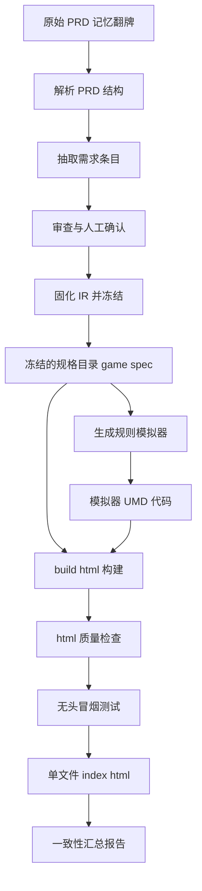
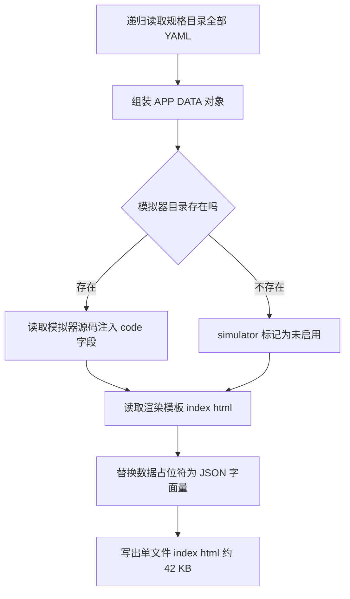

# mini-game Interactive HTML PRD 生成链路指南

> 整理 `.claude/skills/interactive-game-prd` 如何生成 `examples/mini-game/output/interactive-game-prd/index.html` 的完整流程。
> 样例：迷你游戏「记忆翻牌」（Golden Sample，game-spec 已冻结，SHA-256 见 `examples/mini-game/FROZEN.md`）。

## 一句话原理

`index.html` = **渲染模板**（`assets/html-template/index.html`）+ **全部规格数据内嵌**（APP_DATA JSON）+ **模拟器源码字符串注入**——构建时把三者拼成一个离线单文件，浏览器打开即可运行，无任何外链。

## 总流程图



## 阶段一：Create 流程（一次性，产出冻结 IR 与模拟器）

mini-game 于 2026-11-06 走完，产物已冻结。按 SKILL.md 的 Create 模式六步：

| 步骤 | 工作流 | 产出 |
|---|---|---|
| 1 | parse-prd | 章节清单与材料盘点（输入 `game-spec/source/original-prd.md`，只读红线：任何模式不得覆盖） |
| 2 | extract-requirements | 需求条目结构化：功能 2 条（GAME-FR）+ 规则 6 条（GAME-RULE）+ 状态 1 条（GAME-ST）+ UI 组件 4 个 + 测试用例 4 个（GAME-TC-001~004） |
| 3 | review-requirements | 审查报告（只读不改动） |
| 4 | generate-ir | 固化为 `game-spec/` 目录（YAML 树：manifest / game / requirements / ui / tests / reviews / source），`validate-ir` PASS 后写 FROZEN.md 冻结 SHA-256 |
| 5 | generate-html | 见阶段三（可反复重跑） |
| 6 | generate-simulator | 见阶段二 |

状态红线贯穿全程：每条需求带 `status: proposed|approved|rejected|deprecated` 与 `authority: fixed|delegated|open`；AI 只能提 proposed，approved 只能由人工裁决产生并记录 decision-log。

## 阶段二：generate-simulator（模拟器怎么来的）

`examples/mini-game/simulator/simulator.js`（165 行，UMD 结构）由 AI 按 `assets/simulator-template/engine.js` 框架契约生成：

1. **UMD 双用途**：Node 环境 `module.exports` 导出（供 `simulator.test.mjs` 场景回放），浏览器环境挂到 `window.MiniGameFactory`（供 HTML 内嵌执行）。
2. **RULE_TABLE 规则声明表**：声明模拟器实现的每条规则 ID 与 IR 中一致的 status/authority（GAME-RULE-001~006）。
3. **规则守卫**：`guard(ruleId)` 查表——规则不存在或 `authority=open`（未人工确认）时抛 `RULE_NOT_CONFIRMED`，**禁止编造判定结果**。
4. **逻辑与 DOM 分离**：`createGame(config, logger)` 纯逻辑核心（dispatch/getState/snapshot/restore，无 DOM，Node 可测）；`create(area, msg)` DOM 适配层。
5. **可追踪日志**：每个判定分支调用 `logger(ruleId, verdict, detail)`，UI Demo 中实时展示规则引用。

## 阶段三：build-html（index.html 怎么拼出来的）

命令：

```bash
node .claude/skills/interactive-game-prd/scripts/build-html.mjs \
  examples/mini-game/game-spec \
  examples/mini-game/output/interactive-game-prd \
  examples/mini-game/simulator
```



### 第 1 步：collectSpec —— 把规格目录读成一个对象

`build-html.mjs` 的 `collectSpec(specDir)` 按固定清单读取 `game-spec/`：

| 数据来源 | 去向 |
|---|---|
| `manifest.yaml` | `APP_DATA.manifest`（游戏名/版本/统计） |
| `game/overview.yaml` `core-loop.yaml` `glossary.yaml` | `APP_DATA.game.*`（概述/主循环/术语） |
| `requirements/` 全部 YAML（递归） | `APP_DATA.requirements`（功能/规则条目） |
| `data/configs/` | `APP_DATA.configs` |
| `requirements/states/` | `APP_DATA.states`（状态机） |
| `ui/pages/` `ui/components/` `ui/interactions/` `ui/navigation.yaml` | `APP_DATA.ui.*`（页面/组件/事件/导航） |
| `tests/cases/` `tests/scenarios/` | `APP_DATA.tests.*` |
| `reviews/` 四份 JSON（open-questions / decision-log / completeness / consistency） | `APP_DATA.reviews.*` |
| `source/source-map.json` | `APP_DATA.sourceMap`（原文溯源） |

### 第 2 步：模拟器注入

读 `simulator/simulator.js` **整个源码字符串**放进 `APP_DATA.simulator = { enabled: true, code: "<源码>" }`（不是引用路径——file:// 协议下浏览器无法 fetch，数据必须全部内嵌）。

### 第 3 步：模板替换

读 `assets/html-template/index.html`（396 行渲染模板，含 CSS/JS），把模板脚本首行的占位符：

```js
const APP_DATA = /*__APP_DATA_JSON__*/null;
```

替换为 `JSON.stringify(appData)` 的数据字面量（`.replace(/<\/script/g, "<\\/script")` 防止数据中的 `</script` 提前闭合标签逃逸）。替换失败（占位符残留）则构建报错。最终写出 `output/interactive-game-prd/index.html`（约 42 KB 单文件）。

## 阶段四：质量门（三道检查 + 一道汇总）

| 检查 | 命令 | 内容 |
|---|---|---|
| validate-html | `validate-html.mjs <output> <game-spec>` | 5 项：无未替换模板变量 / 无外链资源 / APP_DATA 已内嵌且非 null / UI Spec 组件 ID 在 HTML 中全部渲染（data-component-id）/ 基本体量与模拟器标记一致性 |
| html-smoke | `html-smoke.test.mjs <output>` | jsdom 无头浏览器冒烟：标题/导航/需求卡片/状态徽标渲染、Tab 切换（PRD/UI Demo/Flow/Tests）、模拟器点击翻面、重复点击被 RULE-006 拒绝、状态机 SVG、用例分组、PRD 与 UI 双向定位 |
| simulator.test | `simulator.test.mjs` | 场景回放：正常 / 非法 / 边界 / 状态异常四类用例（GAME-TC-001~004），断言模拟器行为与 IR 规则一致 |
| validate-output | `validate-output.mjs <game>` | 串联全部校验输出机器可读报告（`output/reports/validate-report.json`），要求来源追溯率 100%；e2e.mjs 把以上全部串成端到端断言 |

`scripts/e2e.mjs` 即该链的自动化验证：原始 PRD 在位未污染 → validate-ir → 模拟器回放 → build-html（断言 MiniGameFactory 已注入）→ validate-html → 冒烟 → validate-output result=pass，7 步全过。

## 运行时：浏览器打开 index.html 会发生什么

单文件离线（file:// 双击可开），左侧导航 + 四个 Tab：

| Tab | 内容 |
|---|---|
| PRD | 需求卡片列表（状态徽标 proposed/approved + 权限徽标 fixed/delegated/open + 原文引用 quote / 推导依据 basis），底部未决问题区 |
| UI Demo | 牌桌模拟器：执行 `new Function(APP_DATA.simulator.code)()` 加载 UMD 代码挂 window.MiniGameFactory，`MiniGameFactory.create(area, logger)` 起 DOM 模拟器；每次操作输出带 GAME-RULE 引用的判定日志面板；未确认规则操作弹 `RULE_NOT_CONFIRMED` |
| Flow | 状态机 SVG（idle/playing/won）与主循环 |
| Tests | 四类测试用例表 + 预设场景卡片 |

双向定位：PRD 卡片【查看 UI】按钮 → 跳 UI Demo 并高亮组件；UI 组件右键 → 跳回 PRD 并高亮关联需求。

## 何时重新生成

- IR 变化（走 Update 流程 + decision-log 追加）后：重跑阶段三构建 + 质量门
- 只改模拟器：重跑 build-html（第三参数注入）
- 前端渲染模板改动：重跑 build-html（模板随 skill 版本更新）
- Export 前必须 validate-output result=pass，才打 ZIP

## 命令速查

```bash
# 构建（含模拟器注入）
node .claude/skills/interactive-game-prd/scripts/build-html.mjs examples/mini-game/game-spec examples/mini-game/output/interactive-game-prd examples/mini-game/simulator

# 质量检查
node .claude/skills/interactive-game-prd/scripts/validate-html.mjs examples/mini-game/output/interactive-game-prd examples/mini-game/game-spec

# 模拟器场景回放
node .claude/skills/interactive-game-prd/scripts/simulator.test.mjs

# 端到端（全链 7 步）
node .claude/skills/interactive-game-prd/scripts/e2e.mjs

# 一致性汇总
node .claude/skills/interactive-game-prd/scripts/validate-output.mjs examples/mini-game
```

## 引用说明

- 流程依据：`.claude/skills/interactive-game-prd/SKILL.md`（七种模式与三层职责）、`workflows/generate-html.md`、`workflows/generate-simulator.md`
- 构建逻辑：`.claude/skills/interactive-game-prd/scripts/build-html.mjs`（collectSpec/模板替换）
- 渲染与模拟器运行时：`.claude/skills/interactive-game-prd/assets/html-template/index.html`、`assets/simulator-template/engine.js`
- 样例数据：`examples/mini-game/`（FROZEN.md 冻结记录、game-spec、simulator、output）
- 相关进度：`dev-docs/progress-result/P6-A-执行报告.md`、`dev-docs/progress/执行进度.md`
