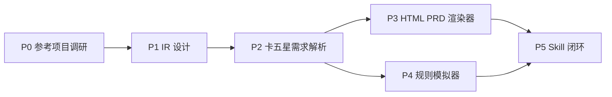

# Interactive Game PRD 执行计划

> 依据：[需求文档 v1.0](../requirements/2026-11-06-interactive-game-prd.md)  
> 日期：2026-11-06  
> 状态：待执行  
> 范围：P0 ~ P5 全阶段任务拆解与执行细节  
> 试点项目：卡五星麻将

## 0. 一句话类比

整个系统像一条「需求翻译流水线」：原始 PRD 是原材料，Game Requirement IR 是标准化零件，HTML PRD 和模拟器是装配好的展品，一致性检查是出厂质检。每个阶段的任务就是把这条流水线的一段建起来，并用卡五星麻将这批「原材料」跑通全流程。

## 1. 与现有计划的衔接

旧版 `dev-docs/planning/开发计划.md` 中的 P0（仓库初始化）、P1（内容建设）编号与本文档的 P0~P5 编号不同。本文档发布后：

- 旧 P0 已完成的部分（仓库初始化、文档体系）保持不动，作为既有基线。
- 旧 P1「内容建设」由本文档的 P0（参考项目调研）接管。
- `dev-docs/progress/执行进度.md` 的里程碑表以本文档的 P0~P5 为准重构。

## 2. 阶段总览与依赖

| 阶段 | 目标 | 核心交付物 | 验收要点 | 预估 |
|---|---|---|---|---|
| P0 | 六个参考项目引入与能力盘点 | submodule + REFERENCES.md + 调研报告 | 6 个 submodule 可初始化，报告覆盖 6 项目 | 8 人日 |
| P1 | Game Requirement IR 格式定义 | schemas/ + templates/ + validate-ir | Schema 可校验，重复 ID 与无效引用可发现 | 6 人日 |
| P2 | 卡五星原始 PRD 结构化 | examples/mahjong/ Golden Sample | 全部需求有来源，核心规则人工确认 | 8 人日 |
| P3 | HTML PRD 渲染器 | examples/mahjong/output/interactive-game-prd/ | HTML 离线可开，双向定位可用 | 10 人日 |
| P4 | 规则模拟器 | simulator 模板 + 接入 HTML | 只按 approved 规则运行，非法操作被拒 | 10 人日 |
| P5 | Skill 闭环 | skills/interactive-game-prd/ 完整技能 | 端到端流程跑通 | 5 人日 |

关键路径：P0 → P1 → P2 →（P3、P4 可并行）→ P5。P3 与 P4 共享同一份 P2 冻结的 Golden Sample，可由两个工作流并行推进。

## 3. 全局约定

### 3.1 目录与命名

- 过程文档进 `dev-docs/` 对应类型子目录，命名 `YYYY-MM-DD-关键词.md`。
- IR 与配置文件一律 kebab-case；需求 ID 按需求文档 4.5 节前缀表。
- 本仓库文档为 UTF-8，统一 LF（git 已有 CRLF 转换警告，可接受，不强制 .gitattributes）。

### 3.2 每阶段收尾动作（DoD，缺一不可）

1. 该阶段验收清单逐项打勾，结果记录到阶段执行记录。
2. 更新 `dev-docs/progress/执行进度.md` 里程碑状态表，新增该阶段执行记录小节（完成时间、交付清单、commit 号、遗留问题）。
3. 未决问题统一登记到 `dev-docs/requirements/` 对应需求文档的遗留问题或 `reviews/open-questions.json`。
4. `git commit` + `git push`。

### 3.3 技术决策点（P1 启动会上确认，当前为推荐默认值）

| 决策点 | 推荐方案 | 备选 |
|---|---|---|
| 脚本与模拟器运行时 | Node.js 20+（ESM） | Python 3.11+ |
| Schema 校验 | JSON Schema 2020-12 + ajv | draft-07 |
| IR 事实源格式 | YAML（人可读可改），构建时生成 JSON 供 HTML | 直接 JSON |
| HTML 渲染栈 | 原生 HTML + 原生 JS，无框架 | React（经 Renderer 接口预留） |
| HTML 数据装载 | 构建时内嵌为单个 JSON，避免 file:// 跨域 fetch | 相对路径本地文件 |

> 说明：file:// 协议下浏览器禁止 fetch 本地 JSON，所以 P3 必须采用「数据内嵌」方案，这是硬约束不是偏好。

### 3.4 外部依赖与前置条件

| 依赖 | 需求方 | 阻塞阶段 | 当前状态 |
|---|---|---|---|
| 原始卡五星麻将 PRD 文件 | 用户提供 | P2 及之后全部 | 未到位，P0 期间向用户索取 |
| 六个参考仓库可访问 | 网络/GitHub | P0 | 待验证 |
| 人工确认规则的产品/策划时间 | 用户 | P2-09 | 需提前排期 |

## 4. P0：参考项目调研与基准建立

### P0-00 前置：调整 .gitignore（0.5 人日）

**冲突说明**：现有 `.gitignore` 用 `thirdparties/` 忽略整个目录，但 submodule 的 gitlink 必须进 git，否则别人克隆拿不到参考项目。必须在添加 submodule 之前处理。

- 输入：现有 `.gitignore`
- 产出：新的 `.gitignore`
- 步骤：
  1. 将 `thirdparties/` 改为 `thirdparties/*`。
  2. 追加白名单（负向规则）：`!thirdparties/REFERENCES.md`、六个 submodule 路径（`!thirdparties/prd-pilot`、`!thirdparties/prd-html-generator`、`!thirdparties/prd-writer`、`!thirdparties/Arrow`、`!thirdparties/GDD-Forge`、`!thirdparties/game-doc-forge`）。
  3. `bmad-module-game-dev-studio` 保持被忽略（普通目录，非 submodule）。
  4. 验证：`git check-ignore thirdparties/bmad-module-game-dev-studio` 命中；`git check-ignore thirdparties/REFERENCES.md` 不命中。
- 验收：`git status` 能看到后续新增的 submodule 路径。

### P0-01 新增六个 Git Submodule（0.5 人日）

- 输入：需求文档 3.2 节六个仓库地址
- 产出：六个 submodule + 更新的 `.gitmodules`
- 步骤：
  1. 依次执行需求文档 3.3 节的六条 `git submodule add` 命令。
  2. 每条执行后立刻 `git submodule status` 确认。
  3. 单个仓库失败（不存在、私有、网络超时）时：记录到风险表并跳过，不阻塞其余仓库；失败仓库在 P0-09 报告中说明替代研究方式（如仅基于网页文档调研）。
  4. Windows 下克隆 Arrow 若报路径过长，使用 `git -c core.longpaths=true submodule update --init --recursive`。
- 验收：`git submodule status` 输出 6 行，行首无 `+` 或 `-` 前缀。
- 依赖：P0-00

### P0-02 记录版本、License、Commit SHA（0.5 人日）

- 产出：`thirdparties/REFERENCES.md`
- 步骤：
  1. 对每个 submodule 记录：仓库地址、License 类型（读根目录 LICENSE 文件）、固定 commit SHA（`git -C thirdparties/<name> rev-parse HEAD`）、研究目的、引入日期。
  2. License 为 GPL/AGPL 类或有争议时，在「复用策略」列标注「只读研究，禁止复制代码」。
- 验收：REFERENCES.md 覆盖全部已成功引入的 submodule，含 License 与 SHA。
- 依赖：P0-01

### P0-03 ~ P0-08 六个项目研究（每项 1 人日，可并行）

每项研究的统一动作：

1. 读 README 与入口源码，回答固定问题清单（见下）。
2. 产出单篇研究笔记：`dev-docs/research/2026-11-XX-ref-<项目名>.md`。
3. 在笔记末尾给出「复用 / 借鉴思想 / 不采用」三档结论。

| 任务 | 项目 | 固定研究问题 |
|---|---|---|
| P0-03 | PRD Pilot | Requirement Spec 的数据结构长什么样？生成链路分几步？质量检查检查什么？定点修改如何不破坏其他部分？ |
| P0-04 | PRD HTML Generator | PRD 抽屉如何组织内容？锚点定位用什么机制（ID 命名、滚动定位）？HTML 模板结构？ |
| P0-05 | PRD Writer | 游戏 PRD 章节结构？HTML 导出是单文件还是多文件？交互原型如何绑定需求？ |
| P0-06 | Arrow | 节点运行时如何求值？变量与状态如何存储？HTML Export 打包了什么，能否离线运行？ |
| P0-07 | GDD-Forge | Manifest/Feature/Segment 数据结构？设计决策如何记录与追溯？ |
| P0-08 | Game Doc Forge | Interview Ledger（决策账本）记录什么？Open Questions 如何管理？Audit 流程？ |

- 验收：六篇笔记齐全，每篇含固定问题清单的回答与三档结论。
- 依赖：P0-01

### P0-09 技术调研总报告与复用决策表（1 人日）

- 产出：`dev-docs/research/2026-11-06-interactive-game-prd-reference-research.md`
- 步骤：
  1. 汇总六篇笔记，形成跨项目对比表：能力维度（IR 设计 / HTML 定位 / 状态机 / 决策账本 / 校验）× 项目。
  2. 输出复用决策表，列：能力项、结论（复用代码 / 借鉴思想 / 自研）、来源项目、理由。
  3. 明确写入：哪些项目不集成进最终产品及原因。
- 验收：报告覆盖六个项目；决策表三档结论均有理由；无「全部复用」这类未思考结论。
- 依赖：P0-03 ~ P0-08

### P0 验收清单

- [ ] 六个 submodule 正常初始化（或失败仓库已记录替代方案）
- [ ] REFERENCES.md 含 License 与 SHA
- [ ] 研究报告覆盖六个项目
- [ ] 明确复用、借鉴、不采用内容
- [ ] 未修改任何第三方源码（`git -C thirdparties/<name> status` 全部干净）

## 5. P1：Game Requirement IR

### P1-01 IR 顶层结构（1 人日）

- 产出：`skills/interactive-game-prd/references/game-prd-format.md`（目录结构规范文档）
- 步骤：
  1. 按需求文档 4.2 节目录树定稿，逐目录写清「放什么、不放什么」。
  2. 定义 `manifest.yaml` 字段：game_name、version、ir_version、source_files、entry_points、stats。
  3. 定义 glossary（术语表）结构：卡五星特有的「赖子」「杠」等术语必须先进术语表再被引用。
- 验收：规范文档评审通过，目录树与需求文档一致。

### P1-02 需求 ID 规范（0.5 人日）

- 产出：ID 规范章节（并入 game-prd-format.md）
- 步骤：
  1. 落地需求文档 4.5 节前缀表。
  2. 补充编号规则：前缀-三位递增数字，废弃 ID 不复用，新增 ID 取当前最大值 +1。
  3. 明确 ID 一经分配永不改变；需求删除用 `deprecated` 状态而不是物理删除。
- 验收：规范无歧义，validate-ir 可据此校验（P1-08 实现）。

### P1-03 Requirement Schema（1 人日）

- 产出：`skills/interactive-game-prd/schemas/requirement.schema.json`
- 步骤：
  1. 按需求文档 4.4 字段定义 JSON Schema：required 字段 = id、type、name、status、authority、source。
  2. `status` 枚举 proposed/approved/rejected/deprecated；`authority` 枚举 fixed/delegated/open。
  3. `source.quote` 为必填且非空——没有原文引用不算有效需求。
  4. `id` 用 pattern 强制前缀与 type 一致（type=game_rule 必须 GAME-RULE 开头）。
- 验收：合法样例通过、缺 source 的样例报错、前缀不匹配的样例报错。

### P1-04 UI Spec Schema（1 人日）

- 产出：`schemas/ui.schema.json`
- 步骤：
  1. 按需求文档 7.2 节定义 page 结构：id、name、resolution、components、states、interactions、requirements、test_refs。
  2. component 定义：id（GAME-COMP 前缀）、type、props、events、requirements 引用数组。
  3. interaction 定义：trigger（GAME-EVENT 前缀）、from_state、to_state、handler_ref。
- 验收：需求文档 7.2 示例可校验通过。

### P1-05 Test Spec Schema（1 人日）

- 产出：`schemas/test.schema.json`
- 步骤：
  1. 场景（scenario）与用例（case）两级结构。
  2. case 必含：id（GAME-TC 前缀）、related_requirements、preconditions、steps、expected、type（normal/illegal/boundary/abnormal 四类，对应需求文档 8.3 节）。
- 验收：四类用例各有一个样例通过校验。

### P1-06 source-map 溯源机制（1 人日）

- 产出：`references/interactive-html.md` 中 source-map 章节 + `templates/` 内 source-map 样例
- 步骤：
  1. 定义 `source/source-map.json`：`[{ "requirement_id": "GAME-RULE-001", "anchors": [{ "file": "original-prd.md", "heading": "第三章 出牌规则", "line_start": 42, "line_end": 47, "quote_hash": "sha1:..." }]}]`。
  2. 定位粒度到「标题 + 行区间」，保证能回到原文段落。
  3. quote_hash 用于检测原始 PRD 被改动后溯源失效。
- 验收：给定任一 requirement_id 能人工按 map 找到原文段落。

### P1-07 需求状态与授权机制（0.5 人日）

- 产出：状态机规则章节（并入 game-prd-format.md）
- 步骤：
  1. 状态流转规则：proposed → approved / rejected；approved → deprecated；rejected → proposed（可重新提取）。禁止 approved → proposed（确认过的规则只能废弃不能退回未确认）。
  2. 授权字段变更权限：fixed 与 delegated 只能由人工确认动作改变，AI 只能在 open 范围内决策。
  3. 状态变更必须记录：谁、何时、依据（写入 reviews/decision-log.json）。
- 验收：规则文档评审通过；P1-08 校验器能拒绝非法流转。

### P1-08 IR 确定性校验工具（1 人日）

- 产出：`skills/interactive-game-prd/scripts/validate-ir`（Node.js 脚本）
- 步骤：
  1. 实现检查项：Schema 校验；ID 重复；引用的 ID 不存在（ui_refs/test_refs/dependencies）；approved 需求无 source；核心需求无 test_refs（告警）；状态非法流转；source-map 指向的文件/行不存在。
  2. 输出机器可读 JSON 报告：`{ result: pass|fail, errors: [...], warnings: [...] }`。
  3. 附最小测试样例集 `scripts/validate-ir.example/`（合法包、重复 ID 包、悬空引用包各一份）。
- 验收：三种样例包运行结果符合预期；`node scripts/validate-ir --help` 可用。
- 依赖：P1-01 ~ P1-07

### P1 验收清单

- [ ] Schema 能验证合法 IR（样例通过）
- [ ] 重复 ID 能被发现
- [ ] 无效引用能被发现
- [ ] 每条需求可追溯原始来源（source-map 可用）
- [ ] 未确认需求明确标记（status/authority 生效）

## 6. P2：卡五星麻将需求解析

> 阶段前置条件：用户已提供原始卡五星 PRD（Markdown 优先；DOCX/PDF 需先人工转 Markdown，第一版不做自动转换服务）。

### P2-01 导入原始 PRD（0.5 人日）

- 产出：`examples/mahjong/source/original-prd.md`
- 步骤：
  1. 原始文件放入 `examples/mahjong/source/`，**不做任何改写**。
  2. 记录文件来源、版本、接收日期到 manifest。
- 验收：文件与用户提供版本一致（可比对 hash）。

### P2-02 ~ P2-06 五步抽取（合计 4 人日）

按需求文档 5.2 节执行，注意每步的产出落点：

| 任务 | 内容 | 产出落点 |
|---|---|---|
| P2-02 | Step1 材料解析：章节、标题层级、表格、数值配置清单 | source-map 骨架 |
| P2-03 | Step2 领域抽取：玩法规则、功能、状态、操作、数值、UI、异常、验收 | requirements/ 与 data/ 各文件 |
| P2-04 | Step3 分类：明确 / 隐含 / AI 建议 / 待确认 / 冲突，AI 推测一律 status=proposed | 需求文件 status 字段 |
| P2-05 | Step4 结构化：分配 ID、写 business_rules、state_transitions | requirements/ 全量文件 |
| P2-06 | UI 页面与组件抽取：三场景（大厅 / 对局 / 结算）页面规格与组件树 | ui/ 目录 |

执行纪律（每步通用）：

- 抽取时逐条填写 `source.quote` 原文引用，禁止凭记忆写。
- 遇到原始 PRD 未定义的规则（如具体番型计算），**只登记 open question，不编造规则**——这是需求文档 8.2 节的红线。
- 每完成一个子任务跑一次 `validate-ir`，保持 IR 始终可校验。

### P2-07 生成需求追踪关系（0.5 人日）

- 步骤：补全全部 ui_refs / test_refs / dependencies 双向引用；跑 validate-ir 清零悬空引用。
- 验收：validate-ir 报告 errors 为空。

### P2-08 完整性与一致性审查报告（1 人日）

- 产出：`examples/mahjong/reviews/completeness.json`、`consistency.json`、`open-questions.json`
- 步骤：
  1. 按需求文档 5.2 Step5 七个维度检查（完整性、一致性、可测试性、可实现性、边界、可追溯、可视化覆盖）。
  2. 问题按 5.3 节格式登记：id（REVIEW-XXX）、severity、related_requirements、evidence、suggestion。
  3. 卡五星重点核查项：赖子（癞子牌）规则是否有明确定义；碰杠优先级；流局条件；计番与结算公式是否完整。
- 验收：三份报告齐全，critical/high 问题逐条有 evidence。

### P2-09 人工确认核心规则（1 人日，需用户参与）

- 产出：决策记录 `reviews/decision-log.json` + 更新后的需求状态
- 步骤：
  1. 从 open-questions 与 proposed 规则中筛出「核心规则确认清单」（预计 10~30 条），按优先级排序，**提前发给用户**。
  2. 逐条与用户确认：采纳 / 修改 / 否决 / 挂起。
  3. 确认结果写回 IR：status → approved/rejected，authority 按用户口径设 fixed/delegated。
  4. 全过程记录 decision-log：问题原文、用户决定、日期、影响的需求 ID。
- 验收：核心规则清单无遗留 open；decision-log 完整。
- 依赖：P2-08；**外部依赖：用户时间，需提前预约**

### P2-10 冻结 Golden Sample（0.5 人日）

- 步骤：
  1. 跑 validate-ir 最终通过。
  2. 记录冻结版本号（manifest.version）与 IR 目录整体 SHA，写入 `examples/mahjong/FROZEN.md`。
  3. 冻结后修改必须走需求文档 Update 流程（P5 集成），P3/P4 阶段一律只读。
- 验收：P3、P4 启动时引用的 IR 与冻结版本 hash 一致。

### P2 验收清单

- [ ] 所有已抽取需求都有来源（validate-ir 零 error）
- [ ] 无虚构规则（抽查 20 条规则核对原文引用）
- [ ] 关键未决问题单独列出（open-questions.json）
- [ ] 核心规则已人工确认（approved）
- [ ] 每条核心需求有对应验收场景（test_refs 完整）

## 7. P3：Interactive HTML PRD 渲染器

### P3-01 HTML 页面结构设计（1 人日）

- 产出：`skills/interactive-game-prd/assets/html-template/` 骨架 + 设计说明（并入 references/interactive-html.md）
- 步骤：
  1. 三栏布局：左导航 / 中展示区（PRD、UI Demo、Flow、Tests 四模式 Tab）/ 右详情面板。
  2. 数据装载：构建脚本把 game-spec 编译为单个 `data/app-data.json`，`index.html` 内联引入（file:// 离线约束，见 3.3 节）。
  3. 全局状态：当前选中需求 ID、当前页面、当前模式，支持 URL hash 深链（如 `#req=GAME-RULE-001`）。
- 验收：静态骨架在 Chrome file:// 下打开无报错。

### P3-02 ~ P3-04 导航、PRD 展示、详情面板（合计 2 人日）

| 任务 | 内容 | 要点 |
|---|---|---|
| P3-02 | 左侧需求导航树 | 按需求文档 6.2 节九个分组；每节点显示需求 ID + 状态徽标（proposed 黄 / approved 绿 / open 灰） |
| P3-03 | PRD 文档模式 | 按 IR 渲染结构化文档；每条需求块带锚点 ID；支持按状态过滤 |
| P3-04 | 右侧详情面板 | 显示当前需求 ID、来源（可展开看原文 quote）、业务规则、前置条件、关联 UI/测试、状态、AI 解释 |

### P3-05 UI Demo 视图（2 人日）

- 步骤：
  1. 按 ui/ 规格 + 模拟数据渲染三个页面（大厅、对局、结算）的静态布局。
  2. 实现 Level 1 交互：页面跳转、弹窗、Loading/Error/Disabled/Success 状态切换（不需真实规则）。
  3. 每个组件渲染时输出 `data-component-id` 与 `data-requirements` 属性。
- 验收：三页面可切换，状态模拟可触发。

### P3-06 Flow 和 State Machine 视图（1.5 人日）

- 步骤：
  1. 从 IR 的 state_transitions 渲染状态图（Canvas 或 SVG 手绘布局，第一版不引入图形库依赖）。
  2. 非法转换标红、未确认转换标黄。
  3. 点击状态/转换节点联动右侧详情面板。
- 验收：卡五星期望状态（如：等待开局 → 对局中 → 结算）可视化正确。

### P3-07 测试用例视图（1 人日）

- 步骤：按 scenario 分组展示四类用例；显示关联需求与预期结果；与模拟器对接的「执行」按钮预留（P4 接入）。

### P3-08 / P3-09 双向定位（合计 1.5 人日）

- P3-08 PRD → UI：点击需求 → 切到 UI Demo 模式 → 滚动定位到 `data-requirements` 含该 ID 的组件 → 高亮（CSS outline 2s）→ 详情面板展示关联规则。
- P3-09 UI → PRD：点击组件 → 读 `data-component-id` → 反查关联需求 → 切到 PRD 模式并定位 → 详情面板显示规则与测试用例。
- 验收：任选 5 条核心需求做双向定位冒烟，全部正确。

### P3-10 离线导出（1 人日）

- 产出：`skills/interactive-game-prd/scripts/validate-html` + 导出打包步骤
- 步骤：
  1. validate-html 检查项：无未替换模板变量（`{{...}}` 扫描）；资源全部相对路径；data-component-id 与 UI Spec 一致；无指向外网 URL 的资源引用。
  2. 全目录打 ZIP（PowerShell `Compress-Archive` 或 Node 脚本）。
  3. 导出前强制先跑 validate-ir + validate-html，双通过才允许导出（对应需求文档 10.2 Export 约束）。
- 验收：ZIP 解压到任意目录，双击 index.html 全功能可用。

### P3 验收清单

- [ ] HTML 独立打开（file:// 无报错）
- [ ] 需求导航完整
- [ ] PRD 条目能定位 UI
- [ ] UI 能定位需求
- [ ] 关联关系正确（抽查通过）
- [ ] 核心功能不依赖在线 API

## 8. P4：麻将规则模拟器

> 硬约束（需求文档 8.2 节）：只按 P2 冻结且 approved 的规则实现；碰、杠、胡是否适用、优先级、牌型判定、结算方式全部以原始 PRD 确认口径为准；规则缺失时报「规则未定义」而不是编造行为。

### P4-01 模拟器接口设计（1 人日）

- 产出：`skills/interactive-game-prd/assets/simulator-template/` 接口定义 + `references/simulator-contract.md`
- 步骤：
  1. 定义核心接口：`loadScenario(spec)`、`dispatchAction(playerId, action)`、`getState()`、`getEventLog()`。
  2. 事件日志契约：每次操作产生 `{ seq, timestamp, player, action, rule_ref, verdict, state_before, state_after }`，`rule_ref` 必须指向 GAME-RULE ID——这就是「可追踪」的落点。
  3. 规则引擎从 IR 读取 approved 规则；遇 open/proposed 规则引用 → 抛 `RULE_NOT_CONFIRMED`，UI 显示未确认标识。
- 验收：契约文档评审通过，接口有 TypeScript 类型定义。

### P4-02 ~ P4-05 核心实现（合计 5 人日）

| 任务 | 内容 | 关联规则来源 |
|---|---|---|
| P4-02 | 牌桌状态：牌墙、余牌数、庄家、局状态 | data/entities + configs |
| P4-03 | 玩家手牌、弃牌区、碰杠区 | entities |
| P4-04 | 摸牌、出牌交互与合法性校验 | approved 的出牌规则 |
| P4-05 | 碰、杠、胡判定（含优先级：同时可碰可胡时按 PRD 口径） | approved 的碰杠胡规则 |

实现纪律：

- 每个规则实现函数头部注释标明实现的 GAME-RULE ID。
- 判定逻辑与 UI 完全分离：core 不 import 任何 DOM/HTML 代码（P4-08 才经 adapter 接入）。

### P4-06 预设场景加载（1 人日）

- 步骤：场景定义格式 = 初始牌面 + 事件序列（JSON），放 `scenarios/` 下 normal-flow / exception-flow / edge-cases 三组；场景里的预期结果引用 GAME-TC ID，不重复写规则。
- 验收：每类场景至少 1 个可加载回放。

### P4-07 规则判定日志展示（0.5 人日）

- 步骤：HTML 的 UI Demo 模式加「判定日志」抽屉，实时显示事件流；点击日志条目跳转对应规则详情。

### P4-08 接入 HTML（1 人日）

- 步骤：实现 `html-ui-adapter`，把模拟器事件翻译成 UI 更新；模拟器 core 编译为浏览器可用的单文件（esbuild 打包，产物进 simulator/）。
- 验收：断网状态（DevTools Offline）下完整对局可玩。

### P4-09 模拟器测试（1 人日）

- 步骤：
  1. Node 侧单测：场景回放断言（初始状态 → 操作序列 → 期望终态），用 P2 的 GAME-TC 作为用例源。
  2. 覆盖需求文档 8.3 节四类场景：正常、非法操作（如乱序出牌被拒）、边界（牌墙摸空）、状态异常（未开局就胡牌被拒）。
  3. 脚本化：`npm test` 一键回放全部场景。
- 验收：全部冻结场景回放通过；故意改错一条规则能让对应场景失败（验证测试有效性）。

### P4 验收清单

- [ ] 预设场景可重复加载
- [ ] 玩家操作符合 approved 规则
- [ ] 非法操作被拒绝
- [ ] 状态转换正确
- [ ] 模拟器输出可追踪（rule_ref 全部有效）
- [ ] 规则缺失时输出 RULE_NOT_CONFIRMED 而非虚假正确结果

## 9. P5：一致性验证与 Skill 闭环

### P5-01 ~ P5-06 六个模式集成（合计 3 人日）

- 产出：`skills/interactive-game-prd/SKILL.md` + workflows/ 七个工作流文档
- 每个 workflow 文档统一结构：触发方式 / 输入 / 步骤 / 质量门 / 输出 / 禁止事项。对应需求文档 10.2 节约束逐条写入禁止事项：

| 集成任务 | 对应 workflow | 关键约束落点 |
|---|---|---|
| P5-01 Create | parse-prd + extract-requirements + generate-ir | 不得覆盖原始 PRD（写前检查目标路径） |
| P5-02 Update | extract-requirements（增量） | 生成变更记录 decision-log 追加 |
| P5-03 Review | review-requirements | 只产出报告，不修改原始需求 |
| P5-04 Generate | generate-html + generate-simulator | 不修改 approved 规则 |
| P5-05 Validate | validate-output | 串联 validate-ir + validate-html + 模拟器回放，输出机器可读报告 |
| P5-06 Export | validate-output 尾段 | 双校验通过才打 ZIP |

### P5-07 端到端测试（1 人日）

- 步骤：
  1. 用一份小样例 PRD（非卡五星，如 20 条规则的迷你游戏）从零走完整 Create 流程。
  2. 断言：IR 通过校验；HTML 可离线打开；模拟器场景回放通过；Validate 报告 result=pass。
  3. 端到端脚本固化，作为回归基线。
- 验收：迷你样例全流程通过；卡五星 Golden Sample 重跑 Validate 通过。

### P5-08 README 与使用示例（1 人日）

- 产出：`skills/interactive-game-prd/SKILL.md` 使用说明 + `docs/` 新增一篇读者向使用指南（en + zh-CN 同步）。
- 步骤：写清六种模式的调用方式、目录约定、常见错误；补充卡五星示例入口。

### P5 验收清单（对应需求文档 16 节最终标准）

- [ ] 迷你样例 PRD 端到端跑通
- [ ] 卡五星 Golden Sample 全链路重跑通过
- [ ] 未参与需求讨论的视角检查：仅凭 IR 能理解规则、仅凭 HTML 能理解并体验核心流程
- [ ] 六种模式约束全部生效（抽样验证）

## 10. 风险清单与应对

| ID | 风险 | 影响 | 应对 |
|---|---|---|---|
| R1 | 原始卡五星 PRD 未到位 | P2 起全部阻塞 | P0 期间向用户索取；到位前 P1 可用迷你样例先行开发 Schema |
| R2 | 参考仓库不存在 / 私有 / 被删 | P0 部分缺失 | 记录并降级为网页资料调研；P0-09 说明 |
| R3 | License 限制代码复用 | P1/P3 复用受阻 | P0-02 逐项核对，争议 License 只借鉴思想 |
| R4 | IR Schema 设计返工 | P1 后全线返工 | P1 先做 validate-ir + 迷你样例验证再铺量；P2 抽取过程持续校验 |
| R5 | 人工确认排期拖延 | P2-09 卡进度 | 确认清单提前产出并预约时间；未确认规则不影响 P3 Level 1 并行 |
| R6 | file:// 离线约束踩坑 | P3 返工 | 3.3 节已定数据内嵌方案；P3-01 骨架先验证 file:// 可用 |
| R7 | Windows 路径过长 / CRLF | 环境问题 | longpaths 克隆；LF 提交 + git 自动转换，不阻塞 |

## 11. 进度跟踪与变更管理

- 里程碑状态统一维护在 `dev-docs/progress/执行进度.md`，每阶段收尾按 3.2 节 DoD 更新。
- 阶段执行中的设计决策：写入 `dev-docs/design/` 对应文档；踩坑：写入 `dev-docs/experience/`。
- 需求变更：回到需求文档改版本（v1.x），本文档同步改受影响任务，不允许执行时静默偏离需求。

## 引用说明

- 需求依据：[Interactive Game PRD 需求文档 v1.0](../requirements/2026-11-06-interactive-game-prd.md)
- 参考方法论：BMad Game Dev Studio（`thirdparties/bmad-module-game-dev-studio`，只读）
- P0 引入的六个参考项目仓库地址见需求文档 3.2 节
- 流程规范：本仓库 [CLAUDE.md](../../CLAUDE.md)（文档管理与进度记录规则）
