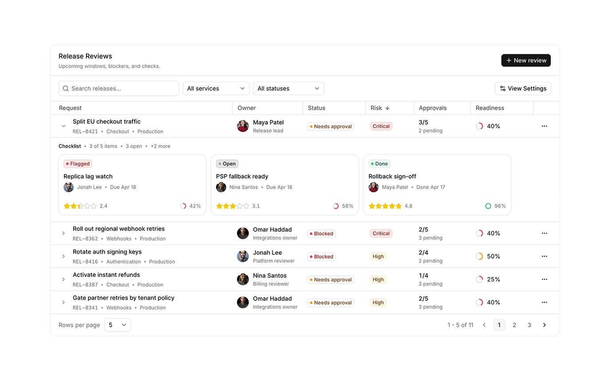
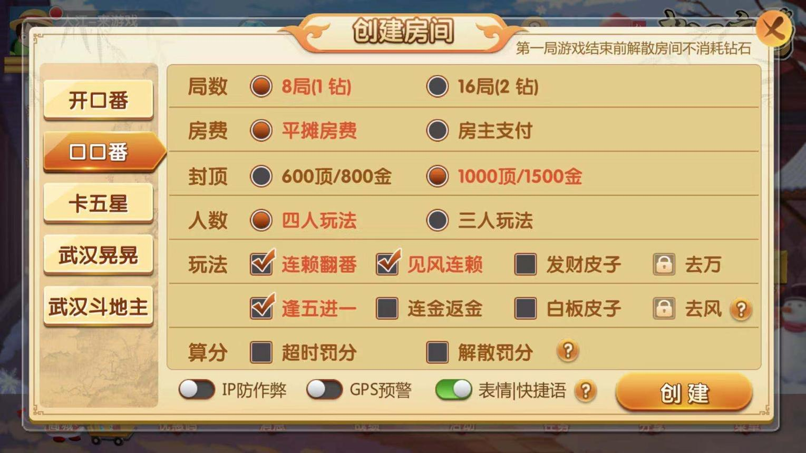
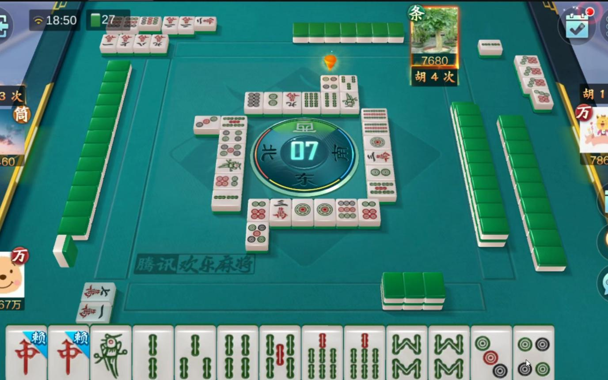
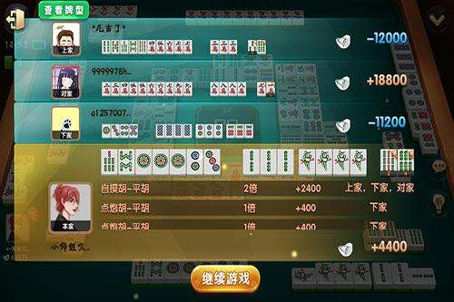

# P6-P10：卡五星需求审批与真实验收执行计划

> 来源：外部评审建议（2026-11-09）
> 核心结论：不建议继续扩展功能，而是进入 PrdGameSkill 的真实项目验收与需求工程闭环阶段。
> 图片参考已下载至本目录 `images/` 下，链接已替换为本地路径。

## 背景

目前已经完成了一个重要里程碑：

> 原始游戏 PRD → 结构化 IR → 需求审查 → Interactive HTML PRD → UI 演示 → 规则模拟器 → 自动校验。

但现在还不能说这套系统已经真正解决了游戏开发中的需求问题。

原因是：目前完成的是 AI 对原始需求的结构化抽取和技术管线验证，尚未完成真正的人工需求确认，也没有充分验证它能否指导后续 UI 设计和游戏开发。

下一阶段围绕三个问题推进：

1. AI 有没有正确理解原始需求？
2. 生成的 UI 是否真的符合需求？
3. 程序员和 AI 能不能直接使用这套 PRD 开始开发？

## 一、P6：卡五星需求人工确认

最高优先级。

当前阻塞项：31 个未决问题。

这是下一步最重要的事情。

仓库已经生成了 `confirmation-checklist.md`，目前分为：

| 优先级    | 数量 | 处理建议    |
| ------ | -- | ------- |
| High   | 18 | 优先确认    |
| Medium | 11 | 随核心规则处理 |
| Low    | 2  | 可以延后    |

其中有几个问题必须先确认：

| 问题                | 影响        |
| ----------------- | --------- |
| OQ-013：字分是否参与结算   | 影响结算公式    |
| OQ-014：杠开是否叠加     | 影响番型计算    |
| OQ-015：首亮荒庄赔付对象   | 影响结算      |
| OQ-016：第二家亮倒包牌    | 影响结算      |
| OQ-011/012：杠上花炮倍数 | 影响番型      |
| OQ-027：大厅页面缺失     | 影响 UI 完整性 |

参考文件：[人工确认清单](https://github.com/mickorz/PrdGameSkill/blob/main/examples/mahjong/game-spec/reviews/confirmation-checklist.md)

### 建议增加一个功能：需求审批工作台

不要一直通过 Markdown 勾选确认。

可以直接在 HTML PRD 中增加审批模式：



参考实现：[reui.io Data Grid Blocks](https://reui.io/blocks/data-grid)

每条问题显示：

- 原始 PRD 引用。
- AI 发现的问题。
- AI 推荐的解决方案。
- 关联需求 ID。
- 影响的 UI、规则、测试。
- 人工裁决按钮。

裁决后自动：

1. 更新 IR。
2. 写入 decision-log。
3. 更新关联需求状态。
4. 重新生成 HTML。
5. 重新执行校验。
6. 更新冻结版本。

注意：不能把 AI 推导出来的口径直接批量批准。尤其是涉及真实业务规则和结算的内容，必须由产品或策划确认。

## 二、P7：真正验证 HTML UI Demo

需要加强实机验收。

现在 HTML 已经能运行，但还需要回答一个关键问题：

> 这个 Demo 是不是能够让一个没看过原始 PRD 的程序员，直接理解游戏？

目前存在两个明确问题：

- 游戏大厅页是占位条目。
- 创房面板只有业务语义，缺少完整 UI 结构。

建议分三个方向：

### 1. 补齐页面

游戏大厅（待补充）：


创建房间（待补充）：



麻将对局（已有基础）：



结算界面（已有基础）：



注意：图片只是页面参考方向，不代表原始需求已经定义了这些 UI 细节。

### 2. 增加 UI 与 PRD 的双向验证

例如点击麻将中的「杠」按钮：

- 能找到对应的 UI 组件 ID。
- 能找到对应的 EVENT ID。
- 能找到对应的 GAME-RULE ID。
- 能找到对应的测试用例。
- 能查看原始 PRD 的依据。

反过来，从某条规则也能直接定位到 UI。

### 3. 真正使用 Chrome 验收

现在的自动化检查主要依靠 jsdom 和脚本。

还需要补充：

- Chrome 实际打开 file:// 页面。
- 页面截图对比。
- 点击操作验证。
- Console 错误检查。
- 不同分辨率验证。
- 模拟器操作和规则日志同步验证。

这一步可以考虑复用之前研究过的 `pi-browser-harness` / `pi-chrome` 自动化测试能力。

## 三、P8：提高测试覆盖率，建立游戏需求测试体系

这是目前技术上最值得补强的部分。

执行记录里有一个数据值得注意：

> 当前测试覆盖率：0.12

当前 Validate 报告记录的测试覆盖率。

模拟器已有 39/39 单测通过，但这不等于全部需求都得到测试覆盖。

这两个指标必须区分：

- 单元测试通过率：现有测试是否正确运行。
- 需求覆盖率：所有应该验证的需求有多少已经被测试用例覆盖。

建议建立：

| 测试类型  | 主要验证内容         |
| ----- | -------------- |
| 正常流程  | 正常摸牌、出牌、碰、杠、胡  |
| 非法操作  | 不允许的碰、杠、胡      |
| 边界测试  | 封顶、番型、剩余牌数     |
| 状态异常  | 漏胡、托管、抢杠胡      |
| 结算测试  | 杠分、漂分、买马、荒庄、包牌 |
| UI 交互 | 按钮、弹窗、状态切换     |
| 配置组合  | 不同创房配置的规则表现    |

特别建议增加一个重要能力：从需求自动生成测试用例，并计算需求覆盖率。

例如：

```
GAME-RULE-108 杠上花
       |
       v
TC-021 默认2倍
TC-022 配置4倍
TC-023 不符合杠上花条件
TC-024 封顶情况下的杠上花
       |
       v
自动执行
       |
       v
需求覆盖报告
```

目标不是追求测试用例数量，而是让每条 approved 规则都有明确的验证依据。

## 四、P9：接入 AI 游戏开发工作台

这一步才是 PrdGameSkill 最终价值的体现。

目标并不是只生成一个 HTML PRD，而是把游戏需求、UI 设计、FairyGUI 和 AI 开发打通。

建议后续建立这样的链路：

```
Game AI Development Pipeline

Interactive Game PRD（需求、规则、UI、配置、测试）
        |
        +-- UI 工作流：需求 → HTML / React → UI 审核 → FairyGUI XML
        +-- 游戏逻辑工作流：规则 → 代码任务 → 实现 → 单元测试
        +-- 配置工作流：数值需求 → 配置表 → 边界检查
        +-- 测试工作流：测试规格 → 自动化测试 → 缺陷反馈
        |
        v
Game Development Agent（实现、验证、修复、交付）
```

这里最重要的是：PrdGameSkill 不应该直接负责生成所有游戏代码。

它应该负责提供可靠的 AI 可读规格，成为不同开发 Agent 的统一输入。

结合现有的 FairyGUI HTML Renderer，可以实现：

1. AI 读取 UI 需求。
2. 生成 HTML / React 页面。
3. 在 UI 工作台中人工调整。
4. 转换为 FairyGUI XML。
5. 将实际 UI 与 PRD 中的 UI 规格进行对照。
6. 发现差异后反馈给需求审查流程。

这样就真正打通了需求到 UI 的链路。

## 五、P10：建立通用游戏 PRD Benchmark

最后不要只在卡五星上验证成功就认为 Skill 已经完成。

建议再选择第二个游戏项目，最好是玩法结构明显不同的游戏，例如：

- 卡牌游戏。
- RPG 游戏。
- 消除类游戏。

用第二个项目检验：

| 评测指标     | 评测目的        |
| -------- | ----------- |
| 需求抽取准确率  | AI 是否正确理解原文 |
| 需求覆盖率    | 是否遗漏重要需求    |
| 来源追溯率    | 能否定位原文      |
| 冲突识别率    | 是否识别需求矛盾    |
| UI 映射完整度 | 需求与 UI 是否对应 |
| 测试覆盖率    | 需求是否有测试依据   |
| 人工修改率    | AI 生成结果需要多少人工修正 |

最终形成一个固定 Benchmark，后续每次修改 Skill 都可以回归测试。

## 六、建议的执行优先级

| 阶段  | 工作内容                  | 优先级 |
| --- | --------------------- | --- |
| P6  | 31 项需求审批、规则确认         | P0  |
| P7  | Chrome 实机验收、补齐 UI     | P0  |
| P8  | 测试覆盖率、测试生成            | P1  |
| P9  | 接入 UI 工作台、AI 开发 Agent | P1  |
| P10 | 第二款游戏 Benchmark       | P2  |

另外，当前仓库还有一个值得在 P6 开始前修复的数据一致性问题：`FROZEN.md` 中的需求条目数量、`manifest.yaml` 的 131 条和 `consistency.json` 中的 162 条统计口径并不一致。需要统一统计定义，避免后续评测失真。

## 七、现在先做什么

首选：先完成 P6。

不建议马上开发新的功能。

先把现有 31 个问题真正处理掉，尤其是核心结算和番型规则。因为这些问题会直接影响后面的 UI、模拟器、测试和代码生成。

下一份执行文档命名建议：

`2026-11-09-P6-卡五星需求审批与真实验收执行计划.md`

重点交付：

1. 31 项问题分级裁决。
2. IR 状态升级和 Decision Log。
3. 需求审批工作台。
4. Chrome 实机验收。
5. 需求与 UI 双向追踪。
6. 重新冻结 Golden Sample。

关键原则：先让卡五星这一个真实项目成为可信的标准样板，再把它抽象成通用游戏 PRD Skill。

这比继续堆功能更有价值。
