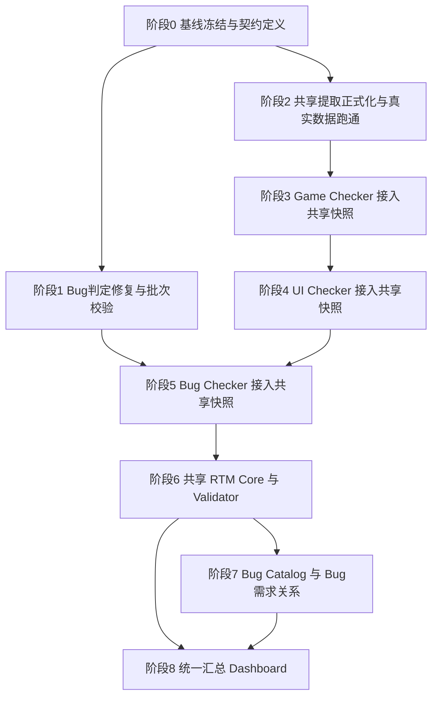
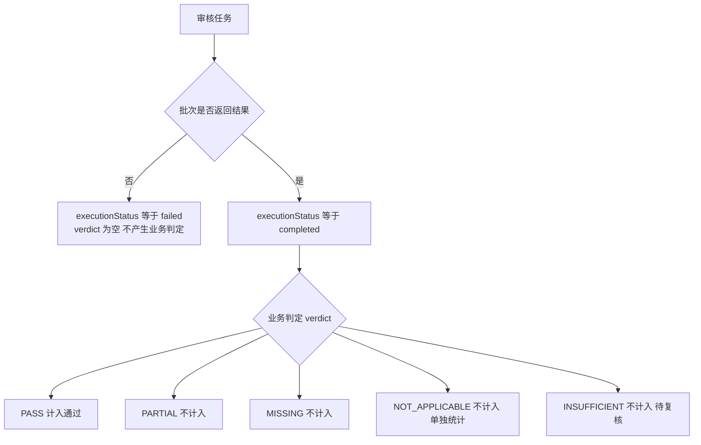

# v4 架构收敛执行计划：共享需求接入与统一 RTM

- 日期：2026-11-12
- 依据：`dev-docs/requirements/2026-11-12-v4架构收敛需求-共享需求接入与Bug判定修复.md`
- 基线：main HEAD（3985412），Game RTM run-20261112（363 需求 × 1455 规则）、Bug 检查 223 条、共享提取 mock 数据 ext-20261112-01~05
- 总目标：完成 T2/T3/T4 共享需求接入 → 建立 Bug RTM 与共享 RTM Core → 统一汇总视图；全程不重写 Checker、不破坏已有运行快照

## 一、总体策略与顺序决策

需求文档给定优先级为 P0（共享接入 + Bug 判定修复）并列。本计划做一处显式调整：

**Bug 判定口径修复（P0-2/P0-3）排在共享接入（P0-1）之前执行。**

理由：

1. 判定修复是纯 bug fix，零依赖、风险最低，可立即落地
2. Bug Checker 在 T4 接入共享快照后需要重跑 223 条审核——**先修口径再接入，只重跑一遍**；顺序反了就要跑两遍
3. 修复后的 `executionStatus / verdict` 分离结构，正是 P1 共享 RTM Core 状态机的输入雏形，先行验证

其余顺序严格遵循需求文档：三 Checker 接入（T2→T3→T4，Game 最成熟先行）→ 共享 RTM Core + Bug RTM（P1）→ 统一汇总（P2）。

## 二、阶段依赖图

说明：阶段 1 与阶段 2 无依赖可并行；阶段 3/4/5 串行（共享消费适配层一次设计、三次复用，串行能吃到前一次的教训）；阶段 6 是架构收敛点；阶段 7/8 可在 6 之后并行。

## 三、逐阶段详细计划

### 阶段 0：基线冻结与契约定义（0.5 天）

**目标**：锁定对照基线，把"共享快照消费"的参数契约和状态机先写死，后面六个阶段只实现不再争论。

任务清单：

1. 基线冻结
   - 确认 `examples/game-prd-check-workflow/rtm/runs/run-20261112/` 为对照基线（只读，后续所有回归对比都和它比）
   - 跑 `node .claude/skills/game-prd-check/scripts/build-dashboard.example.mjs` 确认零错误（当前 5/5 通过）
   - 记录当前指标：363 需求 / 1455 规则 / 99.3% 完成率 / 44.3% 完整通过率
2. 消费参数契约（三个 Checker 统一）
   - `requirementsPath`：共享提取快照目录（含 requirements.json 与 manifest.json），如 `output/projects/hzmj/extractions/20261113-01`
   - `extractionRunId`：用于校验 manifest 内 runId 一致（防错目录）
   - **不传两参数 = 旧路径行为完全保留**（各自扫描 PRD），保证渐进迁移与旧报告可复现
3. 状态机契约（全维度统一）

    - 统计口径：分母 = 总数 − NOT_APPLICABLE − failed；通过分子只含 PASS；INSUFFICIENT 与 failed 分别单独列出
4. 契约落盘：`dev-docs/design/v4-共享快照消费契约.md`（参数、状态机、Schema 字段表）

验收标准：契约文档评审通过；example 自检 5/5。

提交：`docs: v4 契约定义与基线冻结`。

### 阶段 1：Bug 判定修复与批次完整性校验（1 天）【已完成 2026-11-12，commit ead1548】

**实际落地与计划的差异**（设计优于计划，交付更完整）：

- 判定收集/缺口去重/缺口定稿/附录投影全部下沉到确定性脚本 `bug-verdicts.mjs`（计划只要求校验函数），workflow 只保留编排与提示词；13 场景自检 + 分片模式冒烟全过
- 批次 agent 改为直接写分片 `verdicts-parts/batch-XX.json` + 小 schema 确认（对齐 game-prd-check 的 checks 分片模式），避免 250KB 判定数组经模型转述失真
- 报告分片 agent（part1/2/3）改读盘上数据文件（table-rows / detail-issues / appendix-rows / gaps.json），判定数据不再经 prompt 转述
- 问题清单表升为 7 列（含问题性质列）；附录判定表升为 6 列（含执行状态列，failed 显示“执行失败（未判定）”）；概览新增执行状态分布 + 覆盖率口径说明
- `validateVerdicts` 五项校验全部实现；顺带修复 `files` 元素兼容（字符串 bugId 或对象）

**验收标准达成**：自检全过（13 场景 + 分片模式冒烟；223 条重跑待阶段 5 统一执行，见计划“重跑成本”约定）

**目标**：消灭两个 P0 —— 执行失败与判定不分、N/A 与 INSUFFICIENT 等同 PASS；补批次完整性校验。

改动清单（文件：`.opencode-workflows/workflows/bug-coverage-check.js`）：

1. 提示词口径修复（当前 86-90 行区域）
   - 第 89 行 `NOT_APPLICABLE：...相当于直接 pass。` → `NOT_APPLICABLE：检查范围不适用，不计入通过，单独统计。`
   - 第 90 行 `INSUFFICIENT：...只能按 PASS 处理...` → `INSUFFICIENT：证据不足，不计入通过，待复核；禁止凭图片臆测。`
   - 同步修 `VERDICT_LABELS`（当前约 401 行）中 `NOT_APPLICABLE: '直接 pass'` → `'不适用（单独统计）'`
2. 执行状态与判定分离
   - verdict schema 增加必填字段 `executionStatus: 'completed' | 'failed'`
   - 批次收集处（当前约 345 行 `for (const v of r.bugs) verdicts.push(v)`）：批次失败/未返回的 bug 记 `{bugId, executionStatus: 'failed', verdict: null, reason: '审核批次未返回结果'}`
   - 兜底补齐逻辑（当前约 374 行）：`verdict: 'INSUFFICIENT'` 改为 `executionStatus: 'failed', verdict: null`，删除"按信息不足登记"文案
   - `autoPassModules` 预判条目：`executionStatus: 'completed'`（确定性预判非 agent 审核，reason 注明"按 args.autoPassModules 预判"）
3. 批次完整性校验（新独立模块 `.opencode-workflows/scripts/bug-verdicts.mjs`，供 workflow 调用，可单测）

   校验函数 `validateVerdicts(allBugs, verdicts)` 五项检查：

   | 检查项 | 处理 |
   |--------|------|
   | 缺失 ID（扫描到但无任何判定） | 补 `executionStatus: 'failed'` 条目 |
   | 重复 ID（同一 bug 被返回多次） | 去重保留首条，记 warning |
   | 非法 ID（返回了 buglist 中不存在的 ID） | 剔除，记 warning |
   | 跨批次错位（批次返回了其他批次的 bug） | 记 warning（提示分片分配 bug） |
   | 总数一致（allBugs 数 = completed + failed） | 不一致报结构性错误 |

4. 统计输出口径更新：报告概览新增执行状态分布（completed / failed），覆盖率分母剔除 N/A 与 failed
5. 自检：新增 `.opencode-workflows/scripts/bug-verdicts.example.mjs`，构造 mock 批次数据覆盖五项检查 + 状态分离断言

验收标准：

- 自检全过（五项校验各一正一反用例）
- 重跑 223 条 Bug 检查：新报告出现 executionStatus 分布；旧口径下"被 pass 掉的 INSUFFICIENT/未返回"在新报告中显式可见
- 与旧报告（2026-11-11）对比出差异清单，逐条可解释

提交：`fix(bug-check): 执行状态与判定分离 + 批次完整性校验 + N/A 与 INSUFFICIENT 口径修复`。

### 阶段 2：共享需求提取正式化（1 天）【提取与对齐已完成 2026-11-13，待人工裁决 63 条】

**执行结果**：

- 真实提取已跑：`output/projects/hzmj/extractions/ext-20261112-01/`（380 条，validationStatus=passed，identityStats：exact 15 / new 364 / pending 1）
- ID 对齐验证已跑（基线 game RTM run-20261112 的 363 条 vs 快照 380 条）：**对齐率 82.6%**（exact 31 + anchor 200 + anchor-doc 69，其中包含度命中 49），未达 90% 门槛
- 差异构成（诚实归因，不许调阈值造数据）：
  - 63 条未匹配基线：主要为 11-11→11-12-2 版 PRD 真实改写（top1 相似 0.4-0.6 贴阈值但不够）+ 同章节多候选无法区分（提取侧疑似重复条目，如番型介绍 7 条）
  - 104 条快照侧未对齐：11-12-2 版新增/改写内容
  - 110 条告警：包含度命中 40（粗细粒度差异）+ 章节失配全文命中 69 + 显著领先 1
- 人工确认清单：`output/projects/hzmj/extractions/ext-20261112-01/align/align-report.md`（未匹配基线 63 条 + 快照侧 104 条，逐条列章节与原因，禁止自动合并）
- 产物已入库（快照 + 分片 + 计划 + 对齐报告 + identity-map）

**对齐工具语义修正**（跨版本粗细粒度场景，commit 30d9c28）：一对多（不消耗互斥）/ 章节标题归一（剥编号前缀）/ 章节失配全文回退（anchor-doc + 告警）/ 包含度非对称度量（-contains + 告警）；14 场景自检全过

**待办**：63 条人工裁决（区分真变化与提取重复）→ 裁决后决定是否重跑提取或接受差异进阶段 3

原任务清单：

**目标**：把 mock 验证过的 prd-requirements-extract 用真实数据跑成正式资产，完成 game 基线的 ID 对齐。

任务清单：

0. ID 对齐验证工具【已完成 2026-11-12】：`.opencode-workflows/scripts/align-check.mjs`（exact=normText 相同 / anchor=同 basename 文件同章节且 bigram Jaccard ≥ 0.6 且唯一或领先 ≥ 0.25，与 requirements-build.mjs 同算法）+ 10 场景自检 `align-check.example.mjs` 全过；已用 game RTM 363 条基线 + mock 快照冒烟验证
1. 真实提取：对 `input/【杭州麻将】核心流程杭州麻将好友房AI11-11.md` 跑正式提取，产出 `output/projects/hzmj/extractions/20261113-01/`（requirements.json + manifest + identity-map 更新）
2. ID 对齐验证（关键验收）：将 game RTM run-20261112 的 363 条需求与共享提取结果跑 anchor-match 比对
   - 目标：exact + anchor 覆盖 ≥ 90%
   - 未匹配项进 pending-confirm，产出人工确认清单（不允许自动合并）
3. pending-confirm 处理流程：`requirements-build.mjs` 输出 pending 清单文件 + 人工裁决后重跑合并的说明
4. Schema 固化：requirements.json / identity-map.json / manifest.json 字段表并入阶段 0 契约文档（或独立 schema JSON）

验收标准：正式快照落盘；对齐率报告出来；pending 清单可操作。

提交：`feat(rtm): 共享需求提取正式化（真实 PRD 全量提取 + game 基线 ID 对齐）`。

### 阶段 3：Game Checker 接入共享快照（T2，1.5 天）【代码与自检完成 2026-11-13，待真实 run 验收】

**目标**：game-prd-check 支持 `requirementsPath + extractionRunId`，跳过自提取，直接消费共享快照。

改动清单（文件：`.opencode-workflows/workflows/game-prd-check.js`）：

1. args 增加 `requirementsPath` / `extractionRunId`（校验 manifest runId 一致，不一致直接报错不猜测）
2. 替换自提取阶段（当前约 356-390 行"需求点提取：每个 PRD 文件一个 agent"）：
   - 传共享参数时：不再派提取 agent，用确定性转换把共享 requirements.json 写成 `runDir/requirements/parts/part-01.json`（契约：`{reqKey, title, source, text}`，rtm-assemble 已定义，零格式改动）
   - extractionRunId 写入 run manifest（可追溯：本次检查消费了哪次提取）
3. identity-map 复用：rtm-assemble 调用改传 `--identity-map output/projects/hzmj/identity-map.json`（REQ ID 全局稳定的关键）
4. 不传参数：旧自提取路径原样保留

验收标准：

- 消费共享快照完整跑一次 run（规则检查可抽样：3 个规则组全量 + 其余沿用已有 checks 分片做矩阵组装演练）
- Dashboard 正常渲染四 Tab；requirements 数量与共享快照一致；REQ ID 与 identity-map 无漂移
- 旧路径（不传参数）回归跑通不受影响

提交：`feat(game-check): 接入共享需求快照（requirementsPath + extractionRunId）`。

### 阶段 4：UI Checker 接入共享快照（T3，1 天）

**目标**：ui-interaction-prd-extract 消费共享快照；UI 基准逆向保持独立（需求文档明确约束）。

改动清单（文件：`.opencode-workflows/workflows/ui-interaction-prd-extract.js`）：

1. args 增加 `requirementsPath` / `extractionRunId`
2. 扫描阶段（当前约 309 行"扫描规则与需求"）：传参时跳过需求文档扫描，需求清单直接来自共享 requirements.json；**UI 基准（FGUI 逆向）扫描流程不动**
3. 检查证据链改造：PASS/PARTIAL 证据从"PRD 章节引用"升级为"REQ ID + 原文引文"双引用
4. 判定结果增加 `requirementIds` 字段（UI 维度 → REQ 关系，为 P1 关系模型供数）

验收标准：重跑 UI 检查，报告中每个判定可追溯到 REQ ID；UI 逆向产物不受影响。

提交：`feat(ui-check): 接入共享需求快照与 REQ ID 证据链`。

### 阶段 5：Bug Checker 接入共享快照（T4，1 天）

**目标**：bug-coverage-check 消费共享快照，判定挂上 REQ 关系。**此阶段重跑 223 条只此一遍**（口径已在阶段 1 修复）。

改动清单（文件：`.opencode-workflows/workflows/bug-coverage-check.js`）：

1. args 增加 `requirementsPath` / `extractionRunId`；`prdPath` 保留为兼容旧路径
2. 审核提示词：审核输入从"整本 PRD"改为"共享需求清单（REQ ID + 标题 + 原文 + 来源锚点）+ 按需回查 PRD 原文"
3. PASS/PARTIAL 证据改为引用 REQ ID（必须给出命中的需求点，无法定位写空数组）
4. verdict 增加 `requirementIds: []`（Bug ↔ REQ 多对多的原始数据，P1 Bug RTM 直接消费）
5. 沿用阶段 1 的状态分离与完整性校验

验收标准：223 条重跑完成；verdict 全部带 executionStatus 与 requirementIds；统计新口径（N/A 单列、failed 单列、INSUFFICIENT 待复核单列）。

提交：`feat(bug-check): 接入共享需求快照与 Bug 需求关系`。

### 阶段 6：共享 RTM Core 与 Validator（P1，2 天）

**目标**：形成统一 Schema、身份索引、关系模型与 validate-rtm（当前缺失项）。

任务清单（`.opencode-workflows/scripts/` 下新增）：

1. `rtm-core.schema.json`：统一实体与关系
   - 实体：Requirement（REQ）/ Rule（R 前缀）/ UIRule / Bug（buglist 数字 ID）/ Check / Issue
   - 关系：`{dimension: game|ui|bug, requirementId, targetId, verdict, executionStatus, evidence, issueIds[]}`
   - 状态机：沿用阶段 0 契约（executionStatus 与 verdict 分离）
2. 身份索引规范：REQ 由 identity-map 单写者分配；Rule/URule/Bug ID 由各自目录确定性派生；跨维度只允许通过 REQ ID 关联
3. `validate-rtm.mjs`（新增，之前未发现）：校验 RTM 快照
   - ID 引用闭合（relation 引用的 REQ/Rule/Bug 必须存在于 catalog）
   - 状态枚举合法、verdict 与 executionStatus 组合合法（failed 必须 verdict 为空）
   - PASS/PARTIAL 必须有证据字段
   - 统计一致性（各维度统计可由明细重算得出）
   - 退出码：0 通过 / 1 结构性失败
4. `rtm-merge.mjs`：合并三维度 relation + 三份 catalog → `output/projects/hzmj/unified-rtm/{date}/rtm.json` + manifest
5. `validate-rtm.example.mjs` 自检：构造含非法引用/坏状态组合/证据缺失的 mock 快照，断言全部被拦

验收标准：三个维度的最新运行产物（Game run-20261112 或新 run、UI 新 run、Bug 新 run）合并出统一 RTM 快照并通过 validate-rtm。

提交：`feat(rtm-core): 统一 Schema 与 validate-rtm 与 rtm-merge`。

### 阶段 7：Bug Catalog 与 Bug-REQ 关系（P1，1 天）

**目标**：Bug 成为正式独立资产，Bug-REQ 多对多关系落盘。

任务清单：

1. `bug-catalog.mjs`：从 `bugs/buglist/*.md` 文件名与内容确定性抽取 `{bugId, title, module, sourceFile}` → `output/projects/hzmj/bug-catalog.json`（不再只活在 agent 上下文里）
2. `bug-relations.json`：消费阶段 5 判定中的 requirementIds + 阶段 6 合并框架，生成 Bug ↔ REQ 关系表（含 verdict/executionStatus/证据）
3. REQ 视角 Bug 覆盖统计：每个 REQ 关联多少历史 Bug、PASS/PARTIAL/MISSING 分布（反向：未被任何 Bug 检验过的需求也可列出）
4. 自检：`bug-catalog.example.mjs`（223 条全部入 catalog、ID 唯一、relation 引用闭合）

验收标准：bug-catalog 223 条；关系表通过 validate-rtm。

提交：`feat(bug-rtm): bug-catalog 与 Bug 需求多对多关系`。

### 阶段 8：统一汇总 Dashboard（P2，1.5 天）

**目标**：同一个 REQ 查看 Game / UI / Bug 三维度覆盖，不改现有四 Tab 报告。

任务清单：

1. `build-dashboard.mjs` 增加统一 RTM 输入模式（如 `--unified-rtm <dir>`）：读 rtm.json，新增"统一覆盖"视图——按 REQ 列出三维度 verdict/executionStatus/证据/关联问题，支持维度筛选与未验证清单
2. 现有四 Tab 报告与 --rtm 模式原样保留（旧报告可复现）
3. `full-check-suite.js` 串联完整链路：共享提取 → 三 Checker 并行 → rtm-merge → 统一 Dashboard（当前 311 行的并行调度结构已具备，补数据依赖串联）
4. 端到端验收演练一次并留存运行快照

验收标准：363 个 REQ 的三维度覆盖全展示；从任一 REQ 可下钻三个维度的证据；旧模式回归不受影响。

提交：`feat(dashboard): 统一 RTM 汇总视图与全链路串联`。

## 四、里程碑总表

| 阶段 | 内容 | 预估 | 关键交付 | 验收硬指标 |
|------|------|------|----------|------------|
| 0 | 基线冻结 + 契约 | 0.5 天 | 契约文档 | example 自检 5/5 |
| 1 | Bug 判定修复 + 批次校验 | 1 天 | bug-verdicts.mjs + 重跑报告 | executionStatus 分布可见 |
| 2 | 共享提取正式化 | 1 天 | 正式快照 + 对齐报告 | exact+anchor ≥ 90% |
| 3 | Game 接入（T2） | 1.5 天 | 双模式 game-prd-check | REQ ID 零漂移 |
| 4 | UI 接入（T3） | 1 天 | UI 消费共享快照 | 判定可追溯 REQ ID |
| 5 | Bug 接入（T4） | 1 天 | Bug ↔ REQ 关系 | 223 条全带 requirementIds |
| 6 | RTM Core（P1） | 2 天 | schema + validate + merge | 统一快照过校验 |
| 7 | Bug RTM（P1） | 1 天 | catalog + 关系表 | 223 条入 catalog |
| 8 | 统一汇总（P2） | 1.5 天 | 统一 Dashboard | 363 REQ 三维度展示 |

合计约 10.5 人日；阶段 1/2 可并行，临界路径约 9.5 天。

每阶段完成即按仓库规范独立 commit + push，并同步更新 `dev-docs/progress/执行进度.md` 里程碑表。

## 五、风险与回滚

| 风险 | 影响 | 缓解 |
|------|------|------|
| 共享提取与 game 自提取的需求拆分粒度不一致 | REQ ID 大量漂移，矩阵对不上 | anchor-match + pending-confirm 人工裁决；阶段 2 先验证对齐率再动 Checker；不达标不进阶段 3 |
| Bug 223 条重跑成本（agent 审核） | 时间与 token 消耗 | 阶段 1 先修口径、阶段 5 只重跑一遍；重跑前先用小样本（20 条）演练提示词 |
| UI 组合运行（run-mwc4mskn-2）还在 running | 无法当作稳定基线 | 不依赖它；UI 验收用独立新 run |
| 破坏已跑通的 run-20261112 成果 | 丢 363×1455 基线 | 旧快照目录只读；所有新产物走新目录；回归对比以旧快照为基准 |
| 三 Checker 兼容参数回归 | 旧报告无法复现 | 不传参数 = 旧行为，每阶段回归跑一次旧路径 |

回滚策略：每阶段独立提交，任何阶段验证不过直接 revert 该阶段 commit，不影响其余阶段（阶段 6 除外——它是收敛点，但其输入是各阶段落盘产物，revert 后各 Checker 仍可独立运行）。

## 六、类比理解

- **统一供水塔**：三个检查器像三户人家，过去各自打井（各自扫描 PRD、各自拆需求），水位（需求粒度）各不相同；现在建一座供水塔（共享需求快照），水表号统一编（REQ ID + identity-map），三户接同一根管子（requirementsPath + extractionRunId），但各家还是做各自的菜（Game 查规则、UI 查交互、Bug 查历史缺陷）。
- **缺考不等于不及格**：executionStatus 和 verdict 分离，就像考试成绩单上"缺考"和"59 分"是两回事——过去 agent 没交卷（批次未返回）被记成"信息不足（不及格边缘）"，甚至"信息不足"还被当成及格处理；修复后缺考单列，绝不占用判定栏。
- **换地基不拆房子**：T2/T3/T4 是给三栋已住人的房子（Checker）改供水管道，不动承重墙（检查逻辑、报告生成、Dashboard），只在进水口（需求输入）换接头。

## 七、引用说明

- 需求依据：`dev-docs/requirements/2026-11-12-v4架构收敛需求-共享需求接入与Bug判定修复.md`
- 前置设计：`dev-docs/design/PrdGameSkill-9426d93-共享RTM增量改造计划.md`、`dev-docs/design/杭州麻将Dashboard-RTM覆盖清单与规则映射修改方案.md`
- 代码锚点：`.opencode-workflows/workflows/bug-coverage-check.js`（86-90 行提示词、约 374 行兜底补齐）、`.opencode-workflows/workflows/game-prd-check.js`（约 356-390 行自提取）、`.opencode-workflows/workflows/ui-interaction-prd-extract.js`（约 309 行扫描）、`.opencode-workflows/scripts/rtm-assemble.mjs`（分片契约与 identity-map 用法）、`.opencode-workflows/scripts/requirements-build.mjs`（ID 三层匹配）
- 数据基线：`examples/game-prd-check-workflow/rtm/runs/run-20261112/`（manifest.json）、`examples/bug-check-workflow/report.md`（2026-11-11）、`.opencode-workflows/runs/run-mwc4mskn-2.json`（组合运行记录）
