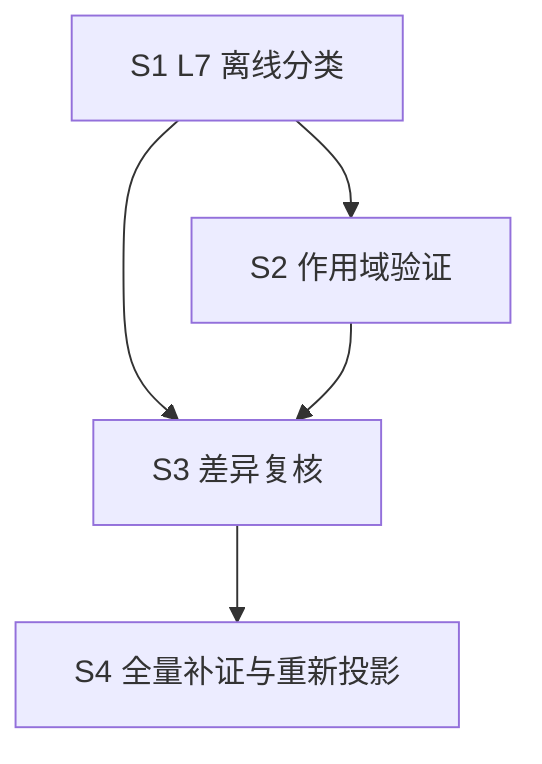

# OSG-W4 后续执行计划（S0~S4）

- **日期**：2026-11-14
- **需求来源**：`dev-docs/requirements/2026-11-14-OSG-W4-服务端规则补证与需求差异质量修复.md`
- **前置交付**：T0.1~T0.4 第一阶段已完成（调查报告 / L7 与作用域设计 / 三 Stage 证据样本 / 复核对照，见文末清单），**本计划自 S1 起，S0 的结构调查已由 T0.1 覆盖**
- **基线锁定**：`spec-workflow/output-spec/2026-11-14/1-spec/`（v2，319 原子）只读；所有新产物进新目录（`server-rule-verify/` 与 v3 目录）

## 0. 已确认的事实基础（来自第一阶段，计划据此制定）

1. 服务端规则主体在 `common_game/com_game/`（com_ju / com_action / com_play / com_result），hzmj_server 为薄层（配置覆写 + 协变替换），另有 4 个玩法变体共享 common_game。
2. 好友房 19 项 JSON 配置入口 `LoadBoxJsonConfig`（game_logic.cpp:19）；定庄/牢庄/财神三规则均受配置项控制（first_banker_type / banker_level_type / cai_shen_type）。
3. 操作优先级裁决在框架 `mah_frame/com_basic/com_action.cpp`（askid 机制），排序细节未展开。
4. 三 Stage 33 原子作用域分布：active 2 / conditional 9 / unknown 22；2 个 conflict 均维持待裁决。
5. workflow 沙箱无 readFile——server-rule-verify workflow 需沿用「确定性 node 脚本准备 + agent read 小文件」两步模式（同 OSG-W3 阶段 0 经验）。

## 1. S1：L7 口径与差异分类修复（P0）

| 任务 | 内容 | 验收 |
|---|---|---|
| S1.1 | 实现离线分类脚本 `scripts/classify-l7.mjs` + example 自检：输入 v2 feature_index + scope-index + server-evidence，按设计文档 4.1 判定矩阵输出 L7 分类（verified / verification_required / decision_required / not_applicable），落 `server-rule-verify/l7-classify.json` | example 全绿；33 原子样本重跑与 difference-review_sample 的 l7Projection 一致 |
| S1.2 | `3-produce-outputs.js` planner prompt 改造：存在 l7-classify 数据时按 L7 分类生成「规则待验证 / 待策划裁决」行（口径四选一），不再从 notes 猜差异；无数据时保持现行为（schemaVersion 分支沿用 OSG-W3 6.4 约定） | plannerOnly 模式用 v2+样本数据投影 ST-C01/02/04 三章节，「规则待验证」「待策划裁决」两种行文出现且口径正确；技术文档零改动 |
| S1.3 | `verify-output-spec.mjs` 增加 L7 自洽校验：l7 值域、conflict 必为 decision_required、consistent+active 才可 verified | example 用例扩展 |

## 2. S2：玩法配置作用域验证（P0，从样本扩展到全量需分批）

| 任务 | 内容 | 验收 |
|---|---|---|
| S2.0 | **符号索引先行**（成本控制）：确定性脚本扫描 common_game / hzmj_server / mah_frame 建符号→file:line 索引（函数/类/配置项 json_key），落 `server-rule-verify/symbol-index.json`，agent 按 Atom 查索引再按需 read，不遍历目录 | 索引覆盖三目录全部函数定义；单次 agent 上下文中证据文件 < 20KB |
| S2.1 | 三 Stage 深查（S2 矛盾候选优先）：CheckPlay 禁打财神条件（AT-ST-C02-007 疑似矛盾）、吃碰杠候选排除完整链（C02-009~011）、框架优先级排序（C04-001~010）、UpdateBankerLevel 推进（C01-008）、牌墙初始化（C02-001~003） | 33 原子 unknown 从 22 降到 ≤5；每条 unknown 附 unresolved 原因 |
| S2.2 | 配置下发值核对：好友房创房 19 项默认值与客户端创房 UI / 配置平台核对（first_banker_type / cai_shen_type / banker_level_type 优先），configVerified 升级 | conditional 条目的 unresolved 清零或转为人工确认项 |
| S2.3 | workflow 化：`server-rule-verify/` 四子流程（1-scan-server 确定性扫描 / 2-match-atoms / 3-verify-scope / 4-review-difference），显式 scriptPath 调用；运行由用户触发 | 试运行 ST-C01 单阶段链路贯通 |

## 3. S3：Difference 二次质量检查（P0）

| 任务 | 内容 | 验收 |
|---|---|---|
| S3.1 | 复核 2 个 conflict（AT-ST-C02-008 / AT-ST-C15-018）→ 产出「需求差异裁决清单」交策划（人工裁决 reviewStatus） | 裁决清单文档化，两条均有策划可读的证据双栏对照 |
| S3.2 | 复核 64 个 partial（scope 证据就位的优先），`4-review-difference` 按 4.1 矩阵出 pending 建议 | pending 建议带 reviewRule 枚举与证据 id；无一违反复核五规则 |
| S3.3 | 复核结果合并：`assemble-output-spec-index.mjs` 扩展（approved 条目合并进 v3 新目录），v2 只读 | v3 索引 differenceStats 与 approved 合并结果一致；v2 文件 hash 不变 |

## 4. S4：全量补证与策划版重新投影（P1）

| 任务 | 内容 | 验收 |
|---|---|---|
| S4.1 | 剩余 12 个 Stage 的服务端补证（复用 S2 workflow，按业务风险分批：算分/番型/结算优先） | scope-index 覆盖全量 319 原子 |
| S4.2 | 策划版 v3 重新投影（plannerOnly 模式，消费 L7 结构化结果） | 泄漏校验零命中；「规则待验证/待策划裁决」口径统一 |
| S4.3 | 交付三份报告：规则待验证报告（verification_required 全清单）、需求差异裁决清单（decision_required）、服务端证据索引（server-evidence 汇总） | 策划/服务端可直接消费 |

## 5. 执行约束（全程有效）

1. 只读游戏服务端源码；不重跑客户端全量查证；v2 与历史策划版零覆盖。
2. workflow 运行（S1.2 投影、S2.3 试运行、S3/S4 批量）由用户手动触发；确定性 node 脚本与静态检查可自行进行。
3. 每个阶段完成即 commit（feat(output-spec)/feat(server-rule-verify) + docs），先调查后改判，任何 difference 变更走 pending → 人工批准 → 合并。

## 6. 依赖顺序

说明：S1 的离线分类可先用客户端证据跑（33 原子样本已验证可行）；S2 的深查结果反哺 S3 复核；S4 依赖 S3 的裁决口径定型。

## 7. 第一阶段交付清单（已完成，2026-11-14）

| 交付物 | 位置 |
|---|---|
| 服务端结构与职责调查报告 | `dev-docs/research/2026-11-14-OSG-W4-T0服务端结构与职责调查报告.md` |
| 玩法配置作用域设计说明 + L7 分类与二次检查方案 | `dev-docs/design/2026-11-14-OSG-W4-L7分类与玩法配置作用域设计.md` |
| 三个 Stage 服务端证据映射样本 + 复核前后对比 | `spec-workflow/output-spec/server-rule-verify/`（server-evidence / scope-index / difference-review 三个 sample.json + README.md） |
| 本执行计划 | `dev-docs/planning/2026-11-14-OSG-W4-执行计划.md` |
| 需求文档 | `dev-docs/requirements/2026-11-14-OSG-W4-服务端规则补证与需求差异质量修复.md` |

## 8. 引用

- OSG-W3 需求与执行计划（difference/trace_index 语义来源）：`dev-docs/requirements/2026-11-14-outputspec策划需求视图与技术实现视图分离.md`
- 沙箱无 readFile 经验：`dev-docs/progress-result/output-spec-generate-演进报告-v2.md` 与 `.opencode-workflows/workflows/bug-coverage-check.js` 头注释
- v2 基线：`spec-workflow/output-spec/2026-11-14/1-spec/`
