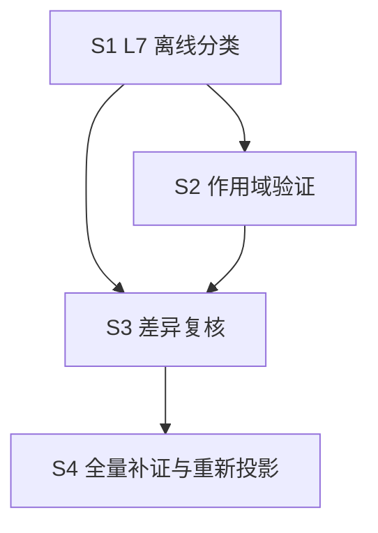

# OSG-W4 后续执行计划（S0~S4）

- **日期**：2026-11-14
- **需求来源**：`dev-docs/requirements/2026-11-14-OSG-W4-服务端规则补证与需求差异质量修复.md`
- **前置交付**：T0.1~T0.4 第一阶段已完成（调查报告 / L7 与作用域设计 / 三 Stage 证据样本 / 复核对照，见文末清单），**本计划自 S1 起，S0 的结构调查已由 T0.1 覆盖**
- **基线锁定**：`spec-workflow/output-spec/2026-11-14/1-spec/`（v2，319 原子）只读；所有新产物进新目录（`server-rule-verify/` 与 v3 目录）

## 0. 已确认的事实基础（来自第一阶段，计划据此制定）

1. 服务端规则主体在 `common_game/com_game/`（com_ju / com_action / com_play / com_result），hzmj_server 为薄层（配置覆写 + 协变替换），另有 4 个玩法变体共享 common_game。
2. 好友房 19 项 JSON 配置入口 `LoadBoxJsonConfig`（game_logic.cpp:19）；定庄/牢庄/财神三规则均受配置项控制（first_banker_type / banker_level_type / cai_shen_type）。
3. 操作优先级裁决在框架 `mah_frame/com_basic/com_action.cpp`（askid 机制），排序细节未展开。
4. 三 Stage 33 原子作用域分布：active 2 / conditional 9 / unknown 22；2 个 conflict 均维持待裁决。
5. workflow 沙箱无 readFile——server-rule-verify workflow 需沿用「确定性 node 脚本准备 + agent read 小文件」两步模式（同 OSG-W3 阶段 0 经验）。

## 1. S1：L7 口径与差异分类修复（P0，含二审 S1.0 数据契约修复）

> 二审（2026-11-14）修订：先执行 S1.0 修复数据契约，再实现 S1.1~S1.3。验收闸门五条：分类无自相矛盾、审批状态独立、客户端冲突得到保留、L7 待确认口径一致、历史索引零改动。

| 任务 | 内容 | 验收 |
|---|---|---|
| S1.0 | **数据契约修复（已完成，本次提交）**：① afterReviewProjection 改为 previousDifference→reviewedDifference 确定性迁移计算，禁止手工填预测值；② AT-ST-C01-002 因执行顺序未证由 active 降 unknown，撤销其升级建议；③ l7 与 reviewStatus 拆为独立字段并新增 effectiveDifference；④ conflict 条目引入证据级 scope（evidenceScopes），缺失 scope 按 unknown 处理 | 样本状态迁移自洽检查通过（迁移后 66/64/2/187，合计 319） |
| S1.1 | **（已完成 2026-11-14，本次提交）** `scripts/classify-l7.mjs` + example 自检：**输入四件套**（feature_index 基线 + scope-index + server-evidence + **difference-review**，二审补充）；按设计文档 4.1 矩阵输出 `l7` + `reviewStatus` + `effectiveDifference` 三字段，落 `server-rule-verify/l7-classify.json`；未批准条目的 l7 标 proposed（l7Basis）不入正式索引；**缺失 scope 一律 unknown（未查证），不缺省 inactive**；conflict 条目采证据级 scope（设计 3.3：client-visual 即冲突产生证据，无 evidenceScopes 时 inactive 不可确认不消除冲突） | example 全绿；33 原子样本重跑与 difference-review_sample 的 l7 分布一致（verified 1/verification_required 11/decision_required 2，顺带修复样本 l7Projection 手写统计漂移 2/10/2/0 → 1/11/2/0，经验沉淀 dev-docs/experience/手写统计块漂移-l7Projection.md）；缺 scope 原子全部落 unknown |
| S1.2 | **（已完成 2026-11-14，本次提交）** `3-produce-outputs.js` planner prompt 改造：存在 l7-classify 数据时按 L7 分类生成「规则待验证 / 待策划裁决」行（口径四选一），**不再从 notes 猜测是否存在需求冲突**；无数据时保持现行为（schemaVersion 分支沿用 OSG-W3 6.4 约定）。落地方式：结构/转写规则抽公共 `plannerDocRules()`（内存/磁盘两 Prompt 同源防漂移）；`prepare-planner-doc-input.mjs` 新增可选 `l7ClassifyPath`（l7/l7Reason 内嵌进证据文件，条目 atomId 必须在基线内防漂移）与 `stageIdsCsv`（阶段过滤，intro/terms 不进 sections）参数；内存链路新增 `A.l7Classify`（classify-l7 产物对象）内嵌进 slimPlannerEvidence | plannerOnly 模式用 v2+样本数据投影 ST-C01/02/04 三章节（33 原子、l7 内嵌 13/14、C15-018 属未投影阶段跳过），「规则待验证」（11 原子全覆盖）「待策划裁决」（C02-008）两种行文出现且口径正确；C04-013（verified）无差异行；带 l7 原子无旧式 notes 猜测行；泄漏零命中、无 file:line/.cpp 残留；无 l7 原子（如 C01-008）保持旧式待确认行（现行为不变）；技术文档零改动（stageDocCount=0，v2 与历史策划版零改动，产物进 v3-planner-sample/）。首跑 ST-C04 agent 未写盘被闸门当场拦截，重跑全绿 |
| S1.3 | **（已完成 2026-11-14，本次提交）** `verify-output-spec.mjs` 校验扩展（新增导出 `checkL7Sidecars(files)`，五道闸门）：classify 复跑（导入 classifyL7 复用矩阵/作用域/统计块逻辑，覆盖矩阵自洽、consistent+active 才 verified、evidenceIds 存在、缺 scope 一律 unknown 不判 not_applicable、手写统计块交叉校验）；l7-classify 产物与复算逐条/逐统计块对比（防落盘后手改）；Sidecar atomId 全部对齐 trace_index（对齐主键自洽）；conflict 条目必须带证据级 scope（设计 112 硬闸门，classify 的 resolveScope 是降级处理）；审批状态独立（pending/rejected 条目正式索引原子 difference 必须等于 previousDifference、approved 必须等于 effectiveDifference）；`verifyOutputSpec` opts 新增可选 `l7`（维度 7）。**样本补据**：C15-018 补 scope-index 条目（client-visual active）满足硬闸门，scope 样本 34 条目（active 2/conditional 9/unknown 23），l7-classify_sample 重算重生成（仅 C15-018 scope 字段变化，l7 仍 decision_required，stats 不变） | example 用例扩展全绿（场景 15 真实样本放行：14 复核 / l7 1/11/2/0 / conflict 2/2 带证据级 scope / trace 319；场景 16 合成夹具五道闸门逐项破坏：手改条目/手改统计块/trace 缺原子/conflict 去 evidenceScopes（仅硬闸门命中 1 项）/pending 混入正式索引/approved 按 effectiveDifference 合并/evidenceIds 断链/文件缺失；场景 17 opts.l7 集成 fail 与放行 + report L7 段） |
| S1.4 | **（已完成 2026-11-14，本次提交）** 三阶段回归：ST-C01 / ST-C02 / ST-C04 分类正确，历史产物不变 | 33 原子分类与人工预期一致（classify-l7.example A 段钉死 S1.4 回归锚点：scope 样本 34 条目、stats active 2/conditional 9/unknown 23/inactive 0、l7 1/11/2/0、C15-018 补据后走证据级 client-visual active → decision_required；三 example 全绿：classify-l7 / prepare-planner-doc-input 31/31 / verify-output-spec）；v2 文件 hash 不变（git status 零改动，v2 最后改动仍为 OSG-W3 收尾 commit c21dbb1） |

## 2. S2：玩法配置作用域验证（P0，从样本扩展到全量需分批）

| 任务 | 内容 | 验收 |
|---|---|---|
| S2.0 | **（已完成 2026-11-14，本次提交）** 符号索引先行（成本控制）：`scripts/build-symbol-index.mjs` + example 确定性扫描 common_game / hzmj_server / mah_frame 建符号→file:line 索引（class/struct、类方法、自由函数、配置项 json_key 含「// key | 类型 | 取值范围 | 默认值 | 说明」元数据；*.pb.h/*.pb.cc 生成文件排除单独计数；签名跨行「先见 { 后见 ;」判定排除声明与列首调用），落 `server-rule-verify/symbol-index.json`；query 子命令按名称/限定名/kind 查询打印 file:line | 索引覆盖三目录全部函数定义（134 文件 / 1793 符号：class 144 / 方法 1356 / 自由函数 258 / 配置项 35）；example 全绿（13 方法 + 4 类 + 1 自由函数锚点人工核对、列首调用/头文件声明排除、35 配置项含默认值、两次构建逐字节一致；后续 workflow 按 Atom 查索引再按需 read，单 agent 证据文件 < 20KB 由 S2.3 切片保证） |
| S2.1 | **（已完成 2026-11-14，本次提交）** 三 Stage 深查（二审指定优先三项闭环）：① AT-ST-C02-007 财神禁打状态——CheckPlay（com_play.cpp:53-85）无爆头前置，打财神仅触发飘财窗口/飘级；com_action.cpp:165「禁打财神值」实为吃禁手黑名单的翻财神归一化（CalcChowForbidMahs），矛盾候选解除，判 active；② AT-ST-C01-006/007 三牢与固定 8 倍——服务端默认 banker_level_type=0（1 牢/2 倍）已证，创房 UI 实际下发值留 S2.2 客户端核对，维持 conditional；③ ST-C04 操作优先级——askid 裁决链全量落判：级别常量胡 4>碰=杠 3>吃 2（macros.h:203-206）+ ConAction 最高级未响应阻塞/已响应立即执行（con_action.cpp:19-62）+ 碰/直杠升序扫描座位最小独得（com_pung.cpp:66/com_kong.cpp:80）+ 胡按座位距离加权近者优先（com_action.cpp:826-838）+ 一炮多响关闭（com_action.cpp:534）；其余：C01-002（Step 链 AddNext 定庄先于骰子/发牌→active）、C01-008（UpdateBankerLevel L369-370 三牢封顶 + hzmj 无 banker_continue_type 覆写入口→active）、C02-001/002/003（InitData+macros.h:218-222 组墙 136 张→conditional，enable_two_suit/del_feng 默认 false）、C02-006（可打财神→active）、C02-009/010/011（InitJokerChows/Pungs/Kongs 移除财神候选→conditional，cai_shen_type=0 默认白板财神）、C02-012（JudgeDiscard L363-364 财神不能放铳注释直证→active）；新增 SVE 15 条（SVE-ST-C01-008/009、SVE-ST-C02-005~010、SVE-ST-C04-004~010） | 33 原子 unknown 从 23 降到 **0**（≤5 达标且清零；stats active 14 / conditional 20 / unknown 0 / inactive 0）；每条原 unknown 附 configCondition/callPath/evidenceIds；l7-classify 重算重生成（l7 分布不变 1/11/2/0，仅 6 条目 scope 字段更新）；classify-l7.example S1.4 锚点同步更新；三 example 全绿；v2 零改动 |
| S2.2 | **（已完成 2026-11-14，本次提交）** 配置下发值核对：客户端大厅 xuanwulobby（gameId 42320=GAME_HZMJ_HYF → `DefaultConfigHZMJ` 创房全量下发，GameRuleConfig.ts:83/311/624、LobbyCreateRoomView.ts:807-825 未缓存取默认、FIXED_RULE_FIELDS_BY_GAME 注释证明协议全量字段下发）核对：创房默认**笃三老庄**（banker_level_type=2，RuleHzmj.ts:29 + L276-287 UI 默认选中 → 服务端三牢起步 8 倍，与需求「首庄三牢/固定 8 倍」**默认一致**）；庄闲放铳(庄三) 默认开（enable_banker_discard_hu=1，L31/288-298）；白板财神默认可选翻（cai_shen_type=0，L27/265-275，未锁定）；first_banker_type/rotate_banker_type/draw_continue_banker UI 未暴露恒默认（0/0/1，rotate type=1 分支好友房不可达）；缺一色仅 2/3 人默认勾选（enable_two_suit=1，L45/364-369，4 人局 136 张/2-3 人局剔万字 100 张）；无风牌默认不勾（del_feng=0）；更新 19 条 conditional 条目 configCondition + C02-008 evidenceScopes note + sampleNote | conditional 条目 unresolved **5 条全部清零**（C01-001/004/006/007、C02-004），无转人工确认项；stats 不变（active 14/conditional 20/unknown 0/inactive 0）；l7-classify 重算一致（1/11/2/0）；三 example 全绿；v2 零改动 |
| S2.3 | **（已完成 2026-11-14）** workflow 化：`.opencode-workflows/workflows/server-rule-verify/` 主编排 + 四子流程（显式 scriptPath 调用，注册表只扫一级目录）：1-scan-server（commandSuccess 重建 symbol-index + agent 回读 stats）/ 2-match-atoms（`prepare-verify-atoms.mjs` 分片输入：功能点贪心不拆散 ≤12 目标/24 硬上限、既有正式条目注入不读 *_sample、旧分片清理；agent 查 query CLI + 读源码切片 → 匹配候选落盘 + 落盘闸门）/ 3-verify-scope（agent 逐原子落判 active/conditional/inactive/unknown + SVE 证据 + DR 复核字段**双写** + conflict 证据级 evidenceScopes + S2.2 客户端创房默认值口径内嵌 + 三根目录证据硬约束）/ 4-review-difference（复核五规则 pending 建议 → `merge-verify-output.mjs` 确定性装配闸门：双写闸门/覆盖闸门/SVE 形状与幂等（同 id 同证据指针原位替换/共享证据去重放行，指针不同 fail）/reviewRule 白名单/ classifyL7 矩阵回填 l7/effectiveDifference/l7Basis + 三统计块重算 → classify-l7 CLI 重算 → verify-output-spec **check-l7 CLI 新子模式**（五道闸门，不触碰 v2 基线目录，报告 runtime/spec-check/））；速度优先档 + deepseek flash + 并发 16；五脚本 wf-syntax-check 全过 | **试运行 ST-C01 链路贯通 ✓**（runId run-mwg3hayc-12，三轮卡点修复后 6 agent/133s/1042 tok；正式四件落盘：scope 8 条 3/5/0/0、SVE 29、DR 8 全 pending（5 条 unverified→consistent 升级建议）、l7 3/5/0/0；五道闸门通过；与人工样本对照 4/8 完全一致、2 样本未覆盖、真分歧 2（C01-002 l7 升级建议与 S2.1 Step 链结论一致待批准、C01-004 scope conditional vs active 转 S3 人工裁决）；坑点沉淀 dev-docs/experience/server-rule-verify试运行agent输出漂移与闸门容差.md） |

## 3. S3：Difference 二次质量检查（P0）

| 任务 | 内容 | 验收 |
|---|---|---|
| S3.1 | **（已完成 2026-11-14）** 复核 2 个 conflict（AT-ST-C02-008 / AT-ST-C15-018）→ 产出「需求差异裁决清单」交策划（人工裁决 reviewStatus） | ✓ 裁决清单文档化（`spec-workflow/output-spec/server-rule-verify/需求差异裁决清单.md`），两条均有策划可读的证据双栏对照（需求拆句 vs 服务端/客户端实现表现）+ A/B/C 裁决选项与裁决栏；附 A 收录试运行 5 条 unverified→consistent 升级建议（含 C01-004 scope 分歧注记）待策划一并批准 |
| S3.2 | **（证据就位阶段完成 2026-11-14；其余 partial 随 S4.1 分批复核）** 复核 64 个 partial（scope 证据就位的优先），`4-review-difference` 按 4.1 矩阵出 pending 建议 | ST-C01/02/04 三阶段经 server-rule-verify 复核完成（33 原子，DR 33 条 pending；批跑 ST-C02/C04：run-mwg59v7b-13，12 agent/21s，一轮卡点修复——merge 按分片 stageId 过滤非目标遗留分片）；建议全部带 reviewRule 枚举与证据 id，无一违反复核规则（五道闸门 + 白名单闸门通过）；64 条 partial 已复核 3 条（C02-006/C04-011/C04-012，2 条升级建议），其余 61 条在其他 12 Stage（S4.1 批跑时随阶段复核）；裁决清单附 A/A2 收录 20 条升级建议 + 9 条 scope 分歧注记待策划批准 |
| S3.3 | **（脚本就绪 2026-11-14，正式合并待裁决回传）** 复核结果合并：`assemble-output-spec-index.mjs` 扩展 `v3` 子命令（`assembleV3FromReview`：读 v2 feature_index 只读（写前后 sha256 校验不变）+ server-rule-verify 正式三件 → approved 条目 difference 采 reviewedDifference、pending/rejected 维持基线、未复核原子不动；每复核原子新增 difference_v2/review_status/reviewed_difference/review_rule/review_reason/l7（终局矩阵视图，经 classifyL7 合成终局 DR 重算）/l7_basis（approved/rejected/baseline）/scope_applicability/scope_source/evidence_ids；闸门：classifyL7 全量交叉校验 + v3 差异统计双路互验 + DR baseline 与 v2 一致 + 输出目录不得等于 v2 目录；example 场景 9/10 全绿 + 真实数据冒烟（319 原子/0 迁移/统计=基线/v2 hash 不变）） | ✓ 脚本与验收闸门就绪；正式 v3 合并在裁决清单回传（approved 落 reviewStatus）后执行，届时验收：v3 索引 differenceStats 与 approved 合并结果一致 + v2 文件 hash 不变 |

## 4. S4：全量补证与策划版重新投影（P1）

| 任务 | 内容 | 验收 |
|---|---|---|
| S4.1 | 剩余 12 个 Stage 的服务端补证（复用 S2 workflow，按业务风险分批：算分/番型/结算优先） | scope-index 覆盖全量 319 原子 |
| S4.2 | 策划版 v3 重新投影（plannerOnly 模式，消费 L7 结构化结果） | 泄漏校验零命中；「规则待验证/待策划裁决」口径统一 |
| S4.3 | 交付三份报告：规则待验证报告（verification_required 全清单）、需求差异裁决清单（decision_required）、服务端证据索引（server-evidence 汇总） | 策划/服务端可直接消费 |

## 5. 执行约束（全程有效）

1. 只读游戏服务端源码；不重跑客户端全量查证；v2 与历史策划版零覆盖。
2. workflow 运行（S1.2 投影、S2.3 试运行、S3/S4 批量）由用户手动触发；确定性 node 脚本与静态检查可自行进行。
3. 每个阶段完成即 commit（feat(output-spec)/feat(server-rule-verify) + docs），先调查后改判，任何 difference 变更走 pending → 人工批准 → 合并。

## 6. 依赖顺序

说明：S1 的离线分类可先用客户端证据跑（33 原子样本已验证可行）；S2 的深查结果反哺 S3 复核；S4 依赖 S3 的裁决口径定型。

## 7. 第一阶段交付清单（已完成，2026-11-14）

| 交付物 | 位置 |
|---|---|
| 服务端结构与职责调查报告 | `dev-docs/research/2026-11-14-OSG-W4-T0服务端结构与职责调查报告.md` |
| 玩法配置作用域设计说明 + L7 分类与二次检查方案 | `dev-docs/design/2026-11-14-OSG-W4-L7分类与玩法配置作用域设计.md` |
| 三个 Stage 服务端证据映射样本 + 复核前后对比 | `spec-workflow/output-spec/server-rule-verify/`（server-evidence / scope-index / difference-review 三个 sample.json + README.md） |
| 本执行计划 | `dev-docs/planning/2026-11-14-OSG-W4-执行计划.md` |
| 需求文档 | `dev-docs/requirements/2026-11-14-OSG-W4-服务端规则补证与需求差异质量修复.md` |

## 8. 引用

- OSG-W3 需求与执行计划（difference/trace_index 语义来源）：`dev-docs/requirements/2026-11-14-outputspec策划需求视图与技术实现视图分离.md`
- 沙箱无 readFile 经验：`dev-docs/progress-result/output-spec-generate-演进报告-v2.md` 与 `.opencode-workflows/workflows/bug-coverage-check.js` 头注释
- v2 基线：`spec-workflow/output-spec/2026-11-14/1-spec/`
