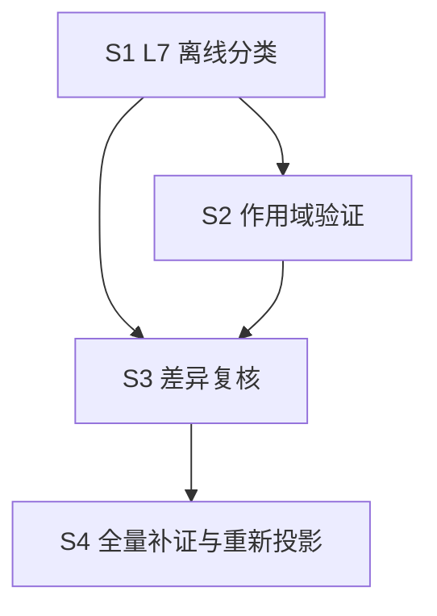

# OSG-W4 后续执行计划（S0~S4）

- **日期**：2026-11-14
- **需求来源**：`dev-docs/requirements/2026-11-14-OSG-W4-服务端规则补证与需求差异质量修复.md`
- **前置交付**：T0.1~T0.4 第一阶段已完成（调查报告 / L7 与作用域设计 / 三 Stage 证据样本 / 复核对照，见文末清单），**本计划自 S1 起，S0 的结构调查已由 T0.1 覆盖**
- **基线锁定**：`spec-workflow/output-spec/2026-11-14/1-spec/`（v2，319 原子）只读；所有新产物进新目录（`server-rule-verify/` 与 v3 目录）

## 0. 已确认的事实基础（来自第一阶段，计划据此制定）

1. 服务端规则主体在 `common_game/com_game/`（com_ju / com_action / com_play / com_result），hzmj_server 为薄层（配置覆写 + 协变替换），另有 4 个玩法变体共享 common_game。
2. 好友房 19 项 JSON 配置入口 `LoadBoxJsonConfig`（game_logic.cpp:19）；定庄/牢庄/财神三规则均受配置项控制（first_banker_type / banker_level_type / cai_shen_type）。
3. 操作优先级裁决在框架 `mah_frame/com_basic/com_action.cpp`（askid 机制），排序细节未展开。
4. 三 Stage 33 原子作用域分布：active 2 / conditional 9 / unknown 22；2 个 conflict 均维持待裁决。
5. workflow 沙箱无 readFile——server-rule-verify workflow 需沿用「确定性 node 脚本准备 + agent read 小文件」两步模式（同 OSG-W3 阶段 0 经验）。

## 1. S1：L7 口径与差异分类修复（P0，含二审 S1.0 数据契约修复）

> 二审（2026-11-14）修订：先执行 S1.0 修复数据契约，再实现 S1.1~S1.3。验收闸门五条：分类无自相矛盾、审批状态独立、客户端冲突得到保留、L7 待确认口径一致、历史索引零改动。

| 任务 | 内容 | 验收 |
|---|---|---|
| S1.0 | **数据契约修复（已完成，本次提交）**：① afterReviewProjection 改为 previousDifference→reviewedDifference 确定性迁移计算，禁止手工填预测值；② AT-ST-C01-002 因执行顺序未证由 active 降 unknown，撤销其升级建议；③ l7 与 reviewStatus 拆为独立字段并新增 effectiveDifference；④ conflict 条目引入证据级 scope（evidenceScopes），缺失 scope 按 unknown 处理 | 样本状态迁移自洽检查通过（迁移后 66/64/2/187，合计 319） |
| S1.1 | **（已完成 2026-11-14，本次提交）** `scripts/classify-l7.mjs` + example 自检：**输入四件套**（feature_index 基线 + scope-index + server-evidence + **difference-review**，二审补充）；按设计文档 4.1 矩阵输出 `l7` + `reviewStatus` + `effectiveDifference` 三字段，落 `server-rule-verify/l7-classify.json`；未批准条目的 l7 标 proposed（l7Basis）不入正式索引；**缺失 scope 一律 unknown（未查证），不缺省 inactive**；conflict 条目采证据级 scope（设计 3.3：client-visual 即冲突产生证据，无 evidenceScopes 时 inactive 不可确认不消除冲突） | example 全绿；33 原子样本重跑与 difference-review_sample 的 l7 分布一致（verified 1/verification_required 11/decision_required 2，顺带修复样本 l7Projection 手写统计漂移 2/10/2/0 → 1/11/2/0，经验沉淀 dev-docs/experience/手写统计块漂移-l7Projection.md）；缺 scope 原子全部落 unknown |
| S1.2 | **（已完成 2026-11-14，本次提交）** `3-produce-outputs.js` planner prompt 改造：存在 l7-classify 数据时按 L7 分类生成「规则待验证 / 待策划裁决」行（口径四选一），**不再从 notes 猜测是否存在需求冲突**；无数据时保持现行为（schemaVersion 分支沿用 OSG-W3 6.4 约定）。落地方式：结构/转写规则抽公共 `plannerDocRules()`（内存/磁盘两 Prompt 同源防漂移）；`prepare-planner-doc-input.mjs` 新增可选 `l7ClassifyPath`（l7/l7Reason 内嵌进证据文件，条目 atomId 必须在基线内防漂移）与 `stageIdsCsv`（阶段过滤，intro/terms 不进 sections）参数；内存链路新增 `A.l7Classify`（classify-l7 产物对象）内嵌进 slimPlannerEvidence | plannerOnly 模式用 v2+样本数据投影 ST-C01/02/04 三章节（33 原子、l7 内嵌 13/14、C15-018 属未投影阶段跳过），「规则待验证」（11 原子全覆盖）「待策划裁决」（C02-008）两种行文出现且口径正确；C04-013（verified）无差异行；带 l7 原子无旧式 notes 猜测行；泄漏零命中、无 file:line/.cpp 残留；无 l7 原子（如 C01-008）保持旧式待确认行（现行为不变）；技术文档零改动（stageDocCount=0，v2 与历史策划版零改动，产物进 v3-planner-sample/）。首跑 ST-C04 agent 未写盘被闸门当场拦截，重跑全绿 |
| S1.3 | `verify-output-spec.mjs` 校验扩展：四分类矩阵自洽、Atom ID 对齐 trace_index、**审批状态独立（pending 条目不得进正式索引）**、证据关联完整（evidenceIds 存在）、conflict 必须带证据级 scope、缺 scope 不得判 not_applicable、consistent+active 才可 verified | example 用例扩展全绿 |
| S1.4 | 三阶段回归：ST-C01 / ST-C02 / ST-C04 分类正确，历史产物不变 | 33 原子分类与人工预期一致；v2 文件 hash 不变 |

## 2. S2：玩法配置作用域验证（P0，从样本扩展到全量需分批）

| 任务 | 内容 | 验收 |
|---|---|---|
| S2.0 | **符号索引先行**（成本控制）：确定性脚本扫描 common_game / hzmj_server / mah_frame 建符号→file:line 索引（函数/类/配置项 json_key），落 `server-rule-verify/symbol-index.json`，agent 按 Atom 查索引再按需 read，不遍历目录 | 索引覆盖三目录全部函数定义；单次 agent 上下文中证据文件 < 20KB |
| S2.1 | 三 Stage 深查（**二审指定优先三项**）：① AT-ST-C02-007 财神禁打状态——核 CheckPlay 限制条件究竟属于「不能打财神」还是其他禁打规则，区分「爆头不是打财神的必要条件」与「某些特殊状态可能禁止打特定牌」，两者未必矛盾；② AT-ST-C01-006/007 三牢与固定 8 倍——**找到创房 UI 中 banker_level_type 的真实选择范围、默认值和最终下发配置**，不能只凭服务端 LoadBoxJsonConfig 默认值判断现有好友房违反需求；③ ST-C04 操作优先级——从 mah_frame/com_basic/com_action.cpp 的 askid 机制追踪到实际裁决链（存在响应机制不代表已证明「胡>碰/杠>吃」完整顺序）；其余：吃碰杠候选排除完整链（C02-009~011）、UpdateBankerLevel 推进（C01-008）、牌墙初始化（C02-001~003） | 33 原子 unknown 从 23 降到 ≤5；每条 unknown 附 unresolved 原因 |
| S2.2 | 配置下发值核对：好友房创房 19 项默认值与客户端创房 UI / 配置平台核对（first_banker_type / cai_shen_type / banker_level_type 优先），configVerified 升级 | conditional 条目的 unresolved 清零或转为人工确认项 |
| S2.3 | workflow 化：`server-rule-verify/` 四子流程（1-scan-server 确定性扫描 / 2-match-atoms / 3-verify-scope / 4-review-difference），显式 scriptPath 调用；运行由用户触发 | 试运行 ST-C01 单阶段链路贯通 |

## 3. S3：Difference 二次质量检查（P0）

| 任务 | 内容 | 验收 |
|---|---|---|
| S3.1 | 复核 2 个 conflict（AT-ST-C02-008 / AT-ST-C15-018）→ 产出「需求差异裁决清单」交策划（人工裁决 reviewStatus） | 裁决清单文档化，两条均有策划可读的证据双栏对照 |
| S3.2 | 复核 64 个 partial（scope 证据就位的优先），`4-review-difference` 按 4.1 矩阵出 pending 建议 | pending 建议带 reviewRule 枚举与证据 id；无一违反复核五规则 |
| S3.3 | 复核结果合并：`assemble-output-spec-index.mjs` 扩展（approved 条目合并进 v3 新目录），v2 只读 | v3 索引 differenceStats 与 approved 合并结果一致；v2 文件 hash 不变 |

## 4. S4：全量补证与策划版重新投影（P1）

| 任务 | 内容 | 验收 |
|---|---|---|
| S4.1 | 剩余 12 个 Stage 的服务端补证（复用 S2 workflow，按业务风险分批：算分/番型/结算优先） | scope-index 覆盖全量 319 原子 |
| S4.2 | 策划版 v3 重新投影（plannerOnly 模式，消费 L7 结构化结果） | 泄漏校验零命中；「规则待验证/待策划裁决」口径统一 |
| S4.3 | 交付三份报告：规则待验证报告（verification_required 全清单）、需求差异裁决清单（decision_required）、服务端证据索引（server-evidence 汇总） | 策划/服务端可直接消费 |

## 5. 执行约束（全程有效）

1. 只读游戏服务端源码；不重跑客户端全量查证；v2 与历史策划版零覆盖。
2. workflow 运行（S1.2 投影、S2.3 试运行、S3/S4 批量）由用户手动触发；确定性 node 脚本与静态检查可自行进行。
3. 每个阶段完成即 commit（feat(output-spec)/feat(server-rule-verify) + docs），先调查后改判，任何 difference 变更走 pending → 人工批准 → 合并。

## 6. 依赖顺序

说明：S1 的离线分类可先用客户端证据跑（33 原子样本已验证可行）；S2 的深查结果反哺 S3 复核；S4 依赖 S3 的裁决口径定型。

## 7. 第一阶段交付清单（已完成，2026-11-14）

| 交付物 | 位置 |
|---|---|
| 服务端结构与职责调查报告 | `dev-docs/research/2026-11-14-OSG-W4-T0服务端结构与职责调查报告.md` |
| 玩法配置作用域设计说明 + L7 分类与二次检查方案 | `dev-docs/design/2026-11-14-OSG-W4-L7分类与玩法配置作用域设计.md` |
| 三个 Stage 服务端证据映射样本 + 复核前后对比 | `spec-workflow/output-spec/server-rule-verify/`（server-evidence / scope-index / difference-review 三个 sample.json + README.md） |
| 本执行计划 | `dev-docs/planning/2026-11-14-OSG-W4-执行计划.md` |
| 需求文档 | `dev-docs/requirements/2026-11-14-OSG-W4-服务端规则补证与需求差异质量修复.md` |

## 8. 引用

- OSG-W3 需求与执行计划（difference/trace_index 语义来源）：`dev-docs/requirements/2026-11-14-outputspec策划需求视图与技术实现视图分离.md`
- 沙箱无 readFile 经验：`dev-docs/progress-result/output-spec-generate-演进报告-v2.md` 与 `.opencode-workflows/workflows/bug-coverage-check.js` 头注释
- v2 基线：`spec-workflow/output-spec/2026-11-14/1-spec/`
