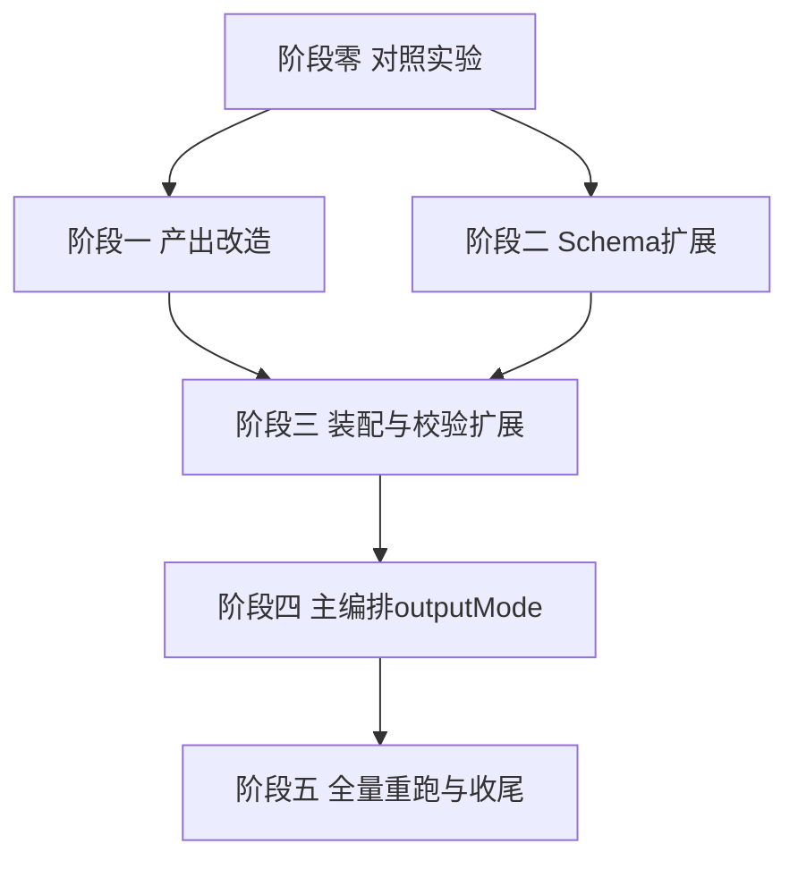

# output-spec-generate 策划视图分离执行计划

- **日期**：2026-11-14
- **需求来源**：`dev-docs/requirements/2026-11-14-outputspec策划需求视图与技术实现视图分离.md`（下称「需求文档」，R1~R8 编号均指向该文档需求清单）
- **改造对象**：`.opencode-workflows/workflows/output-spec-generate/` 四子流程 + `.opencode-workflows/scripts/` 装配校验脚本 + 主编排
- **执行方式**：代码改造与确定性脚本自检可由 agent 自行进行；**workflow 实际运行（阶段 0 实验、阶段 5 全量重跑）由用户手动触发**（沿用「不自行 opencode run 触发 workflow」约定）

---

## 1. 目标与验收总览

| 目标 | 对应需求 | 最终验收 |
|---|---|---|
| 策划版补充文档产出（无技术泄漏） | R1/R2 | 全量跑完后 `verify-report.md` 泄漏检查为零 |
| 实现差异以「需求原文 vs 实际表现 vs 待确认」呈现 | R3 | 三功能抽查（ST-C01/05/02）可见差异条目 |
| 原子项带业务语义与差异字段 | R4/R5 | 新 Schema 校验自洽 + differenceStats 统计进索引 |
| 机械校验扩展 | R6 | verify-output-spec 新增检查项进报告 |
| 主编排 outputMode 兼容旧行为 | R7 | 三模式契约落地：planner-only 绝不重写技术文档（只生成策划版+校验）；legacy 行为与 v2 完全一致 |
| 产物目录读写分离 | R10 | outputDir 与 sourceSpecDir 冲突检查生效；2026-11-13 目录零改动 |
| 结构化追溯索引 | R9 | trace_index.json 确定性生成；verify-report 输出 AT-ID 覆盖率与缺失清单 |
| 局部验证先行 | R8 | 阶段 0 三个检查点通过后才进入阶段 2 正式改 Schema |

## 2. 现状基线（已核实，直接引用）

### 2.1 代码基线

| 文件 | 关键位置 | 现状 |
|---|---|---|
| `3-produce-outputs.js`（v2 分片写盘版） | `supplementPartPrompt(sec, evidence)` | 要求写「`  - 客户端实现：{要点}（{file:line}）`」子列表项——泄漏直接来源 |
| 同上 | `slimEvidence(r)` | 供补充版写作的瘦身证据（id/name/rule/verdict/clientLogic/uiInteraction/refs/messages） |
| 同上 | `copyPartPrompt(sec)` / `partPath(sec)` | intro/nouns 机械复制到 `runtime/supplement-parts/part-NN.md` |
| 同上 | `MAX_ATOMS_PER_DOC_PART` + `splitDocParts` + 落盘闸门 | 技术规格文档分片与 agent 返回未写盘拦截 |
| 同上 | `buildConfigText` | 构建配置含 specDir/supplementPath/templatePath/date/sourceDesc/expectedStageCount/supplementParts |
| `2-verify-stages.js`（v3 加固版） | `STAGE_EVIDENCE_SCHEMA` 原子项 | rule/uiRequirement/verdict/clientLogic/uiInteraction/evidence/messages/notes，**无业务语义与差异字段** |
| 同上 | `stageVerifyPrompt(s)` | 两步：拆原子 + 代码查证；verdict 三值；**无差异判定指令** |
| 同上 | 校验循环（ID 正则 / verdict-证据自洽） | not_found 与证据互斥校验等，需扩展 difference 自洽 |
| `4-assemble-verify.js` | `buildCmd` 调 `build-output-spec.mjs`（经 runtime/build-config.json 传中文路径） | 装配后 check feature_index/stage_manifest/supplementPath |
| `build-output-spec.mjs` | `stepMergeSupplement(config)` / `assembleIndex` / `verifyOutputSpec` | 三步：合并补充版分片、装配索引、机械校验 |
| `verify-output-spec.mjs` | `verifyOutputSpec(specDir, supplementPath, templatePath, date)` | 现有机械校验（导出可导入，配 `.example.mjs` 自检） |
| `assemble-output-spec-index.mjs` | 索引装配 | camelCase 转 snake_case（ui_requirement/client_logic）+ `owner:'client'` |
| `output-spec-generate.js` | `STEPS`/`childArgs`（剔 `mode`）/`gate` | 四子流程编排；args 含 mode/templatePath/.../concurrency |

### 2.2 产物基线（首跑 2026-11-13，只读不改）

| 产物 | 路径 | 说明 |
|---|---|---|
| 扫描结果 | `spec-workflow/output-spec/2026-11-13/1-spec/runtime/state/scan.json` | 含 sections/stageSections/termsSection，阶段 0 实验直接读取 |
| 查证索引 | `spec-workflow/output-spec/2026-11-13/1-spec/feature_index.json` | 15 阶段/90 功能点/349 原子项；**snake_case 字段 + owner 字段，无 excerpt** |
| 阶段规格 | `.../1-spec/stages/spec_stage_ST-Cxx.md` | 保留不动 |
| 技术补充版 | `spec-workflow/output-spec/核心流程杭州麻将好友房AI-补充版本.md`（157KB，219 处「客户端实现：」） | 保留不动，作为对照基线 |
| 对照实验产物目录 | `spec-workflow/output-spec/quality-compare/`（已有 v2 先例） | 阶段 0 产物放 `quality-compare/planner-experiment/` |

### 2.3 实测数据（风险量化依据）

- 补充版 157KB / 219 处「客户端实现：」行（正文含类名与 file:line）。
- 阶段 2 查证：15 agent 中 14 个至少一次撞 1h 墙钟（v3 已加固 2h + retries 2）；**这是禁止无谓全量重跑的原因，也是阶段 0 用已有 feature_index.json 做实验的原因**。
- 写作类任务：会话默认模型、timeoutMs 3600000、retries 2；机械 echo：flash 分析模型、timeoutMs 900000、retries 2（沿用现状参数）。

## 3. 阶段 0：策划版 Prompt 对照实验（P0，前置闸门）

> 需求 R8。**不重跑阶段 2**，用磁盘上已有的 scan.json + feature_index.json 构造子流程 3 的输入，只对 3 个目标阶段跑新 Prompt。

### T0.1 实验脚本（已实现，2026-11-14）

**前置核对结论（三项，实现前发现并已适配）**：

1. **scan.json 与 1-scan-template 返回值不一致**：磁盘上 scan.json 只有 `{templatePath, totalLines, sections}`，无 stageSections/termsSection 字段；按 `sections[].kind`（intro/terms/stage）派生。
2. **workflow 沙箱无 readFile**（见 bug-coverage-check.js 头注释同款经验）：workflow 脚本无法直接读磁盘 JSON，拆两步——确定性 prepare 脚本切分落盘 + agent read 小文件。
3. **uiInteraction/notes 技术词污染实锤**：578 个字段中 127 个含技术词（BoxHzmjMah2DView.showDice / C_Bank / MsgJuData / KW_RESULT / onShowZhuang 等），Prompt 必须硬性要求转写成玩家语言，禁止原样复制。

**实现拆为两个文件**：

| 文件 | 角色 | 状态 |
|---|---|---|
| `.opencode-workflows/scripts/prepare-planner-experiment.mjs` | 确定性数据准备：读 scan.json + feature_index.json（只读）→ 按 kind 派生 stageSections/termsSection → snake_case 转 camelCase → 白名单剔除（client_logic/evidence/messages/owner 不进产物，结构化隔离第一级）→ 写 `outDir/source/planner-evidence_<stageId>.json` + `meta.json` | 已完成；example 自检 16 项全绿；真实数据已跑通（3 阶段 / 50 原子项，单文件 < 14KB） |
| `.opencode-workflows/workflows/output-spec-generate/experiment-planner-projection.js` | workflow 投影（显式 scriptPath 调用）：每阶段一个 agent——read 证据文件拿行号与模板路径 → read 模板章节原文 → 按 T0.2 Prompt 写 `outDir/策划版_<stageId>.md`；落盘闸门沿用 fileExists check | 已完成静态检查（node --check）；运行由用户触发 |

**交付标准（用户二审确认）**：

| 检查项 | 要求 |
|---|---|
| 输入 | 复用 v1 scan.json 和 feature_index.json |
| 验证范围 | ST-C01、ST-C05、ST-C02 |
| 历史目录 | 只读，零修改（example 有只读断言） |
| 输出 | 三份独立策划版 Markdown |
| 需求保留 | 原始规则不删改 |
| 技术泄漏 | 不出现类名、协议、方法或技术路径 |
| 追溯 | 补充内容关联有效 Atom ID |
| 实现差异 | 保留财神高亮等真实观察结果，不擅改需求 |

**核心原则（写进 Prompt 硬规则）**：没有证据时宁可标注未验证，不为了让策划版完整而编造业务规则。

### T0.2 策划版 Prompt 草案（阶段 1 正式实现的蓝本）

写进实验脚本（后续 T1.2 直接搬进 `3-produce-outputs.js`），要点：

1. **角色**：需求文档整理员，面向策划输出。
2. **输入**：模板章节原文（read 行范围）+ 查证结果 JSON（同 slimEvidence 字段 + notes + AT-ID）。
3. **输出结构**（与技术补充版同构，最小改动）：
   - 章节原文逐条保留（规则语句不删改、不改写语义）。
   - 每条规则语句后补缩进子项：`  - 界面表现：{uiInteraction 的业务化描述}（AT-ST-Cxx-nnn）`。
   - `notes` 描述实现与需求不一致时，另起 `  - 待确认：需求为「{原文}」，实际表现为「{实际行为}」（AT-...）` 三段式。
   - `verdict=not_found`：`  - 待确认：客户端未查到对应实现（AT-...）`。
4. **硬性禁令**：正文禁止出现类名（大驼峰 XxxCmd/XxxData 等）、方法名、`Msg`/`CMD_`/`GP_` 前缀协议名、常量（`C_`/`KW_`/`ET_`）、文件路径、`file:line`、`box_hzmj_` 组件名；追溯只允许以 AT-ID 形式内联。
5. **转写而非复制**（二审补充，实测 uiInteraction/notes 残留技术词）：补充行的行为描述必须由 agent 转写成玩家可见行为，禁止从 uiInteraction/notes 原样复制；无法转写的技术细节丢弃不写。
6. **不编造原则**（二审强调）：没有证据宁可标「待确认」，严禁为文档完整编造业务规则或界面表现。
7. 中文书写、无 Emoji、直接写盘、写完只返回路径。

### T0.3 运行与评审（用户触发）

- 用户以 scriptPath 触发实验脚本。
- 评审三检查点（需求文档 7.1）：
  1. 无技术泄漏——用第 9 节泄漏正则跑一次 grep 核验（临时命令即可，正式化在 T3.3）。
  2. 信息不丢失——对照现有补充版同章节：白板财神高亮等差异条目仍以业务语言存在。
  3. 可追溯——每条补充行有 AT-ID，能回查 feature_index.json 证据。
- **闸门**：三检查点全部通过才进入阶段 1/2；不过则修 Prompt 草案重跑实验（仍不碰阶段 2）。
- **验收范围**：仅 Prompt 投影可行性（v1 索引无新字段，本阶段不验证 businessBehavior/difference，见需求文档 7.2）；新 Schema 验收归阶段 2（T2.6）。

## 4. 阶段 1：3-produce-outputs.js 策划版产出改造（P0）

> 需求 R1/R2/R3。备份惯例沿用 `*-org-YYYYMMDD` 后缀。

| 任务 | 内容 |
|---|---|
| T1.1 | 备份 `3-produce-outputs.js` → `3-produce-outputs.v2-org-20261114.js` |
| T1.2 | 新增 `slimPlannerEvidence(r)`（结构化字段隔离，R2 第一级）：策划版写作输入只含业务字段（id/name/rule/uiRequirement/uiInteraction/notes/verdict + businessBehavior 若有），**不含 clientLogic/evidence 路径**；新增 `plannerPartPrompt(sec, evidence)`：以 T0.2 定稿草案为准，参数与 `supplementPartPrompt` 同构但只吃 slimPlannerEvidence 产物 |
| T1.3 | 新增 `plannerPartPath(sec)` = `<outputDir>/runtime/planner-parts/part-NN.md`；intro/nouns 分片同样写 planner-parts（复用 `copyPartPrompt` 换目标路径） |
| T1.4 | **投影任务选择机制**：`writeTasks` 按开关组装——`skipPlanner=true`（legacy）不进策划版任务；`plannerOnly=true` 只进策划版分片 + 策划版配置任务，**跳过阶段规格文档/索引片段/技术补充版任务**（互斥校验：两者同时 true 直接报错）；策划版 stage 章节为写作任务（会话默认模型、timeoutMs 3600000、retries 2）；args 增加 `plannerPath`（默认 `spec-workflow/output-spec/核心流程杭州麻将好友房AI-策划版.md`，新文件名不冲突） |
| T1.5 | `buildConfigText` 增加 `plannerPath` + `plannerParts` + `sourceSpecDir`/`outputDir`（见 T4.1）；落盘闸门按开关分支：parallel 后 check 本模式应有的分片存在（plannerOnly 时只查策划版分片） |
| T1.6 | 头注释补 v3 段落（改造日期、动机指向需求文档、备份文件名） |

**验收**：单阶段模拟调用（构造 1 个 stage 的最小 scan/verify）可产出技术补充版 + 策划版两套分片；`plannerOnly=true` 时技术文档/索引任务零调度（writeTasks 数量可静态断言）；`skipPlanner=true` 行为与当前 v2 完全一致。

## 5. 阶段 2：2-verify-stages.js 业务语义与差异 Schema（P1）

> 需求 R4/R5。**在阶段 0 闸门通过后再动**（避免 Schema 改了 Prompt 又推翻重改）。

| 任务 | 内容 |
|---|---|
| T2.1 | 备份 `2-verify-stages.js` → `2-verify-stages.v3-org-20261114.js` |
| T2.2 | 返回值与索引顶层增加 `schemaVersion: 2`（需求文档 6.4：v1 数据新字段按「未经新 Schema 查证」处理，不补空串冒充）；`STAGE_EVIDENCE_SCHEMA` 原子项新增（全部 required + 空串兜底，与现有字段风格一致）：`businessBehavior{trigger,condition,action,result}`、`difference`（enum: consistent/partial/conflict/unverified）、`differenceDetail`（string）、`verification{businessRuleVerified(boolean), unverifiedReason(string)}`。`clientObserved` 不进 Schema——校验代码从 `verdict != 'not_found'` 派生后填入返回值（减少 agent 输出负担） |
| T2.3 | `stageVerifyPrompt` 增加「第三步，业务语义与差异判定」：businessBehavior 四元组用玩家语言（禁止代码词汇）；difference 判定按需求文档 6.1 规则表（**部分证据不足以判定 = unverified，不等同 partial**；部分子要求已验证满足 = partial；明确矛盾实现 = conflict）；conflict 必须给 differenceDetail + 证据；**禁止把 verdict=confirmed 写成 businessRuleVerified=true** |
| T2.4 | 校验循环扩展：`not_found` ⇒ difference 强制补 `unverified`（缺省兜底而非报错，兼容旧 journal 重放）；`conflict` ⇒ differenceDetail 非空且 evidence 非空；differenceStats 按 conflict 优先原则计数（同一原子项冲突与其他状态并存时只计 conflict）；进返回值与 `perStage` |
| T2.5 | 头注释补 v4 段落（含「Schema 变更后不要用阶段 2 旧 run resume 重放」警示） |
| T2.6 | **新 Schema 质量验收（用户触发）**：选 1 个阶段（建议 ST-C05 吃碰杠，差异高发）跑一次真实查证，检查 businessBehavior 是否玩家语言、difference 分布是否符合 6.1 规则、confirmed 项是否存在 businessRuleVerified 误标——阶段 0 无法替代本项 |

**验收**：构造含合法/非法 difference 的最小 JSON 过一遍校验逻辑（node 临时断言即可，不落脚本文件——校验逻辑在 workflow 内，无独立 example 惯例）；schema 合法样例能让 agent 正常返回；T2.6 单阶段真实查证样本人工复核通过。

## 6. 阶段 3：装配与校验扩展（P1）

> 需求 R6。涉及三个确定性脚本（各自带 `.example.mjs` 自检惯例，同步扩展）。

| 任务 | 内容 |
|---|---|
| T3.1 | 备份 `4-assemble-verify.js` / `build-output-spec.mjs` / `verify-output-spec.mjs`（后两者在 scripts/ 下，备份为 `*.v1-org-20261114.mjs`；也可依赖 git 历史回滚，二选一，倾向 git 即可——scripts 下无备份先例，不新增备份文件） |
| T3.2 | `build-output-spec.mjs`：`stepMergeSupplement` 泛化为 `mergeDocumentParts(parts, outPath, label)`，技术补充版与策划版各调一次；U+FFFD 检查沿用 merge-stage-doc-parts 同款逻辑 |
| T3.3 | `verify-output-spec.mjs` 新增 `checkPlannerLeakage(plannerPath, allowlist)`：按第 9 节正则清单扫描（正则为三级验收的第二级防线，见需求文档 6.2），命中即 fail（allowlist 从 build-config 传入）；新增 difference 覆盖统计段（从 feature_index.json 聚合）写进 verify-report.md |
| T3.4 | `assemble-output-spec-index.mjs`：feature_index.json 顶层增加 `difference_stats`（consistent/partial/conflict/unverified 计数）；原子项保留 `difference`/`businessBehavior` 字段透传 |
| T3.5 | `4-assemble-verify.js`：check `plannerPath` 文件存在（skipPlanner 时跳过）；返回值增加 plannerPath |
| T3.6 | `verify-output-spec.example.mjs` / `build-output-spec.example.mjs` 增加用例：策划版合并 + 泄漏命中/放行 + difference 统计 + trace 覆盖命中/缺失（沿用现有自检跑法 `node xxx.example.mjs`） |
| T3.7 | 新增 `build-planner-trace.mjs`（R9，确定性脚本 + example 自检）：输入 scan.json + feature_index.json，机械生成 `<outputDir>/trace_index.json`（atomId/sourceStage/sourceRule/plannerSection/plannerPart/evidenceCount/reviewStatus=pending，结构见需求文档 6.3，不设 EV 编号）；`verify-output-spec.mjs` 增加 AT-ID 覆盖检查：策划版分片中出现的 AT-ID 集合与 trace_index 对比，覆盖率非 100% 时在 verify-report 列缺失清单并 fail（not_found 的待确认行同样带 AT-ID，覆盖检查不受 verdict 影响） |

**验收**：example 自检全绿（含 trace 用例）；用首跑 feature_index.json + 人工拼装的 planner 分片样例跑 build-output-spec 全链路通过；历史产物保护断言（对 2026-11-13 目录只读访问，内容零变化）。

## 7. 阶段 4：主编排 outputMode（P1）

> 需求 R7。

模式契约（需求 R7，`3-produce-outputs.js` 任务开关由这些模式驱动）：

| 模式 | 查证 | 技术文档（阶段规格/索引/技术补充版） | 策划版 |
|---|---|---|---|
| `all`（默认） | 执行（子流程 2） | 生成 | 生成 |
| `planner-only` | 跳过 | **复用已有，绝不重写** | 生成 |
| `legacy` | 执行 | 生成 | 不生成（行为等同 v2） |

| 任务 | 内容 |
|---|---|
| T4.1 | `output-spec-generate.js` args 增加 `outputMode`（`'all'` 默认 / `'planner-only'` / `'legacy'`）、`plannerPath`（默认同 T1.4）、`sourceSpecDir`（只读，默认 `spec-workflow/output-spec/2026-11-13/1-spec`）、`outputDir`（可写，默认 `spec-workflow/output-spec/2026-11-14/1-spec`） |
| T4.2 | `legacy`：向子流程 3/4 传 `skipPlanner=true`，其余不变（旧行为兼容） |
| T4.3 | `planner-only`：跳过子流程 1/2，从 `sourceSpecDir` 磁盘读 scan.json + feature_index.json 构造 scan/verify（snake_case 转 camelCase 逻辑与 T0.1 同款，允许复制）传入子流程 3/4；子流程 3 以 `plannerOnly=true` 只调度策划版任务；子流程 4 走策划版分支：合并策划版分片 -> `checkPlannerLeakage` -> AT-ID 覆盖检查 -> check plannerPath 存在，**不重跑 assembleIndex/verifyOutputSpec 全套、不触碰 sourceSpecDir 任何文件** |
| T4.4 | `all`：查证与产出写入 `outputDir`（子流程 1/2/3/4 的 specDir 参数统一取 outputDir），策划版最终文件仍输出到 `plannerPath` |
| T4.5 | 运行前路径冲突检查（R10，主编排 fail fast）：`outputDir === sourceSpecDir` 直接报错；`outputDir` 内已存在 `feature_index.json` 或 `stage_manifest.md` 报错（提示换目录，策划版分片残留允许以支持续跑）；返回汇总增加 plannerPath、differenceStats、outputDir/sourceSpecDir；头注释补段落 |

**验收**：代码评审走查三种模式的传参路径与冲突检查分支；真实行为验证并入阶段 5。

## 8. 阶段 5：全量重跑与收尾（用户触发）

| 任务 | 内容 |
|---|---|
| T5.1 | 用户先以 `outputMode=planner-only` 跑一次（零查证成本，验证旧证据 -> 策划版完整链路：分片 -> 合并 -> 泄漏检查 -> 覆盖检查），并核对 2026-11-13 目录零改动；再 `outputMode=all` 全量重跑（查证与产出落 `outputDir` 新目录） |
| T5.2 | 验收（三级验收收口，需求文档 6.2）：verify-report 全部通过（泄漏正则 + AT-ID 覆盖 + difference 统计）；抽查 ST-C01/05/02 三章节逐行人工复核（第三级验收）满足 R8 三检查点；difference_stats 分布合理（conflict 条目逐条人工复核；unverified 占比高属预期——服务端规则不可由客户端代码证实） |
| T5.3 | 文档收尾：`dev-docs/progress/执行进度.md` 里程碑状态更新；`output-spec-generate-演进报告-v3.md`；阶段 2 新超时/Schema 表现回填 experience 文档 |

## 9. 泄漏正则清单（T0.3 临时核验与 T3.3 正式检查共用）

| 正则 | 拦截目标 |
|---|---|
| `source-code` | 源码路径 |
| `\.[tj]s:\d+` | file:line 定位 |
| `\b[A-Z][a-z]+[A-Z]\w*(Cmd\|View\|Data\|Config\|Protocol\|Manager)\b` | 大驼峰类名（GameJuDataCmd/GameData 等） |
| `\bMsg[A-Z]\w+` / `\bCMD_[A-Z_]+` | 协议消息名 |
| `\b(set\|get\|on)[A-Z]\w+` | 方法名（setZhuangSeat 等） |
| `\bC_[A-Za-z]` | 组件引用名（C_Bank 等） |
| `\b[A-Z]{2,}(_[A-Z0-9]+)+\b` | SCREAMING_SNAKE 常量（KW_BTN_Hu、POWER_ID_HU 等） |
| `box_hzmj_\|box_mah_` | FairyGUI 组件/包名 |

正则是三级验收（需求文档 6.2）的最后一道防线，不是根治：第一级结构化字段隔离在 T1.2 落实（写作输入不含技术字段），第三级人工抽查在 T5.2 收口；正则拦不住的新泄漏模式靠人工抽查暴露后回填清单。

白名单（allowlist，从 build-config 传入）：`AI` 等业务允许词；策划版正文确需提及的技术名词应改写为业务语言而非加白名单（白名单只留给无法避免的通用词）。

## 10. 兼容性与回滚

1. **产物兼容与保护**：历史查证证据目录（sourceSpecDir，默认 2026-11-13）整体只读；新产物写 outputDir；策划版最终文件走独立路径 plannerPath（新文件名，不冲突）；feature_index 结构只新增字段（schema_version/difference_stats/原子项新字段），向下可读。
2. **journal 重放**：阶段 2 Schema 变更后，**不要用旧 run 的 resumeFromRunId 重放阶段 2**（旧 agent 输出缺新字段）；校验逻辑按 schemaVersion 分支——v1 数据新字段按「未经新 Schema 查证」处理（difference 视为 unverified），不补空串冒充已验证，重放不炸也不产出脏统计。
3. **回滚**：各文件有 `*-org-20261114` 备份（scripts/ 下依赖 git 历史）；主编排 outputMode=legacy 可在不动代码的情况下关闭策划版产出。
4. **中文路径**：全部经 runtime/build-config.json 传递，CLI 保持 ASCII（沿用既定经验，不新增风险）。

## 11. 风险与对策

| 风险 | 对策 |
|---|---|
| 策划版误删/改写原文规则 | Prompt 硬性规则「原文规则语句逐条保留，只补充不删改」；阶段 5 按 stage 抽查原文行数守恒 |
| 泄漏正则误报（正常业务词被拦） | allowlist 机制 + verify-report 列出命中明细供人工判断后再加白 |
| 阶段 2 新字段拉高 agent 输出长度、加剧超时 | businessBehavior 用短句；clientObserved 派生不进 Schema；阶段 5 观察超时率，必要时 businessBehavior 只要求 trigger/result 两字段 |
| planner-only 模式 scan.json 结构与返回值不一致 | T0.1 已强制先人工核对并在实验脚本内适配；T4.3 复用同款适配 |
| 策划版分片写作超时 | 沿用写作任务 1h 超时 + retries 2 + 逐条落盘硬规则（策划版比技术补充版短，风险低于现状） |
| 新运行覆盖历史产物（feature_index/stage_manifest/阶段规格） | R10：outputDir/sourceSpecDir 分离 + 主编排 fail fast 冲突检查（outputDir 含 feature_index.json 即报错）；阶段 5 planner-only 首跑后核对 2026-11-13 目录零改动 |
| AI 漏写某原子项补充内容而校验仍通过 | R9 追溯索引：trace_index 机械生成 + AT-ID 覆盖率检查，非 100% fail |
| v1 旧数据新字段被误当已验证 | schemaVersion 版本分支（需求文档 6.4）：v1 的 difference 视为 unverified、businessBehavior 视为空，不补空串冒充 |

## 12. 阶段依赖

说明：阶段 1 与阶段 2 在阶段 0 闸门通过后可并行改造（不同文件）；阶段 3 依赖两者；阶段 0、阶段 2 的 T2.6、阶段 5 的 workflow 运行由用户触发；阶段 5 先 planner-only 后 all（见 T5.1）。

## 13. 提交计划（每阶段完成即 commit + push）

| 阶段 | commit |
|---|---|
| 需求+执行文档 | `docs: outputspec 策划视图分离需求与执行计划文档`（本次） |
| 阶段 0 | `feat(output-spec): 策划版 Prompt 对照实验脚本` |
| 阶段 1 | `feat(output-spec): 3-produce-outputs 策划版分片产出` |
| 阶段 2 | `feat(output-spec): 2-verify-stages 业务语义与差异 Schema` |
| 阶段 3 | `feat(output-spec): 装配校验扩展策划版泄漏检查与差异统计` |
| 阶段 4 | `feat(output-spec): 主编排 outputMode 三模式` |
| 阶段 5 | `docs: outputspec 策划版全量验收与进度更新` |

## 14. 引用

- 需求文档：`dev-docs/requirements/2026-11-14-outputspec策划需求视图与技术实现视图分离.md`
- `dev-docs/design/outputspec生成工作流计划.md`：workflow 原始设计与四子流程拆分依据
- `dev-docs/research/2026-11-13-v3-1spec-结构分析.md`：Stage/Feature/Atom 数据层级
- `dev-docs/experience/outputspec大文档agent输出中断分片写盘.md`：分片写盘与落盘闸门机制
- `dev-docs/experience/outputspec续跑不重执行重试耗尽agent.md`：续跑机制与超时经验
- `dev-docs/progress-result/output-spec-generate-演进报告-v2.md`：首跑失败 attempt 与耗时数据
- `dev-docs/experience/workflow扫描agent全量转述超时-确定性扫描替代.md`：确定性装配优先原则
