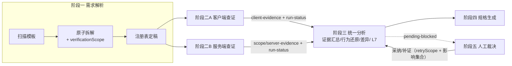

# game-requirement-audit 统一工作流执行文档

- 日期：2026-11-17
- 类型：执行文档（头部：步骤总览 + 全部步骤的产物与结构定义）
- 设计依据：`dev-docs/design/2026-11-17-game-requirement-audit-unified-workflow.md`（合并方案、五阶段架构、三原则、迁移表）
- 现状资产：`.opencode-workflows/workflows/output-spec-generate/`（四子流程）、`.opencode-workflows/workflows/server-rule-verify/`（四子流程 + 3C 客户端落判）、`.opencode-workflows/scripts/`（确定性装配脚本族）
- 状态：**头部 v3.2（收口终版·冻结）**——v3.1 三项收口 + 两项 Schema 终修（共享证据多原子关联、升级识别确定性条件）完成，头部冻结生效；**此后不再增加架构版本**，进入 S1~S11 详细执行章节与工程实现（开发顺序：确定性脚本与 Gold Set 回归先行，再接入 Agent 并行链路，见 §10）
- 修订记录：
  - v1（2026-11-17 初稿）：步骤总览 S1~S11、统一产物目录、全部产物结构、四大数据契约；
  - v2（2026-11-17 评审修订一）：P0×4——S7 取消 conflict 必带双端证据；双端 pending 执行状态独立（run-status）；Registry 新增 `verificationScope`；S8/S9 rejected 回退基线。P1——CLE/SVE 版本追溯三字段；端级补证 retryScope；增量重算；
  - v3（2026-11-17 评审修订二）：P0×4——冲突快速路径（单端直证绕过必要端 pending，原则 7）；SVE 收敛纯服务端（废弃 3C 客户端补证链路）；client verified 六项前置条件；Source Manifest 确定性采集。P1×2——证据失效 hash 优先；增量重算按共享证据影响集合；
  - v3.1（2026-11-17 评审修订三·收口）：**P1×3**——①S4/S5 统计口径收口（entry=已完成原子恰一条，coverage 不变式 `entryCount + pendingAtomIds = expectedAtomCount`，条目去 pending 双写，S4/S5 同契约）；②调用链依赖追踪闭环（CLE/SVE 增 `dependencyFiles` + `repoId`，Source Manifest 按 repoId 分仓统一采集证据文件与依赖文件 hash，依赖链复核有数据支撑）；③conflict-fast 升级 full 的历史与审批语义（`baselineDifference` 历史保全 + `candidateDifference` 候选双写 + `previousDifference` 锚历史基线 + `analysis-history.json` append-only；conflict-fast 条目非冲突字段允许为空）。**Gold Set 扩至八场景（G06~G08 源码时效）并升级为自动化回归测试**。整体架构与四大契约不再调整；
  - v3.2（2026-11-17 评审修订四·终版·冻结）：**Schema 终修×2**——①共享证据多原子关联（CLE/SVE 证据 `atomId` 单值 → `atomIds[]` 列表：证据只存一份、多原子引用、追加引用只扩 atomIds；merge 按证据指针（repoId+file+location+symbol）去重（保留首 id、atomIds 并集）；引用一致性校验——解决单 atomId 与「禁止复制条目」的结构矛盾）；②升级识别确定性判定式（`upgraded = 上轮 conflict-fast ∧ 本轮 full ∧ 上轮基线 conflict`；`previousRunId` 逐原子解析自 analysis-history 最近记录，禁止跨原子取值；同 run 重放不重复追加 history）。架构与四大契约不再调整，冻结；
  - v3.2 补遗（2026-11-17，**不升版本号**）：证据确定性合并契约落 §5.0（并行分片合并顺序无关性：分片按文件名排序读取、证据按指针字典序处理、同指针合并 ID 归属 **Registry 最早支撑原子**（替代原「保留首个 id」的顺序依赖表述）、atomIds 按 Registry 顺序去重、乱序不变式并入 Gold Set 断言）。架构基线维持 v3.2 冻结，进入工程实现；
  - v3.2 补遗二（2026-11-17，**不升版本号**）：①跨平台确定性排序标准（§5.0 B / M7：码元序比较禁区域排序、路径分隔符统一 `/`、不做大小写折叠、location 规范格式 `<file>:<起>-<止>`、空 symbol 空值排序规则、atomIds 只用 Registry 原始顺序）；②证据语义去重边界（§5.0 B / M8 + CLE/SVE 新增 `claimKey` 字段：指针相同且 claimKey 相同才合并，同指针不同 claimKey 保留独立条目——**相同代码位置 ≠ 相同证据语义**，不为去重丢失证据语义）；③G05 扩 Agent 完成顺序变化与跨进程重放断言；④§10 前置条件版本引用统一 v3.2。架构基线维持 v3.2 冻结；
  - v3.2 补遗三（2026-11-17，**不升版本号**）：产物一级子目录加**阶段序数字前缀**——`1-registry/`（阶段一：需求事实源）、`2-client/`（阶段二A）、`3-server/`（阶段二B）、`4-analysis/`（阶段三）、`5-specs/`（阶段四）、`6-review/`（阶段五），**目录排序即主链执行顺序**；全文路径引用同步更新；各分支内 `runtime/` 为执行状态目录不带前缀；§3 目录树 `retry-input` 注释更正为 atomIds 反查。架构基线维持 v3.2 冻结；
  - v3.2 补遗四（2026-11-17，**不升版本号，执行层扩展**）：**Stage Reuse（阶段产物可复用）**——原则 9 + §11 新章节：四执行模式（all/resume/from-stage/retry）、阶段依赖图、契约 #5 stage-manifest（inputHash/configHash/outputHash/stageVersion 四指纹，`Reusable = 四匹配 AND`，文件存在 ≠ 可复用）、失效与复用矩阵（阶段级）、双失效机制（阶段配置变化 / 上游数据变化分开实现）、`reusePolicy=strict` 默认 + `planOnly`、**Run 级隔离**（§3 增 `runs/run-NNN/` 层 + `latest.json`，数字前缀子目录结构保持不变；复用经 Artifact Reference 不改写来源 Run 产物）、S11 决议绑定 analysisRunId + 证据版本（变化标 stale 必须重新人工确认）；D29~D33、G09；§10 增 Stage Reuse 详细章节行与开发顺序⑥。架构与四大业务契约维持 v3.2 冻结；
  - v3.2 补遗五（2026-11-17，**不升版本号，Stage Reuse 执行契约修正**）：①P0——**最小跨 Run Artifact Reference（只读引用历史 Run 不可变产物）划入第一阶段**（from-stage 依赖它成立，原一/二阶段顺序矛盾消除；第二阶段仅做多来源引用与引用链解析优化，D35）；②P1——§3 目录树根级 `runtime/stage-manifest.json` 前置展示，明确**根级（阶段状态）/ 分支级（分片状态）runtime 不混用**；③P1——**依赖图完整性铁律**（D34）：S10 依赖全部直接输入（Registry + CLE + SVE + business-behavior + difference-review + l7-classify），inputHash 覆盖实际消费全部文件；④P1——S11 决议改 **Atom 级证据指纹 evidenceFingerprint**（只聚合该 Atom 实际引用的 CLE/SVE + dependencyFiles，无关文件变化不连坐过期）；⑤§10 开发顺序调整：Stage Reuse 最小闭环提前至 S1~S3 之后实证（`from-stage=S3`）。架构基线维持 v3.2 冻结；
  - v3.2 补遗六（2026-11-17，**不升版本号，Stage Reuse 执行契约收口冻结**）：①P0——**strict 语义收口**：strict = 严格验证复用而非禁止重跑——只校验 startStage 前的复用阶段四指纹（不匹配拒绝复用 fail fast）；startStage 及下游按计划重跑（不检查旧 configHash/stageVersion）；复用产物 Hash 与来源不一致拒绝复用；来源 Run 缺失/引用损坏拒绝执行（§11.3/§11.6/§7/G09 同步）；②P0——**S10 依赖改文件级清单**（§11.2/D34：Registry + CLE + client run-status/source-manifest + scope-index + SVE + server run-status/source-manifest + unified-atoms + business-behavior + difference-review + l7-classify，逐一对照生成逻辑）；③P1——**S11 最小 stale 检查提前到第一阶段**（evidenceFingerprint 比对 + 适用性清单 + 不自动沿用；第三阶段仅留增量复用下的审批依赖传播）；④P1——**新增 executionProfileHash**（模型/采样参数/Agent 配置/工具版本；不参与 Reusable 强校验、不无条件失效上游，只作 Run 间实验对比标识）；⑤§11.9 增最小可验证实验（S1~S3 六步）。**Stage Reuse 执行契约就此冻结。**
  - §12 落地（2026-11-17，**执行层细化，不升版本号**）：S1~S3 详细执行设计 + 最小 Stage Reuse 第一阶段工程实现交付（§10 开发顺序 ②+③）：七文件（主编排 + 三子流程 + build-requirement-registry.mjs + stage-specs.json + stage-reuse.mjs）+ 两 Example（19+18 断言全绿）+ 决策 D36~D41（物化复制/stage-specs 单一事实源/terms 确定性解析/validate-only 复用/中文值经 args-file 不进 shell）；§11.9 六步实验待用户触发（agent 链路不自跑）。
  - §13 落地（2026-11-17，**执行层细化，不升版本号**）：S4/S5 详细执行设计的**确定性脚本层**交付（§10 ④ 前半段，策略「确定性脚本 + Gold Set 双端先行」）：三脚本（prepare-verify-input / collect-source-manifest / merge-branch-evidence，客户端/服务端参数化共用）+ 两 Example（14+25 断言）+ 决策 D42~D45（SVE 编号统一归属原子 / ID 由 merge 全权分配 / 分片模式全清重建 / S5 精细落判沿用旧脚本）；Gold Set G01/G02/G05/G06/G07/G08 确定性等价已断言；S4/S5 agent Prompt 与编排、S6~S11 待接。
  - §14~§19 落地（2026-11-17，**文档完成，不升版本号**）：§10 待写清单**全部章节交付**。§14 S6~S7（屏障三分 + 升级识别 D25 + 历史 append-only 幂等）、§15 S8~S9（审批状态机 D11 + scope 五级 + 六前置 D17 + 候选隔离 D23）、§16 S10~S11（索引/清单/stale + 影响集合 D20/D24 + 端级补证分片）、§17 失败恢复与状态机（四层状态 + 恢复矩阵 + Schema 兼容）、§18 迁移执行计划（脚本落位 + 旧资产保留/废弃策略）、§19 Agent Prompt 与编排接入契约（STEPS 扩展 + 六阶段 Prompt 要点 + 待用户触发项）。六新脚本 + 四新 Example（19+21+13+8），**Gold Set G01~G09 全链端到端回归已可执行**（`gold-set-audit.example.mjs`），全量 **180 断言全绿**；决策 D46~D50。

---

## 0. 文档结构与本文范围

本文是执行文档的头部，只回答三个问题：

1. **统一后有哪些步骤**（§2 步骤总览表，S1~S11）；
2. **每一步产出什么**（§3 统一产物目录 + §5 步骤产物与结构，逐步骤定义所有产物的数据结构）；
3. **四大核心数据契约长什么样**（§6，Requirement Registry / Client Evidence / Server Evidence / Unified Difference 的字段表与关联关系——设计文档「下一步」要求的交付物）。

后续章节（§10 规划）逐步骤展开执行细节：Prompt 全文、确定性脚本改动方案、闸门实现、验收清单、迁移步骤。

## 1. 总体架构回顾（引自设计文档）

- 一个主 Workflow `game-requirement-audit`，五个阶段，两条并行查证分支（客户端 / 服务端）。
- 架构原则：
  1. **一个需求事实源**：Atom ID 只能由原子拆解阶段（S2）产生；
  2. **两套独立证据体系**：客户端（S4）与服务端（S5）分别查证，互不代替、互不覆盖；SVE 只承载服务端三目录证据，客户端证据只进 CLE；
  3. **一个统一业务结论**：双端证据汇总（S6 同步屏障）后才做差异判定（S7/S8）与 L7 分类（S9）；
  4. **执行状态与业务结论分离**（v2）：pending（查证未完成）是执行状态（run-status 表达），unknown（已查证但证据不足）/ not_found（已查证未找到实现）是业务结论；禁止用「缺证据」「缺条目」互相推断；
  5. **验证范围由需求侧声明**（v2）：`verificationScope`（client/server/both）只在 S2 依据需求语义判定并入 Registry，任何下游阶段不得从「哪端找到了证据」反推需求属于哪端；
  6. **客户端 `verdict` 与服务端 `applicability` 是两个独立维度**，永远不合并成一个字段；
  7. **冲突可单端立证，一致必须满足全部必要端证据**（v3）：任一已完成端的直接矛盾证据即可先行成立 conflict（不被另一必要端 pending 阻塞）；consistent / verified 必须等全部必要端查证完成，且不把执行失败当业务冲突；
  8. **历史结论不被新轮输出直接覆盖**（v3.1）：升级重判只产生候选结论，改变正式结论必须经 S8 建议 + 人工审批；分析历史 append-only 保全；
  9. **阶段产物可复用（Stage Reuse，执行层）**（v3.2 补遗四）：每个阶段是具有明确输入、输出和版本指纹的独立执行单元，阶段产物通过确定性闸门后成为**不可变 Artifact**；后续执行按阶段依赖关系与指纹复用历史产物（不改写来源 Run），当某阶段输入、配置或实现版本变化时，仅使该阶段及其受影响下游失效，**不得无条件重跑整个 Workflow**（详见 §11）。
- 文档生成（S10）后置于双端查证与统一分析之后；策划视图只消费业务行为与 L7 分类，不暴露技术细节。



S6 屏障内部判定路径（v3）：

```
双端证据汇总（unified-atoms）
    ↓
任一已完成端存在直接冲突证据（directConflict）？
    ├── 是 → conflict-fast：进 S7 冲突分析（不因另一必要端 pending 阻塞）
    └── 否 → 必要端（verificationScope 声明的端）全部完成？
              ├── 否 → blocked：不进差异判定，pending-list（l7 派生 verification_required）
              └── 是 → full：进 S7 完整差异分析
```

## 2. 步骤总览表（S1~S11）

| 步骤 | 阶段 | 名称 | 职责一句话 | 主要输入 | 主要产物 | 关键闸门 | 现状来源 |
|---|---|---|---|---|---|---|---|
| S1 | 一 | 需求扫描 scan-template | 扫描模板章节结构并校验覆盖 | 模板 md | `scan.json` | 章节覆盖/编号连续校验 | 保留：`1-scan-template.js` |
| S2 | 一 | 原子拆解 atomize-requirements | 按阶段并行拆原子，只产需求侧字段 + 业务语义 + 来源行号 + verificationScope | `scan.json` + 模板原文 | 原子分片（runtime） | ID 规范/唯一校验、行号落界校验、verificationScope 枚举校验 | 拆分：`2-verify-stages.js` 第一步独立成步 |
| S3 | 一 | 注册表定稿 identity-map + requirement-registry | 确定性合并分片，落统一需求事实源 | S2 分片 + `scan.json` | `requirement-registry.json`、`identity-map.json` | 覆盖率/重复/统计块重算（含 scopeStats） | 新增（确定性脚本，机制参照 `recount-verify-parts.mjs`） |
| S4 | 二A | 客户端查证 client-verify | 只查证：客户端实现证据 + 实际观察行为 + 冲突信号 | Registry 原子（只读）+ Code/Fgui 工程 | `client-evidence.json`、`runtime/run-status.json`、`runtime/source-manifest.json` + runtime 分片 | 落盘闸门、verdict/证据自洽、directConflict 自洽、**统计口径不变式**、重算闸门 | 拆分：`2-verify-stages.js` 第二/三步；证据形态吸收 S8 `3-verify-scope-client.js` |
| S5 | 二B | 服务端查证 server-verify | 符号索引 → 匹配候选 → 作用域落判（纯服务端三目录） | Registry 原子（只读）+ 服务端源码根 | `symbol-index.json`、`scope-index.json`、`server-evidence.json`、`runtime/run-status.json`、`runtime/source-manifest.json` + runtime 分片 | 落盘闸门、双写闸门、SVE 形状/id 校验、SVE layer 收敛服务端三目录、重算闸门、按 run-status 分段校验、**统计口径不变式（同 S4）** | 保留：`1-scan-server.js` + `2-match-atoms.js` + `3-verify-scope.js`（内部三步不变；废弃 3C 客户端补证链路） |
| S6 | 三 | 证据汇总 merge-evidence | 同步屏障 + 分析路径三分（conflict-fast / full / blocked）+ 确定性合并 | Registry + 双端产物 + 双端 run-status | `unified-atoms.json`（含 analysisRunId） | 同步屏障（run-status 判定 pending）、冲突快速路径判定（directConflict 信号）、Atom 对齐、evidenceIds 存在性 | 扩展：`merge-verify-output.mjs` |
| S7 | 三 | 业务行为还原 business-behavior-analysis | 双路径差异初判（冲突快速 + 完整）+ **升级重判候选双写（历史基线保全）** + 业务行为还原 | `unified-atoms.json`（conflict-fast + full 原子） | `business-behavior.json`、**`analysis-history.json`（append-only）** | 落盘闸门、覆盖/枚举校验、conflict 证据域校验、**conflict-fast 字段可空校验**、升级原子历史锚定校验 | 新增（agent 阶段；差异初判口径继承 v4 需求 6.1） |
| S8 | 三 | 统一差异复核 difference-review | 双栏证据复核出建议（pending），人工批准后生效；**降级建议须引用候选 + 双端证据** | `unified-atoms.json` + `business-behavior.json` | `difference-review.json` | reviewRule 白名单、复核漂移检测、审批状态闸门（rejected 回退基线）、**升级原子 pending/rejected 维持历史基线** | 调整：`4-review-difference.js` + `merge-verify-output.mjs` 复核合并段 |
| S9 | 三 | L7 分类 l7-classify | 确定性矩阵：复核差异 × 作用域 → L7（scope 解析含 verificationScope；client verified 前置条件） | 四件套（registry/双端/复核） | `l7-classify.json` | 矩阵自洽、统计块交叉校验、scope 解析禁止证据反推、client verified 前置条件校验、五道闸门前置 | 保留：`classify-l7.mjs`（输入换 Registry 基线 + scope 解析扩展） |
| S10 | 四 | 统一规格生成 unified-spec | 双端齐备后一次性生成五类交付物 | 阶段三全部产物 | 技术实现视图、策划业务视图、规则验证报告、需求追溯索引、待处理问题清单 | 机械校验七维度、策划版泄漏扫描、AT-ID 覆盖 | 调整：`3-produce-outputs.js` + `4-assemble-verify.js` 移后 + 扩展 |
| S11 | 五 | 人工裁决 human-review | pending 清单审阅、端级补证（retryScope）+ 影响集合重算、采纳/修改/否决/挂起 | `pending-list.md` + 各正式产物 | 决议记录、补证分片、approved 合并索引 | 审批状态独立闸门、v2 基线只读、影响集合完整性校验 | 保留扩展：`prepare-retry-input.mjs`、`assemble-output-spec-index.mjs` v3 模式 |

说明：

- S4 与 S5 **并行执行**，共享同一份 Registry 原子输入与同一并发配额；
- S5 内部保留现有三步链（扫描 → 匹配 → 落判），对主编排是单步；旧 S8 客户端补证落判（3C/-pc 分片）整体废弃；
- 原 `4-review-difference.js` 的「复核建议」部分移入 S8，「merge/classify/check 确定性闸门」部分拆入 S6/S9/S10；
- 阶段五不是线性终点：补证（retryScope + 影响集合）后回到 S6 重走统一分析（新一轮 analysisRunId），决议改写 `reviewStatus` 后由确定性脚本重算 S9/S10 相关产物。

## 3. 统一产物目录

统一产物根：`spec-workflow/requirement-audit/<date>/runs/<runId>/`（**Run 级隔离**【v3.2 补遗四】，见 §11；`<date>` 经 args 显式传入，脚本内禁止取当前时间）。历史产物目录（`spec-workflow/output-spec/…`）一律只读。

```
spec-workflow/requirement-audit/<date>/
└── runs/                               # Run 级隔离：每次执行（all / from-stage / retry）一个独立 run 目录
    ├── run-001/                        # 例：完整执行（run 根详细结构见下）
    ├── run-002/                        # 例：from-stage=S7 —— S1~S6 经 Artifact Reference 复用 run-001（不改写其产物）
    └── latest.json                     # 当前 run 指针（date 级，确定性脚本维护）
```

run 根详细结构（`runs/<runId>/`，数字前缀子目录命名保持不变；本文 §5 全部相对路径以 run 根为基准）：

```
spec-workflow/requirement-audit/<date>/runs/<runId>/
├── runtime/                           # Run 根执行状态【阶段级】（Stage Reuse 契约 #5，见 §11）——与分支级 runtime（分片级）不同层，不混用
│   └── stage-manifest.json            # 阶段指纹清单（inputHash/configHash/outputHash/stageVersion）
├── 1-registry/                        # 阶段一：需求事实源（唯一 Atom ID 产生地）
│   ├── requirement-registry.json      # S3：统一原子注册表（核心契约 #1）
│   ├── identity-map.json              # S3：术语/章节/跨切面身份映射
│   └── runtime/
│       ├── state/scan.json            # S1：章节扫描结果（保留现结构）
│       └── atom-parts/                # S2：原子拆解分片 <stageId>-ap<NN>.json
├── 2-client/                          # 阶段二A：客户端证据体系（独立，不被服务端覆盖）
│   ├── client-evidence.json           # S4：客户端证据正式产物（核心契约 #2）
│   └── runtime/
│       ├── run-status.json            # S4：分支执行状态（pending/timeout/failed 分片清单）
│       ├── source-manifest.json       # S4：源码版本清单（repoId 分仓，含依赖文件 hash）
│       ├── verify-input/              # S4 输入分片 <stageId>-cp<NN>.json + manifest.json
│       ├── verify-output/             # S4 落判分片 <stageId>-cp<NN>.json
│       └── client-recount.json        # 重算闸门产物
├── 3-server/                          # 阶段二B：服务端证据体系（纯服务端三目录）
│   ├── symbol-index.json              # S5-1：符号索引（保留）
│   ├── scope-index.json               # S5-3：作用域判定（核心契约 #3 组成）
│   ├── server-evidence.json           # S5-3：服务端证据 SVE（核心契约 #3 组成）
│   └── runtime/
│       ├── run-status.json            # S5：分支执行状态
│       ├── source-manifest.json       # S5：服务端源码仓版本清单（repoId 分仓）
│       ├── verify-input/              # 保留：分片 + manifest.json
│       ├── match-output/              # 保留：匹配候选分片
│       ├── verify-output/             # 保留：服务端落判分片 <stageId>-p<NN>.json
│       ├── verify-recount.json
│       └── review-output/             # S8 复核建议分片（迁到本目录，双端统一复核输入）
├── 4-analysis/                        # 阶段三：统一分析
│   ├── unified-atoms.json             # S6：统一 Atom 视图（双端证据挂接 + pending 标记 + 分析路径 + analysisRunId）
│   ├── business-behavior.json         # S7：业务行为还原 + 差异初判基线 + 升级候选
│   ├── analysis-history.json          # S7：分析历史（append-only，历史轮记录只增不改）【v3.1 新增】
│   ├── difference-review.json         # S8：统一差异复核（核心契约 #4 组成）
│   ├── l7-classify.json               # S9：L7 分类（核心契约 #4 组成）
│   └── runtime/spec-check/
│       └── l7-check-report.md         # 五道闸门报告
├── 5-specs/                           # 阶段四：规格生成（结构对齐原 1-spec）
│   ├── stages/spec_stage_ST-Cxx.md    # 技术实现视图：阶段规格文档
│   ├── feature_index.json             # 统一索引（schema v3，双端字段）
│   ├── stage_manifest.md              # 阶段速查表
│   ├── trace_index.json               # 需求追溯索引
│   ├── pending-list.md                # 待处理问题清单（阶段五入口）
│   ├── 技术补充版.md                   # 技术实现视图：补充版需求文档（路径可配）
│   ├── 策划版.md                       # 策划业务视图（路径可配）
│   └── runtime/
│       ├── state/doc-parts/、parts/、planner-parts/   # 文档分片（保留分片写盘机制）
│       ├── build-config.json          # 装配配置（中文路径经此传递）
│       └── spec_check/verify-report.md
└── 6-review/                          # 阶段五：人工裁决
    ├── decisions.json                 # 决议记录（采纳/修改/否决/挂起 + retryScope + 影响集合；Atom 级证据指纹绑定，见 §11.8）
    └── runtime/retry-input/           # 补证重跑分片（端级 client/server/both；影响集合由 atomIds 反查）
```

目录规则（沿用现约定）：

- 目录命名【v3.2 补遗三】：一级子目录按主链阶段序加**数字前缀**（`1-registry` → `2-client` → `3-server` → `4-analysis` → `5-specs` → `6-review`），**目录排序即主链执行顺序**；各分支内 `runtime/` 为执行状态目录，不带前缀；
- 读写分离：`1-registry/`、双端正式产物对查证 agent 只读；agent 只写自己的 runtime 分片；
- 断点续跑：正式产物已存在且分片齐全时支持增量/幂等重跑；`5-specs/` 内已存在 `feature_index.json` 时 fail fast（换新目录或清理）；
- Run 隔离【v3.2 补遗四】：每次执行（all/from-stage/retry）新建 `runs/run-NNN/`；复用经 **Artifact Reference**（来源 runId + 产物路径 + hash）引用来源 Run 产物，**严禁改写来源 Run 的任何产物**；`latest.json` 指针由确定性脚本维护（见 §11）；
- 阶段指纹【v3.2 补遗四/五】：run **根级** `runtime/stage-manifest.json`（阶段执行状态与指纹）由确定性脚本在阶段闸门通过后采集（agent 零指纹填写）——与 `1-registry` / `2-client` / `3-server` 各**分支级** `runtime/`（分片执行状态）不同层，**不混用**；复用判定 `Reusable = 四指纹匹配 AND`（见 §11）；
- JSON 一律 UTF-8 无 BOM、LF、1 空格缩进；`date` 一律经 args/配置文件传递，禁止脚本内取当前时间。

## 4.（并入 §3 与 §5）产物目录见 §3，逐步骤结构见 §5

## 5. 步骤产物与结构

标注约定：**【保留】**现有字段不变；**【扩展】**现有结构新增字段；**【新增】**本工作流新产物；**【v2】/【v3】/【v3.1】**评审修订新增。所有结构为 JSON 字段示意（同现有 schema 风格），非严格 JSON Schema 全文；严格 Schema 随各步骤详细章节给出。

### 5.0 双端分支统一契约（统计口径 + 证据确定性合并）【v3.1/v3.2，S4/S5 共用】

**A. 统计口径契约【v3.1】**

| 字段 | 统计口径 |
|---|---|
| `coverage.expectedAtomCount` | Registry 全部预期原子数（目标阶段） |
| `entries[]` / `coverage.entryCount` | **已完成且成功落判**的原子，每原子恰一条（未完成原子无条目） |
| `coverage.pendingAtomIds` | 未完成原子（分片 pending/failed/timeout） |
| `stats.atomCount` | = `entryCount`（已完成落判数，**不是预期数**） |
| 不变式 | `entryCount + pendingAtomIds.length === expectedAtomCount`（闸门强校验） |
| 双写禁止 | 条目内**不存 pending 字段**——pending 唯一事实源是 `runtime/run-status.json`，S6/S10 从 run-status 派生 |

**B. 证据确定性合并契约【v3.2 补遗，S4/S5 merge 脚本共用】**——并行分片合并产物**不依赖分片完成顺序**（证据 ID、atomIds、条目顺序、统计块对任意分片交付顺序恒定）：

| # | 规则 |
|---|---|
| M1 | 分片归集：merge 按分片**文件名字典序**（排序标准见 M7）读取全部 runtime 分片（`<stageId>-cp<NN>` / `<stageId>-p<NN>`），与 agent 完成顺序无关 |
| M2 | 证据排序：全部证据条目先按**规范化合并键（repoId, file, location, symbol, claimKey）**确定性排序（标准见 M7）后处理 |
| M3 | 同键合并：**证据指针（repoId, file, location, symbol）相同且 claimKey 相同**才合并为一条——`atomIds` 去重并按 **Registry 顺序**（features/atoms 全序基准）排列；**同指针不同 claimKey 不合并**（见 M8） |
| M4 | ID 归一：合并条目 ID 归属 = `atomIds` 中 **Registry 最早支撑原子**的命名空间（`CLE-<归属原子>-NN` / `SVE-<stageId>-P<NN>-NN`）；NN 在归属命名空间内递增编号（本轮新证据按合并键序接续既有最大 NN）；**既有正式产物同合并键证据保留原 id（id 永不变更，幂等）** |
| M5 | 乱序不变式：打乱分片完成/交付顺序、改变 Agent 完成顺序并**在不同进程中**重复执行 merge，证据 ID、atomIds、entries/evidence 顺序、统计块与合并产物内容必须**逐字节一致**（不依赖单次运行内存状态；闸门 + Gold Set 断言） |
| M6 | 冲突保护：同 id 不同合并键（指针或 claimKey 任一不同）= id 劫持 fail（沿用坑 8 口径）；不同 run 重放沿用 history/run 幂等规则 |
| M7 | **跨平台确定性排序标准**：字符串比较一律使用**码元序（Unicode 码点序）**，禁用 `localeCompare`/系统区域排序；路径分隔符统一 `/`；字符串按 Git 记录原样比较、**不做大小写折叠**（大小写差异即不同指针）；`location` 统一规范格式 `<file>:<起>-<止>`（单行可省略区间）；空 `symbol` 统一排在非空之前（空值排序规则）；`atomIds` 排列**只用 Registry 原始顺序**，禁止字符串排序 |
| M8 | **证据语义去重边界**：`claimKey` = 证据业务断言的规范化短标识（agent 填写：小写、连字符、去空白，如 `caishen-mark-display`；merge 视为不透明字符串，只作相等比较）；**相同代码位置 ≠ 相同证据语义**——同指针不同 claimKey 视为同一代码位置上的两个不同业务证明，各自保留独立条目与独立 ID（各自归属 Registry 最早支撑原子），**不为去重丢失证据语义** |

---

### S1 需求扫描（scan-template）

- 脚本来源：`output-spec-generate/1-scan-template.js` 原样迁移。
- 产物：`1-registry/runtime/state/scan.json`【保留】

```json
{
  "templatePath": "templates/…核心简化版本.md",
  "totalLines": 0,
  "sections": [
    { "no": 1, "title": "", "fromLine": 1, "toLine": 0,
      "kind": "intro|terms|stage", "stageId": "ST-Cxx",
      "container": "", "sourceTitle": "行牌 > 吃碰杠" }
  ]
}
```

- 闸门：章节覆盖全文（首节起于 1 行、末节止于 totalLines、相邻间隔 ≤3 行）、stageId 连续编号（ST-C01…）。

---

### S2 原子拆解（atomize-requirements）

- 来源：`2-verify-stages.js` 的「第一步 拆原子需求」独立成步；**只拆解、不查证**。
- 输入：`scan.json`（内存链式）+ 模板原文行段 + 名词章节（terms）。
- 产物：`1-registry/runtime/atom-parts/<stageId>-ap<NN>.json`【新增】（agent 按阶段并行写盘，分片仅按阶段切，不拆散功能点）

```json
{
  "schemaVersion": 1,
  "stageId": "ST-Cxx",
  "partNo": 1,
  "features": [
    {
      "id": "FP-ST-Cxx-nnn", "name": "", "description": "",
      "scope": "", "coordination": "",
      "atoms": [
        {
          "atomId": "AT-ST-Cxx-nnn", "name": "",
          "rule": "",                       // 规则语义，忠实模板原文
          "uiRequirement": "",              // UI 表现相关语句，无则空串
          "verificationScope": "client|server|both",   // 需求验证范围（判定规则见下）
          "businessBehavior": {             // 需求声明的业务语义四元组（玩家语言）
            "trigger": "", "condition": "", "action": "", "result": ""
          },
          "source": {                       // 原文来源追溯【新增】
            "chapter": "行牌 > 吃碰杠",
            "fromLine": 0, "toLine": 0      // 原子对应原文行号区间
          }
        }
      ]
    }
  ]
}
```

- **verificationScope 判定规则【v2】**（拆解时依据需求语义判定，只看需求原文，不看代码）：
  - `client`：纯界面/交互表现类——UI 展示、动效、按钮状态、纯客户端壳逻辑，服务端无规则角色（如「牌河中财神标记显示方式」）；
  - `server`：纯规则计算/判定类——客户端仅展示服务端结果，需求正确性取决于服务端（如「胡牌番数计算规则」）；
  - `both`：双端协作类——客户端交互与服务端规则共同构成完整行为（如「点击吃牌按钮后完成吃牌」）；
  - **无法判定时一律 `both`（保守：宁可多查证，不可少查证）**。
- 与现状差异：现 v4 的 `businessBehavior` 由客户端证据归纳；统一后改为**需求侧从原文归纳**（拆解阶段只看模板）。证据归纳的「实际观察行为」移入 S4（`observedBehavior`）。两套四元组在 S7 对比。
- 闸门：FP/AT ID 规范（`FP-/AT-ST-Cxx-nnn`）与阶段内唯一；`source.fromLine/toLine` 必须落在该阶段章节行段内；`rule` 非空；`verificationScope` 枚举合法（缺省按 `both` 计）。

---

### S3 注册表定稿（identity-map + requirement-registry）

- 来源：新增确定性脚本（合并 + 校验 + 统计重算，机制参照 `recount-verify-parts.mjs` / `merge-verify-output.mjs`）。
- 产物 1：`1-registry/requirement-registry.json`【新增】——**核心契约 #1：唯一需求事实源**

```json
{
  "schemaVersion": 1,
  "date": "2026-11-17",
  "source": { "templatePath": "", "totalLines": 0 },
  "stages": [
    { "stageId": "ST-Cxx", "name": "", "chapter": "", "summary": "",
      "featureCount": 0, "atomCount": 0 }
  ],
  "features": [
    { "id": "FP-ST-Cxx-nnn", "stageId": "ST-Cxx", "name": "", "description": "",
      "scope": "", "coordination": "",
      "atoms": [
        { "atomId": "AT-ST-Cxx-nnn", "name": "", "rule": "", "uiRequirement": "",
          "verificationScope": "client|server|both",
          "businessBehavior": { "trigger": "", "condition": "", "action": "", "result": "" },
          "source": { "chapter": "", "fromLine": 0, "toLine": 0 } }
      ]
    }
  ],
  "stats": { "stageCount": 0, "featureCount": 0, "atomCount": 0,
             "perStage": [],
             "scopeStats": { "client": 0, "server": 0, "both": 0 } }
}
```

- 铁律：**查证字段（verdict/applicability/evidence…）永远不进 Registry**；`verificationScope` 是需求侧声明字段，双端查证只读不写；Registry 定稿后 Atom ID 与 verificationScope 后续任何阶段不得增改（变更需重新拆解整链重跑）。
- 产物 2：`1-registry/identity-map.json`【新增】——双端共享的身份与术语映射

```json
{
  "schemaVersion": 1,
  "terms": [ { "term": "", "definition": "", "source": "模板名词章节 或 file:line" } ],
  "stageChapters": [ { "stageId": "ST-Cxx", "chapter": "", "sourceTitle": "", "fromLine": 0, "toLine": 0 } ],
  "crossCutting": [ "" ]
}
```

- 闸门：分片原子全覆盖（每原子恰一条、无重复无外来）、统计块与逐原子重算一致（含 scopeStats）。

---

### S4 客户端查证（client-verify）【阶段二A】

- 来源：`2-verify-stages.js` 第二/三步独立成步；证据条目形态吸收 S8 `3-verify-scope-client.js` 的经验（layer、id 代际隔离、共享证据引用不复制），但文件独立于 server-evidence。
- 输入：`requirement-registry.json`（确定性投影成查证输入分片，只含需求侧字段；全量原子——技术视图需要客户端职责，不按 verificationScope 裁剪）+ `source-code/client/Code`、`source-code/client/Fgui`。
- 产物 1：`2-client/client-evidence.json`【新增】——**核心契约 #2：客户端证据体系**

```json
{
  "schemaVersion": 1,
  "date": "",
  "source": { "codeDir": "source-code/client/Code", "fguiDir": "source-code/client/Fgui" },
  "entries": [                            // 每已完成原子恰一条（未完成原子无条目，见 coverage；条目不存 pending）
    {
      "atomId": "AT-ST-Cxx-nnn",
      "verdict": "confirmed|partial|not_found",   // 是否发现客户端实现证据（维度一）
      "clientLogic": "",                          // 客户端逻辑实现摘要
      "uiInteraction": "",                        // UI 交互表现
      "messages": [],                             // 涉及协议消息 MsgXxx
      "notes": "",
      "directConflict": false,                    // 【v3】查证中发现与需求直接矛盾的实现行为（语义信号）
      "conflictEvidenceIds": [],                  // 【v3】矛盾证据 CLE id（directConflict=true 时必非空）
      "observedBehavior": {                       // 由证据归纳的实际业务行为（玩家语言）
        "trigger": "", "condition": "", "action": "", "result": ""
      },
      "evidenceIds": ["CLE-ST-Cxx-nnn-01"]
    }
  ],
  "evidence": [                           // 平级证据条目（CLE；atomIds 支撑多原子——共享证据只存一条）
    { "id": "CLE-ST-Cxx-nnn-01", "atomIds": ["AT-ST-Cxx-nnn"],   // 【v3.2】支撑原子列表（共享证据多原子全列）
      "claimKey": "caishen-mark-display",         // 【v3.2 补遗二】业务断言规范化短标识（M8 语义去重边界，非空必填）
      "repoId": "client-code",                    // 【v3.1】所属仓标识（= source-manifest repos[].repoId）
      "layer": "client_code|client_fgui",          // Code 工程 / Fgui 工程
      "file": "client_code/layer/GameMahView.ts",
      "location": "client_code/layer/GameMahView.ts:123",
      "symbol": "", "excerpt": "", "configKeys": [],
      "sourceRevision": "<git commit sha>",        // 【v3】由 merge 从 source-manifest 回填，agent 不填
      "contentHash": "sha256:<file-hash>",         // 【v3】同上
      "verifiedAt": "2026-11-17",                  // 【v3】同上
      "dependencyFiles": [                         // 【v3.1】调用链依赖文件（agent 提供路径，hash 由 manifest 回填）
        { "file": "client_code/layer/GameMahController.ts", "contentHash": "sha256:…" },
        { "file": "client_code/model/GameMahModel.ts", "contentHash": "sha256:…" }
      ] }
  ],
  "coverage": {                             // 查证覆盖情况（统计契约见 §5.0）
    "expectedAtomCount": 0, "entryCount": 0, "pendingAtomIds": []
  },
  "stats": { "atomCount": 0,                // = entryCount（已完成落判数）
             "confirmed": 0, "partial": 0, "not_found": 0,
             "directConflict": 0, "pending": 0, "evidenceCount": 0 }
}
```

- 产物 2：`2-client/runtime/run-status.json`【v2 新增】——**分支执行状态（pending 的唯一事实源）**

```json
{
  "schemaVersion": 1,
  "branch": "client",
  "date": "",
  "runStatus": "completed|partial|failed",     // 全部分片 completed→completed；有未完成→partial；整体失败→failed
  "parts": [
    { "partFile": "ST-C01-cp01.json", "stageId": "ST-C01",
      "status": "pending|completed|failed|timeout",   // 分片级执行状态
      "atomIds": [] }                          // 本片应覆盖原子（Registry 投影清单）
  ]
}
```

- 状态语义：`pending` 尚未完成（未调度/未落盘）；`completed` 正常完成；`failed` 执行失败；`timeout` 执行超时。**pending/failed/timeout 分片不产 entry**（该批原子无条目、进 `coverage.pendingAtomIds`），分支不中止——runStatus=partial 放行到 S6。
- 产物 3：`2-client/runtime/source-manifest.json`【v3 新增，v3.1 扩展】——**源码版本清单（确定性采集，repoId 分仓）**

```json
{
  "schemaVersion": 1,
  "branch": "client",
  "collectedAt": "2026-11-17",
  "repos": [                                  // 客户端两根目录可能同仓或异仓，按仓分条（repoId 唯一）
    { "repoId": "client-code", "repoRoot": "<git 仓根>", "commit": "<采集时 commit sha>",
      "files": [                              // 覆盖本分支全部证据文件 + 依赖文件（含 dependencyFiles 引用）
        { "file": "client_code/layer/GameMahView.ts", "contentHash": "sha256:…" },
        { "file": "client_code/layer/GameMahController.ts", "contentHash": "sha256:…" }
      ] }
  ]
}
```

- 采集机制【v3/v3.1】：确定性脚本 `collect-source-manifest.mjs` 在**分支 merge 时**运行——先归集 runtime 分片引用的全部文件（证据文件 + dependencyFiles 依赖文件），再按 repoId 分仓读取 commit SHA、计算 contentHash；无 git 仓的目录 commit 记 `unversioned`。**agent 严禁执行 git 命令、严禁自填 SHA/hash**：CLE 的 `sourceRevision/contentHash/verifiedAt` 与 `dependencyFiles[].contentHash` 由 merge 脚本从 manifest 按 **（repoId, file）联合匹配**回填（避免不同仓库相同相对路径匹配错误）；客户端与服务端分别记录各自源码仓版本，不共用一个 SHA。
- CLE 编号与共享证据规则【v3.2】：`CLE-<atomId>-NN`（单原子证据注册于该原子命名空间）；`atomIds` 记录全部支撑原子——同一证据服务多原子时**只存一条**（追加引用只扩 `atomIds`，禁止复制条目）；merge 按**规范化合并键（repoId + file + location + symbol + claimKey）去重**，合并条目 ID 归属 **Registry 最早支撑原子**（确定性合并契约 M1~M8，见 §5.0 B——指针相同且 claimKey 相同才合并，同指针不同 claimKey 保留独立条目，与分片完成顺序无关）；同 id 不同合并键 = id 劫持 fail；补证重跑新增证据用 `CLE-<atomId>-R<k>-NN` 代际隔离。**SVE 采用相同契约**。
- 自洽闸门：`verdict != not_found` 必带证据、`not_found` 不得带证据；`directConflict=true` 必带 conflictEvidenceIds（非空且 verdict != not_found）；**引用一致性**（entry 的 evidenceIds / conflictEvidenceIds ⊆ evidence ids，且被引证据的 `atomIds` 必须包含该 entry 的 atomId）；每条证据 `claimKey` 非空（M8）；**统计口径不变式**（§5.0 A：entryCount + pendingAtomIds = expectedAtomCount，coverage 与 run-status 重算一致）；dependencyFiles 的 file 必须能被 manifest 覆盖；证据合并键去重与 id 唯一（同 id 不同合并键 fail；确定性合并按 §5.0 B，ID 归属 Registry 最早支撑原子）。
- runtime 分片：`2-client/runtime/verify-input|verify-output/<stageId>-cp<NN>.json` + `manifest.json`（机制同 server 分支，含落盘闸门与重算闸门）。

---

### S5 服务端查证（server-verify）【阶段二B】

- 来源：`1-scan-server.js`、`2-match-atoms.js`、`3-verify-scope.js` 内部三步链整体保留，改动：①匹配输入基线从 `feature_index.json` 换成 `requirement-registry.json`；②merge 闸门按 run-status 分段校验；③SVE 收敛纯服务端；④废弃旧 S8 客户端补证链路（3C `-pc` 分片、client 层 SVE、scope=client 条目）——纯客户端需求由 Registry `verificationScope=client` 表达，客户端补证走 S4 重跑。
- 产物 1：`3-server/symbol-index.json`【保留】（stats：files/classes/methods/functions/configKeys/symbols）。
- 产物 2：`3-server/scope-index.json`【保留 + v3 收敛 + v3.1 统计契约】——**核心契约 #3 组成：服务端作用域**

```json
{
  "schemaVersion": 1,
  "entries": [                            // 仅已完成落判的原子有条目（统计契约同 §5.0，条目不存 pending）
    { "atomId": "AT-ST-Cxx-nnn",
      "applicability": "active|conditional|inactive|unknown",   // 【v3】收敛四值
      "configVerified": true, "callPathVerified": true,
      "configCondition": "",            // conditional 必填：配置 key + 默认值 + 可选值影响
      "callPath": "",                   // 证据调用链：函数名 + file:line
      "evidenceIds": ["SVE-ST-Cxx-P01-01"],
      "unresolved": "",                 // unknown 必填缺什么证据（已查证但证据不足）
      "noServerEvidence": false,
      "directConflict": false,          // 【v3】查证中发现与需求直接矛盾的服务端实现（语义信号）
      "conflictEvidenceIds": [] }       // 【v3】矛盾证据 SVE id
  ],
  "coverage": { "expectedAtomCount": 0, "entryCount": 0, "pendingAtomIds": [] },
  "stats": { "atomCount": 0,              // = entryCount（已完成落判数）
             "active": 0, "conditional": 0, "unknown": 0, "inactive": 0,
             "directConflict": 0, "pending": 0 }
}
```

- **pending ≠ unknown**：`unknown` = 服务端**已查证**但证据不足（业务结论，有 entry）；查证**未完成**（分片 timeout/failed/pending）= 无 entry + 进 `coverage.pendingAtomIds`（执行状态，由 run-status 表达）。两者来源独立，禁止互相推断。
- 产物 3：`3-server/server-evidence.json`【保留 + v3 收敛】——**核心契约 #3 组成：服务端证据（SVE，纯服务端三目录）**

```json
{
  "schemaVersion": 1,
  "evidence": [
    { "id": "SVE-ST-Cxx-P01-01", "atomIds": [],   // 【v3.2】支撑原子列表（共享证据多原子全列，契约同 CLE）
      "claimKey": "",                            // 【v3.2 补遗二】业务断言规范化短标识（M8，非空必填，契约同 CLE）
      "repoId": "server",                        // 【v3.1】服务端仓标识（单仓）
      "layer": "common_game|hzmj_server|mah_frame",   // 【v3】收敛服务端三目录
      "file": "", "location": "", "symbol": "", "excerpt": "", "configKeys": [],
      "sourceRevision": "<服务端仓 commit sha>",      // 【v3】由 merge 从 source-manifest 回填
      "contentHash": "sha256:<file-hash>",            // 【v3】同上
      "verifiedAt": "2026-11-17",                     // 【v3】同上
      "dependencyFiles": [                            // 【v3.1】调用链依赖文件（agent 提路径，hash 回填）
        { "file": "common_game/RuleEngine.cpp", "contentHash": "sha256:…" } ] }
  ],
  "stats": { "sveCount": 0 }
}
```

- **客户端证据不再进 SVE**【v3】：`client_code/client_fgui` 两 layer 废弃——客户端证据唯一载体是 `client-evidence.json` 的 CLE。旧 `3-verify-scope-client.js`（3C）及其 `-pc` 分片、scope=client 条目全部废弃；客户端视觉冲突改由 S4 的 `directConflict` + CLE 直证承载（S6 冲突快速路径消费）。
- 产物 4：`3-server/runtime/run-status.json`【v2 新增】——结构同 S4 产物 2（`branch: "server"`，`parts[].partFile` 为 `<stageId>-p<NN>.json`）。
- 产物 5：`3-server/runtime/source-manifest.json`【v3 新增，v3.1 扩展】——结构同 S4 产物 3（`branch: "server"`，服务端仓单仓一条 `repoId: "server"`）。
- 产物 6：runtime 中间产物 `verify-input/`、`match-output/`、`verify-output/`【保留】（仅服务端 `-p<NN>` 分片）。
- 闸门：全部沿用（落盘、双写 dr.scopeApplicability==applicability、SVE 形状/id 劫持、recount 重算、证据文件范围硬约束三根目录）+ v2 调整（merge 按 run-status 分段校验）+ v3 收敛闸门（SVE layer 只允许服务端三目录、applicability 只允许四值、directConflict 必带 conflictEvidenceIds）+ v3.1 统计口径不变式（同 §5.0 A）+ **v3.2 共享证据去重与引用一致性（同 CLE 契约，确定性合并按 §5.0 B M1~M8）**。

---

### S6 证据汇总（merge-evidence）【阶段三，同步屏障】

- 来源：扩展 `merge-verify-output.mjs`（客户端证据合并段 + Registry 对齐段 + run-status 消费段 + 分析路径判定段 + analysisRunId 生成；复核段拆给 S8）。
- 输入：`requirement-registry.json` + `client-evidence.json` + `scope-index.json` + `server-evidence.json` + 双端 `runtime/run-status.json` + `4-analysis/analysis-history.json`（runId 递增依据）。
- 产物：`4-analysis/unified-atoms.json`【新增】——统一 Atom 视图（S7/S8/S9/S10 的共同输入）

```json
{
  "schemaVersion": 1,
  "date": "",
  "analysisRunId": "ar-<date>-<seq>",      // 【v3.1】本轮分析运行标识（确定性生成：seq 由 analysis-history 递增）
  "atoms": [
    {
      "atomId": "AT-ST-Cxx-nnn",
      "requirement": { "rule": "", "uiRequirement": "", "source": {},
                       "verificationScope": "client|server|both",
                       "businessBehavior": {} },           // ← Registry 原样
      "client": { "verdict": "", "evidenceIds": [], "observedBehavior": {},
                  "directConflict": false, "conflictEvidenceIds": [],
                  "pending": false },                       // ← pending 由 run-status 派生（非双写）
      "server": { "applicability": "", "evidenceIds": [], "configCondition": "",
                  "directConflict": false, "conflictEvidenceIds": [],
                  "pending": false },                       // ← pending 由 run-status 派生（非双写）
      "analysisPath": "conflict-fast|full|blocked",         // 【v3】S6 分析路径判定
      "previousRunId": "",                                  // 【v3.1】升级原子非空（上一轮 run，来自 analysis-history）
      "baselineDifference": ""                              // S7 填入，本步留空
    }
  ],
  "stats": { "atomCount": 0, "conflictFast": 0, "full": 0, "blocked": 0,
             "upgraded": 0,                                  // 【v3.1】本轮升级原子数
             "clientPending": 0, "serverPending": 0,
             "dualLocated": 0, "clientOnly": 0, "serverOnly": 0, "neither": 0 }
}
```

- **分析路径判定【v3】**（确定性，逐原子）：
  1. **conflict-fast**：任一**已完成端**（该端 pending=false）entry `directConflict=true` → 进 S7 冲突分析，**不因另一必要端 pending 阻塞**（原则 7）；pending 端不参与判定（不把执行失败当业务冲突）；
  2. **blocked**：无已完成端冲突信号，且必要端（verificationScope 声明的端）任一 pending → 不进差异判定，直送 pending-list；
  3. **full**：无冲突信号且必要端全部完成 → 进 S7 完整差异分析；
  4. 非必要端 pending 不阻塞 full 判定（只记录供技术视图标注）；
  5. **升级识别【v3.2，确定性判定式】**：`upgraded = previousAnalysisPath == conflict-fast AND currentAnalysisPath == full AND previousBaselineDifference == conflict`——previousAnalysisPath / previousBaselineDifference 取自该原子在 analysis-history 中的**最近一次有效分析记录**；`previousRunId` **逐原子解析**（指向该原子自己的最近记录，禁止从其他原子的历史记录取得）；history 记录含 analysisPath + baselineDifference，可完整还原上轮路径与基线（闸门校验）；同一 analysisRunId 的恢复重放**不重复识别升级、不重复追加 history**（幂等，见 S7 产物 2）。
- 闸门（本步核心）：
  1. `client.pending` / `server.pending` 一律**从双端 run-status 判定**（原子所属分片 status != completed 即该端 pending），**禁止**从「缺 evidence」「缺 scope 条目」猜测 pending；
  2. Atom 对齐：client/scope 条目 atomId ⊆ Registry 且每原子至多一条（pending 原子零条目）；
  3. evidenceIds / conflictEvidenceIds 存在性（CLE→client-evidence，SVE→server-evidence）与**引用一致性**（被引证据的 atomIds 必须包含引用方 atomId）；dependencyFiles 文件必须被对应 source-manifest 覆盖；
  4. 分析路径统计块与逐原子重算一致；`analysisRunId` 唯一且单调递增（history 追加校验）；
  5. 不做任何语义判断（确定性脚本，无 agent——directConflict 是 S4/S5 agent 已落的语义信号，S6 只做布尔消费）。

---

### S7 业务行为还原与差异初判（business-behavior-analysis）

- 来源：新增 agent 阶段（按阶段分片并行）；差异初判规则继承 v4 需求 6.1 口径。
- 输入：`unified-atoms.json`（conflict-fast + full 原子；blocked 原子除外）。
- 产物 1：`4-analysis/business-behavior.json`【新增 + v3.1 扩展】

```json
{
  "schemaVersion": 1,
  "analysisRunId": "ar-<date>-<seq>",      // 【v3.1】本轮 run
  "entries": [                            // conflict-fast + full 原子每恰一条（blocked 原子除外）
    {
      "atomId": "AT-ST-Cxx-nnn",
      "analysisPath": "conflict-fast|full",
      "analysisRunId": "ar-…",             // 【v3.1】本轮 run 标识
      "previousRunId": "",                 // 【v3.1】升级原子非空（上一轮 run）
      "previousBaselineDifference": "",    // 【v3.1】升级原子非空（历史基线漂移锚点）
      "trigger": "", "condition": "",     // 触发/条件（conflict-fast 条目允许空串，见下）
      "clientAction": "",                 // 客户端职责（玩家语言）
      "serverAction": "",                 // 服务端职责（含配置生效条件，玩家语言）
      "collaboration": "",                // 双端协作链（消息流叙述，不出现类名）
      "result": "",                       // 玩家看到什么
      "baselineDifference": "consistent|partial|conflict|unverified",  // 差异基线
      "baselineDetail": "",               // conflict 必填：需求原文 vs 实际表现
      "candidateDifference": "",          // 【v3.1】升级原子 full 重判候选（非升级原子空串）
      "candidateDetail": "",              // 【v3.1】候选依据（升级原子候选 ≠ 基线时必填）
      "evidenceIds": []                   // CLE + SVE 混引
    }
  ],
  "stats": { "atomCount": 0, "consistent": 0, "partial": 0, "conflict": 0, "unverified": 0,
             "pendingBlocked": 0, "conflictFast": 0, "upgraded": 0 }
}
```

- **双路径初判【v3】**：
  - **冲突快速路径（conflict-fast）**：只做冲突判定——单端直接矛盾证据成立即立 `conflict`（baselineDifference=conflict + baselineDetail + 责任域证据）；另一端 pending 时**不要求其证据**；另一端已完成时可一并核对双端协作断点；不立 consistent/partial；
  - **完整路径（full）**：业务行为还原（四元组 + 双端职责 + 协作链）+ 完整差异初判；
  - **conflict-fast 条目字段可空【v3.1】**：`trigger/condition/clientAction/serverAction/collaboration/result` 在 conflict-fast 条目**允许空串**——快速路径只要求冲突判定字段（baselineDifference/baselineDetail/evidenceIds），**禁止为满足 Schema 强行编造完整行为**；full 条目四元组按必要端职责必填。
- **升级重判语义【v3.1，P1-3】**（conflict-fast → full，历史不被新轮覆盖）：
  1. **历史保全**：升级原子 `baselineDifference` 保持上轮历史基线（通常 conflict）与上轮证据——历史判断与证据**不因新一轮 agent 输出被覆盖**（`previousRunId/previousBaselineDifference` 锚定，history 落档）；
  2. **候选双写**：本轮 full 重判结果写 `candidateDifference/candidateDetail`（可与历史基线不同，如双端证据综合后发现原冲突判断不成立 → 候选 consistent）；
  3. **候选不生效**：`candidateDifference` 只是候选——改变正式结论必须走 S8 复核建议（降级建议须引用候选 + 双端证据）+ 人工批准；
  4. 非升级原子：`baselineDifference` = 本轮初判，`candidateDifference` 空串（无候选语义）。
- **conflict 证据域规则【v2】**：conflict 必须有**能够直接证明需求与实际行为矛盾的证据**；证据可来自客户端、服务端或双端；**证据范围必须覆盖冲突发生的职责域**。保留 `ui-conflict-stands-alone`。冲突类型与证据要求：

| 冲突类型 | 证据要求 | 示例 |
|---|---|---|
| 客户端视觉冲突 | CLE 直接证据即可 | 需求「打出的财神白板按普通白板显示」，实现「牌河中白板财神仍高亮」——服务端不负责牌河视觉 |
| 服务端规则冲突 | SVE 直接证据即可 | 需求「流局连庄」，实现「流局换庄」——客户端仅展示 |
| 双端协作冲突 | 按冲突发生的职责域要求相关端证据 | 点击吃牌后客户端出牌表现与服务端牌型数据不一致——需双端证据定位断点 |
| 无法证明冲突 | 不判 conflict，归 unverified 或 partial | 只有间接证据不能支撑矛盾判定 |

- 完整路径初判口径：
  - **conflict 判定不受 verificationScope 限制**——任一端矛盾证据即可立 conflict；
  - **consistent（可判一致）受 verificationScope 约束**：必要端查证完成且证据同构才可判 consistent；任一必要端证据不足 → unverified（番数案例：客户端有番数显示逻辑、服务端 unknown → unverified，绝不可 verified）；
  - conflict 必带 baselineDetail + 对应职责域证据（CLE/SVE）。
- 产物 2：`4-analysis/analysis-history.json`【v3.1 新增】——**分析历史（append-only，由确定性脚本落盘，agent 不写）**

```json
{
  "schemaVersion": 1,
  "runs": [                                // 只增不改：历史轮记录永不修改
    { "analysisRunId": "ar-<date>-<seq>", "date": "",
      "trigger": "initial|retry|resume|decision",   // 首轮 / 补证重跑 / 断点续跑 / 审批后重算
      "upgradedFrom": [],                  // 本轮升级原子（conflict-fast→full）清单
      "atomSummaries": [
        { "atomId": "", "analysisPath": "conflict-fast|full|blocked",
          "baselineDifference": "", "candidateDifference": "", "evidenceIds": [] } ] } ]
}
```

- 追加幂等【v3.2】：history 只增不改；同一 `analysisRunId` 重放（resume/断点续跑）**不重复追加**（按 analysisRunId 去重，闸门校验）；每轮 `atomSummaries` 覆盖该轮全部 conflict-fast/full/blocked 原子（升级原子可按 S6 判定式从 history 复现）。
- 闸门：落盘、枚举合法、conflict 必带 baselineDetail + 证据（覆盖冲突职责域）、conflict-fast 条目四元组可空（不因空 fail、也不因编造非空值过检）、**升级原子锚点校验**（previousRunId 逐原子解析自 history 最近记录且为该原子自己的记录、previousAnalysisPath=conflict-fast、previousBaselineDifference=conflict 且与该轮记录一致、候选 ≠ 基线时 candidateDetail 非空）、`baselineDifference` 回写 `unified-atoms.json` 后统计块交叉校验。

---

### S8 统一差异复核（difference-review）

- 来源：`4-review-difference.js` 复核建议段迁移 + 输入从「服务端单栏」改为「双端双栏」；复核规则白名单沿用四条前缀，双端合并口径下的新增前缀（含升级降级专用，如 conflict-not-sustained）在详细章节定稿。
- 输入：`unified-atoms.json` + `business-behavior.json`（含升级候选）。
- 产物：`4-analysis/difference-review.json`【扩展】——**核心契约 #4 组成：统一差异复核**

```json
{
  "schemaVersion": 2,
  "analysisRunId": "ar-…",
  "entries": [                            // 只对有把握/有变化的原子出条目，其余不出现
    {
      "atomId": "",
      "previousDifference": "",           // = S7 baselineDifference（升级原子即历史基线——锚点不漂移）
      "candidateDifference": "",          // 【v3.1】升级原子候选快照（非升级原子空串）
      "clientVerdict": "",                // 双栏证据快照
      "serverApplicability": "",          // 双栏证据快照
      "reviewedDifference": "consistent|partial|conflict|unverified",
      "reviewReason": "",                 // 双栏证据摘要：需求语义 vs 双端实现（引 file:line / CLE / SVE）
      "reviewRule": "",                   // 白名单前缀（可带补充说明括号）
      "reviewStatus": "pending|approved|rejected",   // merge 脚本自动落 pending，人工审批流转
      "evidenceScopes": [                 // conflict 条目必带（证据级作用域，标注每条证据能证明什么）
        { "ref": "CLE-…|SVE-…|client-visual", "layer": "", "applicability": "", "note": "" }
      ]
    }
  ],
  "baseline": { "differenceStats": {} },  // 与 S7 统计一致（交叉校验）
  "afterReviewProjection": {}, "l7Projection": {}
}
```

- **审批状态转换规则【v2】**（结论链：`S7 baselineDifference（升级原子含 candidate）→ S8 reviewedDifference → 人工审批 → effectiveDifference → S9 L7`）：

| 审批动作 | reviewStatus | effectiveDifference 取值 | 语义 |
|---|---|---|---|
| 批准 approve | `approved` | `reviewedDifference` | 建议生效，进正式索引（升级原子降级/维持均在此生效） |
| 修改 modify | `approved`（决议记录留人工改写值与理由） | 人工改写值 | 视同批准，改写值即生效结论 |
| 否决 reject | `rejected` | **`baselineDifference`（历史基线）** | **rejected ≠ 需求没有问题**；rejected 建议不得覆盖原始差异；新证据出新一轮建议重置 pending |
| 挂起 hold | 维持 `pending` | `baselineDifference`（不生效） | 挂起条目不进正式索引，留 pending-list |
| 补证 re-verify | 维持 `pending` | `baselineDifference`（不生效） | 转 S11 端级补证链路，重走 S6~S9（新 analysisRunId） |

- **升级原子专项闸门【v3.1】**：降级建议（conflict → 非 conflict）必须引用 `candidateDifference` + 双端证据（reviewReason 引 file:line / CLE / SVE）；`previousDifference` 锚历史基线（不取候选值）；pending/rejected/hold 期间 `effectiveDifference = 历史基线`（conflict 维持，**不被新轮 agent 候选直接覆盖**），仅 approved 后降级生效。
- 未审批条目的 l7 仅为 `proposed` 建议（l7Basis），不入正式索引；`l7/effectiveDifference/l7Basis` 三字段仍由 merge/classify 确定性回填（禁止手写）。
- 闸门：reviewRule 前缀白名单、previousDifference 漂移检测（升级原子锚历史基线）、审批状态独立校验、rejected 条目 effectiveDifference 必须 = baselineDifference。

---

### S9 L7 分类（l7-classify）

- 来源：`classify-l7.mjs` 保留；输入四件套的基线从 `feature_index.json` 换成 `requirement-registry.json`（previousDifference 对齐 business-behavior 基线）；scope 解析与 client verified 前置条件按 v2/v3 扩展。
- 产物：`4-analysis/l7-classify.json`【保留】——**核心契约 #4 组成：L7 分类**

```json
{
  "schemaVersion": 1,
  "date": "",
  "analysisRunId": "ar-…",
  "entries": [                            // conflict-fast + full 原子（blocked 原子无正式 L7 分类）
    { "atomId": "", "scope": "", "scopeSource": "",
      "l7": "verified|verification_required|decision_required|not_applicable",
      "effectiveDifference": "", "l7Basis": "proposed|approved|rejected" }
  ],
  "stats": { "atomCount": 0, "reviewedCount": 0, "unreviewedCount": 0,
             "l7": { "verified": 0, "verification_required": 0,
                     "decision_required": 0, "not_applicable": 0 },
             "l7Approved": { "verified": 0, "verification_required": 0,
                             "decision_required": 0, "not_applicable": 0 } }
}
```

- L7 矩阵（保留现表，`effectiveDifference × scope`）：

| effectiveDifference \ scope | active | conditional | unknown | inactive | client |
|---|---|---|---|---|---|
| consistent | verified | verification_required | verification_required | not_applicable | verified* |
| partial | verification_required | verification_required | verification_required | not_applicable | verification_required |
| conflict | decision_required | decision_required | decision_required | not_applicable | decision_required |
| unverified | verification_required | verification_required | verification_required | not_applicable | verification_required |

`verified*`：**仅在 client verified 前置条件（见下）全部满足时生效**。

- **client verified 完整前置条件【v3】**（全部 AND，任一不满足 → 不 verified，落 verification_required）：
  1. Registry `verificationScope = client`；
  2. `client.pending = false`（run-status 派生）；
  3. `client.verdict = confirmed`——confirmed 不只表示「找到了代码」，还要求现有客户端验证逻辑能够证明必要业务行为（partial / not_found 不满足，**partial 不得进 verified**）；
  4. `evidenceIds` 全部存在于 client-evidence 且证据非 stale；
  5. 差异条件：`effectiveDifference = consistent`（已审批生效）；未复核原子 `baselineDifference = consistent` 时 l7 仅为 `proposed` 建议；
  6. 必要业务行为四元组已得到证据支撑（`observedBehavior` 非空字段均有对应证据）。
- **scope 解析优先级【v2/v3】**（逐级回落）：
  1. conflict 条目优先证据级 evidenceScopes（conflict 不因 scope 未知降级——除 inactive 外一律 decision_required）；
  2. 复核条目 scopeApplicability（S8 双写）；
  3. scope-index Atom 级 applicability（服务端业务结论，四值）；
  4. **仅当 Registry `verificationScope=client` 且客户端已定位（CLE 定位）→ `client`**；
  5. 缺省一律 `unknown`（禁止缺省 inactive）。
  - **禁止**：`server unknown + CLE 存在` 自动推导为 `client`（番数案例：服务端 unknown + 客户端显示逻辑 confirmed → scope=unknown → verification_required，不可能错误通过 verified）。
- **verificationScope × L7 处理原则【v2】**：

| verificationScope | L7 处理原则 |
|---|---|
| `client` | 只要求客户端证据：client scope 可用（解析级 4）；满足 client verified 前置条件 → verified；服务端 pending/unknown 不阻塞、不进 pending-list |
| `server` | 只要求服务端证据：scope 按 scope-index 解析（1~3 级）；客户端证据不参与 scope 解析（仅进技术视图与 conflict 证据池） |
| `both` | 两端都必须完成必要查证：任一端 pending（S6 已 blocked）或 unknown → 不得 verified（矩阵落 verification_required / decision_required） |

- **blocked 原子 L7 口径【v3】**：blocked 原子**不进 l7-classify 正式条目**（未定结论不入正式统计）；规格产物中派生填 `l7=verification_required` 且 `l7Basis=pending-blocked`。
- **升级原子口径【v3.1】**：pending/rejected → `effectiveDifference = 历史基线`（conflict 维持、L7=decision_required），**候选不参与 L7 计算**；仅 approved 后按 `reviewedDifference` 落 L7。
- 闸门：矩阵自洽重算、evidenceIds 存在性、统计块交叉校验、conflict 条目必带证据级 scope、scope 解析路径合规校验（client scope 必须能回溯到 Registry verificationScope=client）、client verified 前置条件逐项校验、**升级原子候选隔离校验（L7 输入不含未审批候选）**。

---

### S10 统一规格生成（unified-spec）

- 来源：`3-produce-outputs.js` + `4-assemble-verify.js` 整体移到阶段四，写作输入从「客户端单端」改为「统一视图」。
- 五类交付物（对应设计文档 mermaid 的五个输出节点）：

**① 技术实现视图**（`5-specs/`）
- `stages/spec_stage_ST-Cxx.md`【扩展】：阶段规格文档，原子项新增双端区块——客户端职责 / 服务端职责 / 双端协作 / 配置生效条件 / 证据定位（CLE+SVE）/ 实际实现差异；blocked 原子标注「查证未完成（哪端 + 执行状态）」；conflict-fast 已立冲突的原子呈现冲突结论 + 另一端查证状态 + 升级候选（若有，标注「候选待审批」）；
- `feature_index.json`【扩展 schema v3】：统一索引，原子项即设计文档 4.1 的统一 Atom 结构：

```json
{ "id": "AT-ST-Cxx-nnn", "name": "", "rule": "", "uiRequirement": "",
  "verificationScope": "client|server|both",
  "clientVerification": { "verdict": "", "evidenceIds": [], "pending": false },   // pending 为派生呈现（源 run-status）
  "serverVerification": { "applicability": "", "evidenceIds": [], "configCondition": "", "pending": false },
  "difference": "", "l7": "" }
```

- blocked 原子：`difference` 留空、`l7` 派生填 `verification_required`（l7Basis=pending-blocked，不入 l7-classify 统计）；
- `stage_manifest.md`【扩展】：速查表增双端分布列；
- `技术补充版.md`【保留】：模板复制后补充完整版（补全内容改由统一视图供料）。

**② 策划业务视图**（`5-specs/策划版.md`）【保留投影口径】
- 只消费 `business-behavior.json` + `l7-classify.json`（l7 四口径差异行规则沿用 v4；blocked 原子按「规则待验证：查证未完成」口径呈现）；技术字段结构性隔离，泄漏扫描闸门沿用。

**③ 规则验证报告**
- `5-specs/runtime/spec_check/verify-report.md`【保留】（机械校验七维度，索引统计源换统一视图）；
- `4-analysis/runtime/spec-check/l7-check-report.md`【保留】（L7 五道闸门 + 前置条件校验结果）。

**④ 需求追溯索引**（`5-specs/trace_index.json`）【保留】
- 条目 `{ atomId, sourceStage, sourceRule, plannerSection, plannerPart, evidenceCount, required, reviewStatus }`；`sourceRule` 增强为可直接回跳 Registry 行号。

**⑤ 待处理问题清单**（`5-specs/pending-list.md`）【新增 + 细化】
- 汇总（按 verificationScope 区分必要端缺口）：
  - blocked 原子：必要端 + 执行状态（timeout/failed/pending）+ 建议补证端（retryScope）；
  - `l7=verification_required`：缺什么证据 / 依赖什么配置（含非必要端 unknown 参考信息）；
  - `l7=decision_required`：需求原文 vs 实际表现双栏（含 conflict-fast 单端立证条目，标注另一端查证状态）；
  - `reviewStatus=pending` 复核建议与 hold 挂起条目（含升级候选降级建议）；
  - stale 证据与依赖链待复核提示（§7 证据时效）；
  - 每项带 atomId、证据链接、建议动作（补证 client/server/both、采纳、修改、否决、挂起）。

- 闸门：机械校验七维度（文件存在/计数自洽/阶段文档原子 ID 一致/清单覆盖/补充版章节完整/乱码与分片标记/策划版泄漏+AT-ID 覆盖+差异统计）、五道 L7 闸门。

---

### S11 人工裁决（human-review）

- 来源：`prepare-retry-input.mjs`（补证分片）、`assemble-output-spec-index.mjs` v3 模式（approved 合并）保留扩展。
- **端级补证控制【v2】**（`retryScope`：`client|server|both`）：

| retryScope | 重跑范围 | 保留 |
|---|---|---|
| `client` | 只重跑 S4（目标原子分片） | server 正式产物与 run-status 原样 |
| `server` | 只重跑 S5（目标原子分片） | client-evidence 与 run-status 原样 |
| `both` | 双端补证 | 未变分片产物幂等保全 |

- **影响集合重算【v3】**：增量重算的最小范围**不是单个 Atom，而是受影响的 Atom 依赖集合**（确定性计算）：
  1. 补证目标原子集合 T（retryScope 对应端的分片覆盖原子）；
  2. 定位本轮更新/新增的 CLE/SVE（含共享证据更新：同 id 摘录或证据指针变化）；
  3. 反查被更新证据的 `atomIds`（支撑原子全列——含非补证目标原子，共享证据依赖，如同一配置判定函数 SVE-001 的 atomIds 含 AT-001/AT-002）；
  4. 影响集合 = T ∪ 反查集合；
  5. S6~S9 对影响集合重算（新一轮 analysisRunId；升级路径可变：blocked → full/conflict-fast、conflict-fast → full；S8 幂等口径沿用）；S10 只重生成影响集合覆盖的阶段文档/索引/策划版分片。
- 产物 1：`6-review/decisions.json`【新增】——决议记录：

```json
{ "schemaVersion": 1, "date": "",
  "decisions": [
    { "atomId": "", "action": "approve|modify|reject|hold|re-verify",
      "target": "difference-review|l7|pending",
      "retryScope": "client|server|both",       // action=re-verify 时必填
      "impactSet": [],                           // 【v3】影响集合（re-verify 时由确定性脚本回填）
      "modifiedValue": "",                       // action=modify 时必填（人工改写结论）
      "reason": "", "decidedAt": "" }
  ] }
```

- 产物 2：补证分片 `6-review/runtime/retry-input/`【保留 + 扩展】：双端统一补证输入（retryHint 含前轮缺口 + 端标识；客户端补证分片产 CLE，服务端补证分片产 SVE 四值作用域）。
- 产物 3：approved 合并：`reviewStatus=approved` 条目经确定性合并进正式索引（v3 模式机制保留，输出目录为 `5-specs/`），pending/rejected 不入正式索引。
- 闸门：审批状态独立校验、v2/历史基线只读（合并输出目录 ≠ 基线目录）、retryScope 与目标原子必要端一致性校验、影响集合完整性校验（反查集合必须覆盖共享证据全部引用原子）。

## 6. 四大核心数据契约汇总（设计文档「下一步」交付）

| 契约 | 产物文件 | 产生步骤 | 消费步骤 | 唯一写者 | 关键字段（v3.1） |
|---|---|---|---|---|---|
| #1 Requirement Registry | `1-registry/requirement-registry.json` | S2→S3 | S4/S5/S6/S7/S8/S9/S10（只读） | S3 确定性脚本（Atom ID 唯一产生地=S2） | atomId / rule / businessBehavior / source / **verificationScope** |
| #2 Client Evidence | `2-client/client-evidence.json` + `runtime/run-status.json` + `runtime/source-manifest.json` | S4 | S6/S7/S8/S10 | S4 merge 脚本（agent 只写 runtime 分片） | verdict / observedBehavior / directConflict / **coverage（不变式契约）** / CLE（**atomIds 多原子共享** + **claimKey 语义键** + **repoId** + 版本三字段 + **dependencyFiles**） |
| #3 Server Evidence | `3-server/scope-index.json` + `3-server/server-evidence.json` + `runtime/run-status.json` + `runtime/source-manifest.json` | S5 | S6/S7/S8/S9/S10 | merge-verify-output.mjs 扩展版 | applicability（四值）/ directConflict / **coverage（不变式契约）** / SVE（layer 服务端三目录 + **atomIds 多原子共享** + **claimKey 语义键** + **repoId** + 版本三字段 + **dependencyFiles**） |
| #4 Unified Difference | `4-analysis/difference-review.json` + `4-analysis/l7-classify.json` + `4-analysis/analysis-history.json` | S7→S8→S9 | S10/S11 | S7/S8 merge + S9 classify（确定性）+ history append | previousDifference 锚基线（升级原子锚历史基线）/ **candidateDifference 候选隔离** / evidenceScopes / 审批状态转换 / scope 解析含 verificationScope + client verified 前置条件 |

关联主键：`atomId`（唯一事实源 Registry）；证据引用：`CLE-*` / `SVE-*` 双前缀互不混用（客户端证据只在 CLE，服务端证据只在 SVE），**证据与原子为多对多关联**（evidence.atomIds 支撑多原子，共享证据只存一条、追加引用只扩 atomIds，影响集合经 atomIds 反查）；证据定位：**（repoId, file）联合匹配** source-manifest；分析追溯：`analysisRunId` / `previousRunId`（history append-only，逐原子解析）；`previousDifference` 锚定基线做漂移检测。两个判定维度（client `verdict` / server `applicability`）全程独立，仅在 L7 矩阵经 scope 解析汇合（client scope 唯一合法来源 = Registry `verificationScope=client`）。

执行层契约 **#5 Stage Manifest**（`runs/<runId>/runtime/stage-manifest.json`，阶段复用指纹，见 §11）——属执行层扩展，不改变上述四大业务契约。

## 7. 执行约定（沿用现有工作流约定 + v2/v3/v3.1 新增）

- **执行模式【v3.2 补遗四扩为四模式，见 §11】**：`mode=all`（默认一次跑完，新建 Run）/ `mode=resume`（上次中断继续，复用当前 Run 已完成产物，即原 `resumeFromRunId` 断点续跑）/ `mode=from-stage`（指定起点阶段重跑：上游经指纹校验复用，`startStage` + `reusePolicy` + `planOnly`）/ `mode=retry`（端级补证，`retryMode` + `retryScope` + 影响集合，沿用原口径）；`mode=step`（每步 checkpoint 人工确认）保留为 all/from-stage 的执行粒度开关。
- **复用策略【v3.2 补遗四/六】**：`reusePolicy=strict`（默认：**只校验 startStage 之前的复用阶段**——四指纹任一不匹配即拒绝复用、fail fast，不静默沿用；startStage 及其下游按计划重跑，不受旧 configHash/stageVersion 匹配约束，见 §11.3 strict 执行语义）/ `auto`（按 §11 依赖图自动失效传播）；`planOnly=true` 只输出执行计划（复用 ✓ / 重跑 / S11 适用性检查清单）不执行；stage-manifest 由确定性脚本采集，**agent 严禁判断复用、严禁自填指纹**。
- **阶段筛选**：`stageIds` CSV 或 ALL（Registry 阶段集）；增量/补证模式沿用 `incremental` / `retryMode` 口径 + `retryScope`（client/server/both）端级控制 + 影响集合。
- **模型档位**：速度优先——分析类 `biangfeng-gateway/deepseek-v4.1-flash-official`，写作类会话默认；质量靠确定性闸门兜底（沿用 2026-11-14 问询结论）。
- **并发**：主脚本 `setConcurrency`（默认 16），双端分支共享同一配额。
- **timeout/retries**：S2/S4 查证 agent 沿用 7200000ms/2 次（v3 墙钟加固结论）；其余 agent 按现值。
- **失败与状态转换【v2】**：分片级失败（agent 失败/超时/落盘闸门失败）不中止分支——run-status 记录分片状态（pending/completed/failed/timeout），分支 merge 只消费 completed 分片，runStatus=partial 放行 S6；正式产物只在确定性 merge 步更新；重跑幂等口径沿用（同 id 同证据指针复用，id 劫持 fail）。
- **源码版本采集【v3/v3.1】**：确定性脚本 `collect-source-manifest.mjs` 在各分支 merge 时运行——归集 runtime 分片引用的**全部文件（证据文件 + dependencyFiles 依赖文件）**，按 `repoId` 分仓读取 commit SHA、计算 contentHash（无 git 仓记 `unversioned`；客户端与服务端分别记录，不共用 SHA）。**agent 严禁执行 git 命令、严禁自填 SHA/hash**：CLE/SVE 的版本三字段与 `dependencyFiles[].contentHash` 由 merge 脚本从 manifest 按 **（repoId, file）联合匹配**回填，模型零生成。
- **证据失效判断（hash 优先）【v3/v3.1】**：
  - `sourceRevision` 仅记录证据采集时的仓库版本，**不作为失效主判据**；
  - 仓库 commit 变化、证据文件 `contentHash` 不变 → **证据有效**（无关文件提交不导致整批失效）；
  - 证据文件 `contentHash` 变化 → 标记 **stale**：不得作为当前实现的证明，进 pending-list 提示重定位；
  - 文件路径或 symbol 重定位失败 → 重新定位证据；
  - 证据文件 hash 不变、`dependencyFiles` 任一依赖文件 hash 变化 → 进 pending-list 提示**依赖链复核**（不自动 stale）——依赖链文件 hash 由 manifest 采集，复核有数据支撑（闭环）。
- **历史保全【v3.1】**：分析历史 `analysis-history.json` append-only（历史轮记录只增不改）；升级重判只产候选（candidateDifference），改变正式结论必须经 S8 建议 + 人工审批；历史冲突不被新一轮 agent 输出直接覆盖。
- **Schema 版本警示**（沿用 2-verify-stages v4 教训）：Schema 变更后禁止用旧 run 的 `resumeFromRunId` 重放对应子流程；旧数据缺新字段按「未经新 Schema 查证」处理，禁止兜底冒充已验证。
- **禁止事项**：agent 严禁执行 git 命令、严禁写正式产物（只写自己的 runtime 分片）、严禁自填版本字段；服务端证据文件范围硬约束三根目录不变（SVE 只承载服务端三目录）；禁止从证据存在性反推 verificationScope / client scope。

## 8. 本文契约决策记录（头部定稿的关键口径）

| # | 决策 | 理由 |
|---|---|---|
| D1 | Registry 含需求侧 `businessBehavior`（从原文归纳），S4 另产 `observedBehavior`（从证据归纳），S7 对比 | 避免「证据归纳冒充需求语义」 |
| D2 | 客户端证据独立 `client-evidence.json`，条目前缀 CLE，不并入 server-evidence.json | 原则 2「两套独立证据体系」 |
| D3 | `verdict`（客户端）与 `applicability`（服务端）全程独立字段，仅 L7 矩阵汇合 | 设计文档 4.1 明确两维度不可合并 |
| D4 | 差异初判（baselineDifference）从 S4 移到 S7（双端证据合齐后） | 设计文档 4.2 同步屏障 |
| D5 | pending 与 unknown 独立：执行状态落双端 run-status 文件（分片级），S6 从 run-status 判定 pending | 评审 v2 P0：执行状态与业务结论分离 |
| D6 | CLE 编号 `CLE-<atomId>-NN`（单原子证据注册于该原子命名空间），重跑代际 `-R<k>-`；共享证据只存一条（atomIds 全列，ID 归属 Registry 最早支撑原子，追加引用只扩列表） | 吸收 SVE 坑 8（id 劫持）教训；评审 v3.2：单 atomId 与「禁止复制条目」矛盾 |
| D7 | S5 匹配输入基线从 feature_index 换 Requirement Registry | 原则 1「一个需求事实源」 |
| D8 | 统一产物根 `spec-workflow/requirement-audit/<date>/`，历史目录只读 | 读写分离 + 断点续跑沿用 |
| D9 | conflict 按职责域要求证据：CLE/SVE 单端直接证据即可立冲突（保留 ui-conflict-stands-alone） | 评审 v2 P0：牌河财神视觉冲突服务端无角色 |
| D10 | verificationScope 需求侧声明：S2 判定入 Registry（无法判定默认 both）；conflict 不受 scope 限制，consistent/verified 受 scope 约束；禁止证据反推 client scope | 评审 v2 P0：番数案例防错误 verified |
| D11 | rejected 回退基线：effectiveDifference = baselineDifference；rejected ≠ 需求没有问题 | 评审 v2 P0：审批语义闭环 |
| D12 | 端级补证 retryScope + 增量重算 | 评审 v2 P1：避免每次补证重跑双端 |
| D13 | 源码版本追溯三字段进 CLE/SVE | 评审 v2 P1：防止旧证据冒充现实现 |
| D14 | pending 阻塞按 verificationScope（client 范围仅 client.pending 阻塞；both 任一端阻塞；非必要端只记录） | D10 的屏障侧推论 |
| D15 | 冲突快速路径：已完成端 directConflict → conflict-fast 绕过必要端 pending 先行立 conflict；升级 full 重判；原则 7 | 评审 v3 P0-1：屏障不吞已成立冲突 |
| D16 | SVE 收敛纯服务端：layer 四值、scope-index 四值；废弃 3C 客户端补证链路 | 评审 v3 P0-2：两套证据体系真正独立 |
| D17 | client verified 完整前置条件（六项全 AND）；partial 不进 verified | 评审 v3 P0-3：找到代码 ≠ 实现正确 |
| D18 | Source Manifest 确定性采集：agent 零填写；客户端/服务端分仓记录 | 评审 v3 P0-4：避免模型生成 SHA |
| D19 | 证据失效 hash 优先：commit 漂移但文件 hash 不变 → 有效；hash 变 → stale；依赖链变化 → 提示复核 | 评审 v3 P1-1：无关提交不整批失效 |
| D20 | 增量重算最小范围 = 共享证据影响集合（evidenceIds 反查） | 评审 v3 P1-2：共享证据牵连 |
| D21 | **统计口径收口**：entry=已完成原子恰一条；coverage 不变式 `entryCount + pendingAtomIds = expectedAtomCount`；条目不存 pending（run-status 唯一事实源，去双写）；S4/S5 同契约 | 评审 v3.1 P1-1：「每原子恰一条」与「未完成不产 entry」矛盾收口 |
| D22 | **调用链依赖追踪**：CLE/SVE 增 `dependencyFiles`（agent 提路径、manifest 回填 hash）+ `repoId`（分仓标识，（repoId, file）联合匹配）；依赖链 hash 变化触发依赖链复核 | 评审 v3.1 P1-2：证据定位 View、行为取决于 Controller/Model；跨仓同路径匹配错误 |
| D23 | **升级历史保全**：baselineDifference 历史保全 + candidateDifference 候选双写 + previousDifference 锚历史基线 + analysis-history.json append-only；conflict-fast 条目非冲突字段允许为空；降级必须人工批准 | 评审 v3.1 P1-3：历史冲突不被新轮 agent 输出覆盖；防 Schema 编造 |
| D24 | **共享证据多原子关联**：CLE/SVE 证据 `atomId` → `atomIds[]`；共享证据只存一条，追加引用只扩 atomIds（id 不变）；merge 按证据指针（repoId+file+location+symbol）去重（确定性合并契约见 §5.0 B：ID 归属 Registry 最早支撑原子、atomIds 按 Registry 顺序排列、同 id 不同指针 fail）；引用一致性校验（被引证据 atomIds ⊇ 引用方） | 评审 v3.2 问题 1：证据只存一份、多原子引用、影响集合反查不遗漏 |
| D25 | **升级识别确定性判定式**：`upgraded = 上轮 conflict-fast ∧ 本轮 full ∧ 上轮基线 conflict`；previousRunId 逐原子解析自 history 最近记录（禁止跨原子取值）；history 可还原上轮路径与基线；同 run 重放不重复追加 history（幂等） | 评审 v3.2 问题 2：升级判定可复现、断点续跑幂等 |
| D26 | **证据合并顺序无关性**（§5.0 B 契约 M1~M8）：分片按文件名字典序读取、证据按规范化合并键（repoId, file, location, symbol, claimKey）排序处理；同键合并 ID 归属 Registry 最早支撑原子、atomIds 去重并按 Registry 顺序排列；**乱序不变式**——任意分片完成/交付顺序（含跨进程重放），产物逐字节一致（并入 Gold Set 断言） | 评审 v3.2 补遗：分片完成顺序不得影响证据 ID/引用稳定性（增量重算/断点续跑/Git Diff/自动化回归） |
| D27 | **跨平台确定性排序标准**（§5.0 B / M7）：码元序比较（禁 localeCompare/系统区域排序）、路径分隔符统一 `/`、不做大小写折叠（按 Git 记录原样比较）、location 规范格式 `<file>:<起>-<止>`、空 symbol 统一空值排序规则、atomIds 只用 Registry 原始顺序 | 评审 v3.2 补遗二：Windows/macOS/Linux 运行时与区域设置不得影响合并产物 |
| D28 | **证据语义去重边界**（§5.0 B / M8，CLE/SVE 新增 `claimKey` 字段）：指针相同且 claimKey 相同才合并；同指针不同 claimKey = 同一代码位置的不同业务证明，各自保留独立条目与 ID；claimKey 由 agent 填写、merge 只作相等比较 | 评审 v3.2 补遗二：相同代码位置 ≠ 相同证据语义，不为去重丢失证据语义 |
| D29 | **Stage Reuse 执行层扩展**（§11）：四模式 all/resume/from-stage/retry；Stage Execution Manager 全确定性脚本（Stage Manifest / Dependency Graph / Reuse Resolver / Invalidation Planner），agent 不判断复用、不填指纹；无新业务阶段、不改四大业务契约 | 评审 v3.2 补遗四：固定上游输入、只重跑目标阶段及下游（可重复实验） |
| D30 | **契约 #5 stage-manifest**：每阶段 inputHash / configHash / outputHash / stageVersion / status / reusable；`Reusable = 四匹配 AND`；**文件存在 ≠ 可复用**；strict 下任一不匹配拒绝复用 fail fast | 评审 v3.2 补遗四：防「文件在就沿用」的静默复用 |
| D31 | **失效传播矩阵 + 双失效机制**：阶段配置变化（该阶段失效、按依赖图向下传播）与上游数据变化（S1~S3 重跑 + Atom 身份匹配 + 影响集合）分开实现；第一阶段只做阶段级复用，Atom 级增量后置 | 评审 v3.2 补遗四：两能力不混一个判定路径 |
| D32 | **Run 级隔离 + Artifact Reference**：每次执行新建 `runs/run-NNN/`，复用只引用（sourceRunId + path + hash）**不改写来源 Run 产物**；`latest.json` 确定性维护；历史 Run（无 stage-manifest）不参与 from-stage 复用 | 评审 v3.2 补遗四：保留每次分析结果可对比；防复用改写历史 |
| D33 | **S11 决议适用性保护（Atom 级证据指纹）**：决议绑定 atomId + analysisRunId + approvedConclusion + **evidenceFingerprint**（只聚合该 Atom 实际引用的 CLE/SVE + dependencyFiles，不绑整份 source-manifest）；指纹或结论变化的 Atom 决议标 stale，必须重新人工确认（不自动沿用、不自动批准） | 评审 v3.2 补遗四/五：人工审批不能因历史存在自动生效；无关文件变化不连坐过期 |
| D34 | **依赖图完整性铁律（文件级）**：Dependency Graph 记录每阶段实际读取的**文件级**直接输入（S10 = Registry + CLE + client run-status/source-manifest + scope-index + SVE + server run-status/source-manifest + unified-atoms + business-behavior + difference-review + l7-classify，逐一对照生成逻辑：实际读取不遗漏、不读取不列入）；inputHash 覆盖全部实际输入 | 评审 v3.2 补遗五/六：防「上游执行状态变化、S10 指纹不变」静默漏判 |
| D35 | **最小跨 Run Artifact Reference 属第一阶段**（只读引用历史 Run 不可变产物，from-stage 依赖它成立）；第二阶段仅做多来源引用与引用链解析优化 | 评审 v3.2 补遗五 P0：原一/二阶段实现顺序矛盾（无引用能力 from-stage 无法完成） |

## 9. 验收口径（头部层面）

- 结构验收：本文 §5 每个产物结构在对应步骤详细章节中给出严格 JSON Schema + 确定性校验脚本清单；
- 一致性验收：四大契约字段在 S4~S10 全链路无改名、无双写冲突；`atomId` 全链路唯一来源 Registry；`verificationScope` 全链路只读、唯一来源 S2/S3；客户端证据唯一载体 CLE、服务端证据唯一载体 SVE；pending 唯一事实源 run-status；版本与依赖 hash 唯一来源 source-manifest。
- **Gold Set 回归测试矩阵【v3 定稿 + v3.1 扩展——自动化回归测试，确定性脚本可执行，非文档示例】**：

| ID | 测试场景 | 必须验证 |
|---|---|---|
| G01 | 客户端视觉冲突，服务端超时（verificationScope=both，client directConflict，server 分片 timeout） | conflict-fast 不被 server pending 阻塞，立 conflict，L7=decision_required |
| G02 | 服务端规则冲突，客户端无相关实现（client not_found，SVE 直证矛盾） | 单端 SVE 立证，conflict 独立成立，L7=decision_required |
| G03 | 双端需求 server unknown + client confirmed（番数类） | 禁止错误 verified：scope=unknown → verification_required |
| G04 | 双端需求，一端直接冲突、另一端 pending 后补证完成 | 升级 full：历史 conflict 保全（pending/rejected 维持 decision_required），降级仅 approved 后生效 |
| G05 | 共享 SVE 补证更新（SVE-001 的 atomIds 含 AT-001/AT-002；含同指针不同 claimKey 的双证据）+ **分片乱序重放**（打乱分片交付顺序与 Agent 完成顺序、**跨进程**重复执行 merge） | 影响集合经 atomIds 反查完整重算：AT-001 与 AT-002 结论均更新，S10 只重生成受影响文档；**同指针不同 claimKey 双证据各自保留独立条目与 ID（M8/D28）**；**乱序不变式：证据 ID、atomIds、统计块与合并产物内容 Hash 逐字节一致（§5.0 B / M5、D26/D27）** |
| G06 | Git commit 变化，证据文件 contentHash 不变 | 证据仍然有效（不整批失效） |
| G07 | 证据文件 contentHash 变化 | 自动标记 stale，进 pending-list，不得作为当前实现证明 |
| G08 | 依赖链文件（dependencyFiles）hash 变化、证据文件 hash 不变 | 触发依赖链复核提示（不自动 stale） |
| G09 | from-stage=S7（run-002 复用 run-001 的 S1~S6；S7 configHash 变化）+ 指纹不匹配样例（run-001 某上游产物 outputHash 不匹配） | plan-only 输出复用/重跑/S11 适用性检查清单；执行后 S1~S6 产物逐字节不变（Artifact Reference 不改写来源 Run）、S7~S10 重跑（**不受旧 configHash 匹配约束**）、S11 决议保留且 evidenceFingerprint/结论变化 Atom 标 stale 待人工确认；strict 下**复用阶段**指纹不匹配拒绝复用 fail fast、来源产物 Hash 不一致拒绝复用（§11、D29~D35） |

- 附加断言（随各步骤详细章节细化）：统计口径不变式（§5.0 A）在 G01（90/100 完成 → entryCount=90）；（repoId, file）跨仓匹配；**共享证据单条多原子**（同合并键去重、atomIds 并集、引用一致性——G05 断言 SVE-001.atomIds ⊇ {AT-001, AT-002}）；**claimKey 语义边界**（同指针不同 claimKey → 两条独立证据均保留、各自 ID 稳定——G05 断言）；**分片乱序不变式**（打乱分片交付顺序与 Agent 完成顺序、跨进程重复执行 merge → 证据 ID、atomIds、entries/evidence 顺序、统计块与合并产物内容 Hash 逐字节一致——并入 G05 断言，§5.0 B/M5、D26/D27）；conflict-fast 条目四元组可空不编造；**升级判定式可复现**（previousRunId 逐原子解析、previousAnalysisPath/previousBaselineDifference 可从 history 还原、同 run 重放幂等）。
- 迁移验收：现有两 workflow 的既有产物（2026-11-13/14 目录）可被统一工作流以只读方式消费（planner-only / 补证重跑场景不回退）。

## 10. 后续章节待写清单（逐步骤详细执行内容）

> **状态（经评审整改，2026-11-17）**：本章每行均已落地为对应章节与脚本，但**「章节完成」≠「已实跑验收」**。
> 逐阶段真实状态（已实现并编排 / 已实现未编排 / 设计完成 / 已实跑验收）见 **§21.2**，成熟度分项见 **§21.4**。
> 当前：S1~S11 均已「已实现并编排」，确定性测试 180 断言全绿；
> **Agent 实跑与真实样本验收均未执行**（待用户触发），`spec-workflow/requirement-audit/` 尚无真实 Run。
>
> 章节索引：S1~S3 → §12；S4/S5 → §13；S6~S7 → §14；S8~S9 → §15；S10~S11 → §16；
> 确定性脚本与 Gold Set → §12/13/18.3 + `gold-set-audit.example.mjs`；失败恢复与状态机 → §17；
> 迁移执行计划 → §18；Agent Prompt 与编排接入 → §19；文档完成状态 → §20；**评审整改记录 → §21**。

**开发顺序策略（评审终版建议，v3.2 补遗五调整——Stage Reuse 最小闭环尽早介入，不等全部 Workflow 完成后改造）**：①S4/S5 证据确定性合并契约冻结（本文 §5.0 B，已完成）→ ②S1~S3 详细执行设计与实现（**唯一需求事实源先行**）→ ③**最小 Stage Reuse**（Stage Manifest + 最小跨 Run Artifact Reference + strict + S11 最小 stale 检查）并按 §11.9 最小可验证实验（S1~S3 六步）实证 `from-stage=S3`（固定 S1~S3 输入，后续阶段即可重复实验）→ ④S4/S5 双端并行查证（确定性脚本 + Gold Set 双端场景先行）→ ⑤S6~S11（统一分析 / 复核 / L7 分类 / 规格生成 / 人工裁决）→ ⑥`from-stage` 扩展至 S1~S10 任意起点 + planOnly + Gold Set 全量回归（含 G09）→ ⑦auto 失效传播 + Atom 级增量复用 + 审批适用性检查（§11.9 第二/三阶段）。原则：**所有确定性规则先用代码和测试证明正确，再让 Agent 负责它真正擅长的源码理解与业务语义分析**；不再增加架构版本（v3.2 为冻结基线）。

| 章节 | 内容 | 前置 |
|---|---|---|
| S1~S3 详细 | 拆解 Prompt 全文（含 verificationScope 判定指引与示例）、注册表合并脚本设计、行号追溯闸门实现、scopeStats 校验 | 头部冻结（本文 v3.2） |
| S4 详细 | 客户端查证 Prompt（吸收 2-verify-stages 二/三步 + S8 检索策略 + directConflict 判定指引 + dependencyFiles 提取指引）、prepare-client-input / merge-client-evidence / run-status 落盘 / collect-source-manifest（repoId 分仓 + 依赖文件归集 + （repoId,file）匹配回填）脚本设计、stale 证据标记实现 | 头部冻结 |
| S5 详细 | prepare-verify-atoms.mjs 数据源切换（feature_index → Registry）、merge 闸门按 run-status 分段校验、SVE layer 收敛改造、旧 3C 链路废弃迁移、source-manifest 接入、统计口径不变式校验 | 头部冻结 |
| S6~S7 详细 | merge-evidence 扩展（run-status 消费 + 分析路径三分 + 升级识别 + analysisRunId 生成）、S7 分片 Prompt（双路径 + 冲突类型证据域 + 番数反例 + 升级候选双写 + conflict-fast 字段可空指引）、业务行为还原模板、analysis-history 追加脚本 | 头部冻结 |
| S8~S9 详细 | S8 双栏复核 Prompt 与白名单扩展（含升级降级专用规则）、审批状态转换实现、classify 基线切换 + scope 解析扩展 + client verified 前置条件逐项校验 + 升级候选隔离 | 头部冻结 |
| S10~S11 详细 | 规格生成双端区块模板（blocked/conflict-fast/候选标注、pending-blocked l7 派生）、pending-list 生成脚本（必要端分组 + stale/依赖链提示）、decisions 流转脚本、retryScope 端级补证 + 影响集合计算脚本（atomIds 反查）、v3 合并改造 | 头部冻结 |
| 确定性脚本与 Gold Set | 全部确定性脚本契约（CLI 参数/退出码/校验清单）+ Gold Set 八场景自动化回归测试（可执行用例 + 断言明细 + 期望产物）——**Agent 链路接入前必须全绿** | 各步骤详细章节完成 |
| 失败恢复与状态机 | 各阶段失败/超时/恢复/重跑的完整状态转换定义（分片级 → 分支级 → S6 屏障级/路径级 → run 级），resumeFromRunId 与 Schema 版本兼容矩阵 | 头部冻结 |
| 迁移执行计划 | 新目录 `.opencode-workflows/workflows/game-requirement-audit/` 脚本落位、旧 workflow 保留/废弃策略（含 3C 废弃）、Gold Set 回归验证 | 各步骤详细章节 + Gold Set 通过 |
| Stage Reuse 详细（§11 落地） | Stage Execution Manager 脚本设计（指纹采集 / 依赖图 / Reuse Resolver / Invalidation Planner）、stage-manifest Schema 与校验、plan-only 输出格式、latest.json 维护、S11 决议适用性检查实现、三阶段落地顺序 | 头部冻结（本文 §11）+ 确定性脚本与 Gold Set 通过 |

## 11. Stage Reuse（阶段产物可复用，执行层扩展）【v3.2 补遗四】

> **原则 9**：每个阶段都是具有明确输入、输出和版本指纹的独立执行单元。阶段产物在通过确定性闸门后成为不可变 Artifact。后续执行可以根据阶段依赖关系和输入输出指纹复用历史产物；当某阶段的输入、配置或实现版本发生变化时，仅使该阶段及其受影响的下游阶段失效，不得无条件重新执行整个 Workflow。

定位：**执行层扩展——不新增业务阶段（无 S12）、不改变四大业务契约与五阶段主链**。目标 = 固定上游输入，只重跑目标阶段及其下游（调整 Prompt / 换模型 / 优化 L7 规则的**可重复实验**能力）。与现有能力的边界：`resume` 只续当前 Run 的未完成部分；`retry` 是 Atom 级补证；`from-stage` 是对已完成阶段的**重放**，且只在指纹校验通过时跳过上游。

### 11.1 四种执行模式

| 模式 | 用途 | 是否复用历史产物 |
|---|---|---|
| `all` | 从头执行完整流程 | 否，创建新 Run |
| `resume` | 上次中断后继续执行 | 是，复用当前 Run 已完成产物（原 resumeFromRunId） |
| `from-stage` | 指定阶段重新执行 | 是，复用上游有效产物（指纹校验通过） |
| `retry` | 指定端、指定 Atom 补证 | 是，只重跑受影响范围（retryScope + 影响集合） |

### 11.2 阶段依赖图（输入依赖，非仅执行顺序）

```
S1 → S2 → S3 → { S4 客户端 ∥ S5 服务端 } → S6 → S7 → S8 → S9 → S10
                                                             └→ S11 人工裁决（消费 S7~S10 + Registry + 历史决议）
```

- S4 与 S5 **互不依赖**（可各自复用/重跑，见 11.4 情况 A）；
- S6 依赖 S3 + S4 + S5；S7 依赖 S6；S8 依赖 S7 + 双端证据 + Registry；S9 依赖 S8 + Registry + 双端证据；
- **S10 依赖（文件级，逐一对照 S10 生成逻辑）【v3.2 补遗六】**：`1-registry/requirement-registry.json`、`2-client/client-evidence.json`、`2-client/runtime/run-status.json`、`2-client/runtime/source-manifest.json`、`3-server/scope-index.json`、`3-server/server-evidence.json`、`3-server/runtime/run-status.json`、`3-server/runtime/source-manifest.json`、`4-analysis/unified-atoms.json`、`4-analysis/business-behavior.json`、`4-analysis/difference-review.json`、`4-analysis/l7-classify.json`——待处理清单需消费双端 run-status（timeout/failed/pending）与 source-manifest（stale / 依赖链复核提示）；
- S11 消费全链结论与历史决议（适用性检查，见 11.8）；
- **依赖图完整性铁律**：Dependency Graph 必须记录每个阶段**实际读取的文件级直接输入**（逐一对照该阶段生成逻辑：实际读取的不得遗漏、实际不读取的不得列入），inputHash 覆盖全部实际输入——防「S4/S5 执行状态变化、S10 输入指纹不变」的静默漏判。

### 11.3 契约 #5：stage-manifest.json（run **根级** `runtime/`——阶段执行状态；与各分支级 runtime 分片状态不混用）

```json
{
  "schemaVersion": 1,
  "runId": "run-002",
  "sourceRunId": "run-001",
  "stages": {
    "S7": {
      "status": "completed",
      "inputHash": "sha256:...",
      "configHash": "sha256:...",
      "executionProfileHash": "sha256:...",
      "outputHash": "sha256:...",
      "stageVersion": "S7@3",
      "reusable": true,
      "reuse": { "sourceRunId": "run-001", "artifactRefs": [ { "path": "", "hash": "sha256:..." } ] }
    }
  }
}
```

| 字段 | 采集口径（确定性脚本，agent 零填写） |
|---|---|
| inputHash | 该阶段**实际消费的全部直接输入文件**内容指纹（按 M7 确定性排序拼接后哈希——覆盖范围见 11.2 依赖图完整性铁律） |
| configHash | **逻辑配置指纹**：Prompt 内容 / Schema / Skill 版本 / 业务规则 / 参数配置 |
| executionProfileHash | **执行画像指纹**：模型厂商 + 模型 ID/版本 + 采样参数（temperature 等）+ Agent 运行配置 + 影响结果的工具版本——换模型横向实验的 Run 差异标识；**不参与 Reusable 强校验**（画像不同不拒绝复用、不无条件失效上游已完成阶段——混合画像 Run 合法，仅作 Run 对比与 planOnly 提示） |
| outputHash | 该阶段正式产物指纹 |
| stageVersion | 阶段实现版本（脚本/Prompt 语义变化时递增） |
| status | completed / partial / pending |
| reusable | 复用判定结果 |

复用判定式：`Reusable(Si) = InputMatch ∧ ConfigMatch ∧ OutputMatch ∧ VersionMatch`——**文件存在 ≠ 可复用**（executionProfileHash 不参与强校验，见上表）。

**strict 执行语义（只校验复用，不禁止主动重跑）【v3.2 补遗六】**：

| 阶段类型 | 指纹不匹配时的行为 |
|---|---|
| startStage **之前**的复用阶段 | 四指纹任一不匹配 → **拒绝复用、fail fast**（不静默沿用） |
| startStage 及其下游（计划内重跑） | **按计划重新执行**，不检查旧 configHash / stageVersion 是否匹配（主动改 Prompt 本就预期不匹配） |
| 复用阶段的产物 Hash 与来源 Run 不一致 | **拒绝复用**（来源产物被篡改） |
| 来源 Run 不存在 / Artifact Reference 损坏 | **拒绝执行**（fail fast） |

strict = **严格验证复用**，不是禁止重新执行。

### 11.4 失效与复用矩阵（第一阶段：阶段级口径）

| 修改内容 | 必须重跑 | 可以复用 |
|---|---|---|
| S1 扫描规则 | S1~S10 | 无 |
| S2 原子拆解 Prompt | S2~S10 | S1 |
| S3 Registry 合并规则 | S3~S10 | S1、S2 |
| S4 客户端查证 Prompt | S4、S6~S10 | S1~S3、S5 |
| S5 服务端查证规则 | S5、S6~S10 | S1~S4 |
| S6 证据合并规则 | S6~S10 | S1~S5 |
| S7 业务行为还原 Prompt | S7~S10 | S1~S6 |
| S8 差异复核规则 | S8~S10 | S1~S7 |
| S9 L7 分类规则 | S9~S10 | S1~S8 |
| S10 文档生成模板 | S10 | S1~S9 |

S11 人工裁决**不自动重跑**：历史决议保留 + 适用性检查（见 11.8）。两个典型情况：**情况 A**——只改 S4 Prompt：S5 复用（不依赖客户端查证），但 S6 起全部重算（统一分析依赖双端证据）；**情况 B**——只改 S9 矩阵：S1~S8 全复用，仅重跑 S9、S10。

### 11.5 两种失效机制（分开实现，不混用）

1. **阶段配置变化**（第一阶段）：某阶段 configHash / stageVersion 变化 → 该阶段失效 → 按依赖图向下传播失效，上游全部复用；
2. **上游数据变化**（第二/三阶段）：PRD 或源码 hash 变化 → S1~S3 重跑 → 新旧 Registry 对比（Atom 身份匹配）→ 识别受影响 Atom → 仅重跑受影响 Atom 的 S4/S5 → 按 atomIds 影响集合重算 S6~S10（衔接 D20/D24 影响集合机制）。

第一阶段只实现阶段级复用；Atom 级增量复用后置——两种能力不得混在同一个判定路径。

### 11.6 执行参数

| 参数 | 作用 |
|---|---|
| `mode` | all / resume / from-stage / retry（§7） |
| `resumeFromRunId` | 指定复用哪个历史 Run |
| `startStage` | from-stage 起点（如 S7） |
| `reusePolicy` | `strict`（默认：**只校验复用阶段**四指纹，不阻止 startStage 及下游的计划内重跑，见 11.3 strict 执行语义）/ `auto` |
| `planOnly` | true：只输出执行计划（复用 ✓ / 重跑 / S11 适用性检查清单），人工确认后再执行 |

### 11.7 Run 级隔离与 Artifact Reference

- 每次执行新建 `runs/run-NNN/`；复用**不改写来源 Run 的任何产物**——新 Run 的 stage-manifest 记 `reuse.sourceRunId + artifactRefs`（path + hash），读取经 Reuse Resolver 解析到来源 Run 路径；**最小跨 Run Artifact Reference（只读引用历史 Run 不可变产物）属第一阶段能力**——from-stage 依赖它成立，第二阶段仅做多来源引用与引用链解析优化（见 11.9）；
- `latest.json`（date 级）由确定性脚本维护，指向当前最新 Run；
- 保留每一次分析结果 → 支持对比不同 Prompt / 模型 / 规则的执行效果（可重复实验）；
- 历史 Run（旧 `output-spec/2026-11-13/14` 及一切无 stage-manifest 的目录）不满足指纹契约，**不参与 from-stage 复用**，维持只读消费。

### 11.8 S11 人工裁决适用性保护

- 决议（`6-review/decisions.json`）绑定 **Atom 级证据指纹**（不绑整份 source-manifest——无关文件变化不导致无关决议过期）：

```json
{ "atomId": "AT-ST-C01-001", "analysisRunId": "ar-001", "approvedConclusion": "consistent", "evidenceFingerprint": "sha256:..." }
```

- `evidenceFingerprint` 只聚合**该 Atom 实际引用的证据**：entry.evidenceIds / conflictEvidenceIds 指向的 CLE/SVE 条目 + 其 dependencyFiles（按 M7 确定性排序拼接后哈希）；
- from-stage 重跑后：历史决议**保留不删除**，Invalidation Planner 输出适用性检查清单——`evidenceFingerprint` 或被审批结论（baselineDifference / candidateDifference）发生变化的 Atom，其决议标记 `stale`，**必须重新人工确认，不得自动沿用、不得自动批准**；未变化 Atom 的决议继续有效；
- **实现阶段【v3.2 补遗六】**：上述最小 stale 检查（指纹比对 + 适用性清单 + 不自动沿用）属**第一阶段能力**（from-stage 一旦重跑 S7+ 即需审批保护，与 §10 ③/G09 对齐）；第三阶段仅扩展 Atom 级增量复用下的复杂审批依赖传播（见 11.9）。

### 11.9 模块与落位（全部确定性脚本）

Stage Execution Manager（主 Workflow 之前执行）= Stage Manifest 采集 + Dependency Graph + Reuse Resolver（指纹校验）+ Invalidation Planner（失效传播与重跑计划）；S1~S11 只执行计划中「必须重跑」的阶段。

| 落地阶段 | 实现内容 |
|---|---|
| 第一阶段 | Stage Manifest、阶段依赖图、**最小跨 Run Artifact Reference（只读引用历史 Run 不可变产物）**、`from-stage`、strict 复用（只校验复用阶段，见 11.3）、plan-only、**S11 最小 stale 检查**（Atom evidenceFingerprint 比对 → 适用性清单，不自动沿用，见 11.8） |
| 第二阶段 | auto 失效传播、多来源 Run 引用与引用链解析优化 |
| 第三阶段 | Atom 级增量复用、共享证据依赖传播、增量复用下的审批依赖传播 |

**最小可验证实验（S1~S3，§10 ③ 的实证内容）**：①首次执行 S1→S2→S3 生成 run-001；②修改 S3 Registry 合并规则；③创建 run-002 指定 `from-stage=S3`（strict）；④验证 S1、S2 自 run-001 复用、S3 重新执行；⑤验证 run-001 全部文件 Hash 逐字节不变（不可变产物）；⑥相同计划重复执行 → 指纹一致、结果可复现。通过后再扩展 S4~S11——先验证**阶段管理器、跨 Run 引用、指纹计算、不可变产物**四个基础能力。

第一阶段即解决核心诉求：修改第三阶段（S7~S9），不再重跑第一、第二阶段。

---

## 12. S1~S3 详细执行设计与最小 Stage Reuse 落地（§10 ②+③ 交付）

> 本章为 §10 待写清单「S1~S3 详细」+「最小 Stage Reuse」的详细执行设计。**只做执行层细化，不改四大业务契约与 v3.2 冻结基线**。脚本落位：

| 文件 | 角色 |
|---|---|
| `.opencode-workflows/workflows/game-requirement-audit/game-requirement-audit.js` | 主编排（args 校验 → init-run → from-stage 复用 → S1~S3 调度 → 逐阶段指纹落档） |
| `.opencode-workflows/workflows/game-requirement-audit/1-scan-template.js` | S1 子流程（自 output-spec-generate 原样迁移，产物路径改 run 根布局） |
| `.opencode-workflows/workflows/game-requirement-audit/2-atomize-requirements.js` | S2 子流程（按阶段并行拆解 agent + 落盘闸门 + validate-only 重算闸门） |
| `.opencode-workflows/workflows/game-requirement-audit/3-build-registry.js` | S3 子流程（薄编排：调确定性脚本 + 统计回读） |
| `.opencode-workflows/scripts/build-requirement-registry.mjs` | S3 核心确定性脚本（合并 + 全部闸门 + 统计重算；含 `--validate-only` 模式供 S2 闸门复用） |
| `.opencode-workflows/scripts/stage-specs.game-requirement-audit.json` | 契约 #5 阶段指纹规格（单一事实源，stage-reuse 消费） |
| `.opencode-workflows/scripts/stage-reuse.mjs` | Stage Reuse 最小实现（init-run / record-stage / prepare-from-stage / verify-immutable） |

主编排与子流程均不进 workflow 注册表（子目录脚本经显式 scriptPath 调用，沿用 output-spec-generate/server-rule-verify 约定）。

### 12.1 S1 需求扫描（迁移）

- 行为与现 `output-spec-generate/1-scan-template.js` 完全一致（扫描 agent → 结构校验 → 覆盖全文/编号连续闸门 → echo agent 落盘），仅两处变化：
  1. 产物路径：`<runDir>/1-registry/runtime/state/scan.json`（runDir 必填 arg，无默认值——run 根只能由主编排创建）；
  2. 返回值不变（`{ stageCount, sections, termsSection, stageSections, scanPath, totalLines }` 内存链式传 S2）。
- S1 是 agent 阶段但结构确定性高（章节扫描），`scan.json` 落盘后即为不可变产物（S2/S3 输入 + stage-manifest outputHash 指纹）。

### 12.2 S2 原子拆解（严格 Schema + 分片落盘）

分片文件：`<runDir>/1-registry/runtime/atom-parts/<stageId>-ap01.json`（**每阶段恰一片**，partNo 恒 1；`ap<NN>` 序号保留给未来超长阶段拆片）。分片由 **agent 自己写盘**（general agentType，沿用 3-verify-scope 落盘模式），agent 只返回结构化摘要（坑 6 口径：摘要仅告警，统计以确定性重算为准）。

分片严格 Schema（头部 §5 S2 示意的严格化，差异见 D36）：

```json
{
  "schemaVersion": 1,
  "stageId": "ST-Cxx",
  "partNo": 1,
  "stage": {
    "stageId": "ST-Cxx", "name": "", "chapter": "", "summary": ""
  },
  "features": [
    { "id": "FP-ST-Cxx-nnn", "name": "", "description": "", "scope": "", "coordination": "",
      "atoms": [
        { "atomId": "AT-ST-Cxx-nnn", "name": "", "rule": "", "uiRequirement": "",
          "verificationScope": "client|server|both",
          "businessBehavior": { "trigger": "", "condition": "", "action": "", "result": "" },
          "source": { "chapter": "", "fromLine": 0, "toLine": 0 } }
      ] }
  ]
}
```

agent 摘要 Schema：`{ partFile, stageId, featureCount, atomCount, client, server, both }`（scopeStats 三值合计须 = atomCount，不符仅告警）。

拆解 Prompt 要点（全文见脚本）：

1. **只拆解、不查证**——不读任何代码，只读模板行段（read offset/limit 覆盖本阶段章节）+ 名词章节；
2. 每条可独立验证的规则语句一个原子；复合长句可拆多条；按子主题归功能点（1~8 原子/功能点）；
3. 编号：`FP-<stageId>-001` 起、`AT-<stageId>-001` 起（阶段内跨功能点连续，三位零填充）；
4. `rule` 忠实模板原文语义；`uiRequirement` 提取 UI 表现语句（无则空串）；
5. **verificationScope 判定指引**（只看需求原文）：
   - `client`：纯界面/交互表现类（示例：财神标记在牌河中的显示方式、按钮置灰表现）；
   - `server`：纯规则计算/判定类，客户端仅展示结果（示例：胡牌番数计算、流局判黄庄条件）；
   - `both`：双端协作类（示例：点击吃牌按钮后完成吃牌——客户端交互与服务端规则共同构成完整行为）；
   - **无法判定时一律 `both`（宁可多查证，不可少查证）**；
6. **businessBehavior 是需求侧声明**（玩家语言，从模板原文归纳，禁止技术词；无法归纳的字段填空串，不编造）——不是证据归纳（证据归纳的 observedBehavior 属 S4）；
7. `source.fromLine/toLine` **必须落在本阶段章节行段 `[fromLine, toLine]` 内**（越界整片闸门失败）；
8. 只写自己这一个分片文件（UTF-8、JSON、1 空格缩进），不执行 git、不写其他文件。

S2 闸门链（子流程内）：

| 闸门 | 实现 | 失败行为 |
|---|---|---|
| 落盘闸门 | 每阶段分片 fileExists | fail（run 中止，重跑走 from-stage=S2） |
| 结构重算闸门 | `build-requirement-registry.mjs --validate-only`（复用 S3 全部闸门，不写正式产物，写 `1-registry/runtime/atom-recount.json` 重算摘要） | fail（明细打印，重跑 from-stage=S2 幂等覆写分片） |

### 12.3 S3 注册表定稿（确定性合并）

`build-requirement-registry.mjs`（唯一写者，agent 零参与）：

- 输入：`<runDir>/1-registry/runtime/state/scan.json` + `<runDir>/1-registry/runtime/atom-parts/*.json`（**按文件名码元序**读取——默认 `Array.prototype.sort()` 即 UTF-16 码元序，禁 localeCompare，§5.0 B M1/M7）；
- 校验清单（全部 fail-fast，退出码 1 不写产物）：
  1. 分片名 `^(ST-C\d{2})-ap\d{2}\.json$`、文件内 stageId 与文件名一致、schemaVersion=1、partNo=1；
  2. **全覆盖**：scan.stageSections 每阶段恰一片，无缺片无多余片；
  3. 分片头 stage 四字段与 scan 对齐（stageId 一致；name/chapter/summary 缺省归一：name 取 scan.title、chapter 取 scan.sourceTitle、summary 空串）；
  4. FP ID `^FP-ST-C\d{2}-\d{3}$` 匹配本阶段、全局唯一；每功能点至少 1 原子；
  5. AT ID `^AT-ST-C\d{2}-\d{3}$` 匹配本阶段、全局唯一；
  6. `rule` 非空；`verificationScope` 枚举合法（**缺失按 both 归一**——头部 S2 闸门口径；非法值 fail）；
  7. **行号落界**：source.fromLine/toLine 为整数且 stage.fromLine ≤ fromLine ≤ toLine ≤ stage.toLine（对照 scan 该阶段章节行段）；
  8. businessBehavior 四键归一（缺失键补空串，不 fail）；source.chapter 缺省归一 scan.sourceTitle；uiRequirement/scope/coordination/description 缺省空串；
  9. 统计重算：stages[] 每阶段 featureCount/atomCount、顶层 stats（stageCount/featureCount/atomCount/perStage/scopeStats）全部由文件重算，不信任 agent 摘要；
- 产物 1：`<runDir>/1-registry/requirement-registry.json`——头部 §5 S3 结构原样（source.templatePath/totalLines 取自 scan.json；features/atoms 顺序 = 分片码元序 → 功能点序 → 原子序，即 **Registry 全序**，后续 M4/M7 atomIds 排列基准）；
- 产物 2：`<runDir>/1-registry/identity-map.json`——terms 由名词章节确定性解析（行格式 `- **术语**：定义`，D39）；stageChapters 由 scan 派生；crossCutting 空数组（S2 不产跨切面，留待 S4 证据侧扩展）；
- CLI：`node build-requirement-registry.mjs --run-dir <dir> --date <YYYY-MM-DD> [--validate-only] [--recount-out <path>]`；`--validate-only` 只跑校验 + 写重算摘要（S2 闸门复用），不写正式产物；
- 闸门通过后 Registry 定稿：Atom ID 与 verificationScope 后续任何阶段不得增改（原则 1/铁律）。

`3-build-registry.js` 薄编排：commandSuccess 调上述脚本（full 模式，额外写 `1-registry/runtime/registry-stats.json` 小文件供回读——stats 块在 registry 末尾，小文件回读更稳；可重生成的 runtime 产物，不入 specs 指纹）→ read-back agent 读 stats 快照返回 `{ stageCount, featureCount, atomCount, scopeStats, registryPath }`。

### 12.4 契约 #5 落地：stage-specs + stage-reuse.mjs

**stage-specs.game-requirement-audit.json**（指纹规格单一事实源，D38）：

```json
{ "schemaVersion": 1, "workflowId": "game-requirement-audit",
  "rootDir": "spec-workflow/requirement-audit",
  "stages": {
    "S1": { "order": 1, "version": "S1@1", "label": "需求扫描",
      "configFiles": ["proj:.opencode-workflows/workflows/game-requirement-audit/1-scan-template.js"],
      "configArgs": ["templatePath"],
      "inputFiles": ["arg:templatePath"],
      "outputFiles": ["run:1-registry/runtime/state/scan.json"] },
    "S2": { "order": 2, "version": "S2@1", "label": "原子拆解",
      "configFiles": ["proj:.opencode-workflows/workflows/game-requirement-audit/2-atomize-requirements.js"],
      "configArgs": ["templatePath"],
      "inputFiles": ["arg:templatePath", "run:1-registry/runtime/state/scan.json"],
      "outputFiles": ["run:1-registry/runtime/atom-parts/*.json"] },
    "S3": { "order": 3, "version": "S3@1", "label": "注册表定稿",
      "configFiles": ["proj:.opencode-workflows/scripts/build-requirement-registry.mjs",
                      "proj:.opencode-workflows/workflows/game-requirement-audit/3-build-registry.js"],
      "configArgs": ["date"],
      "inputFiles": ["run:1-registry/runtime/state/scan.json", "run:1-registry/runtime/atom-parts/*.json"],
      "outputFiles": ["run:1-registry/requirement-registry.json", "run:1-registry/identity-map.json"] }
  } }
```

- 路径前缀：`run:` = run 根相对（复用校验时解析到**来源 Run**）；`proj:` = 仓库根相对；`arg:<key>` = 取 `--config-args` 中该 key 的值作 proj: 路径；
- glob：仅支持尾部 `*.json`（目录清单确定性展开，按码元序）；
- S3 configArgs 只含 `date`——templatePath 经 scan.json 进入 inputHash，不重复计入 configHash；
- **主编排 STEPS 表与 specs 的 order/label 是双写**（workflow 侧无 fs 读不了 specs）：新增阶段/调序时同步两处，stage-reuse 以 specs 为准（D38）。

**stage-reuse.mjs**（四命令）：

| 命令 | 职责 |
|---|---|
| `init-run <date>` | 建 `runs/run-NNN/`（NNN = 现有最大 +1）+ `runtime/stage-manifest.json` 骨架 + 更新 `latest.json`（date 级指针）；打印 runId |
| `record-stage <date> <runId> <stageId> [--args-file <path>] [--config-args k=v,...] [--profile k=v,...]` | 阶段完成后由主编排调用：按 specs 解析文件 → 算四指纹 → 写 stage-manifest 该阶段条目（status=completed、reusable=true）；**--args-file**：JSON `{configArgs:{}, profile:{}}`（**中文值必经此文件传递，不进 shell 命令串**，沿用 build-config.json 先例）；--config-args/--profile 仅跟 ASCII 调试用 |
| `prepare-from-stage <date> --source-run <id> --target-run <id> --start-stage <Sx> [--plan-only] [--args-file <path>] [--config-args ...]` | strict 复用：对 order < startStage 的阶段逐一四指纹校验 → 全过则**物化复制**产物到目标 Run + 记 reuse.sourceRunId + artifactRefs；任一不匹配 fail fast 拒绝复用（明细打印）；--plan-only 只写 `<targetRun>/runtime/reuse-plan.json` 不复制 |
| `verify-immutable <date> <runId>` | 逐阶段重算 outputHash vs 记录值（+ artifactRefs 逐文件 hash）——不可变产物验证（§11.9 ⑤、G09 断言） |

**指纹口径**（全部确定性，agent 零参与）：

| 指纹 | 计算 |
|---|---|
| `inputHash` | 输入文件（specs.inputFiles 解析：run: 取目标/来源 Run 根，proj:/arg: 取仓库根）按记录路径码元序排列，逐文件 `sha256:` 内容哈希后按 `[[path, contentHash], ...]` 序列化再哈希 |
| `configHash` | specs.configFiles（proj: 当前内容）+ configArgs 键值（值字符串哈希）按 `{files:[...], args:{...}}`（键排序）序列化哈希 |
| `executionProfileHash` | `--profile` 键值（model/concurrency 等）哈希；**不参与 Reusable 强校验**（§11.3：画像不同不拒绝复用，仅作 Run 对比标识） |
| `outputHash` | 产物文件（specs.outputFiles glob 展开，run 根相对路径码元序）同 inputHash 口径 |
| `stageVersion` | specs.version 字面值（脚本/Prompt 语义变化时人工递增） |

**strict 四指纹校验矩阵**（prepare-from-stage，对 order < startStage 的每一阶段）：

| 校验项 | 比对对象 | 不匹配行为 |
|---|---|---|
| inputHash | 来源 manifest 记录值 vs **当前输入状态重算**（run: 文件取来源 Run 实物、proj:/arg: 取当前仓库/新 Run 参数） | fail fast 拒绝复用（上游输入已变） |
| configHash | 记录值 vs 当前脚本文件 + 新 Run configArgs 重算；configArgs 值差异单独报告 | fail fast（阶段逻辑/参数配置已变） |
| outputHash | 记录值 vs 来源 Run 实物重算 | fail fast（来源产物被篡改） |
| stageVersion | 记录值 vs specs 当前值 | fail fast（实现版本已变） |
| status | 来源条目 status=completed | fail fast（来源阶段未完成） |

startStage 及下游**不校验旧指纹**（计划内重跑，§11.3 strict 语义：严格验证复用，不禁止主动重跑）。

**物化复制（最小 Artifact Reference，D37）**：复用 = 把来源 Run 该阶段产物**逐字节复制**到目标 Run 同路径（复制前校验来源 outputHash、复制后校验目标一致），目标 manifest 记 `reuse: { sourceRunId, artifactRefs: [{path, hash}] }`——**来源 Run 零写入**（只读）。第二阶段优化为路径解析不落双份（§11.9 落地表「引用链解析优化」），本阶段先保证正确与简单。

**stage-manifest 条目结构**（run 根 `runtime/stage-manifest.json`，§11.3 结构的实现）：

```json
{ "schemaVersion": 1, "runId": "run-002", "sourceRunId": "run-001",
  "stages": {
    "S1": { "status": "completed", "stageVersion": "S1@1",
      "inputHash": "sha256:...", "configHash": "sha256:...",
      "executionProfileHash": "sha256:...", "outputHash": "sha256:...",
      "reusable": true,
      "inputFiles": ["arg:templatePath"], "configArgs": { "templatePath": "templates/…" },
      "outputList": [ { "path": "1-registry/runtime/state/scan.json", "hash": "sha256:..." } ],
      "reuse": { "sourceRunId": "run-001", "artifactRefs": [ { "path": "…", "hash": "sha256:..." } ] } }
  } }
```

### 12.5 主编排契约（game-requirement-audit.js）

| args | 说明 |
|---|---|
| `date` | **必填** YYYY-MM-DD（产物根 `<rootDir>/<date>/runs/`；脚本内禁止取当前时间） |
| `templatePath` | 默认 `templates/【杭州麻将】核心流程杭州麻将好友房AI-核心简化版本.md` |
| `mode` | `all`（默认）/ `from-stage`（本轮交付 S1~S3 范围；`resume`/`retry` 待 S4~S11 接入） |
| `startStage` | from-stage 起点（S1~S3） |
| `sourceRunId` | from-stage 必填（复用来源 run，如 run-001） |
| `planOnly` | true：prepare 只出执行计划（reuse-plan.json）→ checkpoint 人工确认后才真执行 |
| `step` | true：每阶段完成后 checkpoint（拒绝 = 正常停止，产物保留） |
| `analysisModel` / `concurrency` | 默认 `biangfeng-gateway/deepseek-v4.1-flash-official` / 16（速度优先档，沿用 2026-11-14 问询结论） |

流程：

```
args 校验（date 必填；from-stage 需 startStage+sourceRunId；模板存在）
  → init-run（stage-reuse.mjs）→ read-back latest.json 得 runId
  → [from-stage] prepare-from-stage
       planOnly → read-back reuse-plan → checkpoint（拒绝 = 停止返回 stopped:true）
       execute  → strict 四指纹校验 + 物化复制（fail fast）
  → 逐阶段执行（startStage 起）：
       S1 workflow(1-scan-template)   → record-stage S1 → [step checkpoint]
       S2 workflow(2-atomize)         → record-stage S2 → [step checkpoint]
       S3 workflow(3-build-registry)  → record-stage S3 → [step checkpoint]
  → 返回 { ok, date, runId, mode, startStage, sourceRunId, reusedStages, executedStages,
          registryPath, stats }
```

- read-back 模式：workflow 侧无 fs——结构化小文件（latest.json / reuse-plan.json / atom-recount.json / registry-stats.json）经 read-back agent（小 schema）取回，沿用 recount 回读先例；
- **中文值不进 shell**（D41）：record-stage/prepare 的 configArgs（含中文 templatePath）经 echo agent 写 runtime JSON（`stage-args-<stageId>.json` / `reuse-args.json`）后以 `--args-file` ASCII 路径传递，命令串保持纯 ASCII；
- S1 被复用而 S2 将执行时，scan 对象经 read-back agent 从目标 Run 的 scan.json 取回（内存链式断点续传）；
- record-stage 由主编排在每阶段闸门通过后统一调用（agent 严禁自填指纹，§11.3）。

### 12.6 本章决策记录（执行层细化，不改 v3.2 冻结基线）

| # | 决策 | 理由 |
|---|---|---|
| D36 | S2 分片严格 Schema 增分片头 `stage{stageId,name,chapter,summary}` | registry `stages[].summary` 需求侧无其他来源（头部示意未含，属 §10 授权的严格 Schema 定稿；scan 只有标题无概述） |
| D37 | 最小跨 Run Artifact Reference = **物化复制**（逐字节 + 双侧 hash 校验 + artifactRefs 记录），来源 Run 零写入 | §11.7 引用语义的最小正确实现；下游脚本路径稳定不需感知来源 Run；第二阶段优化为路径解析 |
| D38 | 阶段指纹规格集中 `stage-specs.game-requirement-audit.json`（stage-reuse 消费）；主编排 STEPS 表双写 order/label | 指纹单一事实源防漂移；workflow 侧无 fs 无法读 specs，双写为最小代价（新增阶段同步两处） |
| D39 | identity-map `terms` 由名词章节确定性解析（`- **术语**：定义` 行格式），解析为空不 fail | 名词章节格式稳定（模板实测）；terms 是共享映射非闸门对象 |
| D40 | S2 结构闸门复用 S3 脚本 `--validate-only` 模式（不另写校验脚本） | 闸门逻辑单一实现（ID/行号/枚举/统计重算一份代码两处消费），防两套校验漂移 |
| D41 | **中文值不进 shell 命令串**：record-stage/prepare-from-stage 的 configArgs/profile 经 runtime JSON 文件（--args-file）传递，CLI k=v 仅限 ASCII 调试用 | Windows shell 编码风险；沿用 output-spec-generate v2 build-config.json 先例（中文路径经 runtime JSON、CLI 参数 ASCII） |

### 12.7 Example 测试与 §11.9 实验操作手册

**Example（确定性脚本自检，agent 链路接入前必须全绿）**：

- `build-requirement-registry.example.mjs`：fixture scan+分片——happy path（2 阶段全覆盖/统计重算/scopeStats/Registry 全序断言/identity-map terms 解析）、失败路径（atomId 重复、行号越界、scope 非法值、缺片覆盖 gap、FP/AT 格式非法）；scope 缺省归一 both 断言；validate-only 不写正式产物断言；
- `stage-reuse.example.mjs`：fixture 仓（--specs/--root 指向 tmp）——init-run 编号递增 + latest.json、record-stage 四指纹落档、prepare plan-only 计划正确、strict 四类拒绝（输入变/脚本变/产物篡改/版本变）、物化复制后来源 Run 逐字节不变（verify-immutable）、重复计划指纹一致（可复现性）、executionProfile 差异不影响复用、args-file 形态（含中文值）与 CLI 等价 + 非法结构 fail；

**§11.9 六步实验（用户手动触发 workflow，脚本不自跑）**：

```text
① 首次执行（生成 run-001）——workflow 工具触发：
   scriptPath ./.opencode-workflows/workflows/game-requirement-audit/game-requirement-audit.js
   args { date: "<日期>" }
② 修改 S3 Registry 合并规则（编辑 build-requirement-registry.mjs 逻辑 + specs stageVersion S3@1 递增）
③ run-002 from-stage=S3（strict）——args { date, mode: "from-stage", startStage: "S3", sourceRunId: "run-001" }
   可先 planOnly:true 看计划（reuse-plan.json：S1/S2 复用、S3 重跑），确认后去掉 planOnly 执行
④ 验证复用与重跑：run-002 的 S1/S2 条目带 reuse.artifactRefs、S3 指纹为新值
⑤ 验证不可变：node .opencode-workflows/scripts/stage-reuse.mjs verify-immutable <date> run-001
⑥ 可复现性：再跑一次 planOnly 计划 → reuse-plan 指纹与上一次一致
```

---

## 13. S4/S5 详细执行设计（双端并行查证，§10 ④ 的确定性部分）

> 本章为 §10 待写清单「S4 详细 / S5 详细」的**确定性脚本层**设计（§10 ④ 策略：「确定性脚本 + Gold Set 双端场景先行，再接入 Agent 并行链路」）。S4/S5 的 agent Prompt 与 workflow 编排接入属 ④ 后半段，本章先冻结脚本契约。**不改四大业务契约与 v3.2 冻结基线。**

脚本落位（全部在 `game-requirement-audit` 命名空间，客户端/服务端共用一套）：

| 文件 | 角色 | 对应头部条款 |
|---|---|---|
| `.opencode-workflows/scripts/prepare-verify-input.mjs` | 查证输入准备：Registry → 分片（`-cp`/`-p`）+ run-status 骨架 | §5 S4/S5、D5、D7 |
| `.opencode-workflows/scripts/collect-source-manifest.mjs` | 源码版本清单确定性采集（repoId 分仓 + 证据/依赖文件归集） | §5 S4/S5 产物 3、D18、D22 |
| `.opencode-workflows/scripts/merge-branch-evidence.mjs` | 双端证据确定性合并（M1~M8 + 统计不变式 + 版本回填） | §5.0 A/B、D21、D24、D26~D28 |

**为什么三个脚本而非六个**（关键设计）：头部 §5.0 B 明确「S4/S5 merge 脚本共用」、S4/S5 产物结构除 `verdict`/`applicability` 与 layer 白名单外完全相同——参数化 `branch` 是契约的最小实现，写两份必然产生两套校验漂移（D40 同一逻辑）。S5 的 `symbol-index`/`scope-index` 精细落判（`1-scan-server`/`2-match-atoms`/`3-verify-scope` 内部三步）在本章范围外，仍走既有脚本；`scope-index.json` 的 atom 级 `applicability` 由 merge 一并产出。

### 13.1 prepare-verify-input.mjs（查证输入准备）

- 输入基线：`<runDir>/1-registry/requirement-registry.json`（**只读**，D7 一个需求事实源；替代旧 `feature_index.json`）。
- 分片策略：功能点贪心分片，不拆散功能点；单片 ≤12 原子（硬上限 24，超硬上限的功能点独立成片）。
- 分片命名：客户端 `<stageId>-cp<NN>.json`、服务端 `<stageId>-p<NN>.json`（沿用 §5 命名）。
- **只投影需求侧字段**（硬约束）：`atomId / name / rule / uiRequirement / verificationScope / businessBehavior / source`——不含 `verdict / applicability / evidence / directConflict`（查证字段永不进 Registry，也不预先出现在输入里）。
- **客户端全量原子**：不按 `verificationScope` 裁剪（技术视图需要客户端职责，§5 S4 输入口径）。
- run-status 骨架：全部分片初始 `status=pending` + `atomIds` 覆盖清单（**pending 唯一事实源**；绝不乐观置 completed）。断点续跑：既有 run-status 中 `completed` 的分片状态保持，不倒退。
- 幂等清理：按本分支命名模式（`^ST-C\d{2}-(cp|p)\d{2}\.json$`）**全清再生成**——防收窄 `stageIds` 时旧分片残留被 merge 消费；`verify-output/`（agent 产物）不受影响。

### 13.2 collect-source-manifest.mjs（源码版本清单）

- 归集口径：runtime 分片引用的**全部文件**——证据 `file` + `dependencyFiles[].file` + 既有正式产物已引用文件（幂等重跑覆盖）。
- 分仓：`roots[]`（物理源码根，服务端根可在仓库外）+ `repoIds[]`（一一对应）。文件书写两式：
  1. `<repoId>:<relPath>` —— 显式指定仓（多仓同 rel 路径时必须）；
  2. `<relPath>` —— 按 `roots` 顺序取第一个 `root/relPath` 存在的仓。
  **物理路径 = `path.resolve(root, relPath)`**，manifest 的 `file` 统一写 `relPath`（仓库相对，不含 root 前缀）。
- 版本信息：每仓读一次 `git -C <root> rev-parse HEAD`；非 git 仓记 `unversioned`（不报错，离线/导出目录合法）。
- 输出 `{ schemaVersion, branch, collectedAt, repos: [{ repoId, repoRoot, commit, files: [{ file, contentHash }] }] }`；文件与仓按码元序（M7）。
- **agent 严禁执行 git、严禁自填 SHA/hash**（D18）：版本信息唯一来源是本脚本。
- 返回 `fileHashes: Map("repoId\u0000file" -> { contentHash, sourceRevision, verifiedAt })` 供 merge 回填。

### 13.3 merge-branch-evidence.mjs（确定性合并，§5.0 A+B 全量落地）

分支参数化：`branch=client` → 写 `2-client/client-evidence.json`（`entries` + `evidence` + `coverage` + `stats`）；`branch=server` → 写 `3-server/server-evidence.json`（`evidence` + `stats`）并返回 `scopeEntries`。两侧共同写 `runtime/run-status.json` 与 `runtime/branch-recount.json`。

**§5.0 A 统计口径**：

| 字段 | 实现 |
|---|---|
| `entries[]` / `coverage.entryCount` | 已 `completed` 分片的原子，每原子恰一条（重复条目 fail） |
| `coverage.pendingAtomIds` | run-status 中 `pending/failed/timeout` 分片声明的 `atomIds`，按 Registry 顺序 |
| `stats.atomCount` | = `entryCount` |
| 不变式 | `entryCount + pendingAtomIds.length === expectedAtomCount`（强校验 fail） |
| 双写禁止 | 条目**不含 `pending` 字段**（断言级校验）；pending 唯一事实源 run-status |
| 无法判定 | 原子既无 entry 也未被 run-status 声明为 pending → **fail fast** 要求补 `parts[].atomIds`（不猜测，D5） |

**§5.0 B 确定性合并 M1~M8**：

| # | 实现要点 |
|---|---|
| M1 | 分片按文件名字典序读取（`Array.sort()` = UTF-16 码元序），与 agent 完成顺序无关 |
| M2 | 证据按规范化合并键 `(repoId, file, location, symbol, claimKey)` 码元序排序后处理 |
| M3 | 同键合并：指针（repoId+file+location+symbol）相同**且** claimKey 相同 → `atomIds` 并集去重、按 **Registry 全序**排列 |
| M4 | ID 归属 = `atomIds` 中 Registry 最早支撑原子；命名空间 `CLE-<atomId>-NN` / `SVE-<atomId>-NN`（见 D42）；NN 接续该命名空间既有最大值；**既有正式产物同合并键沿用原 id**（幂等） |
| M5 | 乱序不变式：分片交付顺序颠倒 + 跨进程重跑 → 产物**逐字节一致**（Gold Set 断言） |
| M6 | 同 id 不同合并键 = id 劫持 fail |
| M7 | 码元序（禁 localeCompare）；路径统一 `/`；**不做大小写折叠**（大小写差异即不同指针）；`location` 规范为 `<file>:<起>-<止>`（单行省略区间）；空 `symbol` 排非空之前；`atomIds` 只用 Registry 原始顺序 |
| M8 | `claimKey` = agent 填写的业务断言规范化短标识（小写、去空白→连字符），merge 作不透明字符串只做相等比较；**同指针不同 claimKey 保留两条独立条目与独立 ID**（不为去重丢失证据语义） |

**版本回填（D18/D22）**：`sourceRevision / contentHash / verifiedAt` 与 `dependencyFiles[].contentHash` 全部由 `fileHashes` 按 **`(repoId, file)` 联合匹配**回填；未命中 → fail（"证据文件未被 source-manifest 覆盖"）。agent 零生成。

**自洽闸门（客户端）**：`verdict ∈ {confirmed,partial,not_found}`；`verdict≠not_found` 必带证据、`not_found` 不得带证据；`directConflict=true` 必带非空 `conflictEvidenceIds` 且 `verdict≠not_found`；**引用一致性**——`evidenceIds`/`conflictEvidenceIds` 指向的证据必须存在且其 `atomIds` **包含**引用方 atomId。
**自洽闸门（服务端）**：`applicability ∈ {active,conditional,inactive,unknown}`；`conditional` 必填 `configCondition`；`unknown` 必填 `unresolved`；无证据须标 `noServerEvidence`；`directConflict` 同客户端。
**分支 layer 白名单**：客户端 `client_code|client_fgui`、服务端 `common_game|hzmj_server|mah_frame`（D16 两套证据体系真正独立）。

### 13.4 本章决策记录（执行层细化，不改 v3.2 冻结基线）

| # | 决策 | 理由 |
|---|---|---|
| D42 | **SVE 编号统一为 `SVE-<归属atomId>-NN`**（原 §5.0 B M4 写作 `SVE-<stageId>-P<NN>-NN`） | merge 全权分配 ID 后，`P<NN>`（分片号）失去依据；证据归属由 M4「最早支撑原子」定义，与分片无关。命名与 CLE 同构，一条规则两处适用。契约要求（id 唯一/归属最早原子/幂等不变）未变 |
| D43 | **ID 由 merge 全权分配**，分片中的 id 字段不参与决策（只用于既有产物锚定） | M4/M5 要求乱序不变与幂等；agent 按分片编号会随完成顺序漂移（坑 8 id 劫持的根因）。agent 只提供合并键 + atomIds，验证与编号全确定性 |
| D44 | 分片命名模式全清再生成（非按目标阶段清理） | 收窄 `stageIds` 时目标阶段外的旧片会污染 merge；全清重建最简单且分片生成确定性 |
| D45 | S5 的 `scope-index` atom 级 `applicability` 由 merge 的 `scopeEntries` 产出，精细落判（symbol-index/match/verify-scope 三步）沿用既有脚本 | 本章只做确定性装配层；S5 内部检索链路属 agent 阶段接入范围（§10 ④ 后半段） |

### 13.5 Example 测试与 Gold Set 覆盖

| Example | 断言数 | 覆盖 |
|---|---|---|
| `build-requirement-registry.example.mjs` | 19 | S3 合并全部闸门 + CLI 三模式 |
| `stage-reuse.example.mjs` | 18 | Stage Reuse 四命令 + strict 四类拒绝 + args-file |
| `prepare-verify-input.example.mjs` | 14 | 投影边界 / 分片命名 / 客户端全量原子 / run-status 骨架 / 断点续跑 / 幂等清理 / 端到端串联 |
| `merge-branch-evidence.example.mjs` | 25 | §5.0 A 不变式 + M1~M8 + **Gold Set G01/G02/G05/G06/G07/G08 确定性等价** + 七类失败路径 + 幂等 |

Gold Set 场景映射（§9 矩阵）：

| Gold | 本章验证点 | 归属 |
|---|---|---|
| G01 | `directConflict` 落地 + `conflictEvidenceIds` 引用自洽（客户端视觉冲突，另一端无产物不阻塞统计） | merge（G01 断言） |
| G02 | 单端立证；`directConflict` 无矛盾证据 → fail | merge（G02 断言） |
| G03 | 禁止错误 verified（数据侧：`verificationScope` 只读、证据不反推 scope） | S9 L7 矩阵（本章只保证 Registry scope 不被改动） |
| G04 | 升级 full 重判历史保全 | S7/S8（本章范围外） |
| G05 | 共享证据单条多原子（atomIds 并集 + M8 同指针不同 claimKey 保留）+ **乱序/跨进程逐字节一致** | merge（G05/E1/C1 断言） |
| G06 | commit 变但文件 hash 不变 → 证据仍有效 | merge F1 |
| G07 | 文件 hash 变 → contentHash 变（下游标 stale 依据） | merge F2 |
| G08 | 依赖链 hash 变、证据 hash 不变 → 可观测（触发依赖链复核，不自动 stale） | merge F3 |

**尚未覆盖**（待 §10 ④ 后半段 / ⑤）：S4/S5 agent Prompt 与 workflow 编排、`symbol-index`/`scope-index` 精细落判链路、S6 分析路径三分（conflict-fast/full/blocked）、G03/G04 的 L7 侧断言。

---

## 14. S6~S7 详细执行设计（统一分析：同步屏障 + 业务行为还原）

> §10 待写清单「S6~S7 详细」交付。脚本：
> `merge-evidence.mjs`（S6）、`append-analysis-history.mjs`（S7 历史落盘）；S7 的 agent Prompt 见 §19.2。

### 14.1 S6 merge-evidence（同步屏障，确定性，无 agent）

| 项 | 实现 |
|---|---|
| 输入 | Registry + client-evidence + scope-index + server-evidence + 双端 run-status + analysis-history |
| pending 判定 | **只从 run-status**（`parts[].status !== completed` 的分片 `atomIds`），并做**矛盾检测**：pending 端不得有条目（有则 fail，防双写） |
| 分析路径 | `conflict-fast`（任一已完成端 `directConflict`）→ `blocked`（必要端 pending）→ `full`；`verificationScope` 决定必要端，非必要端 pending 只记录 |
| 升级识别 | `upgraded = 上轮 analysisPath==conflict-fast ∧ 本轮 full ∧ 上轮 baselineDiff==conflict`；`previousRunId` 逐原子取 history 中**该原子自己的**最近记录 |
| analysisRunId | `ar-<date>-<seq>`，seq = `history.runs.length + 1`（确定性；重放同 seq → fail） |
| 闸门 | 证据存在性、引用一致性（被引证据 `atomIds` ⊇ 引用方）、条目唯一、pending↔entry 矛盾、run-status 非空 |

### 14.2 S7 append-analysis-history（append-only）

- **agent 不写这个文件**：S7 agent 只产 `business-behavior.json`，历史由本脚本确定性追加（§7 历史保全）。
- 校验：`analysisRunId` 三方一致（unified-atoms / business-behavior / 本轮）；覆盖 = 全部 conflict-fast + full 原子每恰一条、blocked 原子零条目；`baselineDifference` 枚举；`conflict` 必带 `baselineDetail` + 证据；`candidateDifference` 枚举。
- **升级原子锚点**：`previousRunId` 与 S6 解析一致、指向的 run 必须含该原子自己的记录、上轮 `analysisPath==conflict-fast`、上轮 `baselineDifference==conflict`、`previousBaselineDifference` 与历史一致；候选 ≠ 基线时 `candidateDetail` 非空。
- **幂等**：同 `analysisRunId` 已落档 → 跳过（不重复追加），返回 `appended:false`。
- `conflict-fast` 条目四元组允许空串（不因空 fail，也不因编造非空过检）。

---

## 15. S8~S9 详细执行设计（差异复核 + L7 分类）

> §10 待写清单「S8~S9 详细」交付。脚本：`merge-difference-review.mjs`（S8）、`classify-l7-audit.mjs`（S9）。

### 15.1 S8 merge-difference-review

| 项 | 实现 |
|---|---|
| reviewRule 白名单 | 四条既有前缀 + **`conflict-not-sustained`（升级降级专用）** + **`dual-side-collaboration-gap`**（双端协作断点） |
| 条目范围 | 仅 conflict-fast / full 原子；**blocked 原子出条目 = fail** |
| conflict 证据 | `reviewedDifference=conflict` 必带 `evidenceScopes`；`ref` 必须存在于 CLE/SVE 或为 `client-visual` |
| 漂移检测 | `previousDifference` 非空时必等于 S7 `baselineDifference`（升级原子即历史基线） |
| 升级专项 | `candidateDifference` 必须与 S7 一致（禁手写漂移）；历史 conflict → 非 conflict 的降级建议，`reviewReason` 必须引用双端证据（`CLE-/SVE-` 或 client/server） |
| 审批状态机 | 新条目 `pending`；既有条目建议一致（结论 + 规则同）→ 保持原状态；**建议变化 → 重置 pending**；`reject` → `rejected`（effective 回退基线）；`hold`/`re-verify` → 保持 `pending` |
| 幂等 | 既有已审批条目本轮无新分片 → 保全原条目（不因未提交而丢审批结果）；输出按 atomId 码元序排序（顺序无关） |

### 15.2 S9 classify-l7-audit（v3.2 完整语义，Registry 基线）

与旧 `classify-l7.mjs` 的差异（旧脚本保留给旧 workflow）：基线换 Registry、`difference` 取 `business-behavior`、scope 五级回落、client verified 六前置、升级候选隔离、blocked 派生。

**effectiveDifference 取值（D11/D23）**：`approved` → `reviewedDifference`；`rejected` / `pending` / 无复核 → `baselineDifference`（**候选不参与**）。**升级候选隔离校验**：未审批却把 `candidateDifference` 当 effective → fail。

**scope 解析五级回落**（§5 S9 原文，实测可回溯）：① conflict 证据级 `evidenceScopes`（`client-visual` 优先，全 inactive → inactive）→ ② 复核条目 `serverApplicability` → ③ scope-index Atom 级 → ④ **仅当 Registry `verificationScope=client` 且客户端已定位** → `client`（`scopeSource=registry-verification-scope`）→ ⑤ 缺省 `unknown`（**禁止缺省 inactive**；**禁止** server unknown + CLE 存在 → client）。

**client verified 六前置（全 AND）**：① Registry scope=client ② `client.pending=false` ③ `verdict=confirmed`（partial/not_found 不满足）④ 证据全部存在且非 stale ⑤ `effectiveDifference=consistent` ⑥ `observedBehavior` 至少一字段非空。任一不满足 → `verification_required`。

**blocked 口径**：不入 `entries`（不进正式统计），列入 `blockedAtoms`，由 S10 派生 `l7=verification_required` + `l7Basis=pending-blocked`。

**统计**：`stats.l7` 全量、`stats.l7Approved` 仅 approved、`baseline.differenceStats` 与 `effectiveDifferenceStats` 交叉校验。

---

## 16. S10~S11 详细执行设计（规格生成 + 人工裁决）

> §10 待写清单「S10~S11 详细」交付。脚本：`build-unified-index.mjs`（S10）、`apply-decisions.mjs`（S11）。

### 16.1 S10 build-unified-index

- **feature_index.json（schema v3）**：原子项 `{id,name,rule,uiRequirement,verificationScope, clientVerification{verdict,evidenceIds,pending}, serverVerification{applicability,evidenceIds,configCondition,pending}, difference, l7, l7Basis, analysisPath}`。blocked：`difference` 空、`l7=verification_required`、`l7Basis=pending-blocked`（单独计入 `stats.blocked`，不进 l7 classify 统计口径）。
- **dependencyFiles（D34 落地）**：文件级 12 项清单（Registry / CLE / client run-status + source-manifest / scope-index / SVE / server run-status + source-manifest / unified-atoms / business-behavior / difference-review / l7-classify）——逐一对照生成逻辑，S10 的 inputHash 覆盖这些文件的全部实际读取。
- **trace_index.json**：`{atomId, sourceStage, sourceRule, sourceLines, evidenceCount, required, l7, l7Basis, reviewStatus, analysisPath}`。
- **pending-list.md**：四类分组（blocked 必要端缺口+执行状态+建议 retryScope / verification_required 缺什么证据+依赖配置 / decision_required 需求 vs 实际双栏 / review_pending 待审批建议）+ stale 与依赖链提示表；decision_required 行附带「另有待审批复核建议」标注（同一原子可两事并行）。
- **verify-report.md**：统计表 + 机械校验表（计数自洽 / 原子 ID 一致 / blocked 口径 / l7 全有值）。
- **stale/依赖链提示**（§7 hash 优先）：证据 `contentHash` 与当前 manifest 不一致 → `stale`；证据文件不在 manifest → `reposition`；`dependencyFiles[].contentHash` 变化 → `dependency`（提示复核，不自动 stale）。

### 16.2 S11 apply-decisions

- **决议校验**：`action ∈ {approve,modify,reject,hold,re-verify}`、`target ∈ {difference-review,l7,pending}`、atomId 属 Registry、重复决议（同原子+动作+目标）fail；`re-verify` 需合法 `retryScope` 且**与原子必要端一致**（scope=client 不许 server，反之亦然）；`modify` 需 `modifiedValue` 且为差异枚举。
- **审批应用**：approve → `approved`；modify → `approved` + 改写 `reviewedDifference` + `reviewReason` 追加人工改写标注；reject → `rejected`；hold → 保持 `pending`；结果**回写** `difference-review.json`（审批生效后 S9 重算即生效）。
- **影响集合（D20/D24，最小范围 = 受影响依赖集合而非单原子）**：① 目标集合 T（retryScope 覆盖原子）② 定位 T 的证据（CLE/SVE）③ **反查 `evidence.atomIds`**（支持多原子，含非补证目标原子——共享证据牵连）④ 影响集合 = T ∪ 反查集合；⑤ 记 `rerunStages = [S6,S7,S8,S9,S10]`。
- **补证分片**：端级 `-rc<NN>`（客户端）/ `-rp<NN>`（服务端）代际隔离；每原子标 `isRetryTarget` + `retryHint`（目标=前轮缺口摘要；牵连=共享证据复核提示）。
- **approved 合并**：approved 条目经确定性合并进 `5-specs/`，pending/rejected 不入正式结论。

---

## 17. 失败恢复与状态机

> §10 待写清单「失败恢复与状态机」交付。脚本：`run-state.mjs`（`check` / `advance`）。

### 17.1 四层状态定义

| 层级 | 载体 | 取值 |
|---|---|---|
| 分片级 | `<branchDir>/runtime/run-status.json` → `parts[].status` | `pending` / `completed` / `failed` / `timeout` |
| 分支级 | 同上 → `runStatus` | `completed`（全 completed）/ `partial`（有未完成）/ `failed`（整体失败）/ `pending`（全 pending） |
| 屏障/路径级 | `4-analysis/unified-atoms.json` → `atoms[].analysisPath` | `conflict-fast` / `full` / `blocked` |
| run 级 | `runtime/run-state.json` → `runStatus` | `pending` / `running` / `partial` / `completed` / `failed` |

**关键不变量**（与 §5.0 A 联动）：分片 `failed`/`timeout` 与 `pending` 一样**不产 entry**，其原子进 `coverage.pendingAtomIds`；分支 `partial` **放行到 S6**（不中止）；S6 把该端判为 pending 并按 `verificationScope` 决定 blocked / 非阻塞。

### 17.2 恢复决策矩阵（`run-state.mjs check` 输出）

| 现状 | 建议 mode | 说明 |
|---|---|---|
| 无阶段记录 | `all` | 全新执行 |
| 已完成至 Sx | `from-stage` + `startStage=Sx+1` | 上游经 strict 四指纹校验复用（§11.3） |
| 全链完成 | `none` | 需重跑须显式 `from-stage` |
| 分支 run-status 存在但正式产物缺失 | 重跑对应分支 merge | 警告「分支 merge 未完成」 |
| run-state.json 缺失（旧 run） | 先 `advance` 补齐 | 仅依据 stage-manifest 判定 |

### 17.3 Schema 版本兼容矩阵（§7 Schema 警示）

| 情形 | 行为 |
|---|---|
| `stageVersion` 主版本（`@` 后数字）一致 | 允许 resume 复用 |
| 主版本不一致 | **禁止 resume 复用该阶段**，必须 `from-stage` 重跑 |
| 旧 run 缺新字段 | 按「未经新 Schema 查证」处理，**禁止兜底冒充已验证** |

---

## 18. 迁移执行计划与脚本清单

> §10 待写清单「迁移执行计划」交付。

### 18.1 脚本落位（全部在 `game-requirement-audit` 命名空间，已实现并通过 Example）

| 步骤 | 脚本 | 角色 | 确定性/agent |
|---|---|---|---|
| S1 | `workflows/game-requirement-audit/1-scan-template.js` | 章节扫描 | agent |
| S2 | `workflows/game-requirement-audit/2-atomize-requirements.js` | 原子拆解（只拆不查） | agent |
| S3 | `scripts/build-requirement-registry.mjs` + `3-build-registry.js` | Registry 定稿 | 确定性 |
| S4/S5 | `scripts/prepare-verify-input.mjs` | 查证输入 + run-status 骨架 | 确定性 |
| S4/S5 | `scripts/collect-source-manifest.mjs` | 源码版本清单 | 确定性 |
| S4/S5 | `scripts/merge-branch-evidence.mjs` | 双端证据合并（M1~M8） | 确定性 |
| S6 | `scripts/merge-evidence.mjs` | 同步屏障 + 路径三分 | 确定性 |
| S7 | `scripts/append-analysis-history.mjs` | 分析历史 append-only | 确定性 |
| S8 | `scripts/merge-difference-review.mjs` | 双栏复核 + 审批状态机 | 确定性 |
| S9 | `scripts/classify-l7-audit.mjs` | L7 分类（v3.2） | 确定性 |
| S10 | `scripts/build-unified-index.mjs` | 索引/清单/校验报告 | 确定性 |
| S11 | `scripts/apply-decisions.mjs` | 决议 + 影响集合 + 补证分片 | 确定性 |
| 执行层 | `scripts/stage-reuse.mjs` + `scripts/stage-specs.game-requirement-audit.json` | 契约 #5 阶段复用 | 确定性 |
| 执行层 | `scripts/run-state.mjs` | 失败恢复与状态机 | 确定性 |
| 主编排 | `workflows/game-requirement-audit/game-requirement-audit.js` | S1~S3 + Stage Reuse | 编排（S4~S11 待接入） |

### 18.2 旧 workflow 保留/废弃策略

| 旧资产 | 策略 |
|---|---|
| `output-spec-generate/1-scan-template.js` | S1 已迁移（原样）；旧文件保留给旧 workflow |
| `output-spec-generate/2-verify-stages.js` | 拆解部分由 S2 取代；查证部分由 S4（`prepare-verify-input` + `merge-branch-evidence`）取代；**旧文件保留不动** |
| `output-spec-generate/3-produce-outputs.js` / `4-assemble-verify.js` | S10 取代索引/清单部分；文档写作 agent 链路待 §19 接入 |
| `server-rule-verify/1-scan-server.js` | 服务端符号索引，按 D45 保留复用 |
| `server-rule-verify/2-match-atoms.js` / `3-verify-scope.js` | S5 精细落判按 D45 保留（数据源基线切换待 agent 接入时改） |
| `server-rule-verify/3-verify-scope-client.js`（3C 客户端补证） | **废弃**（D16：客户端证据唯一载体 CLE，走 S4） |
| `server-rule-verify/4-review-difference.js` | 复核部分由 S8 取代；确定性闸门拆入 S6/S9/S10 |
| `scripts/classify-l7.mjs` | 旧 workflow 继续用；新工作流用 `classify-l7-audit.mjs` |

**迁移原则**：旧 workflow 目录**只读不动**（保证历史产物可复现），新链路全部在新命名空间；共用的确定性脚本（symbol-index/match/verify-scope）按 D45 逐步改造而非重写。

### 18.3 全量回归（183 断言，`node .opencode-workflows/scripts/<name>.example.mjs`）

> 口径：每 `test()`/`expectFail()` 调用计 1 断言（§21.8 I6 后重校，历史计数已按此口径统一）。

| Example | 断言 | 覆盖 |
|---|---|---|
| `build-requirement-registry.example.mjs` | 19 | S3 全部闸门 + CLI 三模式 |
| `stage-reuse.example.mjs` | 18 | Stage Reuse 四命令 + strict 四类拒绝 + args-file + optionalInputs |
| `prepare-verify-input.example.mjs` | 13 | 投影边界 / 分片命名 / run-status 骨架 / 幂等清理 / 端到端 |
| `merge-branch-evidence.example.mjs` | 29 | §5.0 A 不变式 + M1~M8 + Gold Set G01/G02/G05/G06~G08 等价 + **K1/K2 引用归一化（D-REFNORM）** |
| `merge-evidence.example.mjs` | 19 | 屏障三分 + 升级识别 D25 + 历史 append-only 幂等 |
| `difference-review-l7.example.mjs` | 21 | 审批状态机 D11 + scope 五级 + 六前置 D17 + 候选隔离 D23 + G03 |
| `spec-decisions.example.mjs` | 13 | S10 索引/清单/stale + S11 影响集合 D20/D24 |
| `gold-set-audit.example.mjs` | 8 | **G01~G09 全链端到端回归** |
| `run-state.example.mjs` | 8 | 四层状态 + 恢复矩阵 + Schema 兼容 |
| `decision-fingerprint.example.mjs` | 15 | **§21 整改**：决议 evidenceFingerprint（无关证据不连坐 / 依赖链变 stale）+ 三态 + stale 门 + 影响集合新旧证据 diff（old∪new / removed / degraded） |
| `orchestration.example.mjs` | 20 | **§21 整改**：STEPS 覆盖 S1~S11 + specs 一致 + 子流程存在 + D34 12 项依赖 + S10 覆盖/泄漏/速查表闸门 + S7 汇总闸门 |
| **合计** | **183** | |

---

## 19. Agent 阶段 Prompt 与编排接入（§10 ④/⑤ 后半段）

> 本章给出 S2/S4/S5/S7/S8/S10 的 agent Prompt 全文要点与主编排扩展契约。**脚本骨架已就绪（§12~§16），agent 链路接入需用户触发实跑**（不改确定性契约）。

### 19.1 编排扩展契约（S4~S11 接入 STEPS 表）

主编排 STEPS 表按 specs order 扩展（D38 双写）：

```text
S4  → prepare-verify-input(client) → parallel agent(按分片) → collect-source-manifest(client)
      → merge-branch-evidence(client) → record-stage S4
S5  → prepare-verify-input(server) → 既有三步链(symbol-index/match/verify-scope)
      → collect-source-manifest(server) → merge-branch-evidence(server) → record-stage S5
S6  → merge-evidence.mjs → record-stage S6
S7  → parallel agent(按阶段分片) → append-analysis-history.mjs → record-stage S7
S8  → parallel agent(复核建议分片) → merge-difference-review.mjs → record-stage S8
S9  → classify-l7-audit.mjs → record-stage S9
S10 → parallel agent(文档写作分片) + build-unified-index.mjs → record-stage S10
S11 → 人工 checkpoint（决议）→ apply-decisions.mjs → record-stage S11
```

S4/S5 并行（共享同一并发配额）；S6 是同步屏障（必须等双端 merge 完成）；S11 之后 `re-verify` 回到 S6 新一轮 analysisRunId。

### 19.2 Prompt 要点（全文随脚本接入时落档）

| 阶段 | Prompt 核心约束 |
|---|---|
| S2 原子拆解 | §12.2 八条（只拆不查 / 一条规则一原子 / 编号 / rule 忠实原文 / **verificationScope 判定指引** / businessBehavior 需求侧声明 / source 行号落界 / 只写自己分片） |
| S4 客户端查证 | 三态 verdict（confirmed/partial/not_found）+ 证据必带（not_found 不带）+ `claimKey` 业务断言短标识（小写/连字符）+ `atomIds` 支撑原子全列（共享证据只写一条）+ `dependencyFiles` 调用链依赖 + `directConflict` 语义信号（矛盾实现，必带 `conflictEvidenceIds`）+ **禁止填 sourceRevision/contentHash/verdictAt**（merge 回填）+ **禁止执行 git** |
| S5 服务端查证 | 四态 applicability（active/conditional/inactive/unknown）+ conditional 必填 `configCondition` + unknown 必填 `unresolved` + `callPath` 证据链 + SVE 收敛三目录 + 同 CLE 的 claimKey/atomIds/dependencyFiles 契约 |
| S7 业务行为还原 | 双路径（conflict-fast 只判冲突，四元组可空；full 完整还原）+ conflict 按职责域取证（客户端视觉/服务端规则/双端协作/无法证明）+ 升级原子候选双写（`candidateDifference`，基线不动） |
| S8 差异复核 | 双栏证据快照（clientVerdict + serverApplicability）+ `reviewRule` 白名单前缀 + conflict 必带 `evidenceScopes`（标注每条证据能证明什么）+ 升级降级建议必须引双端证据 |
| S10 文档写作 | 技术视图含双端区块（客户端职责/服务端职责/协作/配置生效条件/证据定位/实现差异）+ blocked 标注「查证未完成（哪端 + 状态）」+ conflict-fast 呈现冲突结论 + 另一端状态 + 升级候选（标注「候选待审批」）；策划版只消费业务行为 + L7（技术字段结构性隔离） |

### 19.3 待用户触发的验证项

| 项 | 命令/方式 |
|---|---|
| §11.9 六步实验（from-stage=S3） | workflow 工具触发 `game-requirement-audit.js`（先 `mode=all` 生成 run-001，再改 S3 规则 + `mode=from-stage, startStage=S3, sourceRunId=run-001`） |
| S1~S3 真实模板跑通 | 同上首次执行 |
| S4~S11 agent 链路 | 接入 STEPS 后按 §19.1 顺序实跑 |

**红线**：agent 链路实跑前必须满足 §18.3 全量回归全绿（当前 183 断言，已全绿）；实跑只验证 agent 语义质量，不得改动确定性契约。

### 19.4 本章决策记录（执行层细化，不改 v3.2 冻结基线）

| # | 决策 | 理由 |
|---|---|---|
| D46 | **S7 分析历史由确定性脚本追加**，agent 只产 `business-behavior.json` | §7 历史保全要求 append-only 且幂等；agent 写历史必然破坏「只增不改」与同 run 重放幂等 |
| D47 | **reviewRule 白名单扩展两条**：`conflict-not-sustained`（升级降级专用）、`dual-side-collaboration-gap`（双端协作断点） | §5 S8 明确「双端合并口径下的新增前缀在详细章节定稿」；两者是 v3 冲突快速路径与协作链判定必需 |
| D48 | **S9 写新脚本 `classify-l7-audit.mjs`，不改旧 `classify-l7.mjs`** | 基线（feature_index → Registry）与语义（scope 五级 + 六前置 + 候选隔离 + blocked 派生）差异过大，适配器会扭曲语义；旧脚本保留给旧 workflow 保证历史可复现 |
| D49 | **run-state.json 与 stage-manifest.json 分工**：manifest 记指纹与复用判定（§11.3），run-state 记可恢复性视图与失败历史 | 指纹必须确定性由 stage-reuse 独占写；失败历史是 append 语义且需要「check 诊断」，两者变更频率与消费者不同 |
| D50 | **旧 workflow 目录只读不动**（不删 3C 废弃文件、不改 share 脚本），新链路全在新命名空间 | 历史产物可复现是第一优先级；共用脚本按 D45 逐步改造而非重写 |

---

## 20. 文档完成状态

> 口径见 §21.1 三态定义；**逐阶段真实状态以 §21.2 为准**，本章只做章节→产物的映射。
> 「脚本就绪」不等于「已实跑验收」——Agent 实跑与真实样本验收均未执行（§21.4）。

| §10 待写清单行 | 交付章节 | 脚本/测试 | 状态 |
|---|---|---|---|
| S1~S3 详细 | §12 | 3 子流程 + `build-requirement-registry.mjs`（19 断言） | 已实现并编排 |
| S4 详细 | §13 + §19 | `4-client-verify.js`（Prompt 全文）+ 3 确定脚本（13+29 断言） | 已实现并编排 |
| S5 详细 | §13 + §19 | `5-server-verify.js`（Prompt 全文）+ 同三脚本（branch=server）+ D45 复用符号索引链 | 已实现并编排 |
| S6~S7 详细 | §14 + §19 | `6-merge-evidence.js` / `7-business-behavior.js` + `merge-evidence.mjs` / `assemble-behavior-parts.mjs` / `append-analysis-history.mjs`（19 断言） | 已实现并编排 |
| S8~S9 详细 | §15 + §19 | `8-difference-review.js` / `9-classify-l7.js` + 两确定脚本（21 断言） | 已实现并编排 |
| S10~S11 详细 | §16 + §19 | `10-unified-spec.js` / `11-human-review.js` + 6 确定脚本（13+20+15 断言） | 已实现并编排 |
| 确定性脚本与 Gold Set | §18.3 | 11 套 Example（**183 断言全绿**），含 `gold-set-audit`（G01~G09）、`orchestration` | 已实现 |
| 失败恢复与状态机 | §17 | `run-state.mjs`（8 断言）+ 主编排每阶段 `advance` + `mode=resume` | 已实现并编排 |
| 迁移执行计划 | §18 | 脚本落位表 + 保留/废弃策略 | 完成 |
| Stage Reuse 详细 | §11（冻结）+ §12.4 + §21 | `stage-reuse.mjs`（18 断言）+ specs 覆盖 S1~S11 | 已实现并编排 |
| （附）Agent Prompt 与编排 | §19 | STEPS 扩展契约 + 五阶段 Prompt 全文 | 完成 |
| （附）评审整改 | §21 | P0×3 + P1×4 + P2×3 逐项对照 | 完成 |

**待用户触发（非文档/代码缺口）**：真实 S1~S3 跑通、§11.9 六步实验、S4~S11 agent 实跑、真实样本验收。

---

## 21. 评审整改记录（2026-11-17，回应 `dev-docs/progress-result/2026-11-17-game-requirement-audit-执行评审.md`）

> 评审结论为**不通过**（P0×3 / P1×4 / P2×4）。本章记录逐项整改，并**用三态标注替代原先含糊的「全部已交付」**。

### 21.1 状态三态定义（P2-2 整改）

| 状态 | 含义 | 判定依据 |
|---|---|---|
| **已实现并编排** | 主 Workflow 已调度该阶段，能进 stage-manifest 指纹 | `STEPS` + `stage-specs.json` 同时声明 |
| **已实现未编排** | 独立脚本/fixture 存在，但主 Workflow 不调度 | 仅脚本存在 |
| **设计完成** | 文档/Prompt 契约存在，代码未实现 | 仅文档章节 |
| **已实跑验收** | 真实模板 + 真实源码跑通并留产物 | 存在 `spec-workflow/requirement-audit/<date>/runs/run-NNN/` |

### 21.2 阶段状态表（整改后）

| 阶段 | 状态 | 编排 | 子流程 | 确定性脚本 | 测试 |
|---|---|---|---|---|---|
| S1 需求扫描 | **已实现并编排** | ✔ STEPS | `1-scan-template.js` | — | 由主 Workflow 调度 |
| S2 原子拆解 | **已实现并编排** | ✔ STEPS | `2-atomize-requirements.js` | `build-requirement-registry.mjs --validate-only` 复用 | 19 断言 |
| S3 注册表定稿 | **已实现并编排** | ✔ STEPS | `3-build-registry.js` | `build-requirement-registry.mjs` | 19 断言 |
| S4 客户端查证 | **已实现并编排** | ✔ STEPS（与 S5 并行） | `4-client-verify.js`（Prompt 全文） | `prepare-verify-input` / `collect-source-manifest` / `merge-branch-evidence` | 13+29 断言 |
| S5 服务端查证 | **已实现并编排** | ✔ STEPS（与 S4 并行） | `5-server-verify.js`（Prompt 全文） | 同上（branch=server） | 13+29 断言 |
| S6 证据汇总 | **已实现并编排** | ✔ STEPS（同步屏障） | `6-merge-evidence.js` | `merge-evidence.mjs` | 19 断言 |
| S7 业务行为还原 | **已实现并编排** | ✔ STEPS | `7-business-behavior.js`（Prompt 全文，353 行） | `assemble-behavior-parts.mjs` / `append-analysis-history.mjs` | 19 断言 |
| S8 统一差异复核 | **已实现并编排** | ✔ STEPS | `8-difference-review.js`（Prompt 全文，281 行） | `merge-difference-review.mjs` | 21 断言 |
| S9 L7 分类 | **已实现并编排** | ✔ STEPS | `9-classify-l7.js` | `classify-l7-audit.mjs` | 21 断言 |
| S10 统一规格生成 | **已实现并编排** | ✔ STEPS | `10-unified-spec.js`（Prompt 全文，366 行） | `build-unified-index` / `check-spec-coverage` / `prepare-planner-input` / `check-planner-leak` / `build-stage-manifest` | 13+20 断言 |
| S11 人工裁决 | **已实现并编排** | ✔ STEPS | `11-human-review.js` | `decision-fingerprint.mjs` / `apply-decisions.mjs` | 15+13 断言 |

**未达「已实跑验收」**：真实模板 + 真实客户端/服务端源码的完整 S1~S11 实跑尚未执行（需用户触发 agent 链路）。这是本章唯一剩余缺口，已明确记录而非掩盖。

### 21.3 逐项整改对照

| 评审项 | 严重度 | 整改内容 | 验收证据 |
|---|---|---|---|
| **P0-1** 主 Workflow 只执行 S1~S3 | 阻断 | `STEPS` 扩到 S1~S11；新增 `mode=resume/retry`；每阶段闸门后 `record-stage` + `run-state advance`；S4∥S5 并行、S6 同步屏障 | `orchestration.example.mjs` A1/A2/B1（STEPS 覆盖 + specs 一致 + 子流程存在） |
| **P0-2** Stage Reuse 只覆盖 S1~S3 | 阻断 | `stage-specs.json` 扩到 S1~S11（schemaVersion 2），新增 `agentStage` / `optionalInputs`；`stage-reuse.mjs` 支持可选输入（缺失记 `absent` 保持指纹确定性）；S10 落 D34 的 12 项文件级输入 | `orchestration` B2/B3/B4；`stage-reuse` 18 断言含 optionalInputs |
| **P0-2 后半** S11 evidenceFingerprint 缺失 | 阻断 | 新增 `decision-fingerprint.mjs`：Atom 级证据指纹（只聚合该 Atom 引用的 CLE/SVE + dependencyFiles，无关变化不连坐）+ `baselineAt`/`reviewedAt` 依据快照 + `check` 三态（valid/stale/orphan）；`apply-decisions` 接 stale 门，**stale 决议不应用不丢弃** | `decision-fingerprint.example.mjs` 15 断言（A2 无关证据不连坐 / B1~B4 / C1 拦截 / D1 同 run 幂等） |
| **P0-3** Gold Set 仅 fixture | 阻断 | 保留 fixture Gold Set（快），**新增 orchestration 一致性套件**（编排水位真实校验）；真实 agent 端到端仍待用户触发（已在本章明示） | `gold-set-audit` 8 断言 + `orchestration` 20 断言 |
| **P1-1** agent 链路只有 Prompt 要点 | 高 | 新增 5 个 agent 子 Workflow，**Prompt 全文入脚本**：`4-client-verify.js`(442) / `5-server-verify.js`(407) / `7-business-behavior.js`(353) / `8-difference-review.js`(281) / `10-unified-spec.js`(366) | 文件存在 + `orchestration` B4（agentStage 标注一致） |
| **P1-2** 影响集合未 diff 新旧证据 | 高 | `apply-decisions` 影响集合升 schemaVersion 2：读 `previous-evidence-index.json`，检出 changed（contentHash/location/claimKey/excerpt/dependencyFiles/atomIds）/ added / removed；反查用 **old ∪ new atomIds**（移除证据仅旧索引有 atomIds）；无快照时 `degraded` 标注不静默偏小；**每轮写回快照供下轮** | `decision-fingerprint` E1~E4（atomIds 变化牵连 / 移除证据仍牵连 / degraded 标注 / 快照落盘） |
| **P1-3** Source Manifest 未接通 | 高 | S4/S5 子 Workflow 固定顺序：`prepare-verify-input → agent 写分片+落盘闸门 → 更新 run-status → 归集证据文件 → collect-source-manifest → merge-branch-evidence` | `4-client-verify.js` / `5-server-verify.js` 实现 + specs `configFiles` 登记 |
| **P1-4** 「Prompt 全文」名不符实 | 高 | 5 个 agent 子 Workflow 内**逐条 Prompt 全文**（输入、可读范围、检索策略、判决规则、字段要求、禁用项、输出结构、返回摘要、严禁事项十节） | 见上表行数 |
| **P2-1** 无真实产物 | 中 | 未整改（需真实 agent 跑批）；`spec-workflow/requirement-audit/` 仍为空，本章明示 | 本章 §21.2 末段 |
| **P2-2** 「脚本存在」当「工程接入」 | 中 | 引入**三态标注**（§21.1）+ 逐阶段状态表（§21.2） | 本章 |
| **P2-3** run-state 不驱动恢复 | 中 | 主编排每阶段成功后调用 `run-state advance`；`resume` mode 读 latest.json 并跳过已完成阶段；`from-stage`/`retry` 经 strict 复用 | 主编排 `recordStage` 内 `run-state advance`；`mode=resume` 分支 |
| **P2-4** 数字与成熟度混报 | 中 | 本章分列「文档 / 确定性脚本 / 编排 / Agent 实跑 / 真实样本验收」五项成熟度 | §21.4 |

### 21.4 成熟度分项（替代单一「完成」结论）

| 维度 | 当前状态 | 证据 |
|---|---|---|
| 文档设计 | 完成 | 本文件 21 章 |
| 确定性脚本 | 完成并全绿 | 11 套 Example，**183 断言通过 / 0 失败**（§21.8 重校口径） |
| 主 Workflow 编排 | **已接入 S1~S11**（`STEPS` + `stage-specs` 一致） | `orchestration` A1/A2/B1 全绿 |
| Agent Prompt 全文 | 完成（5 个 agent 阶段） | 子 Workflow 内正文 |
| Agent 实跑 | **进行中（run-001，journal `run-mwkpasup-2`）** | S1~S4 已完成并记录；S5 双端分片已落盘、merge 闸门修复后手动合并全绿（§21.8 I6），待 journal 续跑 S6~S11 |
| 真实样本验收 | **未执行** | run-001/run-002 产物已存在，S11 完成后验收 |

### 21.5 剩余待办（按优先级）

1. **真实 S1~S3 跑通**（生成 run-001 与真实 Registry）——需要触发 workflow；
2. **§11.9 六步 from-stage 实验**（现支持 `from-stage=S1~S11` 任意起点）；
3. **S4/S5 真实双端查证**（ST-C01 最小范围），验证 agent Prompt 与落盘闸门；
4. **S7~S10 真实跑批**，观察 free-text 质量与闸门命中率；
5. **S11 人工裁决实操**（写 decisions.json → bind → apply → 重跑 S9/S10 验证生效）；
6. 真实产物入库或明确 gitignore + 摘要留档（P2-1）。

### 21.6 本章新增决策

| # | 决策 | 理由 |
|---|---|---|
| D51 | stage-specs `schemaVersion: 2`，新增 `agentStage` / `optionalInputs` | 编排需要区分 agent/确定性阶段（planOnly 提示与成本预估）；可选输入（analysis-history/difference-review/source-manifest）首轮不存在是合法状态 |
| D52 | 可选输入缺失记为 `absent` 参与哈希 | 「缺失」与「存在」必须是两种不同指纹状态，否则首轮与补跑会误判可复用 |
| D53 | 决议适用性用 `baselineAt` + `reviewedAt` 双快照，**不用 approvedConclusion 比对** | modify 的 approvedConclusion 是改写值，与当前 effective 结论必然不等（自反矛盾），会导致所有 modify 决议永久 stale |
| D54 | 未绑指纹的决议一律 `stale`（须重新人工确认），而非默认 valid | 评审 P0-2 要求：人工审批不能因「历史存在」自动生效；宁可多确认一次 |
| D55 | 影响集合 `schemaVersion: 2` 且每轮写回 `previous-evidence-index.json` | 没有上轮快照就无法算 diff；快照写回让「新旧证据对比」在下一轮真正成立；无快照时显式 `degraded` 而非静默偏小 |
| D56 | 策划版输入经 `prepare-planner-input.mjs` 确定性投影，agent 只读投影文件 | 结构性隔离胜过事后扫描：agent 拿不到技术字段就不可能泄漏；泄漏扫描作为第二道闸门 |

### 21.7 二次集成复核修复（真实运行前阻断项）

| 编号 | 问题 | 修复 | 验证 |
|---|---|---|---|
| I1 | S6/S9/S10 的 optionalInputs 同时在 inputFiles，首轮缺文件时 record-stage 先失败 | 移出必填列表，仅保留 optionalInputs；`stage-reuse` 对缺失可选输入记 `absent` 入 hash | `orchestration` G1；首次/后续 Run 指纹状态可区分 |
| I2 | `mode=resume` 虽读 latest Run，但仍按默认 S1 调度 | 读 stage-manifest 找首个非 completed 阶段，改用 `effectiveStartIdx`；输入检查后移，仅查实际执行依赖 | `orchestration` G2；已完成阶段不再重跑 |
| I3 | S4 全 not_found / S5 unknown/noServerEvidence 等合法空证据会在 Source Manifest 前抛错 | 空证据写空 Source Manifest（`repos: []`）后继续 merge，业务结论由 merge 表达 | `orchestration` G3；不再将无实现误判执行失败 |

**二次复核**：11 套 Example **180 断言通过 / 0 失败**。真实 Agent 跑批仍为单独的验收工作，不在此处伪造执行结果。

### 21.8 三次集成修复（2026-11-18，首跑 run-001 实跑暴露）

> 首跑（`run-001`，journal `run-mwkpasup-2`，模板「核心策划补齐版」23 阶段 / 109 功能 / 416 原子，收窄 `stageIds=ST-C01`）实跑 S1~S5 暴露的集成缺陷与修复。经验细节见 `dev-docs/experience/`（一篇一问题）。

| 编号 | 问题（现象） | 根因 | 修复 | 验证 |
|---|---|---|---|---|
| I4 | S2 结构重算闸门 CLI 报缺 `--date` | `2-atomize-requirements.js` 的 validateCmd 漏传 `--date`（`build-requirement-registry.mjs` CLI 必填） | 补 date 参数解析 + 校验 + 传参 | 手动重跑闸门绿：23 阶段 / 109 功能 / 416 原子（commit ad55bc1） |
| I5 | S5 服务端采集失败：证据文件「在声明的源码根下均不存在」 | agent 按层引用（`common_game/…`、`hzmj_server/…`、`mah_frame/…`），单一根 `…/mahjong_server/src` 不含层目录；真实布局 `src/game_hzmj/{hzmj_server,common_game,…}` + `src/mah_frame` | `collect-source-manifest.mjs` 放开**同 repoId 多根**（roots/repo-ids 逗号并行，manifest 合并单仓条目）；`5-server-verify.js` 派生双根 `src/game_hzmj,src` + `--repo-ids "server,server"` | 手动采集绿（run-001 13 文件 / run-002 16 文件，`server@bf85ebee`）（commit 715dfb9） |
| I6 | S4/S5 merge 报 13/9 项「条目引用不存在的证据」「引用一致性失败（atomIds 不含引用方原子）」 | **编号错位假故障**：merge 按合并键码元序重编正式 id，而 entry 引用 agent 分片内编号；两者错位时引用悬空/错挂（run-001 客户端纯属巧合对齐）。**D-REFNORM 引用归一化**：a) 条目引用按身份重映射（本片 agent 证据 id → 合并键 → 正式 id）；b) 引用即支撑声明（可解析引用的引用方原子并入被引证据 atomIds，按 Registry 顺序）；c) 悬空引用删除，「需证据而空」仍按分支规则 fail（真实缺陷不豁免） | `merge-branch-evidence.mjs` 六处修改（rawEvidence 记 agentId / partNormById / 引用归一化前置 / mergeKeyToId / 条目+冲突引用重映射 canonRefs / 防御校验） | `merge-branch-evidence` K1/K2/H3 新用例；**真分片手动合并全绿**：run-001 客户端（29 条目/10 证据）+ 服务端（29/60）、run-002 服务端 |
| I7 | `plan-only` 确认通过后**越界执行**（run-mwlhe4sk 越界跑完 S4/S5 生成 run-002） | 主编排 planOnly 分支仅 REJECT 才 return，ACCEPT 后 fall-through 到真实执行 | ACCEPT 后同样 return `planOnlyUsed` 结果（`stoppedAfter='prepare-plan-confirmed'`），确认后不执行 | 代码路径审查（模式分支先 return） |
| I8 | `from-stage` strict 复用校验误报「S4 configArgs 已变」 | `stage-reuse.mjs:326` 诊断把**全量新 args** 与记录比对；真实原因是 configFiles（collect 脚本）变化合法失效 | 诊断按 spec.configArgs 过滤比对（spec 已过滤，诊断漏跟） | 手动 plan-only 复现：诊断如实报 configFiles 变化（commit c986367） |
| I9 | run-002 客户端采集失败：`client-fgui:box_hzmj_*/…` 悬空 | fguiDir 根少 `assets` 层：FGUI 组件包 XML 实际在 `Fgui/assets/box_hzmj_*/`，agent 引用按 assets 相对路径 | fguiDir 默认改 `source-code/client/Fgui/assets`（主编排 + S4 子流程 + 指南 + run-001 `stage-args-S4.json` 同步） | run-002 真实 evidence-files（22 文件含 4 个 fgui 引用）采集绿 |
| I10 | （风险确认，无需修改）journal-resume 时 `prepare-verify-input` 重跑会否重置 run-status 致 merge 空跑 | 源码已幂等：prep 重写 run-status 时**保留既有 completed 分片状态**（断点续跑不倒退）；状态更新 agent 重放不落盘无影响 | — | 代码审查（`prepare-verify-input.mjs` readJsonSafe prev 保留 completed） |

**运行资产说明**：

- `run-001`（续跑主体）：S1~S4 已完成并记录；S5 双端分片落盘（客户端 3 + 服务端 3）；merge 闸门修复后手动合并全绿（I6）。续跑路径：journal-resume `run-mwkpasup-2`（命令重跑 + agent 按位重放，S5 merge → record → S6~S11 全新执行）。
- `run-002`（I7 越界执行产物）：S1~S3 物化 + S4/S5 全新分片，真数据保留不删；其 journal（`run-mwlhe4sk`）为 plan-only 形态，**不可用于续跑**（位置对齐不成立）。
- 已知 resume 副作用：每次 resume 的 init-run 会新建孤儿 run 目录并劫持 `latest.json`（journal 回放使主流程仍工作于原 run 目录）；续跑完成后需清理孤儿目录并复原 `latest.json → run-001`。
- 断言口径重校（I6 顺带）：各套按 `test()`/`expectFail()` 调用计数，11 套合计 **183**；历史行文中的 180/186 为旧口径漂移，已统一。
